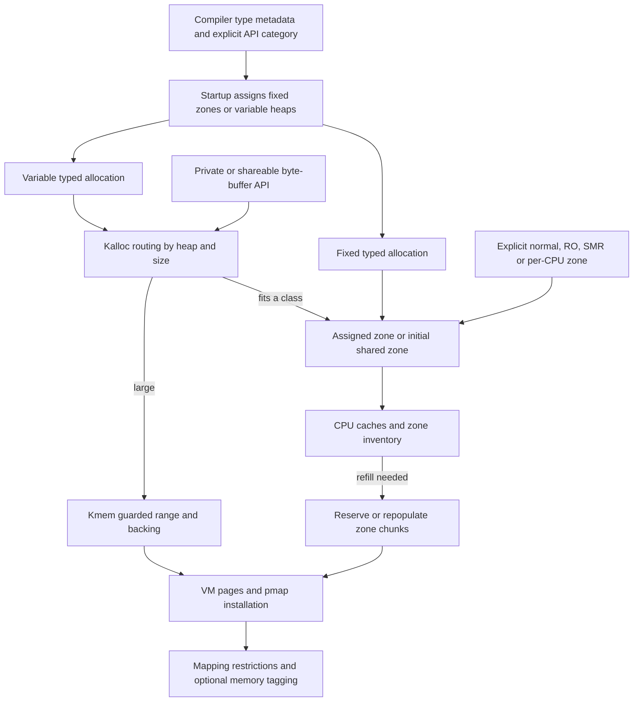

# Kernel allocation: mechanisms, type isolation, and lifetimes

[VM index](README.md) · [Objects and pages](objects-and-pages.md) · [Reclamation](reclaim-and-pressure.md)

XNU kernel allocation is a set of cooperating layers. **Zones** manage fixed-size elements. **Kalloc** selects zones or VM backing for variable-size requests. **Typed allocation** uses compiler metadata and startup policy to select where a type may be allocated. **Kmem** reserves virtual ranges, chooses backing objects, obtains pages, and installs mappings. Specialized zone and IOKit interfaces change the protection, layout or lifetime of that storage.

The important question is not just “which function returns memory?” Follow the allocation category, selected storage pool, physical backing, and matching release independently. The following chapters trace each layer in this checkout.

## Detailed reading route

| Question | Guide |
| --- | --- |
| How do fixed-size elements, bitmaps, CPU caches, magazines and depots work? | [Zone allocator](zone-allocator.md): creation, allocation, refill, free, expansion, GC and VA retention |
| How does a size and heap/view become a zone or large allocation? | [Kalloc heaps and routing](kalloc-heaps-and-routing.md): size classes, initial sharing, flags, free validation, realloc and encoded arrays |
| How is type isolation actually implemented? | [Typed allocation](typed-allocation.md): compiler signatures, metadata sections, startup classification/grouping, zone budgets, variable heaps, runtime selection and free compatibility |
| How are pages and kernel addresses allocated and guarded? | [Kernel virtual allocation](kernel-virtual-allocation.md): kmem flags, range/type-hash placement, guard objects, population, contiguous memory, free and resize |
| What changes for immutable state or unusual lifetimes? | [Read-only and special zones](read-only-and-special-zones.md): controlled mutation, SMR, per-CPU, permanent and exhaustible allocation, callback-backed object caches |
| Where do IOKit, C++ and BSD interfaces enter these mechanisms? | [Allocator interfaces](allocator-interfaces.md): typed operators, compatibility paths, aligned/physical/pageable pools, extension image allocation and restricted-page categories |

For end-to-end virtual-memory paths, continue with [mapping walkthroughs](mapping-walkthroughs.md). Kernel allocations often populate explicitly managed objects and wire pages immediately; they do not all behave like a demand-paged anonymous userspace mapping.

This is a relationship diagram. The detailed guides show allocation failures, retries, lock transitions, tracking fallbacks and configuration branches. In particular, a fixed typed allocation does not normally recompute a size class or signature on every call. [Fixed runtime path](../../../xnu/osfmk/kern/kalloc.c#L2980-L2992), [variable dispatcher](../../../xnu/osfmk/kern/kalloc.c#L2513-L2555).

## What type isolation means here

The typed allocator knows layouts supplied by compiler metadata. Startup processes fixed and variable records, classifies data-only and pointer-bearing cases, groups eligible layouts, and assigns a finite set of zones/heaps. Allocation then uses that assignment; it does not parse C type definitions at runtime. The actual representations are [`kalloc_type_view`](../../../xnu/osfmk/kern/kalloc.h#L329-L348) and [`kalloc_type_var_view`](../../../xnu/osfmk/kern/kalloc.h#L432-L448), initialized by [fixed startup](../../../xnu/osfmk/kern/kalloc.c#L1862) and [variable startup](../../../xnu/osfmk/kern/kalloc.c#L1967).

Several mechanisms contribute different properties:

| Mechanism | What it separates or checks | Limit to retain |
| --- | --- | --- |
| Fixed typed zone assignment | Groups fixed allocations by size/layout and distributes types across a configured zone budget | A distinct C type does not necessarily receive a unique zone. |
| Variable typed heap assignment | Routes arrays/header-array layouts to selected heap sequences; data and pointer-array classes have special handling | A heap serves many sizes and may contain several layouts; finite/randomized assignment is not one heap per type. |
| Private/shared data heaps | Separate byte-buffer categories from pointer-bearing allocations and from each other | The compiler/API category is a contract; the allocator does not inspect writes to prove that no pointer entered a data buffer. |
| Shared initial inventory | Reduces backing cost for eligible low-volume allocation views | Some allocations initially use EARLY zones even after startup assigned their eventual destination. |
| Fixed typed free validation | Checks assigned zone, supported signature-equivalent zones, or the initial shared alternative | It is not strict nominal C/C++ type identity. |
| Variable free validation | Checks actual zone capacity and coarse heap family | It does not prove the exact source variable type-view identity. |
| Zone VA retention and VM placement | Constrain how addresses are assigned/reused across categories | Zone sequestering and VM guard-object quarantine have different algorithms and lifetime guarantees. |
| Restricted mapping type | Requests protection of kernel-private physical pages from inappropriate aliases/sharing on the relevant backend | SPTM enforcement is external; configuration and runtime choices matter. |
| RO mutation, guards, MTE/KASAN | Restrict writes, expose some bounds violations, or validate memory-tag use | They are complementary to layout segregation and do not establish complete memory safety. |

The [typed guide](typed-allocation.md) explains the exact grouping/budget algorithms and examples. The fixed free compatibility is visible in [`kfree_type_impl_internal`](../../../xnu/osfmk/kern/zalloc.c#L5806-L5839); variable family checks are in [`kfree_zone`](../../../xnu/osfmk/kern/kalloc.c#L2853-L2901). Read those bodies before equating segregation with a strict dynamic type system.

Explicit zones remain useful where a subsystem requires a dedicated allocation class and strong membership assertions. RO, per-CPU and SMR zones also have capabilities that generic typed allocation does not select automatically. The in-tree [allocator API guide](../../../xnu/doc/allocators/api-basics.md#zones-zalloc) describes when to use them; the implementation chapters show their actual storage paths.

## The structures to keep open while reading

| Structure | What it describes | Source |
| --- | --- | --- |
| `zone` | Element/chunk geometry, inventory queues, expansion/GC state, caches and locking | [zalloc_internal.h](../../../xnu/osfmk/kern/zalloc_internal.h#L228) |
| `zone_page_metadata` | Owning zone, primary/secondary chunk state, occupancy and bitmap/queue linkage for zone VA pages | [zalloc.c](../../../xnu/osfmk/kern/zalloc.c#L193) |
| `zone_stats`, `zone_depot` | Per-CPU accounting/initial-sharing state and magazine inventory | [statistics and depot](../../../xnu/osfmk/kern/zalloc_internal.h#L140-L178) |
| `zone_security_flags` | Heap family, placement/security classifications and signature-equivalence information | [zalloc_internal.h](../../../xnu/osfmk/kern/zalloc_internal.h#L413) |
| `kalloc_heap` | Starting zone, family, statistics, accounting tag and VM-placement hash | [kalloc.h](../../../xnu/osfmk/kern/kalloc.h#L90-L98) |
| `kalloc_type_view` / variable view | Compiler type metadata and startup-assigned allocation destination | [fixed view](../../../xnu/osfmk/kern/kalloc.h#L329), [variable view](../../../xnu/osfmk/kern/kalloc.h#L432) |
| `kmem_guard_t` and VM guard-object state | Allocation interval/context and placement inputs; slab/chunk availability and guard policy | [VM kernel interface](../../../xnu/osfmk/vm/vm_kern_xnu.h), [guard-object implementation](kernel-virtual-allocation.md) |
| `vm_map_entry`, `vm_object`, `vm_page`, `pmap` | Reserved virtual interval, logical backing, physical-page ownership and CPU translation | [VM structures](maps-and-faults.md#know-the-five-principal-structures) |

Zone page metadata and a `vm_page` are not duplicate descriptions. The first manages object-sized slots within a chunk; the second manages the physical backing of pages. Kalloc views and their statistics likewise do not replace the zone's storage identity.

## Follow one allocation and its release

For an ordinary fixed pointer-bearing structure, the macro emits type metadata. Startup chooses the layout group and allocation destination. At runtime the fixed helper selects assigned or initial shared storage, then `zalloc_ext` uses a CPU cache or obtains inventory from the zone. On refill, the zone may reserve addresses, obtain/zero VM pages, populate its mappings, and publish available elements. The object caller then initializes its own fields. [Typed path](typed-allocation.md), [zone fast and refill paths](zone-allocator.md).

The corresponding typed free resolves the actual storage identity and supported compatibility, clears/releases the element, and returns it to the zone's inventory or caches. This does not imply immediate page release. Only after caches/inventory and occupancy permit reclamation can backing pages be depopulated. Ordinary GC can retain the virtual chunk for later repopulation. Non-DATA submaps use stronger VA retention, including through zone destruction; DATA destruction can release the range. [Free and reclaim](zone-allocator.md).

For a large variable allocation, routing instead passes category, flags and placement/owner metadata into `kmem_alloc_guard`. Kmem creates/reserves the interval, selects or creates an object, obtains the required pages, wires/populates them and enters pmap. Reallocation may change the reservation, preserve pages, or move contents depending on the selected object and size transition. Free validates the interval and removes it with the appropriate unwiring. [Kalloc large dispatch](kalloc-heaps-and-routing.md#large-allocations-preserve-category-and-placement-inputs), [VM allocation/free/resize](kernel-virtual-allocation.md).

| Released item | What can remain |
| --- | --- |
| Client object | Its element may be cached free; the chunk can still contain live neighbors. |
| Cache magazine | The elements can return to shared zone inventory without freeing a physical page. |
| Empty zone chunk's physical backing | Its addresses can remain reserved for that zone. |
| A guarded VM slot | Chunk/slab metadata and an aggregate quarantine budget can remain; a fully empty chunk can eventually become a map hole. |
| Kernel VM interval | Other independently retained backing relationships can survive, subject to that allocation's object contract. |
| Physical page | Its old mapping must have been removed and relevant translation/lifetime completion satisfied before reuse. |

This layered release explains why element frees, zone allocated/free counts, wired-page counts, virtual reservation and physical footprint are not interchangeable measurements.

## Flags and API variants change the contract

`Z_WAITOK` permits blocking; `Z_NOWAIT` requests a nonblocking allocation that can fail; `Z_NOPAGEWAIT` permits synchronization waits but forbids waiting for free pages. `Z_NOFAIL` is restricted to supported allocation sizes/classes and is rejected by the large kalloc path. `Z_ZERO` requests zeroed contents explicitly. Do not infer that every freeing/zeroing strategy makes these flags interchangeable. [Flag guidance](../../../xnu/doc/allocators/api-basics.md#allocation-flags), [large-path rejection](../../../xnu/osfmk/kern/kalloc.c#L2350-L2370).

Fixed `kalloc_type(T, flags)`, variable `kalloc_type(T, count, flags)`, header-plus-array forms and encoded `kalloc_array` representations have different metadata and matching free contracts. A count of one does not make a variable allocation equivalent to a fixed one. IOKit operators, unprocessed extension metadata, tracking, sanitizer and architecture branches add explicit fallbacks. [Typed API forms](typed-allocation.md), [array representation](kalloc-heaps-and-routing.md#encoded-arrays-carry-capacity-separately-from-ordinary-pointers), [wrapper behavior](allocator-interfaces.md).

## Inspecting the implementation in a matching kernel

The checkout includes LLDB commands for inspecting the structures described here. With a matching kernel and symbols, start with the zone inventory, find a typed view's assigned zone, then inspect that zone's caches and chunks. Assignment is boot-dependent, so the source alone does not give the zone address or randomized assignment for a particular boot. See [debugger setup and observability](../../development/observability.md).

| Command | Question it helps answer | Implementation |
| --- | --- | --- |
| `zprint` | Which zones exist, and what do their capacity and usage counters report? | [Zone summary](../../../xnu/tools/lldbmacros/memory.py#L481) |
| `showkalloctypes -S <sizeclass>` | Which fixed type views were associated with this size class? | [Type listing](../../../xnu/tools/lldbmacros/memory.py#L683) |
| `showkalloctypes -K <view-address>` | Which zone or variable heap does this metadata record identify? | [View decoding](../../../xnu/tools/lldbmacros/memory.py#L728) |
| `showkalloctypes -V` | What variable views and heap assignments are visible? | [Variable listing](../../../xnu/tools/lldbmacros/memory.py#L745) |
| `showzcache <zone-address>` | How much inventory is held in this zone's CPU caches? | [Cache summary](../../../xnu/tools/lldbmacros/memory.py#L283) |
| `showzchunks <zone-address> [address]` | Which chunks belong to this zone, and how is an address represented in its metadata? | [Chunk inspection](../../../xnu/tools/lldbmacros/memory.py#L836) |

These commands expose allocator state, not a reconstructed history of every live object's type or ownership. In particular, an assigned fixed-view zone need not be the actual zone of an allocation still using shared EARLY storage. Inspect actual pointer metadata and the free-time rules as well as the startup assignment.

There are useful test entry points to read alongside the implementation. [`tests/kalloc.c`](../../../xnu/tests/kalloc.c) invokes the kernel's typed-policy, heap and guard-region tests; the corresponding [typed-policy test](../../../xnu/osfmk/kern/kalloc.c#L3746) checks budget distribution and data redirection, while [heap tests](../../../xnu/osfmk/kern/kalloc.c#L3792) exercise allocation, free and resize behavior. [`tests/vm/zalloc.c`](../../../xnu/tests/vm/zalloc.c) selects basic, RO, stress and GC tests. [`verify_kalloc_config.c`](../../../xnu/tests/verify_kalloc_config.c) compares reported kalloc zone names with their element sizes; it is not a proof of type isolation. These are source-navigation pointers, not tests executed for this documentation change.

## Scope and verification

The detailed chapters inspect startup policy, runtime decisions, allocation/free/realloc pairs and backing lifetimes, with exact source excerpts and diagrams. They cover the primary zone/kalloc/kmem mechanisms and selected specialized interfaces. Dedicated subsystem pools, every sanitizer instrumentation path, every guard tuning option and external monitor implementations are not claimed as exhaustive audits.

No kernel source was modified or kernel run. Compiler metadata behavior beyond the exposed builtins/records is described as an interface contract; no generated kernel image was available to measure its exact type signatures or startup assignments. Local source references and marked excerpts are checked by [the documentation checker](../../tools/check_links.py).
