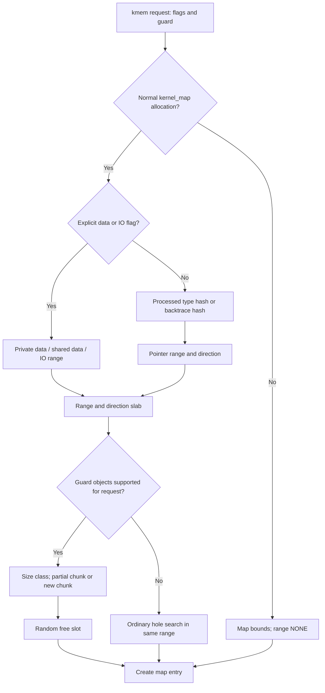
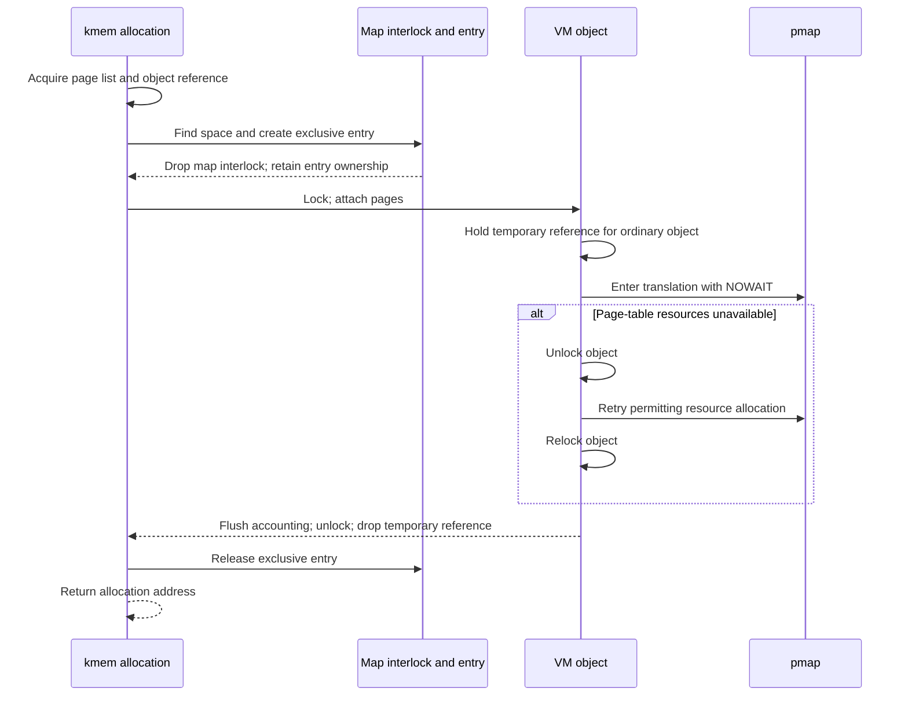

# Kernel virtual allocation: placement, guard objects, and page ownership

[VM index](README.md) · [Allocator overview](kernel-allocation.md) · [Typed allocation](typed-allocation.md) · [Heap routing](kalloc-heaps-and-routing.md)

The `kmem_*` layer turns a kernel allocation request into a virtual address reservation, a VM object association, and, for a populated allocation, physical pages and wired translations. Its security policy has several independent parts: separate pointer/data address ranges, type-derived placement, randomized slots with guard space, checks on whole-allocation operations, and the mapping type passed to pmap. These parts operate on different metadata and have different lifetimes.

This chapter follows the implementations in this checkout, principally [vm_kern.c](../../../platydoc-data/xnu/osfmk/vm/vm_kern.c), [vm_map_store.c](../../../platydoc-data/xnu/osfmk/vm/vm_map_store.c), and [vm_kern_xnu.h](../../../platydoc-data/xnu/osfmk/vm/vm_kern_xnu.h). The [typed allocation chapter](typed-allocation.md) explains how compiler metadata reaches this layer. The [zone allocator](zone-allocator.md) has a separate element allocator and can retain virtual space after returning its physical pages.

## The allocation contract has three independent axes

The entry points `kmem_alloc_guard`, `kmem_alloc_contig_guard`, `kmem_realloc_guard`, and `kmem_free_guard` carry a `kmem_guard_t`. “Guard” here does not mean only a no-access page.

[Source: kmem_guard_t and standard initializers](../../../platydoc-data/xnu/osfmk/vm/vm_kern_xnu.h#L98-L106)

<!-- source-excerpt: ../../../platydoc-data/xnu/osfmk/vm/vm_kern_xnu.h#L98-L106 -->
```c
typedef struct {
	uint16_t                kmg_tag;
	uint16_t                kmg_type_hash;
	uint32_t                kmg_atomic : 1;
	uint32_t                kmg_submap : 1;
	uint32_t                kmg_context : 30;
} kmem_guard_t;
#define KMEM_GUARD_NONE         (kmem_guard_t){ }
#define KMEM_GUARD_SUBMAP       (kmem_guard_t){ .kmg_atomic = 1, .kmg_submap = 1 }
```

The fields have distinct consumers:

| Input | What the implementation does with it |
|---|---|
| `kmg_tag` | Sets the entry's VM alias/tag; passes it through page insertion, wiring, and allocation accounting |
| `kmg_type_hash` | Selects a kernel virtual range and allocation direction; zero requests a backtrace-derived fallback |
| `kmg_atomic` | Marks the entry as an allocation that must be targeted as a whole by guarded operations |
| `kmg_submap` | Distinguishes an atomic submap entry from an object-backed entry |
| `kmg_context` | Stores 30 caller-defined bits on an object entry and compares them on guarded operations |

These meanings are visible in [entry initialization](../../../platydoc-data/xnu/osfmk/vm/vm_kern.c#L1046-L1062), [placement policy](../../../platydoc-data/xnu/osfmk/vm/vm_kern.c#L725-L765), and [guard validation](../../../platydoc-data/xnu/osfmk/vm/vm_kern.c#L558-L608). The runtime's [`kalloc_guard`](../../../platydoc-data/xnu/osfmk/kern/kalloc.c#L2105-L2123) sets atomicity and derives the context from `os_hash_kernel_pointer(owner)`. The context is a compact caller association; it is not a reference that keeps the owner alive.

The flags form a second axis. `KMA_*` flags describe allocation; `KMR_*` reallocation; `KMF_*` freeing; `KMS_*` submaps. They share bits from `kmem_flags_t`, but each interface exposes a restricted set. They choose backing, placement, explicit guards, tagging, and waiting behavior. Consult the [flag definitions and contracts](../../../platydoc-data/xnu/osfmk/vm/vm_kern_xnu.h#L109-L318) when following a call.

The third axis is the physical mapping type. It comes from `__kmem_mapping_type`, independently of the integer VM accounting tag or the placement hash.

[Source: mapping-type selection](../../../platydoc-data/xnu/osfmk/vm/vm_kern.c#L218-L229)

<!-- source-excerpt: ../../../platydoc-data/xnu/osfmk/vm/vm_kern.c#L218-L229 -->
```c
static inline pmap_mapping_type_t
__kmem_mapping_type(kmem_flags_t flags)
{
	if (flags & (KMEM_COMPRESSOR | KMEM_DATA_SHARED)) {
		return PMAP_MAPPING_TYPE_DEFAULT;
	} else if (flags & KMEM_DATA) {
		return kalloc_is_restricted_data_mode_enforced() ?
		       PMAP_MAPPING_TYPE_RESTRICTED : PMAP_MAPPING_TYPE_DEFAULT;
	} else {
		return PMAP_MAPPING_TYPE_RESTRICTED;
	}
}
```

Pointer allocations request restricted mappings. Shared data and compressor storage request default mappings. Private data requests restricted mappings when the runtime restricted-data mode is enforced. These are requests to the architecture's pmap implementation; this function does not itself program page tables or implement the platform's protected page-type policy. See [ARM64 pmap](pmap-arm64.md) and [mapping lifetime](pmap-mapping-lifecycle.md).

For a large `kalloc` request, [`kalloc_large`](../../../platydoc-data/xnu/osfmk/kern/kalloc.c#L2340-L2435) translates heap and allocation flags, selects the tag, and calls `kmem_alloc_guard(kernel_map, ..., kalloc_guard(...))`. On non-x86 builds, its ordinary non-copyinmap route adds `KMA_KOBJECT`; x86 preserves an older sharing ABI. Thus “large allocation” does not always imply an independent VM object, and identical high-level APIs can use different object/mapping policies across configurations.

## Kernel virtual ranges and type-derived placement

### Startup partitions a finite kernel address space

[`vm_map_range_id_t`](../../../platydoc-data/xnu/osfmk/mach/vm_statistics.h#L508-L552) defines three pointer ranges, an IO range, private data, and shared data. Private and shared data are described as pointer-free byte storage; shared data is intended for exchange with external domains. The range identifier is a placement classification, not a mechanism that examines stored bytes.

[`kmem_range_init`](../../../platydoc-data/xnu/osfmk/vm/vm_kern.c#L3293-L3305) scrambles startup claims, initializes pmap, and initializes two guard-object slabs per range, one for each direction. The [claim setup](../../../platydoc-data/xnu/osfmk/vm/vm_kern.c#L3014-L3137) reserves a 1 GiB IO range, subtracts registered claims from the available space, divides a portion between the configured pointer ranges, then splits the remaining data space between private and shared data. The actual addresses and sizes depend on the platform's kernel virtual bounds and all registered claims.

[`kmem_fuzz_start`](../../../platydoc-data/xnu/osfmk/vm/vm_kern.c#L2873-L2925) keeps the largest available hole and consumes a random initial page count. [`kmem_scramble_ranges`](../../../platydoc-data/xnu/osfmk/vm/vm_kern.c#L3141-L3290) shuffles claims, honors address restrictions, and creates reservation entries where a claim requires them. The generic claim-to-allocation helpers discuss padding, but in this checkout both [conversion helpers](../../../platydoc-data/xnu/osfmk/vm/vm_kern.c#L2810-L2831) return their input unchanged. Do not infer mandatory gaps between every range from those comments.

The number of pointer ranges is a build distinction. [`ZSECURITY_CONFIG_KERNEL_PTR_SPLIT`](../../../platydoc-data/xnu/osfmk/vm/vm_kern_xnu.h#L340-L348) is disabled for KASAN and for the specified ARM64 configurations lacking the listed KTRR/CTRR macros. With the split disabled, startup creates one pointer range and `kmem_adjust_range_id` returns `PTR_0`. Otherwise it maps the hash modulo three. This is not a per-C-type virtual region scheme.

### The hash is already reduced to placement information

At normal post-startup allocation into `kernel_map`, explicit data/IO flags take precedence. A nonzero `kmg_type_hash` carries a preprocessed range identifier in its low bits. A zero hash causes a short kernel backtrace to be hashed, then reduced through `kmem_adjust_range_id`.

[Source: range and direction selection](../../../platydoc-data/xnu/osfmk/vm/vm_kern.c#L740-L764)

<!-- source-excerpt: ../../../platydoc-data/xnu/osfmk/vm/vm_kern.c#L740-L764 -->
```c
	if (kma_flags & KMA_DATA_SHARED) {
		vmk_flags->vmkf_range_id = KMEM_RANGE_ID_DATA_SHARED;
	} else if (kma_flags & KMA_DATA) {
		vmk_flags->vmkf_range_id = KMEM_RANGE_ID_DATA_PRIVATE;
	} else if (kma_flags & KMA_IO) {
		vmk_flags->vmkf_range_id = KMEM_RANGE_ID_IO;
	} else if (type_hash) {
		vmk_flags->vmkf_range_id = type_hash & KMEM_RANGE_MASK;
	} else {
		/*
		 * Range id needs to correspond to one of the PTR ranges
		 */
		type_hash = (uint16_t)kmem_hash_backtrace(__builtin_frame_address(0));
		vmk_flags->vmkf_range_id = kmem_adjust_range_id(type_hash);
	}

	/*
	 * As an optimization in KMA_DATA, KMA_DATA_SHARED,
	 * to avoid fragmentation, allocate static carveouts at the end.
	 */
	if (kma_flags & (KMA_DATA | KMA_DATA_SHARED | KMR_IO)) {
		vmk_flags->vmkf_last_free = (bool)(kma_flags & KMA_PERMANENT);
	} else {
		vmk_flags->vmkf_last_free = (bool)(type_hash & KMEM_DIRECTION_MASK);
	}
```

The masks are [`KMEM_RANGE_MASK = 0x3fff` and `KMEM_DIRECTION_MASK = 0x8000`](../../../platydoc-data/xnu/osfmk/vm/vm_kern_internal.h#L44-L46). The intervening `KMEM_HASH_SET` bit is used by the allocator's processed-hash representation. `kmem` consumes the range and direction; it does not allocate a new range for every distinct hash.

The consequences are concrete:

- Different types can share a range, direction, and slot size class. This layer provides grouping and placement separation, not an injective mapping from type to address space.
- The data/IO branches allocate ordinary requests from the beginning and permanent carveouts from the end. Pointer requests use the hash's direction bit.
- Setting `KMA_LAST_FREE` before this policy call does not override the policy. `kmem_apply_security_policy` writes the final direction.
- Before `STARTUP_SUB_KMEM` or for a map other than `kernel_map`, the policy sets the range to `NONE` and direction to forward. A kernel submap does not independently reproduce the parent's pointer/data partition.

The [type chapter](typed-allocation.md) details which variable views have signature hashes, which fixed allocations route through a heap hash, and which requests reach the backtrace fallback. It is unsafe to infer “every fixed allocation uses its type signature” from this lower-level API.

The placement path then uses [`kmem_slab`](../../../platydoc-data/xnu/osfmk/vm/vm_kern.c#L466-L478) to select `kmem_slabs[range - 1][direction]`. `vm_map_get_range` supplies both the legal address interval and the slab; [`vm_map_locate_space_anywhere`](../../../platydoc-data/xnu/osfmk/vm/vm_map.c#L2640-L2750) first tries guard-object placement. If that placement returns `KERN_NOT_SUPPORTED`, it searches ordinary map holes while retaining the selected range.

`KERN_NO_SPACE` from guard-object placement is different: the caller returns it, rather than automatically relaxing guard-object placement. The fallback is a policy decision made before the search, not a universal response to exhaustion.



Fixed placement is also constrained. After the relevant startup phase, a non-submap fixed operation on `kernel_map` calls [`kmem_validate_range_for_overwrite`](../../../platydoc-data/xnu/osfmk/vm/vm_kern.c#L502-L527) from [`vm_map_locate_space_fixed`](../../../platydoc-data/xnu/osfmk/vm/vm_map.c#L2851-L2856). The range must contain the whole request, and pointer ranges are rejected. This check protects the pointer-range allocation policy against arbitrary fixed insertion/overwrite routes; it is distinct from atomic-entry guard validation during removal.

## Guard objects are a map-store allocation scheme

### Slabs, chunks, slots, and entries are different objects

A guard object in this implementation is not a `vm_object` with a pager. It is virtual-address allocation metadata embedded in the map store. A slab owns size-segregated lists of chunks. A chunk contains equal-sized slots. A map entry covers an allocated interval within one slot and still points to an ordinary or special VM object for backing.

[Source: chunk fields](../../../platydoc-data/xnu/osfmk/vm/vm_map_store_internal.h#L277-L294)

<!-- source-excerpt: ../../../platydoc-data/xnu/osfmk/vm/vm_map_store_internal.h#L277-L294 -->
```c
typedef struct vm_guard_object_chunk {
	/* immutable fields */
	vm_guard_object_slab_t  vgoc_slab;
	uint32_t                vgoc_start;
	uint8_t                 vgoc_granule;
	uint8_t                 vgoc_count;
	uint8_t                 vgoc_count_shift : 4;

	/* mutable fields, serialized by the map lock */
	uint8_t                 vgoc_quarantined : 4;
	uint8_t                 vgoc_available;
	bitmap_t                vgoc_bitmap;

	vm_map_store_val_ptr_t  vgoc_prev;
	vm_map_store_val_ptr_t  vgoc_next;

	vm_map_store_val_ptr_t  vgoc_ptrs[8];
} *vm_guard_object_chunk_t;
```

`vgoc_granule` is the base-two logarithm of slot size. `vgoc_count` is the number of slots; `vgoc_count_shift` encodes that count. The packed `vgoc_start` reconstructs the aligned chunk base. Immutable geometry is separated from mutable availability, quarantine, bitmap, list, and lookup state. The map interlock serializes mutations; this is not a lock-free bitmap allocator.

The [slab](../../../platydoc-data/xnu/osfmk/vm/vm_map_store_internal.h#L297-L312) has `vgos_partial[]` and `vgos_full[]` arrays indexed by size class. “Full” means no allocation budget remains, including a chunk whose recently freed capacity is still quarantined. Empty chunks are not retained on a third list.

For kernel VM-managed slots, a set bitmap bit means the slot is free. The map's B+tree reserves the whole chunk, while a small eight-way lookup structure and the map entry list identify entries inside it. Free slots do not need individual no-access `vm_map_entry` objects. This representation keeps the chunk's unused addresses unavailable to ordinary hole allocation without manufacturing a page descriptor for each guard slot. See [chunk insertion](../../../platydoc-data/xnu/osfmk/vm/vm_map_store.c#L1155-L1194) and [the structure's representation contract](../../../platydoc-data/xnu/osfmk/vm/vm_map_store_internal.h#L158-L275).

Slot geometry depends on requested size and alignment. `vm_guard_object_find_space_anywhere` page-rounds the alignment mask, accounts for an explicit leading guard, and chooses a power-of-two slot large enough for the resulting interval. It takes a partial chunk in that size class or creates one.

[Source: choose a chunk, reserve a random slot, and align the entry](../../../platydoc-data/xnu/osfmk/vm/vm_map_store.c#L1836-L1850)

<!-- source-excerpt: ../../../platydoc-data/xnu/osfmk/vm/vm_map_store.c#L1836-L1850 -->
```c
	granule = vmgo_size_to_granule(MAX(mask + 1, size) + delta);
	chunk   = *vmgo_slab_queue(slab, granule, false);
	if (chunk == NULL) {
		chunk = vmgo_chunk_alloc_anywhere(map, slab, range, vmk_flags,
		    granule, mask);
	}
	if (__improbable(chunk == NULL)) {
		return KERN_NO_SPACE;
	}

	addr = vmgo_chunk_reserve_slot(chunk,
	    vmgo_chunk_select_random_slot(chunk));
	addr = (addr + guard_offset + mask) & ~mask;
	*rsv = vmsr_make(addr - guard_offset, chunk);
	return KERN_SUCCESS;
```

New kernel chunks have 16, 8, 4, or 2 slots. On builds with at least 40 significant kernel-pointer bits, the thresholds for those first three groups are slot sizes up to 128 KiB, 4 MiB, and 128 MiB. Smaller-VA builds use 64 KiB, 2 MiB, and 64 MiB. Larger supported slots get two per chunk. These are [source constants](../../../platydoc-data/xnu/osfmk/vm/vm_map_store.c#L53-L72), interpreted by [`vmgo_chunk_alloc_anywhere`](../../../platydoc-data/xnu/osfmk/vm/vm_map_store.c#L1198-L1235), rather than fixed properties of every Apple device.

`vmgo_chunk_alloc_fixed` allocates metadata from `ZONE_ID_VM_GO_CHUNKS`, initializes all bits as free, and sets the initial allocation budget to `count - max(1, count / 4)`. A 16-slot chunk therefore permits 12 simultaneous allocations, retaining four free slots. The particular four addresses are not permanently designated guards: random selection chooses among all currently free bits. The reservation clears the selected bit and decrements the allocation budget; reaching zero moves the chunk to the full list. [Initialization](../../../platydoc-data/xnu/osfmk/vm/vm_map_store.c#L1169-L1191), [random selection](../../../platydoc-data/xnu/osfmk/vm/vm_map_store.c#L1103-L1141), [reservation](../../../platydoc-data/xnu/osfmk/vm/vm_map_store.c#L1238-L1253).

A schematic chunk can look like this; allocation order and positions are illustrative:

```text
range + direction + slot-size slab
    |
    +-- chunk: 16 equal slots; at most 12 allocated
        [A][free][B][C][free][D][E][F][G][free][H][I][J][K][free][L]
         |
         +-- slot A: alignment gap | entry's requested range | unused tail
                                      |
                                      +-- VM object + page offset
```

The unused tail is reserved virtual space, not extra writable capacity returned to the caller. Hardware access depends on actual translations. The slot allocator also limits VM operations to the allocated slot; it does not perform bounds checks on every CPU load/store.

### Freeing restores a budget, not a permanently assigned type address

The bitmap counts all free slots, while `vgoc_available` and `vgoc_quarantined` divide capacity into immediately usable and delayed budget. The invariant is:

`popcount(bitmap) = available + quarantined + max(1, count / 4)`.

On a free, the implementation sets the freed bit, then applies this accounting:

[Source: quarantine release and full-to-partial transition](../../../platydoc-data/xnu/osfmk/vm/vm_map_store.c#L1042-L1064)

<!-- source-excerpt: ../../../platydoc-data/xnu/osfmk/vm/vm_map_store.c#L1042-L1064 -->
```c
	if (freed_mask & (freed_mask - 1)) {
		qtn += __builtin_popcountll(freed_mask);
	} else {
		/* power of 2 */
		qtn += 1;
	}

	assert3u(chunk->vgoc_available + qtn + vmgo_chunk_guards(chunk), ==,
	    __builtin_popcountll(bitmap));

	if (chunk->vgoc_available + qtn >= vmgo_chunk_guards(chunk)) {
		chunk->vgoc_available  += qtn;
		chunk->vgoc_quarantined = 0;
	} else {
		chunk->vgoc_quarantined = qtn;
	}

	if (was_full && chunk->vgoc_available) {
		vmgo_chunk_dequeue(vmgo_slab_queue(chunk, true), chunk);
		vmgo_chunk_enqueue(vmgo_slab_queue(chunk, false), chunk);
	}

	return false;
```

For a full 16-slot chunk, one free leaves `available = 0` and `quarantined = 1`. Four frees release four slots of allocation budget and make the chunk partial. If there was already sufficient available capacity, a free can release its budget immediately.

There is only one free bitmap. Random selection uses `available + quarantined + guards` as its free-bit count. Consequently, the quarantine bookkeeping does not attach a separate “do not select yet” bit to each recently freed address. It delays replenishment of allocation capacity; it should not be described as a per-address timer or guaranteed number of unrelated allocations before any specific address can recur. [Free-count helper](../../../platydoc-data/xnu/osfmk/vm/vm_map_store_internal.h#L1605-L1619), [selection](../../../platydoc-data/xnu/osfmk/vm/vm_map_store.c#L1103-L1141).

If every slot becomes free, `vmgo_chunk_free_slots` returns true immediately. [`vm_map_store_remove`](../../../platydoc-data/xnu/osfmk/vm/vm_map_store.c#L2796-L2892) removes the chunk's occupied tree range, merges the surrounding hole, and frees chunk metadata. The reservation-abort path does the same when the last outstanding slot reservation is cancelled. An empty guard-object chunk therefore returns virtual space to the map. Its address is not permanently sequestered to a type or size class.

This differs from a zone's deliberate VA-sequestering policy. A sequestered zone can keep a map reservation, depopulate its physical pages, and reuse the retained addresses for that zone. Guard-object chunk recycling itself has no comparable lifetime guarantee. The surrounding kernel range partition remains, but a hole inside it can later host another compatible chunk size.

### VM operations cannot silently cross slot boundaries

[`vm_guard_object_check_op_range`](../../../platydoc-data/xnu/osfmk/vm/vm_map_store.c#L1888-L1905) verifies that an operation lies within the chunk, that both endpoints identify the same slot, and that the slot is allocated.

[Source: operation-range check](../../../platydoc-data/xnu/osfmk/vm/vm_map_store.c#L1897-L1904)

<!-- source-excerpt: ../../../platydoc-data/xnu/osfmk/vm/vm_map_store.c#L1897-L1904 -->
```c
	if (start < vmgo_chunk_start(chunk) || vmgo_chunk_end(chunk) < end) {
		return false;
	}

	sidx = vmgo_chunk_slot(chunk, start);
	eidx = vmgo_chunk_slot(chunk, end - 1);

	return sidx == eidx && !bit_test(bitmap, sidx);
```

The [range-lock acquisition path](../../../platydoc-data/xnu/osfmk/vm/vm_map_lock.c#L2654-L2692) checks both the next entry and the previous entry when an operation starts in a hole. This handles unused space inside a slot without treating it as an unrelated normal map hole. Invalid user-map requests can return `KERN_INVALID_GUARD_OBJECT_SLOT`; the corresponding kernel-pmap path asserts the invariant. Subsequent entry checks still enforce mapping permissions and atomic-allocation identity.

Guard-object support is deliberately conditional. [`vm_guard_object_should_fallback`](../../../platydoc-data/xnu/osfmk/vm/vm_map_store.c#L1738-L1802) excludes permanent entries, disabled entry reuse, terminated maps, certain mapping modes, alignments above 256 KiB, and sizes at least 1 TiB. Small-VA configurations additionally bypass it for private/shared data allocations larger than 128 MiB. The implementation also contains a kernel-stack VM-tag exception to the general startup gate. These decisions precede ordinary hole search; they do not abolish the kernel range partition.

General activation happens through [`zalloc_first_proc_made`](../../../platydoc-data/xnu/osfmk/kern/zalloc.c#L10245-L10250), which calls `vm_guard_object_enable`. The separate user-managed-slot implementation has different ownership and bitmap rules and is outside this kernel-allocation trace.

## A populated allocation, from page request to published address

[`kmem_alloc_guard_internal`](../../../platydoc-data/xnu/osfmk/vm/vm_kern.c#L835-L1175) is shared by ordinary and contiguous allocation. It requires `kernel_map` or a map using `kernel_pmap`. The critical sequence is:

1. **Validate and calculate sizes.** Reject zero/invalid sizes and requests smaller than their explicit guards. Page-round the mapping size, compute the usable fill interval, and apply KASAN adjustments when configured.
2. **Prepare explicit guard descriptors if needed.** Ordinary objects can receive fictitious guard pages. Kernel/compressor objects and never-faulting maps skip those descriptors; the corresponding addresses still receive no usable physical backing from this allocation.
3. **Obtain the physical page list.** Unless `KMA_VAONLY` or `KMA_PAGEABLE` is set, allocate the usable pages before locking the map.
4. **Select or create the VM object.** Retain the selected kernel object, retain `compressor_object`, or allocate a new ordinary object. Object creation precedes map locking to avoid default-pager lock inversion.
5. **Choose placement and reserve an entry.** Apply the range policy, acquire the map interlock, and call `kmem_find_space`. The resulting entry remains exclusively owned after releasing the map interlock.
6. **Attach backing and metadata.** Install the object, atomic/context information, tag, and object offset. The special kernel/compressor objects use the allocated virtual address as the object offset; independent objects start at offset zero.
7. **Populate.** Insert guards and supplied pages while holding the object lock. Install wired pmap translations for usable pages. Complete relevant accounting.
8. **Release the entry and return.** Optional sanitizers and memory tagging adjust or tag the returned pointer. Failure paths release the selected object and any still-owned pages/guard descriptors.

The ownership transition into the entry is compact:

[Source: entry object, alias, and initial wiring state](../../../platydoc-data/xnu/osfmk/vm/vm_kern.c#L1046-L1062)

<!-- source-excerpt: ../../../platydoc-data/xnu/osfmk/vm/vm_kern.c#L1046-L1062 -->
```c
	map_addr = entry->vme_start;
	VME_OBJECT_SET(entry, object, guard.kmg_atomic, guard.kmg_context);
	VME_ALIAS_SET(entry, guard.kmg_tag);
	if (flags & (KMA_KOBJECT | KMA_COMPRESSOR)) {
		VME_OFFSET_SET(entry, map_addr);
	}

#if KASAN
	if ((flags & KMA_KOBJECT) && guard.kmg_atomic) {
		entry->vme_object_or_delta = (-size & PAGE_MASK) + delta;
	}
#endif /* KASAN */

	if (!(flags & (KMA_COMPRESSOR | KMA_PAGEABLE))) {
		entry->wired_count = 1;
		vme_btref_consider_and_set(entry, __builtin_frame_address(0));
	}
```

The map interlock protects map topology and slot metadata. The exclusive entry lock protects the new entry while backing is installed. The VM object lock protects resident-page membership. Holding one does not substitute for the other two. [`kmem_find_space`](../../../platydoc-data/xnu/osfmk/vm/vm_kern.c#L781-L832) returns with the interlock held and a newly created entry; the caller drops the interlock before expensive object population while retaining exclusive entry ownership.

A newly created ordinary object receives its rounded and requested sizes. It is initialized to `MEMORY_OBJECT_COPY_DELAY` with `true_share` set to stabilize it against shadowing; the adjacent comment explicitly says this does not imply actual sharing. With MTE-tagged backing, the branch instead sets `VM_WIMG_MTE` and `MEMORY_OBJECT_COPY_NONE` and clears `true_share`. This special allocation setup should not be mistaken for the ordinary anonymous-fault object's copy strategy. [Object setup](../../../platydoc-data/xnu/osfmk/vm/vm_kern.c#L991-L1025).

### Backing modes have different page and fault contracts

| Mode | Object/entry and physical behavior |
|---|---|
| Ordinary populated allocation | Independent VM object unless a special object is requested; physical pages obtained now, entry wired, pages wired and mapped |
| `KMA_KOBJECT` | Selected kernel object; offsets equal kernel virtual addresses; explicit page population |
| `KMA_COMPRESSOR` | Compressor object; pages marked `VM_PAGE_USED_BY_COMPRESSOR`; no normal entry wire count or global wired-page charge |
| `KMA_VAONLY` | Creates the reservation without supplying usable pages; the normal non-compressor entry still has `wired_count = 1` |
| `KMA_PAGEABLE` | No initial usable-page list and no initial entry wire count; later faults supply backing under the ordinary VM contract |
| `kmem_alloc_contig_guard` | Uses `cpm_allocate` to obtain a physically contiguous list, then shares entry creation and population |
| `KMA_LOMEM` | Constrains physical page supply through the low-page allocator; not a request for a low virtual address |

The distinction between VA-only and pageable matters to zone backing. Reserving a logically wired range with no pages is useful when another subsystem owns the later population schedule. It is not a request to let arbitrary accesses transparently create pages in the kernel object. The [population/depopulation helpers](../../../platydoc-data/xnu/osfmk/vm/vm_kern.c#L1739-L1841) are that subsystem's explicit interface.

These flags are not freely interchangeable. Allocation asserts that private and shared data flags are mutually exclusive. On ARM64 it also rejects `KMA_PAGEABLE | KMA_DATA`, with the stated policy that pageable allocations should use the shared category. This is a checked configuration distinction, not a claim that all historical x86 allocation paths use the same category. [Entry checks](../../../platydoc-data/xnu/osfmk/vm/vm_kern.c#L858-L871).

Explicit `KMA_GUARD_FIRST`/`LAST` pages are included in the caller's size. Requesting three usable pages and both guards therefore requires five pages. The returned ordinary address is the entry start, including the left guard; alignment is applied to the address immediately after that guard. `KMA_GUARD_STACK` adds a second leading guard and requires `GUARD_FIRST`. KASAN_CLASSIC's implicit guards instead add space internally and adjust the returned address. Reallocation/free must pass the corresponding guard flags consistently. [Flag contract](../../../platydoc-data/xnu/osfmk/vm/vm_kern_xnu.h#L225-L270), [size and guard setup](../../../platydoc-data/xnu/osfmk/vm/vm_kern.c#L864-L976).

The implementation enforces allocation-size limits separately from ordinary address exhaustion. For an immediately populated non-contiguous request, a sufficiently large size above `MAX(2 GiB, sane_size / 64)` is rejected by the wired allocation check. `KMA_NOSOFTLIMIT` controls a different map-size check. `KMA_NOFAIL` converts supported allocation failures into a panic; it does not generate physical capacity. [Checks](../../../platydoc-data/xnu/osfmk/vm/vm_kern.c#L864-L940).

### Physical-page supply is separated from virtual placement

[`vm_page_alloc_list`](../../../platydoc-data/xnu/osfmk/vm/vm_resident.c#L8680-L8766) grabs pages one at a time, links them through `vmp_snext`, and requests low pages or MTE-capable pages according to flags. Without `KMA_NOPAGEWAIT` it may call `VM_PAGE_WAIT`; with that flag a missing page produces `KERN_RESOURCE_SHORTAGE`. The function has additional pressure checks for oversized requests and releases a partial list on recoverable failure. `KMA_ZERO` explicitly zeroes contents; allocation is not generally zero-filled by default.

[`kmem_alloc_contig_guard`](../../../platydoc-data/xnu/osfmk/vm/vm_kern.c#L1188-L1204) supplies an alternate page-allocation block that calls `cpm_allocate(fill_size, ..., max_pnum, pnum_mask, FALSE, flags)`. The `FALSE` wiring argument means the contiguous allocator returns the pages in its gobbled accounting state for subsequent kmem population. [`cpm_allocate`](../../../platydoc-data/xnu/osfmk/vm/vm_resident.c#L8389-L8449) validates page granularity/count, obtains physically consecutive pages through `vm_page_find_contiguous`, verifies physical ordering, and optionally zeroes them. Virtual alignment, physical maximum page number, and physical alignment mask are separate arguments.

The contiguous search itself is more expensive than a normal list grab and may reclaim or relocate eligible pages. Its full scanning algorithm is not duplicated here; the shared ownership boundary is the returned list, which kmem either inserts or frees.

## Population owns references across pmap calls

[`kernel_memory_populate_object_and_unlock`](../../../platydoc-data/xnu/osfmk/vm/vm_kern.c#L1582-L1736) consumes a page list with the object locked. Each page must be canonical, not queued, and initially unwired. Ordinary pages become `VM_PAGE_IS_WIRED` with `vmp_wire_count = 1`. Compressor pages instead become `VM_PAGE_USED_BY_COMPRESSOR` and are kept off the special page queue. The function inserts pages into the object, clears their busy/gobbled state, marks them mapped, and enters their translations.

The low-level helper initially asks pmap to avoid a resource wait:

[Source: nonblocking pmap attempt and retry outside the object lock](../../../platydoc-data/xnu/osfmk/vm/vm_kern.c#L1563-L1579)

<!-- source-excerpt: ../../../platydoc-data/xnu/osfmk/vm/vm_kern.c#L1563-L1579 -->
```c
	pe_result = pmap_enter_options(kernel_pmap, addr + offset,
	    VM_PAGE_GET_PHYS_PAGE(mem), prot, VM_PROT_NONE,
	    pe_flags, /* wired */ TRUE, pe_options, NULL, mapping_type);

	if (pe_result == KERN_RESOURCE_SHORTAGE) {
		vm_object_unlock(object);

		pe_options &= ~PMAP_OPTIONS_NOWAIT;

		pe_result = pmap_enter_options(kernel_pmap, addr + offset,
		    VM_PAGE_GET_PHYS_PAGE(mem), prot, VM_PROT_NONE,
		    pe_flags, /* wired */ TRUE, pe_options, NULL, mapping_type);

		vm_object_lock(object);
	}

	assert(pe_result == KERN_SUCCESS);
```

This unlock is why ordinary objects need an extra reference:

[Source: preserve an ordinary object's lifetime across that unlock](../../../platydoc-data/xnu/osfmk/vm/vm_kern.c#L1605-L1614)

<!-- source-excerpt: ../../../platydoc-data/xnu/osfmk/vm/vm_kern.c#L1605-L1614 -->
```c
	if (flags & (KMA_KOBJECT | KMA_COMPRESSOR)) {
		assert3u(offset, ==, addr);
	} else {
		/*
		 * kernel_memory_populate_pmap_enter() might drop the object
		 * lock, and the caller might not own a reference anymore
		 * and rely on holding the vm object lock for liveness.
		 */
		vm_object_reference_locked(object);
	}
```

After all insertions, delayed accounting is flushed, the object lock is released, and that temporary ordinary-object reference is dropped. The global wired/gobbled counters are then reconciled under the page-queue lock. A gobbled contiguous list was already charged as wired; it must not be charged a second time. Compressor pages are excluded from normal wired accounting, including correction of any incoming gobbled charge. Kernel-object tag accounting is updated explicitly. [Insertion and accounting](../../../platydoc-data/xnu/osfmk/vm/vm_kern.c#L1635-L1727).



`kernel_memory_populate` is a wrapper for later population of reserved addresses in a selected kernel or compressor object. It obtains a new list and calls the same helper with object offset equal to virtual address. It does not search for a new map entry. Callers must already own an appropriate reservation.

The inverse, [`kernel_memory_depopulate`](../../../platydoc-data/xnu/osfmk/vm/vm_kern.c#L1776-L1841), also leaves map topology intact. It removes translations with `pmap_protect(..., VM_PROT_NONE)`, looks up pages at address-based offsets, and disconnects ordinary wired pages from remaining mappings. It removes pages from the object, chains them for release, unlocks the object, and calls `vm_page_free_list`. Then it adjusts wired and tag accounting. The compressor branch follows its special page-state rules and skips the ordinary wired/disconnect bookkeeping.

Thus three events must be distinguished: removing a CPU translation, releasing a physical page, and deleting a virtual reservation. A zone can request the first two while deliberately keeping the third.

## Freeing validates allocation identity before releasing mappings

[`kmem_free_guard`](../../../platydoc-data/xnu/osfmk/vm/vm_kern.c#L2573-L2658) canonicalizes/tag-checks addresses as configured and accounts for KASAN's implicit guards. Normal callers supply the size. `KMF_GUESS_SIZE` looks up the entry and obtains its original allocation size; the header restricts that interface to the data-free route that intentionally omits a size.

The free calls `vm_map_remove_and_iunlock` with `VM_MAP_REMOVE_KUNWIRE` and the caller's guard. Removal's kernel-map preflight refuses permanent entries and calls `kmem_entry_validate_guard`. The decisive comparison is:

[Source: atomic entry validation](../../../platydoc-data/xnu/osfmk/vm/vm_kern.c#L566-L591)

<!-- source-excerpt: ../../../platydoc-data/xnu/osfmk/vm/vm_kern.c#L566-L591 -->
```c
	if (entry->vme_atomic != guard.kmg_atomic) {
		return false;
	}

	if (!guard.kmg_atomic) {
		return true;
	}

	if (entry->is_sub_map != guard.kmg_submap) {
		return false;
	}

	if (addr != entry->vme_start) {
		return false;
	}

	if ((flags & KMEM_GUESS_SIZE) == 0 && addr + size != entry->vme_end) {
		return false;
	}

	if (!guard.kmg_submap && guard.kmg_context != entry->vme_context) {
		return false;
	}

	return true;
}
```

Atomicity must match even for an unguarded caller. For an atomic allocation, the entry kind, start, complete end, and object-entry context must match. A non-atomic entry accepts non-atomic guard validation without those exact-allocation checks; the rest of VM removal still supplies its own range and mapping rules.

Neither `kmg_tag` nor `kmg_type_hash` appears in this comparison. The type hash influenced placement; it is not retained as a nominal type identity that this free operation compares. The owner-derived context is a separate validation input. This explains why type grouping, whole-entry free checks, and allocator-level typed-free checks must be described as separate mechanisms.

`vme_atomic` likewise does not mean that an arbitrary multi-entry deallocation is an all-or-nothing transaction. The [preflight comment](../../../platydoc-data/xnu/osfmk/vm/vm_map.c#L8265-L8287) notes that earlier non-atomic entries might already have been deleted before an atomic entry is encountered. The strict rule is that an atomic entry can be removed only when specifically targeted with a matching guard.

[`vm_map_remove_and_iunlock`](../../../platydoc-data/xnu/osfmk/vm/vm_map.c#L9009-L9030) drives deletion and then disposes the zap list. Page unwiring, object cleanup, entry removal, and guard-slot release occur through the lower VM machinery. `kmem_free_guard` returns the rounded size and does not separately erase allocation contents. The page will be prepared as needed on later reuse; with memory tagging the code explicitly relies on unmapping and later laundering rather than a separate tag-clear operation at this call site.

For a guard-object entry, removing the last entry occupying a slot releases that slot's budget. Removing the last allocation in a chunk can release the entire chunk reservation, as described above. The lifetimes of the map entry, chunk metadata, object reference, and physical page are therefore related but not identical.

## Reallocation transfers backing ownership

`kmem_realloc_guard` is not implemented as a general `malloc + memcpy + free`. It has an in-place shrink path and a growth path that builds another mapping and transfers or shares the existing backing. It accepts atomic allocations or the explicit non-atomic private/shared-data cases. Non-atomic kernel-object reallocation is rejected. Kernel-object backing and trailing guards require `KMR_FREEOLD` under the interface contract. [Flag rules](../../../platydoc-data/xnu/osfmk/vm/vm_kern_xnu.h#L699-L738), [entry checks](../../../platydoc-data/xnu/osfmk/vm/vm_kern.c#L2020-L2047).

| Request | Behavior |
|---|---|
| Old address zero | Delegate to allocation |
| New size zero | Free the old allocation and return a zero address |
| Same rounded size | On non-KASAN builds, return the old address before looking up its entry; sanitizer builds have additional bookkeeping |
| Shrink | Truncate in place; the base remains unchanged |
| Grow | Acquire extension pages, reserve a new entry, then move kernel-object pages or map the expanded ordinary object |
| Growth failure | Release extension pages; retain the original allocation unless `KMR_REALLOCF` requests freeing it |
| Growth without `KMR_FREEOLD` | Where permitted, caller retains responsibility for freeing the old mapping |

The equal-rounded-size fast path is a reason not to claim that every realloc call revalidates map-entry identity. Callers must satisfy the API contract even when the current call does not need to change pages. For actual size changes, [the lookup path](../../../platydoc-data/xnu/osfmk/vm/vm_kern.c#L2091-L2153) exclusively locks the old entry, validates the guard and object kind, and insists that the supplied old interval matches that entry.

For growth, additional physical pages are obtained before taking that lock. The allocator then copies the old entry's VM accounting tag into the new guard, reapplies placement policy, and reserves new virtual space. Pointer growth requires a nonzero placement hash unless an explicit data/IO flag supplies the range. This ensures the growth route has stable placement inputs rather than silently recomputing a new backtrace grouping. [Growth setup](../../../platydoc-data/xnu/osfmk/vm/vm_kern.c#L2155-L2226).

### Shrinking keeps the base and releases the suffix

[`kmem_realloc_shrink_guard_and_iunlock`](../../../platydoc-data/xnu/osfmk/vm/vm_kern.c#L1860-L1992) temporarily clears the old entry's atomic bit so it can split off the suffix, restores the surviving entry's atomicity, and removes the suffix with kernel unwiring. It preserves an ordinary object's reference across that operation.

If a trailing guard is requested, kernel-object backing depopulates the page that becomes the new trailing guard. For an ordinary object, the function verifies the old object size, updates size metadata, removes pages beyond the new usable end, and installs a new fictitious trailing guard if required. There is no relocation just because the caller did not request `FREEOLD`. The operation has already released the truncated suffix.

### Kernel-object growth moves page membership

A kernel object indexes pages by their kernel virtual addresses. Moving the allocation therefore requires moving page membership from old address offsets to new address offsets, not only changing a `vm_map_entry`.

The implementation first removes old translations for the usable interval. For each existing old page it then disconnects mappings, removes the old object offset, inserts the page as wired at its new object offset, and creates the new translation.

[Source: moving a page in the kernel object](../../../platydoc-data/xnu/osfmk/vm/vm_kern.c#L2252-L2266)

<!-- source-excerpt: ../../../platydoc-data/xnu/osfmk/vm/vm_kern.c#L2252-L2266 -->
```c
			mem = vm_page_lookup(object, oldaddr + offset);
			if (mem == VM_PAGE_NULL) {
				continue;
			}

			pmap_disconnect(VM_PAGE_GET_PHYS_PAGE(mem));

			mem->vmp_busy = true;
			vm_page_remove(mem);
			vm_page_insert_wired(mem, object, newaddr + offset,
			    guard.kmg_tag);
			mem->vmp_busy = false;

			kernel_memory_populate_pmap_enter(object, newaddr,
			    offset, mem, VM_PROT_DEFAULT, 0, mapping_type);
```

The extension list fills the new suffix through the usual population helper. After the new entry is initialized, `KMR_FREEOLD` removes the old entry. The content stays in the existing physical pages; the virtual address and object offsets change. Holes corresponding to guards have no normal page to move. [Full kernel-object branch](../../../platydoc-data/xnu/osfmk/vm/vm_kern.c#L2240-L2274).

### Ordinary-object growth preserves backing across an unwired interval

An ordinary object uses offsets starting at zero. The new entry can point to the same expanded object. The implementation rejects an object with a pager or a size different from the expected old size, since this path does not grow an external pager. It takes an object reference for the new entry and updates object size.

With `KMR_FREEOLD`, the existing physical pages need protection during the interval after removing the old wired mapping and before wiring the new one. The function takes an additional object reference and increments each old usable page's wire count. It inserts extension pages, moves a fictitious trailing guard when needed, and releases the object lock. Only then does it remove the old entry and wire the new mapping.

The order is deliberate:

[Source: wire the new ordinary-object mapping after removing the old one](../../../platydoc-data/xnu/osfmk/vm/vm_kern.c#L2373-L2385)

<!-- source-excerpt: ../../../platydoc-data/xnu/osfmk/vm/vm_kern.c#L2373-L2385 -->
```c
	if ((flags & KMR_KOBJECT) == 0) {
		/*
		 * This must happen _after_ we do the KMR_FREEOLD,
		 * because wiring the pages will call into the pmap,
		 * and if the pages are typed XNU_KERNEL_RESTRICTED,
		 * this would cause a second mapping of the page and panic.
		 */
		kr = vm_map_wire_kernel(map,
		    vm_sanitize_wrap_addr(newaddr),
		    vm_sanitize_wrap_addr(newaddr + newsize),
		    vm_sanitize_wrap_prot(VM_PROT_DEFAULT),
		    guard.kmg_tag, FALSE);
		assert(kr == KERN_SUCCESS);
```

The new wiring can then fault/enter the object's pages normally. Once it succeeds, realloc decrements the temporary extra wire counts on the original pages and releases the temporary object reference. This prevents a pageout window without requiring two simultaneous mappings of a restricted physical page. [Temporary wiring](../../../platydoc-data/xnu/osfmk/vm/vm_kern.c#L2290-L2323), [new-page insertion](../../../platydoc-data/xnu/osfmk/vm/vm_kern.c#L2325-L2344), [wire-count restoration](../../../platydoc-data/xnu/osfmk/vm/vm_kern.c#L2387-L2421).

Where growth without `FREEOLD` is allowed, the old entry remains an additional mapping of the same backing object. It is not an independent copy of the bytes. The caller must later remove that mapping with the correct old bounds and guard. Page-type and API restrictions determine which uses permit such sharing.

The final sanitizer/tagging steps also differ by configuration. MTE retains the allocation tag for the grown region; the KASAN_TBI branch can generate a fresh tag and mark unused tail space. These checks accompany the mapping transfer; they do not replace object references or wire accounting. [Tagging and failure cleanup](../../../platydoc-data/xnu/osfmk/vm/vm_kern.c#L2427-L2492).

## Submaps and boundaries of this implementation

[`kmem_suballoc`](../../../platydoc-data/xnu/osfmk/vm/vm_kern.c#L1206-L1292) creates a child map sharing the parent's pmap reference, then inserts it as a permanent, atomic submap entry. It takes the references needed for both the returned map and the parent entry, and drops both on insertion failure. Successful insertion consumes the entry's reference and teaches the child its bounds. Root kernel-map suballocation normally needs an explicit data classification or a fixed overwrite of a reserved claim.

That is a virtual ownership boundary inside one kernel translation context. It does not create an independent hardware address space. Later `kmem` calls inside the child map use its own map bounds; the global `kernel_map` type-range selector is not rerun there. The higher-level subsystem decides which submap reservations survive, when they are populated, and whether its internal allocator sequesters VA.

Several limits keep the interpretation precise:

- Guard-object placement does not guarantee every allocation has an explicit leading/trailing guard page. Explicit page guards, free guard slots, and the `kmem_guard_t` validation record are three different mechanisms.
- A VM tag is an accounting/classification value, not a type capability. A type hash groups placement. A guard context checks a caller association. None alone authenticates all C accesses to an allocation.
- Retained virtual ranges can outlive physical pages. Conversely, ordinary objects can outlive one of their map entries when permitted sharing exists.
- This source selects restricted/default mapping types; platform pmap and protected monitor code enforce their architecture-specific consequences.
- Build flags, startup state, pointer width, runtime MTE state, and restricted-data mode affect the path. This chapter does not assert that every branch is active on every device.

## Reading route and inspection limits

For one concrete trace, start at a [large heap allocation](kalloc-heaps-and-routing.md), inspect the constructed guard and flags, and record four values: selected range, atomic/context fields, object kind, and pmap mapping type. Follow those through allocation, realloc, and free. Keeping those values separate makes the security and lifetime checks much easier to follow.

| Sources inspected | Depth and remaining boundary |
|---|---|
| [vm_kern_xnu.h](../../../platydoc-data/xnu/osfmk/vm/vm_kern_xnu.h), [vm_kern_internal.h](../../../platydoc-data/xnu/osfmk/vm/vm_kern_internal.h) | Guard/return types, flags, range masks, suballocation and realloc contracts read directly |
| [vm_kern.c](../../../platydoc-data/xnu/osfmk/vm/vm_kern.c) | Detailed allocation, guard validation, range selection/startup, population/depopulation, shrink/growth, free, and submap bodies |
| [vm_map_store_internal.h](../../../platydoc-data/xnu/osfmk/vm/vm_map_store_internal.h), [vm_map_store.c](../../../platydoc-data/xnu/osfmk/vm/vm_map_store.c) | Detailed VM-managed chunk/slot structures, size selection, bitmap accounting, randomized selection, fallback, operation bounds, insertion and removal; user-managed slots surveyed only |
| [vm_map.c](../../../platydoc-data/xnu/osfmk/vm/vm_map.c), [vm_map_lock.c](../../../platydoc-data/xnu/osfmk/vm/vm_map_lock.c) | Range/slab selection, anywhere/fixed placement, deletion guard preflight, removal wrapper, slot-boundary checks; general map concurrency in [virtual-address maps](virtual-address-maps.md) |
| [vm_resident.c](../../../platydoc-data/xnu/osfmk/vm/vm_resident.c#L8389-L8449) | Page-list allocation and contiguous wrapper read directly; contiguous page-search/reclaim internals surveyed, not exhaustively traced |
| [kalloc.c](../../../platydoc-data/xnu/osfmk/kern/kalloc.c#L2340-L2435), [zalloc.c](../../../platydoc-data/xnu/osfmk/kern/zalloc.c#L10245-L10250) | Large-allocation guard/flag handoff and guard-object enable point; full typed metadata and zone caches covered in their dedicated chapters |
| [Allocator guard-object design note](../../../platydoc-data/xnu/doc/allocators/guard-objects.md) | Used as context and checked against current implementation; claims here follow the C code's actual bitmap and empty-chunk behavior |
| Architecture pmap and protected monitor | Mapping-type call boundary documented; architecture enforcement and page-table internals belong to [pmap chapters](pmap-mapping-lifecycle.md) |

<!-- BEGIN PLATYDOC DOCUMENTATION LICENSE -->
Original Platydoc text and diagrams are licensed under [CC BY 4.0](https://creativecommons.org/licenses/by/4.0/). Quoted source code and third-party material retain their respective licenses.
<!-- END PLATYDOC DOCUMENTATION LICENSE -->
