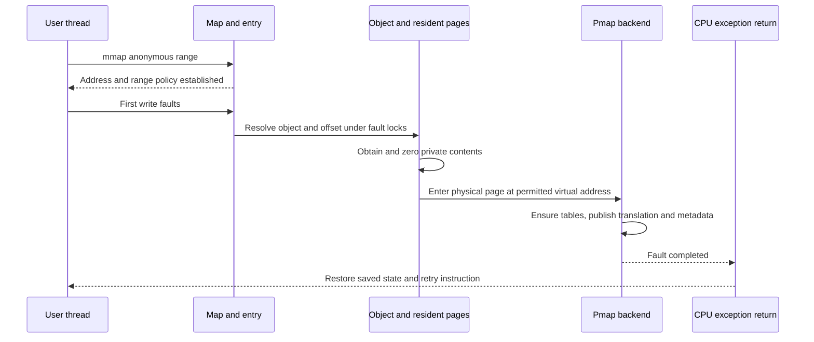

# Memory mapping from API request to CPU access

[VM overview](README.md) · [Address maps](virtual-address-maps.md) · [Fault resolution](fault-resolution.md) · [ARM64 pmap](pmap-arm64.md) · [x86 pmap](pmap-x86.md)

Follow three independent facts for each address: **the map allows a range**, **an object supplies contents**, and **the pmap currently translates an access**. A successful mapping request can establish the first two without populating hardware translations. Reclamation can remove the third while preserving the first two. These traces connect those transitions to the concrete implementation rather than treating “mapped memory” as one Boolean state. [`map/pmap contract`](../../../platydoc-data/xnu/osfmk/vm/vm_map.h#L113), [`fault entry`](../../../platydoc-data/xnu/osfmk/vm/vm_fault.c#L4288).

## 1. Allocate anonymous memory, then write one byte

Consider an ordinary pageable anonymous mapping, without special guard, JIT, tagging, or superpage options. Let its start be `A` and let `P` denote the relevant map page size. The notation is explanatory; neither `A` nor `P` is a fixed system constant.

BSD `mmap` sanitizes the request, computes flags/protections, and reaches `mach_vm_map_kernel` without a supplied memory-object port. The anonymous branch passes inheritance separately from protection:

[Source: kern_mman.c, lines 803–810](../../../platydoc-data/xnu/bsd/kern/kern_mman.c#L803-L810)

<!-- source-excerpt: ../../../platydoc-data/xnu/bsd/kern/kern_mman.c#L803-L810 -->
```c
		result = mach_vm_map_kernel(user_map,
		    vm_sanitize_wrap_addr_ref(&user_addr), user_size,
		    0, vmk_flags,
		    IPC_PORT_NULL, 0, FALSE,
		    prot, maxprot,
		    (flags & MAP_SHARED) ?
		    VM_INHERIT_SHARE :
		    VM_INHERIT_DEFAULT);
```

The Mach allocation API is another entry: `mach_vm_allocate_external` filters user flags and calls `mach_vm_allocate_kernel`. The latter establishes a zero-fill range through the map machinery. These are distinct wrappers around related common mechanisms, not a claim that BSD `mmap` invokes the userspace Mach RPC library. [`Mach allocation wrapper`](../../../platydoc-data/xnu/osfmk/vm/vm_user.c#L144-L165), [`kernel allocation API`](../../../platydoc-data/xnu/osfmk/vm/vm_kern.c#L1410), [`map wrapper`](../../../platydoc-data/xnu/osfmk/vm/vm_kern.c#L2482).

| Stage | Address-space state | Contents and CPU translation |
| --- | --- | --- |
| Mapping returns | Entry covers the selected range and records protections/inheritance/backing semantics | Ordinary demand allocation need not have populated all physical pages or PTEs |
| First write to `A + k` | Fault lookup verifies the range and requested access | Resolve/create backing and obtain a zero-filled page for an initially empty anonymous offset |
| Fault commits | Entry/object relationship remains valid under the required locks/revalidation | Install a permitted translation to the selected physical page |
| Exception return | The saved user instruction address still identifies the faulting instruction | Restore state, retry the access, and use the translation |

The object offset for an ordinary entry is `VME_OFFSET(entry) + address - entry->vme_start`. Map rounding, object-page rounding, pmap granules, and subpage physical offsets are explicit concerns in the fault path; an arithmetic example using `P` must not collapse them into one universal 4 KiB constant. [Address maps](virtual-address-maps.md) and [ARM geometry](pmap-arm64.md) explain those layers.

On ARM64, the hardware abort reaches `handle_user_abort`. For selected non-translation faults it first tries pmap reference/modified repair. Otherwise it invokes common VM:

[Source: sleh.c, lines 1961–1974](../../../platydoc-data/xnu/osfmk/arm64/sleh.c#L1961-L1974)

<!-- source-excerpt: ../../../platydoc-data/xnu/osfmk/arm64/sleh.c#L1961-L1974 -->
```c
		/* check to see if it is just a pmap ref/modify fault */
		if (!is_translation_fault(fault_code)) {
			result = arm_fast_fault(pmap,
			    vm_fault_addr,
			    fault_type, (fault_code == FSC_ACCESS_FLAG_FAULT_L3), TRUE);
		}
		if (result != KERN_SUCCESS) {

			{
				/* We have to fault the page in */
				result = vm_fault(map, vm_fault_addr, fault_type,
				    /* change_wiring */ FALSE, VM_KERN_MEMORY_NONE, THREAD_ABORTSAFE,
				    /* caller_pmap */ NULL, /* caller_pmap_addr */ 0);
			}
```

The condition in this excerpt excludes translation faults from the `arm_fast_fault` attempt. A first-touch translation miss and a deliberately induced access/dirty-tracking fault are therefore different events even when both began as a CPU exception. [`fault classification`](../../../platydoc-data/xnu/osfmk/arm64/sleh.c#L1951-L1965).

In common VM, resident contents may satisfy the request without I/O. If no contents exist in the anonymous backing chain, the fault supplies zero-filled contents; writes through COW mappings require a private page instead of writing shared backing. The insertion machinery carries the selected `vm_page`, pmap, virtual address, protection, physical subpage offset, and wiring intent. `vm_fault_enter` groups preparation, page queue handling, data synchronization, and pmap insertion for common cases; the fast zero-fill path performs specialized preparation/insertion directly. The diagram below groups those implementations by their responsibility. [`specialized zero-fill insertion`](../../../platydoc-data/xnu/osfmk/vm/vm_fault.c#L6372-L6405), [`zero-fill slow path`](../../../platydoc-data/xnu/osfmk/vm/vm_fault.c#L2145-L2202), [`VM-to-pmap helper`](../../../platydoc-data/xnu/osfmk/vm/vm_fault.c#L4158-L4222), [complete fault branches](fault-resolution.md).



The pmap does not return directly to userspace. Its result returns through VM and the exception handler; the [ARM64 return path](../platform/arm64-exception-return.md) restores the saved state and executes `eret`.

### A fault can need memory even when its data page already exists

A missing page-table page or reverse-map allocation can make insertion fail with `KERN_RESOURCE_SHORTAGE`. Common VM first requests `PMAP_OPTIONS_NOWAIT` while holding the object lock. It cannot casually drop that lock and continue using the old COW decision: another thread could establish a delayed-copy relationship in the meantime. The helper reports `need_retry` so a higher layer can release the relevant locks, expand the hierarchy, and retry the fault. [`nonblocking insertion and retry`](../../../platydoc-data/xnu/osfmk/vm/vm_fault.c#L3894-L3930).

[Source: vm_fault.c, lines 3918–3930](../../../platydoc-data/xnu/osfmk/vm/vm_fault.c#L3918-L3930)

<!-- source-excerpt: ../../../platydoc-data/xnu/osfmk/vm/vm_fault.c#L3918-L3930 -->
```c
	if (kr == KERN_RESOURCE_SHORTAGE) {
		/*
		 * We can't drop the object lock(s) here to retry the pmap_enter()
		 * in a blocking way so that it can expand the page table as needed.
		 * That would allow vm_object_copy_delayed() to create a new copy object
		 * and change the copy-on-write obligations.
		 * Our only recourse is to deal with it at a higher level where we can
		 * drop both locks, expand the page table and retry the fault.
		 */
		*need_retry = true;
		vm_pmap_enter_retried++;
		goto done;
	}
```

This is why “the physical page is resident” does not prove that a fault can finish without allocation, waiting, or revalidation.

## 2. Map file contents, then compare private and shared writes

For an ordinary vnode-backed file, `mmap` obtains the UBC memory-object control with `ubc_getobject`, establishes credentials, and computes `docow`. A mapping that is neither anonymous nor shared requests copying semantics:

[Source: kern_mman.c, lines 851–855](../../../platydoc-data/xnu/bsd/kern/kern_mman.c#L851-L855)

<!-- source-excerpt: ../../../platydoc-data/xnu/bsd/kern/kern_mman.c#L851-L855 -->
```c
		docow = FALSE;
		if ((flags & (MAP_ANON | MAP_SHARED)) == 0) {
			docow = TRUE;
		}

```

The subsequent call supplies the file offset, protections, and copy request to `vm_map_enter_mem_object_control`:

[Source: kern_mman.c, lines 899–906](../../../platydoc-data/xnu/bsd/kern/kern_mman.c#L899-L906)

<!-- source-excerpt: ../../../platydoc-data/xnu/bsd/kern/kern_mman.c#L899-L906 -->
```c
		result = vm_map_enter_mem_object_control(user_map,
		    vm_sanitize_wrap_addr_ref(&user_addr), user_size,
		    0, vmk_flags,
		    control, vm_map_trunc_page(file_pos, user_mask),
		    docow, prot, maxprot,
		    (flags & MAP_SHARED) ?
		    VM_INHERIT_SHARE :
		    VM_INHERIT_DEFAULT);
```

That function resolves the control to a VM object, retains it, handles pager mapping notification, and uses `vm_object_copy_strategically` when the request needs copying. The choice of object copy strategy matters; private mappings need not all be represented by one identical shadow-chain shape. [`control conversion and mapping notification`](../../../platydoc-data/xnu/osfmk/vm/vm_map.c#L5510-L5566), [`copy strategy`](../../../platydoc-data/xnu/osfmk/vm/vm_map.c#L5572-L5630).

At a later read fault, the VM object may already hold the file page because another mapping or filesystem cache operation brought it in. Otherwise VM requests contents from the pager. The vnode pager reaches VFS page-in, whose UPL describes pages being filled and whose completion updates their VM state. Only after valid contents and fault revalidation does pmap install this task's translation. No physical disk access is implied merely by the existence of the fault. [Pager and UPL path](pagers-and-upl.md), [`memory-object request dispatch`](../../../platydoc-data/xnu/osfmk/vm/memory_object.c#L1971).

| Operation | Private file mapping | Shared file mapping |
| --- | --- | --- |
| Read existing contents | Can obtain contents from file backing until a private version exists | Reads the file-backed object contents |
| Write | Fault/copy machinery preserves a private version according to the object strategy | Modifies permitted shared backing and makes dirty-state preservation relevant |
| Unmap this address range | Removes this mapping and its references | Removes this mapping and its references |
| Filesystem writeback | A private change is not made into a shared-file change by unmapping or synchronizing the mapping | Dirty backing can be returned through the pager/VFS writeback path |

`msync_nocancel` translates its options into VM synchronization flags and calls `mach_vm_msync`. This is a backing synchronization request, distinct from flushing CPU translation caches. It validates conflicting sync flags and marks the range contiguous so holes are reported. The full durability contract also depends on the selected filesystem and lower storage stack. [`msync`](../../../platydoc-data/xnu/bsd/kern/kern_mman.c#L1002-L1071), [VFS cached I/O](../vfs/io-and-cache.md).

## 3. Share or copy a range across address spaces

Sharing contents does not require equal virtual addresses. Two entries in different maps can refer to one object and offset while their pmaps install translations at unrelated addresses. Conversely, equal virtual addresses in two tasks do not imply shared contents. The entries' backing references are the connection. [Object/page relationships](objects-and-pages.md).

Fork applies each entry's inheritance policy. Shared inheritance retains sharing; copy inheritance uses the VM copy machinery and establishes the required COW protections; noninherited ranges are omitted. A first private write can then copy only the needed page. Wired mappings and copy strategies add cases, so “fork copies every page table” is not the implementation model. [`vm_map_fork`](../../../platydoc-data/xnu/osfmk/vm/vm_map.c#L12688), [fork setup](virtual-address-maps.md#fork-and-inheritance), [COW fault details](fault-resolution.md).

A named memory entry is another route: a Mach capability identifies an allowed backing range, and a mapping operation imports that range into a target map. A `vm_map_copy` describes a transfer and can hold entry-list or kernel-buffer contents. Neither object is itself a hardware page table. IPC OOL memory uses these VM copy contracts, and receiving may create new addresses before future accesses populate translations. [Memory entries, copies, and wiring](wiring-and-memory-entries.md), [IPC OOL conversion](../ipc/message-send-receive.md).

Writing into an existing destination follows a different path from installing those entries as a new mapping. [Copy-overwrite and remapping](copy-overwrite-and-remap.md) compares the two and works through a 16 KiB head/middle/tail overwrite, a 4 KiB-to-16 KiB sharing adjustment, and a 16 KiB-to-4 KiB trimmed view. It also explains why a failed byte overwrite can leave changed contents even though its copy object remains available for cleanup.

VM submaps and pmap nesting introduce a different kind of sharing. A submap lets a parent entry refer to another map's range policy; selected configurations can also share lower-level hardware tables through a nested pmap. The common VM's supported submap hierarchy and backend nesting constraints must both hold. The current range-lock implementation supports one VM-submap level, so a diagram of arbitrarily recursive submaps would misdescribe this snapshot. [`submap contract`](../../../platydoc-data/xnu/osfmk/vm/vm_map_lock_internal.h#L68), [map/submap details](virtual-address-maps.md), [ARM pmap nesting](pmap-arm64.md), [x86 nesting](pmap-x86.md#9-shared-hierarchy-and-ept-are-separate-features).

## 4. Change protection, remove a range, or reclaim a page

These operations start from different objects and leave different state behind:

| Operation | Starts from | State that must change | State that may survive |
| --- | --- | --- | --- |
| `mprotect` / `mach_vm_protect` | Virtual range in a map | Entry protection and any installed translation that grants excess access | Backing object and resident contents |
| `munmap` / `mach_vm_deallocate_kernel` | Virtual range in a map | Remove the address-space relationship, translations, and associated references | Objects/pages retained by other mappings, pager/cache relationships, or in-flight work |
| `pmap_disconnect_options` during reclamation | Physical page | Remove aliases and collect reference/modified state | Map entries and logical backing contents |
| Compression | Object page needing preservation | Replace ordinary resident contents with compressor backing and update accounting | The virtual range and object offset |
| Final object teardown | Object lifetime | Complete/defer outstanding work, detach backing, and release pages | Other independent objects and mappings |

BSD `mprotect` sanitizes addresses/protections and applies configured policy before calling `mach_vm_protect(..., false, prot)`; common VM performs range and maximum-protection checks. Pmap enforcement can be stricter than the entry's allowed protection temporarily. Lowering access must stop use of an old permissive translation; increasing allowed access can be realized by a later fault, depending on the backend/path. [`BSD protection request`](../../../platydoc-data/xnu/bsd/kern/kern_mman.c#L1163-L1280), [`Mach protection`](../../../platydoc-data/xnu/osfmk/vm/vm_user.c#L259-L278), [map protection](virtual-address-maps.md), [TLB completion](pmap-tlb-and-cache.md).

`munmap` calls `mach_vm_deallocate_kernel` after validation. That function passes the sanitized range to `vm_map_remove_guard`; range removal and object release have their own ordering and deferred cleanup. Unmapping a file is therefore not a command to discard every cached page of that file. [`BSD unmap`](../../../platydoc-data/xnu/bsd/kern/kern_mman.c#L1091-L1122), [`deallocation`](../../../platydoc-data/xnu/osfmk/vm/vm_kern.c#L1509-L1534), [object termination](objects-and-pages.md).

Reclamation travels in the reverse direction. Starting with a physical page, reverse mappings identify all affected virtual translations. Disconnect/flush completion prevents continued CPU access while VM reclaims or saves contents. If compressed backing later satisfies a fault, the page becomes resident again and pmap installs a new translation. A software compressed PTE marker preserves accounting; it is not a compressed payload that the CPU can translate. [Reclamation](reclaim-and-pressure.md), [mapping lifecycle](pmap-mapping-lifecycle.md).

## 5. Kernel RAM, a physical aperture, and device memory

`kmem_alloc_guard_internal` can allocate pages, choose/create an object, reserve a kernel virtual range, insert/wire pages, and populate `kernel_pmap`. `KMA_VAONLY` and `KMA_PAGEABLE` take different population paths. A contiguous virtual allocation normally does not prove contiguous physical backing; contiguous requests have separate allocation support. [`kernel allocation`](../../../platydoc-data/xnu/osfmk/vm/vm_kern.c#L835), [allocator guide](kernel-allocation.md).

A physical aperture is a kernel mapping used to access supported physical memory, including table pages. Helpers such as `phystokv` or `PHYSMAP_PTOV` interpret that mapping contract; they are not general task-virtual-address lookup routines. Keep the physical address, aperture virtual address, and a task virtual address distinct when reading pmap code. [ARM apertures](../platform/hardware-mappings.md#physical-addresses-aperture-addresses-and-io-mappings), [x86 table walking](pmap-x86.md#2-decode-a-virtual-address-using-this-checkouts-geometry).

ARM `io_map` makes the device distinction concrete. After VM startup it reserves a kernel range and then maps the **supplied** physical address with the requested protection/cache attributes:

[Source: io_map.c, lines 105–116](../../../platydoc-data/xnu/osfmk/arm/io_map.c#L105-L116)

<!-- source-excerpt: ../../../platydoc-data/xnu/osfmk/arm/io_map.c#L105-L116 -->
```c
	} else {
		kma_flags_t kmaflags = KMA_NOFAIL | KMA_PAGEABLE | KMA_IO;

		if (!unmappable) {
			kmaflags |= KMA_PERMANENT;
		}

		kmem_alloc(kernel_map, &start, alloc_size, kmaflags,
		    VM_KERN_MEMORY_IOKIT);
		pmap_map(start, phys_addr, phys_addr + alloc_size, prot, flags);
	}
	return start + start_offset;
```

This operation does not allocate a new RAM page for each device register. Before KMEM startup the same function uses bootstrap address-space reservation and mapping routines. Finally, a CPU pmap translation is distinct from a device's DMA translation: IOKit memory descriptors and DMA commands carry additional preparation, lifetime, and mapper contracts. [Driver memory/DMA](../drivers/memory-and-dma.md), [wiring](wiring-and-memory-entries.md).

## What to track while following a real address

Record the map and range; entry protection/maximum/inheritance; object and offset; resident page and busy/wired state; pmap and its geometry; PTE and reverse-map association; and the invalidation completion point. When a lock is dropped, ask what reference, busy bit, range state, epoch, or retry preserves the next operation's assumptions. The linked implementation guides explain those contracts separately so a trace can be deep without treating all VM state as one structure.

<!-- BEGIN PLATYDOC DOCUMENTATION LICENSE -->
Original Platydoc text and diagrams are licensed under [CC BY 4.0](https://creativecommons.org/licenses/by/4.0/). Quoted source code and third-party material retain their respective licenses.
<!-- END PLATYDOC DOCUMENTATION LICENSE -->
