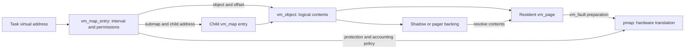

# Maps and faults: a reading guide

[VM index](README.md) · [Virtual address maps](virtual-address-maps.md) · [Fault resolution](fault-resolution.md) · [Objects and pages](objects-and-pages.md)

A mapping answers **which contents an address names, and which accesses the process may request**. Fault resolution finds or creates those contents and asks pmap to make the access possible in hardware. The mapping can exist before its object is allocated, an object can exist without resident pages, and a resident page can exist without a translation in a particular task. Start with these separate relationships when following [`vm_map_enter`](../../../platydoc-data/xnu/osfmk/vm/vm_map.c#L3030) and [`vm_fault_internal`](../../../platydoc-data/xnu/osfmk/vm/vm_fault.c#L4806).

## Follow one virtual address

For an address `A`, a map lookup finds a half-open interval `[vme_start, vme_end)`. In an ordinary entry, its backing position is:

`object offset = VME_OFFSET(entry) + A - entry->vme_start`

The offset belongs to an object, not to the task's address space. Two entries at different virtual addresses can name the same object offset. A submap entry first converts `A` into the child map's coordinates, then finds the child entry. The common implementation is [`vm_map_lookup_object_and_lock_entry`](../../../platydoc-data/xnu/osfmk/vm/vm_fault.c#L4525); the arithmetic is explicit in the range-lock helper:

[vm_map_lock_ctx_offset_for_address — source lines 974–988](../../../platydoc-data/xnu/osfmk/vm/vm_map_lock_internal.h#L974):

<!-- source-excerpt: ../../../platydoc-data/xnu/osfmk/vm/vm_map_lock_internal.h#L974-L988 -->
```c
static inline vm_map_offset_t
vm_map_lock_ctx_offset_for_address(vm_map_lock_ctx_t ctx, vm_map_address_t addr)
{
	vm_map_entry_t vme = ctx->vmlc_vme;

	/*
	 * the address really should be within the entry,
	 * and within the enumeration range.
	 * (<= because they may want to know about the end addr)
	 */
	assert(ctx->vmlc_req_start <= addr && addr <= ctx->vmlc_req_end);
	assert(vme->vme_start <= addr && addr <= vme->vme_end);

	return VME_OFFSET(vme) + addr - vme->vme_start;
}
```

An example using a hypothetical map with 4 KiB pages: entry `[0x10000, 0x14000)` names object `O` starting at offset `0x8000`. Address `0x12345` therefore names `O:0xa345`; the relevant 4 KiB page begins at object offset `0xa000`, with byte displacement `0x345`. On a machine with a larger system page, resident-page lookup can cover a larger aligned object interval. The fault path separately retains the within-system-page physical displacement; [Fault resolution](fault-resolution.md#page-size-is-not-one-number) explains that distinction.



This graph separates a mapping's logical contents from a pmap's present translations. The objects can outlive individual mappings, and their contents can move between resident and compressed or external backing without changing the virtual entry's identity. Follow [Objects and pages](objects-and-pages.md), [Pagers and UPL](pagers-and-upl.md), and [Reclamation](reclaim-and-pressure.md) for those lifetimes.

## Know the five principal structures

| Structure | What to inspect first | What it does not establish by itself |
|---|---|---|
| [`_vm_map`](../../../platydoc-data/xnu/osfmk/vm/vm_map_xnu.h#L594) | `hdr`, B+tree `root`, `pmap`, `ilock`, `map_refcnt`, virtual limits and policy flags | Physical residency of its entire virtual range |
| [`vm_map_entry`](../../../platydoc-data/xnu/osfmk/vm/vm_map_xnu.h#L320) | Bounds, `VME_OBJECT`/`VME_SUBMAP`, `VME_OFFSET`, `protection`, `max_protection`, `needs_copy`, inheritance and wiring counts | A current PTE for every page in the entry |
| [`vm_map_lock_ctx`](../../../platydoc-data/xnu/osfmk/vm/vm_map_lock_internal.h#L623) | Requested range, current map/entry, iteration mode, parent/submap state and preflight callback | An object reference after the mapping is unlocked |
| [`vm_object`](../../../platydoc-data/xnu/osfmk/vm/vm_object_xnu.h#L136) | `Lock`, `ref_count`, resident pages, shadow/copy relations, pager and paging activity | A specific virtual address in a specific task |
| [`vm_page`](../../../platydoc-data/xnu/osfmk/vm/vm_page.h#L286) | Owning object and offset, physical page number, busy/error/dirty state, wire count and queues | Permission to insert that page into any caller's pmap |

Use the entry accessors. `vme_object_value` overlays submap and object representations, normal object pointers are packed, kernel objects have special representations, and the stored offset is shifted. `use_pmap` means **nested pmap** on a submap entry but **pmap footprint accounting** on an ordinary object entry. These details are documented beside the fields in [`vm_map_xnu.h`](../../../platydoc-data/xnu/osfmk/vm/vm_map_xnu.h#L329).

A page's `vmp_busy` state, an object lock, a paging reference, and an ordinary object reference serve different purposes. Busy state excludes competing use of incomplete contents. The object lock serializes its state and page membership. A paging reference prevents unsafe restructuring across paging work. An ordinary reference keeps the object alive. Slow fault code deliberately changes which of these protections it holds; treating all four as a single “VM lock” hides the important transitions. See [`vm_fault_page` invariants](../../../platydoc-data/xnu/osfmk/vm/vm_fault.c#L1166).

## Read the paths in this order

1. **Create an anonymous range.** [`mach_vm_allocate_kernel`](../../../platydoc-data/xnu/osfmk/vm/vm_kern.c#L1410) sanitizes the request and enters a mapping with `VM_OBJECT_NULL`. [`vm_map_enter`](../../../platydoc-data/xnu/osfmk/vm/vm_map.c#L3030) chooses space and establishes entries. [Virtual address maps](virtual-address-maps.md#api-entry-points-and-sanitization) follows the public API routes and the insertion transaction.
2. **Touch the range.** [`vm_map_lookup_object_and_lock_entry`](../../../platydoc-data/xnu/osfmk/vm/vm_fault.c#L4525) stabilizes the entry, creates missing backing when required, resolves entry-level COW for writes, and checks protections. [`vm_fault_internal`](../../../platydoc-data/xnu/osfmk/vm/vm_fault.c#L4806) then searches objects for a page. [Fault resolution](fault-resolution.md) follows resident, zero-fill, compressed and slow pager cases.
3. **Fork and write.** [`vm_map_fork`](../../../platydoc-data/xnu/osfmk/vm/vm_map.c#L12688) applies inheritance policy, including setting up symmetric COW. A later write can create a shadow object and copy a page into it. The map preparation and page copy are separate phases; see [Fork and inheritance](virtual-address-maps.md#fork-and-inheritance) and [COW faults](fault-resolution.md#resident-pages-and-copy-on-write).
4. **Reduce permissions or remove the mapping.** [`vm_map_protect`](../../../platydoc-data/xnu/osfmk/vm/vm_map.c#L5801) coordinates logical permission changes with pmap protection. [`vm_map_remove_guard`](../../../platydoc-data/xnu/osfmk/vm/vm_map.c#L9038) detaches entries and translations, then releases backing references. The object's last reference may be elsewhere.
5. **Follow the architecture boundary.** [`vm_fault_enter`](../../../platydoc-data/xnu/osfmk/vm/vm_fault.c#L4158) validates page state, accounts/queues the page, and reaches `pmap_enter_options_addr`. Continue into [ARM64 pmap](pmap-arm64.md), [Mapping lifecycle](pmap-mapping-lifecycle.md), and [TLB and cache handling](pmap-tlb-and-cache.md).

For a file mapping, insert a VFS step before the common map work. BSD [`mmap`](../../../platydoc-data/xnu/bsd/kern/kern_mman.c#L279) resolves and authorizes the descriptor, obtains the vnode's UBC object control, and calls [`vm_map_enter_mem_object_control`](../../../platydoc-data/xnu/osfmk/vm/vm_map.c#L5447). A later page-in runs through the object's pager. The mapping call and the file read that eventually supplies a missing page need not occur together. The [VFS cache and paging guide](../vfs/io-and-cache.md) and [Pagers and UPL](pagers-and-upl.md) follow the storage side.

## Current-checkout details that change the reading strategy

The map store is a **B+tree**, with linked entries retained for ordered traversal and special guard-object chunks represented in leaves. Some surrounding comments still use older map-lock terminology; read the actual [`vm_map_store_root`](../../../platydoc-data/xnu/osfmk/vm/vm_map_store_internal.h#L133) and [range-lock API](../../../platydoc-data/xnu/osfmk/vm/vm_map_lock_internal.h#L307) before assuming an older implementation.

Map operations now use the map interlock for structure and per-entry range locks for stabilized operations. A streaming range lock holds entries as it advances; an atomic range lock stabilizes the whole requested range. A shared range-lock request can temporarily prepare an entry under exclusive ownership to allocate backing or resolve COW. Sealed constant submaps and transparent kernel submaps have different rules, and this implementation explicitly prohibits submaps containing another submap. [Virtual address maps](virtual-address-maps.md) develops those contracts.

A page fault is not necessarily a disk operation. The common code handles resident-page permission faults, COW, zero-fill and some decompressions without the full `vm_fault_page` route. Conversely, having found a valid page is not sufficient to finish: page-table resources can be unavailable, page validation can fail, or the mapping can have changed during slow work. The retry and cleanup paths are part of the algorithm, not incidental error handling. See [Fault resolution](fault-resolution.md#slow-faults-release-and-revalidate-the-mapping).

## Sources inspected and limits

| Sources | Inspection in this guide family |
|---|---|
| `vm_map_xnu.h`, `vm_map_lock_internal.h`, `vm_map_lock.c`, `vm_entry_lock.c`, `vm_map_store_internal.h`, `vm_map_store.c` | Deep reads of structures, lookup/clipping, range modes, preparation, submap handling and entry wait/relookup; B+tree balancing and guard allocation are narrower surveys |
| `vm_user.c`, `vm_kern.c`, `vm_map.c`, `kern_mman.c` | Deep reads of the common allocate/map/protect/remove/remap/fork paths; the full BSD authorization and every special mapping flag are outside these three pages |
| `vm_fault.c` | Deep reads of current map lookup, fast resident/COW/zero-fill/compressor paths, slow setup/relookup and pmap insertion/cleanup; paging internals continue in sibling guides |
| Machine pmap and security code | Common call contract inspected here; backend translation geometry, monitor behavior, TLB implementation and full code-signing/MTE policy belong to the linked specialized guides |

The snippets are exact extracts from this checkout. Configuration branches remain significant: page sizes, x86 execute-permission behavior, ARM64e TPRO, MTE, code-signing monitors and map ranges can change which paths apply. The original [VM parameter sanitization document](../../../platydoc-data/xnu/doc/vm/sanitize.md) explains the checked arithmetic at public boundaries.

<!-- BEGIN PLATYDOC DOCUMENTATION LICENSE -->
Original Platydoc text and diagrams are licensed under [CC BY 4.0](https://creativecommons.org/licenses/by/4.0/). Quoted source code and third-party material retain their respective licenses.
<!-- END PLATYDOC DOCUMENTATION LICENSE -->
