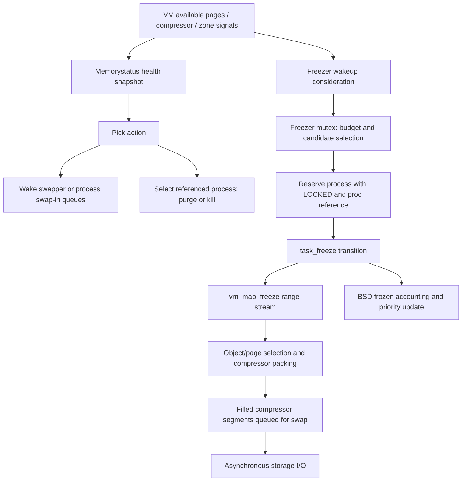

# Memorystatus selection, freezing, and recovery

[VM overview](README.md) · [Reclamation and compression](reclaim-and-pressure.md) · [Objects and pages](objects-and-pages.md) · [Process lifecycle](../processes/README.md)

Page reclamation chooses physical pages. Memorystatus chooses process-level actions using resource health, process priority, limits, and state. Freezing is one preservation mechanism: selected anonymous contents are compressed and, in configured modes, packed for swap. Killing tears down a process; freezing keeps its mappings and backing logically available. Neither a pressure notification nor a freezer wakeup guarantees a particular ordering before a kill. The workers run concurrently and reevaluate their inputs. [`memorystatus_thread_internal()`](../../../xnu/bsd/kern/kern_memorystatus.c#L4963), [`memorystatus_freeze_thread()`](../../../xnu/bsd/kern/kern_memorystatus_freeze.c#L2936).

This chapter follows the policy-to-VM handoff, candidate lifetime, map/object locking, and completion states. [Reclamation and pressure](reclaim-and-pressure.md) already explains compressor slots, segments, pageout workers, and swap I/O; those mechanisms are referenced here rather than repeated.

## 1. State is spread across a process, a task, and VM

The BSD process embeds requested/effective/assertion priorities, a priority-bucket link, active/inactive memory limits, memorystatus state bits, and freeze/thaw accounting. The task supplies ledger footprint, a VM map, `frozen`, and `changing_freeze_state`. VM objects and pages supply resident, wired, dirty, purgeable, and compressed content. A policy band is neither a CPU scheduling priority nor a pmap protection. [`proc` fields](../../../xnu/bsd/sys/proc_internal.h#L470), [`memorystatus flags`](../../../xnu/bsd/sys/kern_memorystatus.h#L543), [`task freeze state`](../../../xnu/osfmk/kern/task.c#L5042).

| State or owner | Meaning in this path | Synchronization or lifetime |
|---|---|---|
| `p_memstat_list` / effective priority | Placement in a process policy bucket | Traversal and selected state changes under `proc_list_lock()` |
| `P_MEMSTAT_TERMINATED` | Candidate marked as being terminated so another pass skips it | Set before dropping the process-list lock for a kill attempt; cleared on applicable purge/failure paths |
| `P_MEMSTAT_LOCKED` | Process temporarily owned by an operation such as freeze | Kill selectors skip it; freezer clears it and wakes state waiters at completion |
| `P_MEMSTAT_FROZEN` | BSD retains frozen-process accounting, including after resume when backing may remain on disk | Distinct from task execution/freeze serialization |
| `P_MEMSTAT_REFREEZE_ELIGIBLE` | A previously frozen process has resumed and may be reconsidered | Resume sets it; freeze/demotion consumes or clears it |
| `task->changing_freeze_state` | Freeze/resume/thaw transition is in progress | Task mutex plus wait/wakeup protocol |
| `freezer_context_global` | Current task, compressor filling head, scratch buffer and packed-content counters | Ordinary BSD freezer path is serialized by `freezer_mutex`; not a per-task private compressor worker |

See [`priority-kill reservation`](../../../xnu/bsd/kern/kern_memorystatus.c#L6677), [`freeze reservation`](../../../xnu/bsd/kern/kern_memorystatus_freeze.c#L1883), [`resume accounting`](../../../xnu/bsd/kern/kern_memorystatus.c#L3884), and [`task/compressor context`](../../../xnu/osfmk/kern/task.c#L5075). Names alone are misleading: `P_MEMSTAT_FROZEN` can remain true while the process runs and faults pages back in.



## 2. A wakeup is a hint to reevaluate, not a selected victim

`memorystatus_update_available_page_count()` atomically publishes the available-page count, asks pressure notification code to reevaluate, considers a freezer wakeup, and considers waking jetsam. It cannot take `freezer_mutex`: callers may hold page-queue locks with preemption disabled. Its freezer predicate is therefore an inexpensive preliminary gate; the worker later checks state with its proper mutex. This particular available-page path wakes the freezer only with active freezer swap, while inactivity and other entry points provide additional triggers. [`available-page update`](../../../xnu/bsd/kern/kern_memorystatus.c#L6045), [`inactivity wakeup`](../../../xnu/bsd/kern/kern_memorystatus.c#L3953).

The health snapshot separates low versus exhausted compressor/swap space, available-page thresholds, thrashing, zone-map exhaustion, and pageout starvation. The definition of “healthy” differs under `CONFIG_JETSAM`; non-jetsam builds use pressure levels and different paging-space actions. It is incorrect to replace all these inputs with one free-page threshold. [`memstat_evaluate_health_conditions()`](../../../xnu/bsd/kern/kern_memorystatus_policy.c#L76), [`health classification`](../../../xnu/bsd/kern/kern_memorystatus_policy.c#L113).

`memorystatus_pick_action()` selects an action, not a process. In the jetsam branch, conditions can first choose low-swap victims, swapper work, compressor-shortage priority kills, or high-water-limit enforcement. Idle and long-idle actions have their own healthy-system conditions. An unhealthy system can enter aggressive recovery or fall back to priority order; foreground sorting is a stated exception to simple within-band LRU. The non-jetsam branch has no aggressive or early high-water sequence and includes throttled no-paging-space handling. [`action selection`](../../../xnu/bsd/kern/kern_memorystatus_policy.c#L312).

The worker repeatedly picks and executes actions until `MEMORYSTATUS_KILL_NONE`. It remembers when a category has no remaining candidate, resets relevant category flags after progress, and acknowledges subsystem shortage signals following successful relevant actions. `memorystatus_do_action()` also performs non-kill work such as waking swapout or processing special swapped-in segments, so its action enum and result require interpretation in context. [`main loop`](../../../xnu/bsd/kern/kern_memorystatus.c#L5022), [`action dispatch`](../../../xnu/bsd/kern/kern_memorystatus.c#L4848).

## 3. Selecting a kill candidate requires reference acquisition and restart

`memstat_kill_top_process()` optionally sorts the applicable bucket, chooses its maximum band, then walks candidates under `proc_list_lock()`. It skips errored/terminated/skipped processes, applies requested swappable or long-idle filters, avoids the current process for vnode-exhaustion kills, and skips freezer-locked candidates when configured. The selected process is not safe to use after simply releasing the list lock. The selector takes a process reference first. [`priority-kill traversal`](../../../xnu/bsd/kern/kern_memorystatus.c#L6569).

The reference operation itself can drop the list lock. On failure the saved `next_p` is no longer trustworthy, so traversal restarts from the first process:

[Candidate reference and restart boundary](../../../xnu/bsd/kern/kern_memorystatus.c#L6682)

<!-- source-excerpt: ../../../xnu/bsd/kern/kern_memorystatus.c#L6682-L6700 -->
```c
		if (proc_ref(p, true) == p) {
			/*
			 * Mark as terminated so that if exit1() indicates success, but the process (for example)
			 * is blocked in task_exception_notify(), it'll be skipped if encountered again - see
			 * <rdar://problem/13553476>. This is cheaper than examining P_LEXIT, which requires the
			 * acquisition of the proc lock.
			 */
			p->p_memstat_state |= P_MEMSTAT_TERMINATED;
		} else {
			/*
			 * We need to restart the search again because
			 * proc_ref _can_ drop the proc_list lock
			 * and we could have lost our stored next_p via
			 * an exit() on another core.
			 */
			i = 0;
			next_p = memorystatus_get_first_proc_locked(&i, TRUE);
			continue;
		}
```

With a reference, the code marks `P_MEMSTAT_TERMINATED`, prepares diagnostic snapshot state, drops the list lock, and calls `memorystatus_kill_proc()`. That helper may first ask networking to reduce pressure and purge task-owned purgeable memory; configured secluded pages may also be released. If this sufficiently reduces the relevant limit/pressure, it returns progress with `*killed = false`. The caller clears the temporary terminated bit and releases its reference. A successful kill retains the terminated marker to avoid selecting a process again while its exit path is still working; a failed attempt clears that marker, marks an error, and restarts. [`purge before kill`](../../../xnu/bsd/kern/kern_memorystatus.c#L6431), [`caller completion`](../../../xnu/bsd/kern/kern_memorystatus.c#L6716).

The high-water selector follows a similar lifetime protocol but first compares the current task physical footprint against the process's cached positive limit. This is not a comparison of just resident-page count. Fatal per-process ledger-limit handling is another entry path and can request a synchronous victim kill without following the ordinary asynchronous action sequence. [`high-water candidate path`](../../../xnu/bsd/kern/kern_memorystatus.c#L7167), [`ledger callback`](../../../xnu/bsd/kern/kern_memorystatus.c#L5124), [`synchronous entry`](../../../xnu/bsd/kern/kern_memorystatus.c#L5311).

A proc reference stabilizes the selected object; it does not prove the process is still eligible forever or that the eventual exit must succeed. Marker bits, restart rules, and actual kill results close that gap. Lower exit and reason ownership is handled by [`memorystatus_do_kill()`](../../../xnu/bsd/kern/kern_memorystatus.c#L2379) and the [process lifecycle guides](../processes/README.md). This chapter does not derive exact physical bytes reclaimed from a kill's diagnostic footprint: shared objects and asynchronous teardown prevent such a direct identity.

## 4. The freezer selects candidates under two levels of policy

The preliminary `memorystatus_freeze_thread_should_run()` checks enablement, available pages, slot/refreeze availability, shared-memory limits, and the next permitted run time. The worker additionally checks that enough suspended candidates exist, compressor/swap space is usable, budgets remain, and slots or refreeze opportunities exist. It holds `freezer_mutex` across selection and freezing. Before sleeping it installs an uninterruptible wait on the wake event, releases the mutex, then blocks with its continuation. [`wakeup predicate`](../../../xnu/bsd/kern/kern_memorystatus_policy.c#L939), [`worker`](../../../xnu/bsd/kern/kern_memorystatus_freeze.c#L2936), [`can-freeze gate`](../../../xnu/bsd/kern/kern_memorystatus_freeze.c#L2288).

One wake does not always mean one process. `memorystatus_pick_freeze_count_for_wakeup()` normally returns one, but app-swap mode counts processes in configured candidate bands as the iteration cap. A selected coalition leader can also lead to freezing XPC service members. These are code paths, not evidence that every product enables app swap or uses the same candidate band. [`per-wake count`](../../../xnu/bsd/kern/kern_memorystatus_policy.c#L983), [`coalition follow-up`](../../../xnu/bsd/kern/kern_memorystatus_freeze.c#L2175).

`memorystatus_is_process_eligible_for_freeze()` is called with the process-list lock. It rejects terminated, locked, disabled, or ignored processes. Ordinary applications must be suspended, meet the resident-page minimum, not be exiting, satisfy the applicable recommendation path, and not exceed the configured candidate band for a first freeze. System-process candidates instead require an already frozen coalition leader and the XPC-service role; this special branch bypasses the ordinary app size checks. [`eligibility`](../../../xnu/bsd/kern/kern_memorystatus_policy.c#L654).

The iterator supports an ordered candidate list or bucket traversal. When the freezer is full, it switches to refreeze-only mode and resets the saved traversal pointer because it is entering a different band. Refreeze selection requires a previously frozen, eligible, unlocked process and optionally excludes recently thawed processes. If no fresh candidate is found, sufficient eligible thaws can trigger this same refreeze path. [`iterator layout`](../../../xnu/bsd/kern/kern_memorystatus_internal.h#L581), [`selection and fallback`](../../../xnu/bsd/kern/kern_memorystatus_policy.c#L855).

The checked-in [original freezer design](../../../xnu/doc/vm/freezer.md) describes historical selection and product examples. The ordered-list and app-swap branches above are reasons to read those statements as context rather than unconditional present defaults. External userspace recommendation generation is outside this checkout trace.

## 5. Freeze reserves a process but releases the global process-list lock

`memorystatus_freeze_process()` enters and returns with both `freezer_mutex` and `proc_list_lock()` held. It rechecks first-freeze/refreeze eligibility, consumes refreeze eligibility and its old shared-memory snapshot when applicable, checks slots, and chooses a dirty-page work budget. Freezer-swap mode uses the smaller of per-freeze maximum and remaining budget; compressor-only mode supplies a much larger bound. [`process transaction`](../../../xnu/bsd/kern/kern_memorystatus_freeze.c#L1816).

It then marks the process locked, obtains a reference, and drops only the process-list lock before entering Mach VM:

[Freeze reserves and references the process before VM work](../../../xnu/bsd/kern/kern_memorystatus_freeze.c#L1883)

<!-- source-excerpt: ../../../xnu/bsd/kern/kern_memorystatus_freeze.c#L1883-L1899 -->
```c
	/* Mark as locked temporarily to avoid kill */
	p->p_memstat_state |= P_MEMSTAT_LOCKED;

	p = proc_ref(p, true);
	if (!p) {
		memorystatus_freezer_stats.mfs_error_other_count++;
		return EBUSY;
	}

	proc_list_unlock();

	KDBG(MEMSTAT_CODE(BSD_MEMSTAT_FREEZE) | DBG_FUNC_START, memorystatus_available_pages, aPid, max_pages);

	max_pages = MIN(max_pages, UINT32_MAX);
	kr = task_freeze(proc_task(p), &purgeable, &wired, &clean, &dirty,
	    (uint32_t) max_pages, &shared, &freezer_error_code,
	    memorystatus_freeze_shared_memory ? FREEZE_SHARED : FREEZE_NONE);
```

The ordinary kill selectors honor `P_MEMSTAT_LOCKED`; this is a policy reservation, not the same object as a VM map lock. The proc reference keeps the object usable through the unlocked work. If reference acquisition fails, this body returns `EBUSY` before entering VM. Once work has run, both success and failure paths reacquire the process-list lock, finalize state, clear the reservation, wake waiters on `p_memstat_state`, and release the proc reference. The freezer mutex continues to serialize this operation's shared compressor context. [`completion branches`](../../../xnu/bsd/kern/kern_memorystatus_freeze.c#L1911).

On success BSD sets first-freeze state/counts, records shared-memory accounting, emits a freeze note outside the process-list lock, optionally elevates the inactive jetsam band, updates interval accounting, and returns coalition members for further selection. `P_MEMSTAT_LOCKED` remains set during that intermediate priority work. On failure a first-freeze process can be marked `P_MEMSTAT_FREEZE_IGNORE`; selected refreeze failures caused by shared-memory heuristics can remove elevated-band protection and demote the process. None of these paths claims to restore already compressed pages to their original physical locations. [`success and failure state`](../../../xnu/bsd/kern/kern_memorystatus_freeze.c#L1911), [`refreeze failure`](../../../xnu/bsd/kern/kern_memorystatus_freeze.c#L2010).

## 6. Task serialization and map evaluation protect different things

`task_freeze()` requires a stable task reference and rejects null/kernel tasks. Under the task lock it waits while `changing_freeze_state` is set, rejects a currently frozen task, then claims the transition and drops the task lock. Configured deferred reclamation is drained before entering `vm_map_freeze()`; a drain error is logged, while the map freeze call supplies the subsequent result. Task resume/thaw use the same transition wait channel. [`task_freeze()`](../../../xnu/osfmk/kern/task.c#L5042), [`task_pidresume()`](../../../xnu/osfmk/kern/task.c#L4474), [`task_thaw()`](../../../xnu/osfmk/kern/task.c#L5149).

At map level, initial compressor/swap-space checks can reject work immediately. Freezer-swap mode begins with an evaluation pass; compressor-only mode skips that pass and rejects `FREEZE_EVAL_ONLY`. Each pass acquires an exclusive whole-map streaming range lock, requesting no pmap unnest because it does not edit entries. This blocks concurrent faults through the affected map while scanning. It does not prevent all activity on shared backing from other maps. [`vm_map_freeze()`](../../../xnu/osfmk/vm/vm_map.c#L20322).

[Whole-map range lock and backing eligibility](../../../xnu/osfmk/vm/vm_map.c#L20392)

<!-- source-excerpt: ../../../xnu/osfmk/vm/vm_map.c#L20392-L20409 -->
```c
	kr = vm_map_range_ex_lock(ctx, &map, VMRL_WHOLE_MAP_START, VMRL_WHOLE_MAP_END, VMRL_EX_STREAM | VMRL_EX_WHOLE_MAP | VMRL_EX_NO_PMAP_UNNEST);
	if (kr != KERN_SUCCESS) {
		goto after_loop_evaluation;
	}

	while ((entry2 = vm_map_range_stream_next(ctx))) {
		vm_object_t src_object;

		if (entry2->is_sub_map) {
			continue;
		}

		src_object = VME_OBJECT(entry2);
		if (!src_object ||
		    src_object->phys_contiguous ||
		    !src_object->internal) {
			continue;
		}
```

Submap entries, absent backing, physically contiguous objects, and external objects are skipped. Evaluation classifies candidate anonymous memory using object references, resident-minus-wired pages, and compressed-page counts. References greater than one are a heuristic for sharing; subsequent occurrences of the same object can reconcile that reference count against mappings encountered locally and treat it as private. This is not an exhaustive proof that every reference belongs to another process. With `FREEZE_SHARED` absent, shared candidates can be skipped; maximum shared MiB and private/shared ratio can reject the evaluated task. [`shared-object accounting`](../../../xnu/osfmk/vm/vm_map.c#L20463), [`evaluation decision`](../../../xnu/osfmk/vm/vm_map.c#L20525).

The map lock is dropped between passes. After acceptable evaluation, the code purges task-owned purgeable memory, clears evaluation counters, and scans again to perform compression. Object/page state can change between these phases, so evaluation is a heuristic admission decision, not an atomic snapshot plus guaranteed identical execution. Volatile objects mapped only here have additional purge handling in the execution pass. [`evaluation-to-execution transition`](../../../xnu/osfmk/vm/vm_map.c#L20552), [`purgeable branch`](../../../xnu/osfmk/vm/vm_map.c#L20423).

## 7. Object freezing keeps busy/activity ownership across compression

`vm_object_compressed_freezer_pageout()` locks each internal object, creates its compressor pager if needed, and skips objects already carrying paging/activity work. With freezer swap enabled it first walks existing compressed offsets and asks the pager to relocate available compressed data into the freezer's filling head. It then snapshots resident-page count and begins object activity before walking resident pages; the snapshot bounds work even if shared activity repeatedly causes pages to be decompressed. [`object freeze start`](../../../xnu/osfmk/vm/vm_object.c#L7777).

The page scan skips wired, busy, absent, fictitious, unusual, errored, or cleaning pages, moving skipped residents to the end of the object queue. Mapped pages are disconnected through pmap, and returned modification state updates `vmp_dirty`. Clean nonprecious pages can be freed; dirty/precious pages are removed from replacement queues and prepared for compression. Thus “freeze a process” does not mean forcibly unwiring its pages or treating all map entries as interchangeable. [`page eligibility and disconnect`](../../../xnu/osfmk/vm/vm_object.c#L7868), [pmap physical lifetime](pmap-mapping-lifecycle.md).

Before dropping the object lock, the code marks the selected page busy and takes an activity reference specifically consumed by the page compression helper:

[Busy page and donated activity across compression](../../../xnu/osfmk/vm/vm_object.c#L7934)

<!-- source-excerpt: ../../../xnu/osfmk/vm/vm_object.c#L7934-L7942 -->
```c
		p->vmp_busy = TRUE;

		vm_object_activity_begin(object);

		vm_object_unlock(object);

		if (vm_pageout_compress_page(&(freezer_context_global.freezer_ctx_chead),
		    (freezer_context_global.freezer_ctx_compressor_scratch_buf),
		    p) == KERN_SUCCESS) {
```

This lock drop avoids an object/kernel-map lock cycle when compressor data structures need allocation. Successful compression has already removed the page from the object; the freezer collects those physical pages into a local free batch. Failed compression leaves page-level cleanup to the common helper, and queue rotation prevents selecting the same failed page forever. At completion the outer activity is ended and the object unlocked. Duty-cycle yields bound how long the freezer monopolizes execution. [`object-lock rationale`](../../../xnu/osfmk/vm/vm_object.c#L7848), [`batch completion`](../../../xnu/osfmk/vm/vm_object.c#L7944), [common compression ownership](reclaim-and-pressure.md).

This operation is bounded, not all-or-nothing. Wired/busy objects and pages may survive, budgets can stop scanning, and space conditions can stop work after partial progress. In particular, the current `vm_map_freeze()` execution-pass tail sets `kr = KERN_SUCCESS` after loop completion, including the route reached by a space-shortage break. Initial space failures and explicit evaluation rejections instead go directly to `done`. Do not infer universal propagation of every intermediate `KERN_NO_SPACE`, or equate successful return with every anonymous page having been processed. This describes the body without claiming a bug or an unseen intended contract. [`space stop`](../../../xnu/osfmk/vm/vm_map.c#L20501), [`result normalization`](../../../xnu/osfmk/vm/vm_map.c#L20565).

## 8. Packing completion, disk completion, and counters are different

A successful non-evaluation map freeze calls `vm_object_compressed_freezer_done()`, which finishes the compressor filling head. For the configured freezer swap path, filled freezer segments enter `C_ON_SWAPOUT_Q`, receive task ownership/accounting, and accumulate their compressed bytes into the freezer context. This is queueing and packing completion; the swap worker issues and completes storage I/O later. [`freezer filling completion`](../../../xnu/osfmk/vm/vm_object.c#L7770), [`swapout selection`](../../../xnu/osfmk/vm/vm_compressor.c#L4632), [`segment task ownership and bytes`](../../../xnu/osfmk/vm/vm_compressor.c#L4712), [swap reservation/I/O/completion](reclaim-and-pressure.md).

`task_freeze()` then sets the task frozen state on successful real work, clears transition state, wakes waiters, and wakes compressor/swapout workers. Its output counters require care:

| Value at boundary | Actual computation in this path |
|---|---|
| Object helper's `paged_out_count` | Resident pages successfully compressed during this invocation; used to reduce scan budget |
| `vm_map_freeze()` `shared_count` | Shared-accounting page count converted to **MiB**, despite page-oriented names in some callers/fields |
| `task_freeze()` `dirty_count`, freezer swap active | Packed compressed bytes divided by `PAGE_SIZE_64`, replacing the initially zero map output |
| Freezer packed-byte total | Segment compressed bytes charged when queued through freezer completion; not a count of completed storage writes |

The precise conversions are [`shared output`](../../../xnu/osfmk/vm/vm_map.c#L20525), [`task output replacement`](../../../xnu/osfmk/kern/task.c#L5098), and [`packed bytes`](../../../xnu/osfmk/vm/vm_compressor.c#L4726). `purgeable`, `clean`, and `dirty` are initialized by this map routine, but it does not populate every output in the way those names might suggest; interpret caller logs using assignments, not a presumed comprehensive page census.

Budget calculation gets the storage-layer budget when available, scales it by multiplier and interval duration, adds rollover/missed-interval allowance, and saturates to `UINT32_MAX`. App-swap mode returns an effectively unlimited budget; no active freezer swap returns zero from this calculator. Throttle updates run with `freezer_mutex` but without the process-list lock and consider normal/degraded windows. These configurable gates are separate from object scan budgets and from final I/O errors. [`new budget`](../../../xnu/bsd/kern/kern_memorystatus_freeze.c#L2522), [`throttle contract`](../../../xnu/bsd/kern/kern_memorystatus_freeze.c#L2810).

## 9. Resume and demotion preserve backing until it is actually needed

`task_pidresume()` serializes against freeze changes, releases the PID-suspension hold, and clears `task->frozen` on success. At BSD level, `memorystatus_on_resume()` deliberately preserves `P_MEMSTAT_FROZEN`, sets refreeze eligibility once, records thaw accounting, and clears suspended state. The process can run while many of its compressed pages remain on disk. Ordinary [fault resolution](fault-resolution.md) brings back touched contents; these resume bodies do not eagerly read the whole process into memory. [`task resume`](../../../xnu/osfmk/kern/task.c#L4474), [`BSD resume`](../../../xnu/bsd/kern/kern_memorystatus.c#L3884).

[Resume adds refreeze eligibility without dropping frozen history](../../../xnu/bsd/kern/kern_memorystatus.c#L3906)

<!-- source-excerpt: ../../../xnu/bsd/kern/kern_memorystatus.c#L3906-L3909 -->
```c
		if ((p->p_memstat_state & P_MEMSTAT_REFREEZE_ELIGIBLE) == 0) {
			p->p_memstat_state |= P_MEMSTAT_REFREEZE_ELIGIBLE;
			memorystatus_refreeze_eligible_count++;
		}
```

Demotion likewise changes policy rather than backing contents. `memorystatus_demote_frozen_process()` removes elevated inactive-band protection and chooses an effective priority respecting assertions and dirty tracked state. It can clear refreeze eligibility, but deliberately retains frozen counting/state because disk contents remain. It neither kills the process nor reads all its data. Do not reduce this to “demotion always sends it to idle”: higher assertions and requested priority can win. [`demotion`](../../../xnu/bsd/kern/kern_memorystatus_freeze.c#L2341).

A useful investigation trace is therefore: health cause → chosen action → candidate/reference marker → task transition → map admission → object/page progress → segment queueing → BSD completion → later fault or exit. At each boundary, ask which lock was dropped, what reference survives, and whether the observed counter describes logical pages, resident pages, compressed bytes, or policy slots.

## Sources inspected and limits

| Depth | Sources | Reviewed scope and limits |
|---|---|---|
| Deep selected policy paths | [`kern_memorystatus_policy.c`](../../../xnu/bsd/kern/kern_memorystatus_policy.c), [`kern_memorystatus.c`](../../../xnu/bsd/kern/kern_memorystatus.c) | Health/action loop, priority/high-water candidate reservation, purge-before-kill, available-page wakeup and resume. Full aggressive-kill heuristics, all bucket aging, notification filters and synchronous exit internals remain narrower. |
| Deep selected freezer paths | [`kern_memorystatus_freeze.c`](../../../xnu/bsd/kern/kern_memorystatus_freeze.c), [`proc_internal.h`](../../../xnu/bsd/sys/proc_internal.h#L470), [`kern_memorystatus_internal.h`](../../../xnu/bsd/kern/kern_memorystatus_internal.h#L581) | Candidate iterator/eligibility, process reference/lock handoff, completion, coalition handoff, worker, budget calculation and demotion. Every throttle-window transition, list-update syscall, telemetry statistic and product tunable is not audited. |
| Deep VM execution path | [`task.c`](../../../xnu/osfmk/kern/task.c#L5042), [`vm_map.c`](../../../xnu/osfmk/vm/vm_map.c#L20322), [`vm_object.c`](../../../xnu/osfmk/vm/vm_object.c#L7770), [`vm_compressor.c`](../../../xnu/osfmk/vm/vm_compressor.c#L4632) | Task transition serialization, two map passes, shared heuristic, busy/activity ownership, packing and completion accounting. Compressor relocation internals and all segment swap/error cases remain in the reclaim guide or outside this focused review. |
| Design companions / external limit | [Original freezer guide](../../../xnu/doc/vm/freezer.md), [kill policy](../../../xnu/doc/vm/memorystatus_kills.md), [notifications](../../../xnu/doc/vm/memorystatus_notify.md) | Freezer design read; kill/notification documents surveyed for context. Userspace recommendations, storage firmware budget policy, product configuration and live performance were not observed. |
