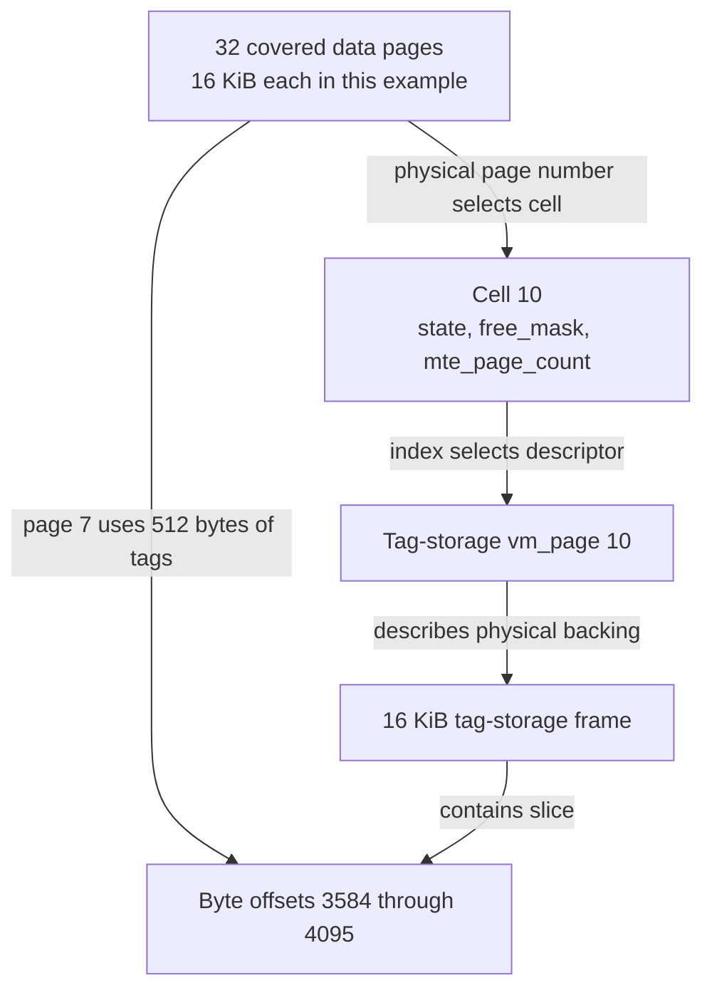
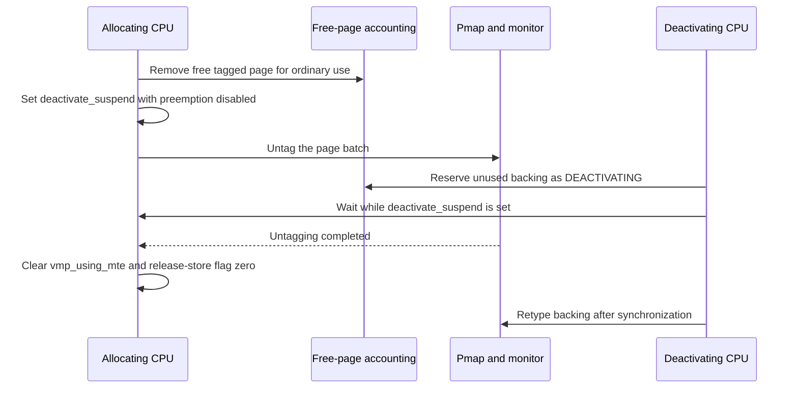
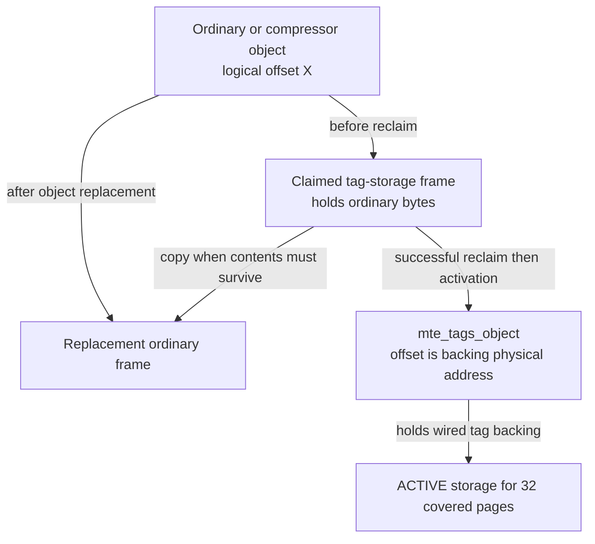
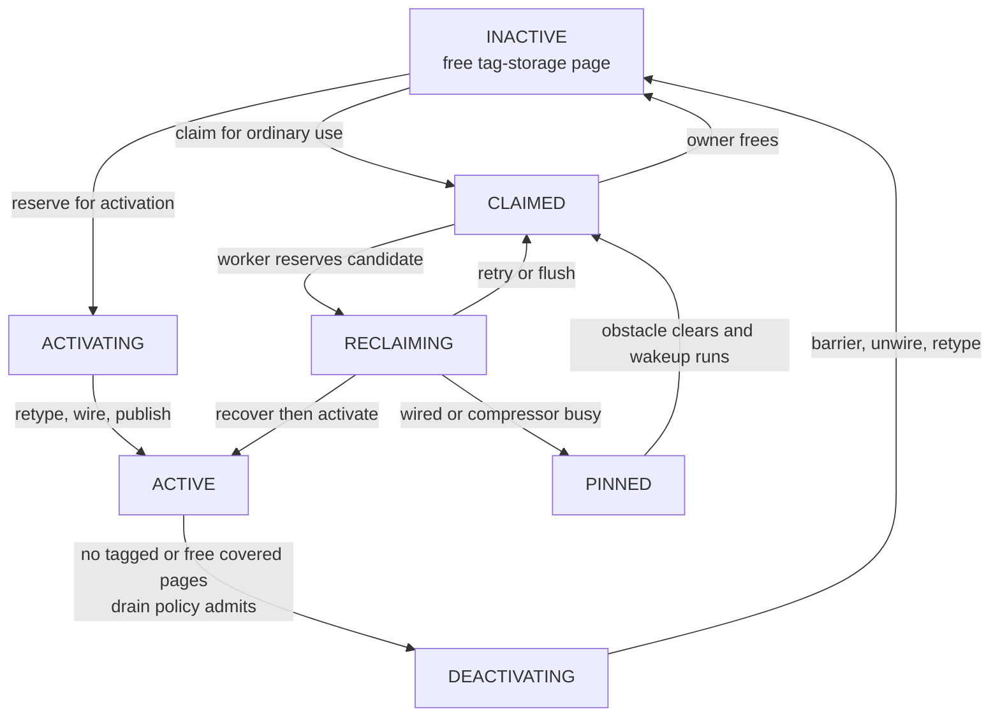

# MTE tag storage and the physical-page lifecycle

[VM overview](README.md) · [Objects and pages](objects-and-pages.md) · [Reclamation](reclaim-and-pressure.md) · [SPTM](../security/sptm.md) · [Bootstrap memory](../platform/bootstrap-memory-and-lockdown.md)

A tagged allocation needs both its ordinary data pages and physical storage for their allocation tags. XNU cannot turn an arbitrary free page into a tagged page merely by changing a mapping: the physical tag backing that covers it must be available first. This chapter follows that backing from boot through allocation, borrowing for ordinary contents, relocation and return to tag storage. It documents the `HAS_MTE` VM machinery and the local SPTM pmap implementation in `xnu-12377.121.6`; process enablement, tag-fault delivery and the monitor's enforcement code are separate boundaries. [Implementation and scope](../../../xnu/osfmk/vm/vm_mteinfo.c#L53-L89), [SPTM frame conversion](../../../xnu/osfmk/arm64/sptm/pmap/pmap.c#L2333-L2355).

## 1. Separate the data page, its tags and the backing page

The implementation uses `MTE_PAGES_PER_TAG_PAGE == 32`: one tag-storage page covers 32 data pages. The tag-storage region is supplied through `SPTMArgs->first_tag_storage_paddr` and `n_tag_storage_frames`; pmap checks the count against the DRAM size and exports its physical boundaries. It also derives recursive, unmanaged and memory-cap-discarded subranges. Tag-storage pages do not themselves become MTE-tagged data pages. Storage covering storage, or memory that will not be managed/tagged, therefore has a different policy from storage covering live ordinary pages. [Ratio](../../../xnu/osfmk/arm64/proc_reg.h#L3407), [region adoption and classification](../../../xnu/osfmk/arm64/sptm/pmap/pmap.c#L2410-L2494).

Three identities must remain distinct:

| Identity | Representation and meaning |
|---|---|
| Covered data page | Physical page number and canonical `vm_page`; may be in use or free, tagged or regular. |
| Tag-storage page | Another physical page, with its own canonical `vm_page`, lying in the dedicated physical region. It can temporarily hold ordinary contents. |
| Cell | Twelve bytes of VM metadata describing one tag-storage page and the 32 pages it covers. It is neither a page-table entry nor the tags themselves. |

For a physical page number `p`, the cell index is `(p - pmap_first_pnum) / 32`. The corresponding tag-storage descriptor is `vm_tag_storage_page_get(index)`. Conversely, a cell's first covered page is `pmap_first_pnum + index * 32`. The pmap-side equivalent starts from `gDramBase` and adds the derived index to `mte_tag_storage_start_pnum`. These are physical relationships; neither task virtual addresses nor VM-object offsets choose the tag-storage page. [Cell conversions](../../../xnu/osfmk/vm/vm_mteinfo.c#L1210-L1241), [inverse conversion](../../../xnu/osfmk/vm/vm_mteinfo.c#L675-L681), [pmap conversions](../../../xnu/osfmk/arm64/sptm/pmap/pmap.c#L2363-L2385).

**Worked geometry, with 16 KiB software pages.** Choose a data page `p = pmap_first_pnum + 32 * 10 + 7`. Its cell is 10; the tag-storage frame is `mte_tag_storage_start_pnum + 10`. That frame covers 512 KiB of data, and the tags for the selected page occupy the 512-byte slice beginning at offset `7 * 512 = 3584` in that frame. The debug helper computes exactly `(PAGE_SIZE / 32) * ((p - pmap_first_pnum) % 32)`. This calculation does not imply that callers may directly write monitor-owned tag storage through an arbitrary mapping. [Debug tag-location helper](../../../xnu/osfmk/vm/vm_mteinfo.c#L1583-L1605).



`pmap_is_tagged_page()` tests physical cache attributes, while `pmap_is_tagged_mapping()` tests a particular translation. A physical page can still be tagged when the caller's particular mapping does not check tags. At the VM layer, `vmp_using_mte` tracks the page's current tagging state. Do not equate any of these with a `kalloc_type` segregation class: [typed allocation](typed-allocation.md) concerns which allocations share zones/heaps. [Page and mapping tests](../../../xnu/osfmk/arm64/sptm/pmap/pmap.c#L2283-L2330).

## 2. Cells, queues and memory classes answer different questions

The exact cell layout is small because only tag-storage pages need this additional metadata. [Cell definition, vm_mteinfo.c:428–445](../../../xnu/osfmk/vm/vm_mteinfo.c#L428-L445):

<!-- source-excerpt: ../../../xnu/osfmk/vm/vm_mteinfo.c#L428-L445 -->
```c
#pragma pack(4)
typedef struct {
	cell_idx_t              prev : MTE_FF_CELL_INDEX_BITS;
	cell_idx_t              next : MTE_FF_CELL_INDEX_BITS;
	cell_count_t            enqueue_pos : MTE_FF_CELL_PAGE_COUNT_BITS;
	cell_count_t            mte_page_count : MTE_FF_CELL_PAGE_COUNT_BITS;
	mte_cell_state_t        state : MTE_FF_CELL_STATE_BITS;
	uint8_t                 __unused_bits : 1;
	union {
		uint32_t        free_mask;
		uint32_t        cell_count;
	};
} cell_t;
#pragma pack()

static_assert(sizeof(cell_t) == 12);
static_assert(MTE_STATE_ACTIVE < (1u << MTE_FF_CELL_STATE_BITS));
static_assert(MTE_PAGES_PER_TAG_PAGE <= (1 << MTE_FF_CELL_PAGE_COUNT_BITS));
```

`free_mask` has one bit per free covered page, whether that page is currently tagged or not. `mte_page_count` counts **in-use tagged** covered pages. Thus `popcount(free_mask) + mte_page_count <= 32`; the remaining covered pages are in use without tags. A free page may retain `vmp_using_mte`, so it contributes to `free_mask`, not `mte_page_count`. `enqueue_pos` identifies the one free covered page whose `vmp_pageq` linkage represents this cell in the allocation queues. [Field invariants](../../../xnu/osfmk/vm/vm_mteinfo.c#L391-L426), [allocation-queue representation](../../../xnu/osfmk/vm/vm_mteinfo.c#L759-L873).

There are two independent queue organizations:

- `mte_info_lists[]` organizes **cells/tag-storage candidates** by state. INACTIVE, CLAIMED and ACTIVE-with-zero-tagged-users have five free-covered-page buckets: 0, 1–8, 9–16, 17–24 and 25–32. ACTIVE cells with tagged users occupy a separate list. This is how the refill worker finds profitable backing to activate or reclaim.
- `mte_free_queues[]` organizes **free covered data pages**, through the representative linkage above. Its index expresses the preference for ordinary versus tagged allocations; color subqueues retain the VM's page-color selection. It is not a second list of all 32 descriptors.

`CELL_UPDATE` coordinates cell-list and free-queue changes. The state list uses `(free_count + 7) / 8` for bucket selection; the free-queue index uses a separate policy combining state, free pages, tagged users and untagged users. [Lists and update machinery](../../../xnu/osfmk/vm/vm_mteinfo.c#L1034-L1207), [free-queue policy](../../../xnu/osfmk/vm/vm_mteinfo.c#L882-L934).

| Cell state | What owns the physical tag-storage page |
|---|---|
| `DISABLED` | Excluded from dynamic tag-storage selection: startup/unmanaged/recursive or retired cases need distinguishing. This state alone does not say the physical page is allocatable. |
| `INACTIVE` | Free backing, typed `XNU_DEFAULT`; eligible either for activation or for borrowing as ordinary memory. |
| `ACTIVATING` | Reserved by an activator, not yet published as usable tag backing. |
| `ACTIVE` | Typed `XNU_TAG_STORAGE`, wired into `mte_tags_object`; covered pages may be allocated tagged. |
| `DEACTIVATING` | Removed from the usable active pool; tag-state synchronization and backing teardown are in progress. |
| `CLAIMED` | Borrowed for a non-tag-storage use, including a per-CPU claimed-free queue or ordinary object contents. |
| `RECLAIMING` | A worker is attempting to recover a claimed page, possibly by moving its contents. |
| `PINNED` | Recovery found a long-lived obstacle; `vmp_ts_wanted` requests notification when it clears. |

These states describe the tag-storage page, not the state of each covered page. Untagged covered pages may be allocated in any cell state; tagged allocations require ACTIVE. [State contracts](../../../xnu/osfmk/vm/vm_mteinfo_internal.h#L50-L137).

The separate `vm_memory_class_t` distinguishes REGULAR, TAGGED, TAG_STORAGE and DEAD_TAG_STORAGE. TAG_STORAGE identifies a page participating in the backing lifecycle even while CLAIMED. DEAD_TAG_STORAGE represents recursive/unmanaged backing that can be used as ordinary untaggable memory; it can be wired without risking future tag-backing starvation. Mere physical membership in the tag region does not establish the class. [Memory classes](../../../xnu/osfmk/vm/vm_page.h#L155-L204), [classification](../../../xnu/osfmk/vm/vm_resident.c#L614-L670).

## 3. Boot creates metadata before publishing usable backing

The SPTM-side RAM initialization preserves the tag region in the managed page-descriptor span. A `maxmem` override cannot simply truncate the ordinary physical endpoint when that would discard the tag-storage descriptors; instead it adjusts availability and discarded storage in aligned groups. `KASAN_TBI` has an explicit exceptional path in which SPTM supplied tag storage before tag checking was disabled; the code accepts that lost DRAM. [RAM initialization](../../../xnu/osfmk/arm64/sptm/pmap/pmap.c#L2410-L2494), [VM memory-cap choice](../../../xnu/osfmk/arm64/sptm/arm_init_sptm.c#L1790-L1820).

`vm_map_steal_memory()` calls `mteinfo_init()` before ordinary VM pages are represented. The latter uses `pmap_steal_memory()` for cells and queue heads, initializes every cell DISABLED, and builds the colored free queues. When `pmap_startup()` creates the linear `vm_pages` array it identifies the tag-storage slice within it. These are two allocations: the cell array is separate from the canonical page-descriptor array. [Early metadata allocation](../../../xnu/osfmk/vm/vm_map.c#L1892-L1906), [cell initialization](../../../xnu/osfmk/vm/vm_mteinfo.c#L3052-L3110), [descriptor slice](../../../xnu/osfmk/vm/vm_resident.c#L2747-L2762).

Each storage descriptor reaches `mteinfo_tag_storage_release_startup()` through `vm_page_release_startup()`. The handler checks monitor frame type, retires discarded storage, classifies recursive/unmanaged storage, and counts already-tagged covered pages. It retains backing required by those pages and tries to preserve an initial active pool of approximately one eighth of eligible storage, preferentially where all 32 covered pages are free. Other backing is retyped to default and becomes INACTIVE or ordinary dead storage. This is a startup target and selection rule, not a guarantee of exact occupancy. [Startup release](../../../xnu/osfmk/vm/vm_resident.c#L5938-L5956), [startup decisions](../../../xnu/osfmk/vm/vm_mteinfo.c#L3139-L3202).

Active startup descriptors first accumulate on `mte_tag_storage_startup_list`. The `KMEM` startup callback wires/inserts them only after the special VM object exists. `PERCPU` initializes claimed-page ticket locks/queues; `EARLY_BOOT` creates `VM_mte_fill` at `BASEPRI_VM`. Later `LOCKDOWN` discovery excludes tag storage covering unmanaged physical holes, while preserving storage with tagged users. [Object initialization](../../../xnu/osfmk/vm/vm_object.c#L598-L604), [startup callbacks](../../../xnu/osfmk/vm/vm_mteinfo.c#L3219-L3278), [unmanaged discovery](../../../xnu/osfmk/vm/vm_mteinfo.c#L3281-L3347).

## 4. A tagged allocation reserves accounting before changing pmap state

`vm_page_grab_options()` and its slow path choose a memory class. An MTE request needs free **taggable** capacity as well as ordinary free capacity and the applicable reserve. Under shortage, `vm_page_grab_slow()` can attempt inline activation, but not while its caller holds the page-queue lock. A successful attempt may have dropped the free lock, so the caller restarts its selection rather than using stale counts or a stale per-CPU pointer. [Slow-path admission/restart](../../../xnu/osfmk/vm/vm_resident.c#L5093-L5189).

Inside `mteinfo_free_queue_grab()` ordinary allocation takes the lowest available queue index. Tagged allocation filters the mask to ACTIVE buckets and takes the highest. The policy tries to concentrate tagged use where backing is already worthwhile and avoid wasting that capacity on ordinary allocations. The exact ACTIVE scoring is `n = tagged + free/5; n -= MIN(n, used)/3; index = ACTIVE_0 + fls(n/4)`. It is an allocation heuristic, not a correctness condition. [Policy](../../../xnu/osfmk/vm/vm_mteinfo.c#L882-L934), [selection](../../../xnu/osfmk/vm/vm_mteinfo.c#L2775-L2850).

After selecting a representative, the allocator removes a run of free covered pages, clears mask bits, sets queue state, updates `vm_page_free_count` and `vm_page_free_taggable_count`, and increments `mte_page_count` for tagged allocation. It then requeues the cell and remaining free representative. The returned list is reversed by this checkout to avoid exposing long contiguous runs to driver paths mentioned in the source; contiguous physical allocation is not this API's promise. [Removal/accounting/list reversal](../../../xnu/osfmk/vm/vm_mteinfo.c#L2852-L2937).

Tagging itself is deferred until `mteinfo_page_list_fix_tagging()`, with preemption disabled. It submits a `unified_page_list_t` batch to `pmap_make_tagged_pages()` or `pmap_unmake_tagged_pages()` and updates each page's `vmp_using_mte`. The allocation loop has already reserved the corresponding accounting while it holds the free lock. [Tag adjustment](../../../xnu/osfmk/vm/vm_mteinfo.c#L2991-L3026), [caller after free-lock release](../../../xnu/osfmk/vm/vm_resident.c#L5210-L5238).

### Pmap publishes cache attributes and the physical-aperture change

The SPTM backend's `pmap_tag_op()` drains pmap epochs, walks the unified page list, skips fictitious/invalid pages and filters redundant changes using the available `vm_page`. The VM contract requires prior mappings to be disconnected and prevents new mappings during conversion; this is why the helper does not acquire a PV-head lock for each attribute update. It atomically replaces the WIMG bits in `pp_attr_table`, then collects physical addresses in a per-CPU SPTM buffer with preemption disabled. Full batches and the tail call `sptm_tag_papt_multipage()` or `sptm_untag_papt_multipage()`. The VM's later `vmp_using_mte` update records completion; it is not itself the hardware change. [Pmap batching and caller contract](../../../xnu/osfmk/arm64/sptm/pmap/pmap.c#L2117-L2220).

Changing a **covered page's tagging/cache state** uses this operation. Changing the **backing frame's ownership type** uses `pmap_make_tag_storage_page()` / `pmap_unmake_tag_storage_page()`. Keeping those separate explains why activation, tagging, untagging and deactivation have four distinct places in the lifecycle. [Tagging wrappers](../../../xnu/osfmk/arm64/sptm/pmap/pmap.c#L2222-L2249), [backing conversion](../../../xnu/osfmk/arm64/sptm/pmap/pmap.c#L2333-L2355).

### Why ordinary reuse needs a cross-CPU deactivation barrier

Suppose the last tagged user frees a data page. It can stay physically tagged on the free queue. An ordinary allocation clears its free bit without incrementing `mte_page_count`, then must remove its physical tagging. In that interval neither count represents the still-tagged page. Without additional synchronization, another CPU could observe zero tagged users and retype its backing too soon.

The allocator sets the current CPU's `deactivate_suspend` before releasing that vulnerable state. The same CPU must finish the pmap batch, clear `vmp_using_mte`, and release-store zero to the suspension flag. Deactivation waits for other CPUs' flags, then uses a sequentially consistent fence. Its own CPU is excluded because it must complete its pending untagging before attempting deactivation. [Suspension setup and invariant](../../../xnu/osfmk/vm/vm_mteinfo.c#L2938-L2972), [cross-CPU barrier](../../../xnu/osfmk/vm/vm_mteinfo.c#L1913-L1943).

The ordering-sensitive completion is explicit in [vm_mteinfo.c:3003–3014](../../../xnu/osfmk/vm/vm_mteinfo.c#L3003-L3014):

<!-- source-excerpt: ../../../xnu/osfmk/vm/vm_mteinfo.c#L3003-L3014 -->
```c
	if (class == VM_MEMORY_CLASS_REGULAR && list->vmpl_has_tagged) {
		pmap_unmake_tagged_pages(&pmap_batch_list);
		vm_page_list_foreach(mem, *list) {
			mem->vmp_using_mte = false;
		}

		/*
		 * Invariants related to tagged pages are resolved,
		 * we can allow deactivations again.
		 */
		os_atomic_store(&vmp_pcpu->deactivate_suspend, 0, release);
	}
```



The diagram isolates this one race; it does not replace the free-page, object and page-queue locking around the full operations.

## 5. Activation changes frame ownership before publishing ACTIVE

Inline activation only considers INACTIVE candidates with at least 17 free covered pages. It serializes low-priority activators through `vm_mte_activator`. A competing allocator with enough capacity can continue; one that cannot progress sleeps with the activator as inheritor, avoiding an unbounded priority inversion behind a low-priority thread. The dedicated refill worker uses its own high-priority execution path. [Inline activation and inheritance](../../../xnu/osfmk/vm/vm_mteinfo.c#L1814-L1863).

Selection changes INACTIVE to ACTIVATING under the free lock and removes candidate descriptors into a private list. `mteinfo_tag_storage_activate_locked()` then:

1. Drops the free-page lock and calls `pmap_make_tag_storage_page()` for every selected physical page.
2. Takes `mte_tags_object` and page-queue locks, wires each descriptor, and inserts it at an object offset equal to its **physical byte address**.
3. Reacquires the free-page lock in the caller's requested mode, publishes ACTIVE, and recomputes newly taggable free pages.
4. Wakes activation waiters, privileged tagged waiters, then ordinary tagged waiters according to available capacity.

While the free lock was dropped, ordinary covered-page allocation/free could proceed. The selected candidate's original free count is therefore not the final capacity increase. [Selection](../../../xnu/osfmk/vm/vm_mteinfo.c#L1656-L1693), [activation](../../../xnu/osfmk/vm/vm_mteinfo.c#L1711-L1811), [object identity](../../../xnu/osfmk/vm/vm_mteinfo.c#L1625-L1635).

The publication step deliberately follows frame conversion and wiring. [vm_mteinfo.c:1741–1760](../../../xnu/osfmk/vm/vm_mteinfo.c#L1741-L1760):

<!-- source-excerpt: ../../../xnu/osfmk/vm/vm_mteinfo.c#L1741-L1760 -->
```c
	if (spin_mode) {
		vm_free_page_lock_spin();
	} else {
		vm_free_page_lock();
	}

	/*
	 * Second, mark all the pages as active now, which makes the
	 * covered pages available for taggable allocation.
	 *
	 * And recompute how many taggable pages we really freed,
	 * as allocations/free of untagged pages could have made
	 * progress while we dropped the free page queue lock.
	 */

	total = 0;
	vm_page_list_foreach_consume(tag_page, &list) {
		total += mteinfo_tag_storage_set_active(tag_page, 0, false);
	}
	result = total;
```

The SPTM pmap helper drains pmap epochs before `sptm_retype(pa, XNU_DEFAULT, XNU_TAG_STORAGE, ...)`; the inverse helper likewise drains before restoring `XNU_DEFAULT`. These waits address in-flight pmap operations. They are additional to the VM deactivation-suspension protocol, which protects data pages pending untagging. The monitor's retype validation remains outside this checkout. [Epoch and retype helpers](../../../xnu/osfmk/arm64/sptm/pmap/pmap.c#L2333-L2355).

## 6. Borrowing backing for ordinary contents and reclaiming it

Idle tag-storage pages need not remain unusable RAM. The claimable count is the larger of (a) INACTIVE cells covering 0–8 free pages and (b) total INACTIVE cells above `vm_page_tag_storage_inactive_target`. It does not reserve every inactive page for tagging. When a CPU's claimed-free queue is empty and at least one full batch is claimable, refill transfers INACTIVE pages with the fewest free covered pages into that queue. It changes cells to CLAIMED, records `vmp_local_id`, and protects that queue with `free_claimed_lock`. A page may therefore be CLAIMED while still free for an eligible consumer. [Claimable count and refill gate](../../../xnu/osfmk/vm/vm_mteinfo.c#L2683-L2731), [per-CPU publication](../../../xnu/osfmk/vm/vm_mteinfo.c#L2744-L2772).

Consumers must opt into `VM_PAGE_GRAB_ALLOW_TAG_STORAGE`. Locally visible users include compressor pool allocations with `KMA_COMPRESSOR` and selected untagged VM allocation tags in fault paths. The `mte_ts_compressor`, `mte_ts_vmtag` and `mte_ts_grab` controls change eligibility. Permission to borrow backing is not permission to use it as tagged data. [Compressor allocation](../../../xnu/osfmk/vm/vm_resident.c#L8689-L8702), [fault eligibility](../../../xnu/osfmk/vm/vm_fault.c#L1216-L1224), [tunables](../../../xnu/osfmk/vm/vm_mteinfo.c#L485-L540), [grab contract](../../../xnu/osfmk/vm/vm_page.h#L1662-L1680).

To recover a candidate, `mteinfo_reclaim_tag_storage_page()` first marks RECLAIMING under the free lock. If it appears on a CPU's claimed-free queue, the worker locks that queue and rechecks both `vmp_q_state` and CPU ID before removing it. A lockless glimpse alone is not enough to steal the page. [Per-CPU steal](../../../xnu/osfmk/vm/vm_mteinfo.c#L2069-L2097), [reclaim entry](../../../xnu/osfmk/vm/vm_mteinfo.c#L2137-L2158).

For ordinary object contents, it drops the free lock, takes the page-queue lock to stabilize the page-to-object association, and **try-locks** the object because this is the inverse of normal lock ordering. It rechecks the association after acquiring that lock. Compressor pages are different: the stable special object permits taking the compressor replacement lock and `compressor_object` first, followed by a state recheck and page-queue lock. [Lock ordering and revalidation](../../../xnu/osfmk/vm/vm_mteinfo.c#L2162-L2239).

`vm_page_relocate(..., VM_RELOCATE_REASON_TAG_STORAGE_RECLAIM, ...)` either discards recoverable contents or allocates a replacement page. For contents that must survive, it disconnects mappings, copies bytes, transfers relevant state, removes the old descriptor from its object and inserts the replacement at the same object offset. Compressor backing additionally reinstalls the kernel mapping of the replacement at its compressor-object offset. **The object and logical contents can survive while the physical storage returns to the tag pool.** [Relocation checks and allocation](../../../xnu/osfmk/vm/vm_resident.c#L7497-L7614), [replacement publication](../../../xnu/osfmk/vm/vm_resident.c#L7615-L7748).



Reclaim failure is part of the protocol:

| Outcome | State and next action |
|---|---|
| Wired page or busy compressor page | Under the free lock, set `vmp_ts_wanted` before publishing PINNED. A later completion/unwire/free path calls `mteinfo_tag_storage_wakeup()` and restores CLAIMED. |
| Object try-lock failure or association race | Return a retry result; restore CLAIMED if the cell still belongs to this reclaim attempt. |
| No replacement page | Return `KERN_RESOURCE_SHORTAGE`; the worker can wait for regular VM capacity and flush its pending reclaim list. |
| Other temporary nonrelocatable state | Do not force the page out of its actual owner/state; remaining RECLAIMING entries are restored by the worker's flush. |
| Concurrent free/reallocation while locks were dropped | Revalidate cell/page state; success can require restoring RECLAIMING before passing the detached page to activation. |

The code handles PINNED notification specifically for wiring and busy compressor pages; its TODO lists additional temporary obstacles that do not yet use that notification mechanism. Avoid describing every relocation failure as a watched pin. [Pinned publication and limitation](../../../xnu/osfmk/vm/vm_mteinfo.c#L2241-L2311), [completion/retry](../../../xnu/osfmk/vm/vm_mteinfo.c#L2340-L2406), [wakeup](../../../xnu/osfmk/vm/vm_mteinfo.c#L1467-L1493), [reclaim flush](../../../xnu/osfmk/vm/vm_mteinfo.c#L1436-L1461).

## 7. The fill worker balances taggable capacity and ordinary reuse

`VM_mte_fill` runs activation/refill and then draining, under the free-page lock in spin mode where required to pin per-CPU state. Helpers intentionally drop/reacquire that lock around object work, monitor operations or waits. Its scheduler condition consolidates wakeups; it eventually waits through a continuation. [Worker](../../../xnu/osfmk/vm/vm_mteinfo.c#L2606-L2664).

Refill stops when taggable free pages reach the ordinary free target. Below that target it proceeds for tagged reserve shortage, tagged waiters, or sufficiently healthy total free memory. It compares the best INACTIVE and CLAIMED buckets: activation is cheaper than relocating equivalent backing, and an INACTIVE candidate with more than half its covered pages free is preferred even against a more populated CLAIMED bucket. No profitable candidate means parking until state changes, rather than repeatedly waiting on an unrelated generic free-page count. [Refill predicate](../../../xnu/osfmk/vm/vm_mteinfo.c#L2424-L2447), [candidate choice and no-progress exit](../../../xnu/osfmk/vm/vm_mteinfo.c#L2466-L2553), [resource-shortage wait](../../../xnu/osfmk/vm/vm_mteinfo.c#L2562-L2588).

Drain goes the other way. It selects ACTIVE cells with **zero tagged users and zero free covered pages**: all covered pages are currently used without tags, so the backing is doing no useful tag work. It preserves configured reserves and only drains when the claimable pool needs replenishment. After marking DEACTIVATING, it performs the cross-CPU barrier, removes wiring/object membership, retypes to default and publishes INACTIVE via the TAG_STORAGE free path. It does not free a backing page while any covered tagged allocation remains live. [Drain eligibility](../../../xnu/osfmk/vm/vm_mteinfo.c#L1879-L1896), [selection](../../../xnu/osfmk/vm/vm_mteinfo.c#L2013-L2050), [teardown](../../../xnu/osfmk/vm/vm_mteinfo.c#L1954-L1996).



This diagram shows the dynamic cycle. Startup DISABLED, retirement and concurrent-free branches are explained separately above; not every ACTIVE page is a drain candidate.

## 8. Compressing tags differs from borrowing backing for the compressor

Two independent interactions use the word compressor:

1. **The compressor pool borrows a tag-storage frame for compressed bytes.** That frame is CLAIMED, has no covered tagged users, and can be relocated as described above. This is physical-capacity reuse.
2. **A tagged data page is compressed.** Its tag values must survive along with its bytes, even though the original resident page and tag backing may later be reused. The compressor slot records `c_mte_size` and appends the encoded tag stream after the compressed page bytes. This is preservation of logical contents.

`compress_mte_tags()` reads allocation tags into a temporary bulk-tag buffer and calls `vm_mte_rle_compress_tags()`. The result is either a compressed stream size, the full uncompressed size, or a value above `C_MTE_SIZE` encoding a uniform tag with no payload bytes. `vm_mte_compressed_tags_actual_size()` resolves that representation before sizing/moving slot contents. The compressor reserves worst-case tag space before ordinary page compression and accounts for the actual extra size afterward. [Bulk extraction/restore](../../../xnu/osfmk/vm/vm_compressor.c#L5083-L5137), [encoding and actual-size conversion](../../../xnu/osfmk/arm64/vm_mte_compress.c#L283-L335), [reservation](../../../xnu/osfmk/vm/vm_compressor.c#L5193-L5207), [slot publication](../../../xnu/osfmk/vm/vm_compressor.c#L5349-L5366).

On decompression, tags are restored only when present and `C_MTE_DROP_TAGS` is clear. Invalid tag encoding has its own failure result; ordinary data decompression success is insufficient. The bulk helpers also contain a KASAN incompatibility panic path. This chapter does not enumerate the RLE bytecode or every compressor recovery policy; [compressor segments and swapfiles](compressor-segments-and-swapfiles.md) follows storage movement and backing lifetime. [Tag-restore decision](../../../xnu/osfmk/vm/vm_compressor.c#L5859-L5875).

## 9. Configuration and verification boundaries

| Selection or evidence | Meaning for this trace |
|---|---|
| `HAS_MTE` and runtime `mte_enabled()` | Build support and active runtime machinery are separate; neither follows solely from ARM64. [VM gate](../../../xnu/osfmk/vm/vm_mteinfo.c#L53), [startup gate](../../../xnu/osfmk/vm/vm_mteinfo.c#L3260-L3278). |
| Local SPTM pmap | Supplies frame-type conversion and tagged-page operations. This chapter does not infer equivalent legacy/PPL behavior from those calls. [Retype interface](../../../xnu/osfmk/arm64/sptm/pmap/pmap.c#L2333-L2355). |
| MTE allocation-policy tunables | Enable borrowing and choose reserves/eligible VM tags; defaults are policy, not geometry. [Tunables](../../../xnu/osfmk/vm/vm_mteinfo.c#L485-L540). |
| `tests/vm/vm_mteinfo.c` | Includes selected implementation through `VM_MTE_FF_VERIFY` with mocked kernel surroundings; tests cell/list migrations and candidate selection. It does not execute concurrent monitor retyping. [Harness inclusion](../../../xnu/tests/vm/vm_mteinfo.c#L53-L80), [tests](../../../xnu/tests/vm/vm_mteinfo.c#L523-L710). |
| `tests/vm/vm_mte_reclamation.c` | Invokes kernel sysctl tests under specified boot arguments for compressor/VM-tag borrowing. [Cases](../../../xnu/tests/vm/vm_mte_reclamation.c#L61-L136), [kernel implementation](../../../xnu/osfmk/vm/vm_mte_tests.c#L46-L108). |
| `tests/arm_mte_compress.c` | Contains codec round trips, malformed-stream cases and separate active compressor scenarios. [Codec tests](../../../xnu/tests/arm_mte_compress.c#L363-L463), [active-test boundary](../../../xnu/tests/arm_mte_compress.c#L523-L545). |

The VM-tag test metadata uses `mte_ts_vm_tag`, whereas the inspected tunable is spelled `mte_ts_vmtag`. That discrepancy must be resolved before treating those boot-argument cases as evidence that the intended policy was selected. [Test metadata](../../../xnu/tests/vm/vm_mte_reclamation.c#L85-L119), [actual tunable](../../../xnu/osfmk/vm/vm_mteinfo.c#L539-L540).

The source paths and test bodies were inspected; no kernel boot, pressure workload or MTE test binary was executed. Hardware tag checking, monitor-internal ownership enforcement, every page-retirement branch and the full compression bytecode remain outside this chapter.

<!-- BEGIN PLATYDOC DOCUMENTATION LICENSE -->
Original Platydoc text and diagrams are licensed under [CC BY 4.0](https://creativecommons.org/licenses/by/4.0/). Quoted source code and third-party material retain their respective licenses.
<!-- END PLATYDOC DOCUMENTATION LICENSE -->
