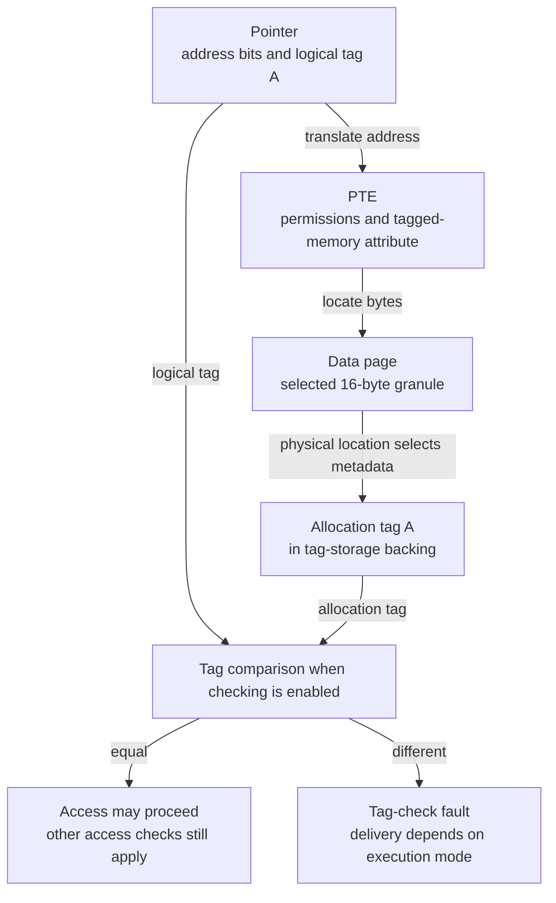
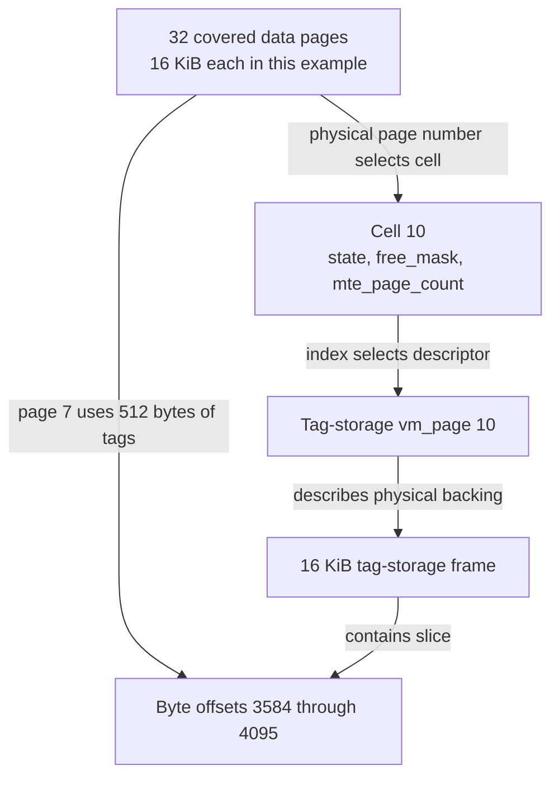
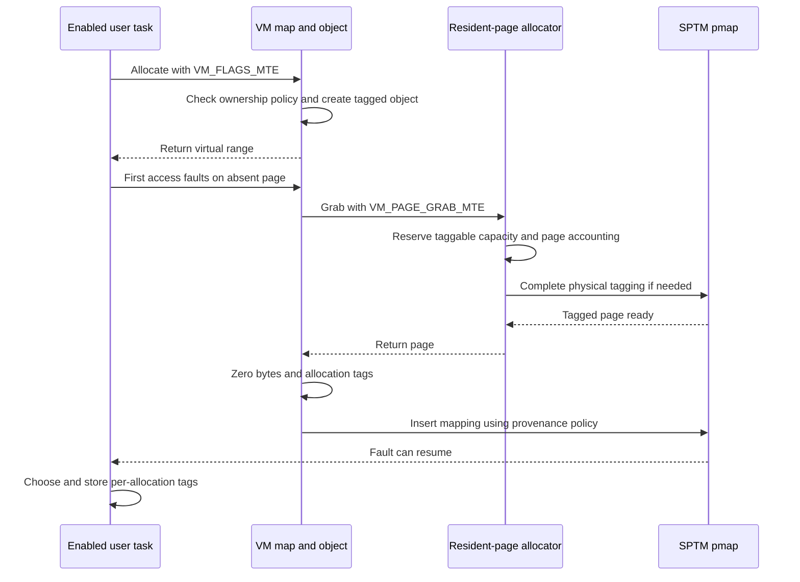
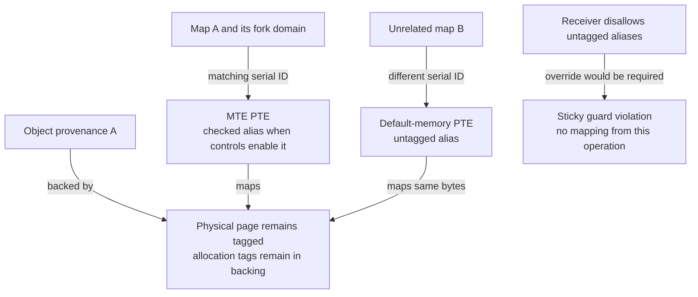
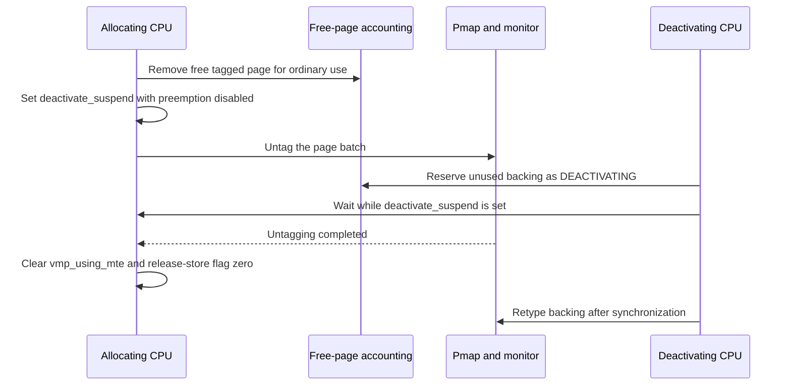
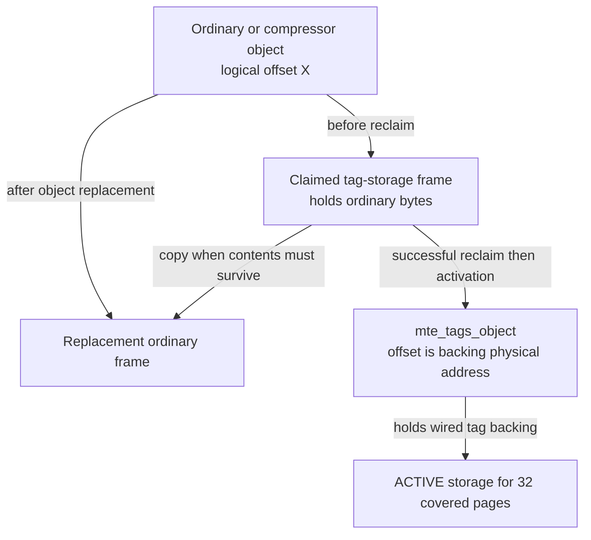
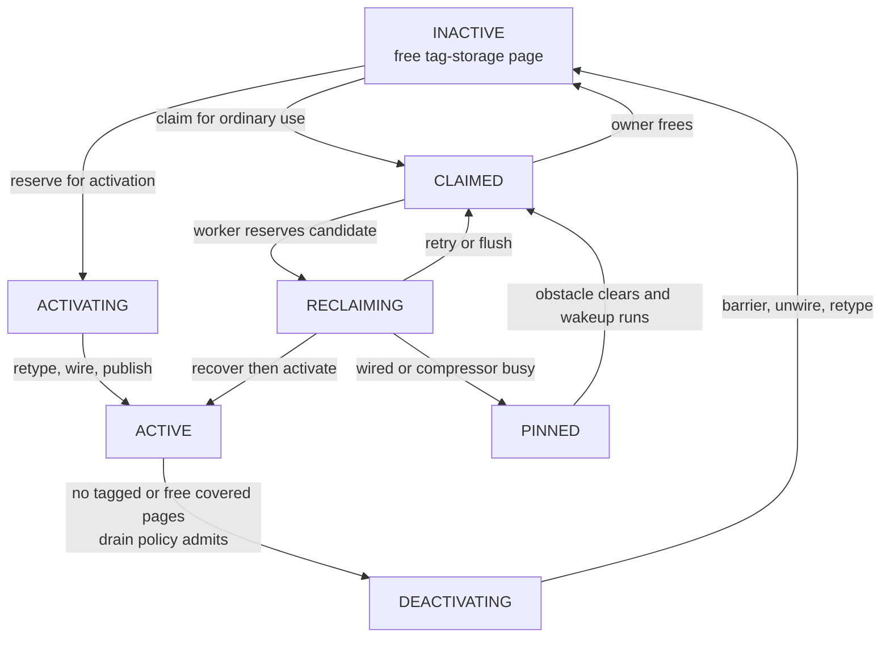
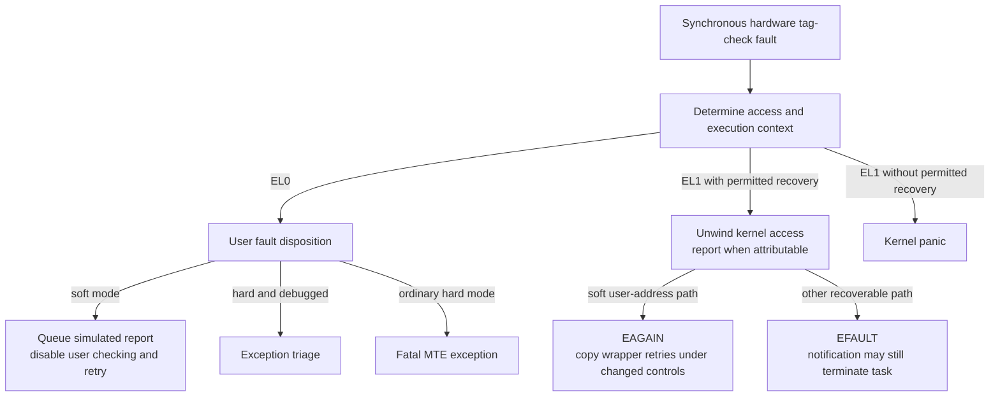

# MTE tag storage and the physical-page lifecycle

[VM overview](README.md) · [Objects and pages](objects-and-pages.md) · [Reclamation](reclaim-and-pressure.md) · [SPTM](../security/sptm.md) · [Bootstrap memory](../platform/bootstrap-memory-and-lockdown.md)

Memory Tagging Extension (MTE) checks whether a pointer carries the tag expected by the memory it accesses. XNU uses that check as a mitigation for accesses outside an allocation and accesses through stale pointers, while VM preserves the tags through page faults, copying, compression and physical reuse. A tagged allocation therefore needs both ordinary data pages and physical storage for their allocation tags. This chapter follows the mitigation from its pointer representation and mapping policy down to backing-cell ownership, activation and reclamation. It documents the `HAS_MTE` VM machinery and local SPTM pmap implementation in `xnu-12377.121.6`; the monitor's enforcement body and external user allocators remain boundaries. [Implementation and scope](../../../platydoc-data/xnu/osfmk/vm/vm_mteinfo.c#L53-L89), [SPTM frame conversion](../../../platydoc-data/xnu/osfmk/arm64/sptm/pmap/pmap.c#L2333-L2355).

## What MTE checks, and what XNU must preserve

An ordinary translated address answers **which byte is being accessed**. A tagged pointer additionally carries a four-bit *logical tag*. Tagged memory stores a four-bit *allocation tag* for each 16-byte granule. When the selected mapping and execution controls enable checking, the access must use the tag stored for that granule. Changing the tag stored for reused memory can make an old pointer fail even though its address still translates to a valid page. Placing different tags on adjacent allocations can expose a boundary-crossing access. XNU's pointer layout and tag-store helpers make these two representations explicit. [Pointer layout and canonicalization](../../../platydoc-data/xnu/osfmk/vm/vm_memtag.h#L151-L201), [16-byte granules and tag stores](../../../platydoc-data/xnu/osfmk/arm64/mte.h#L66-L110), [runtime enablement requirement](../../../platydoc-data/xnu/osfmk/arm64/mte.h#L48-L53).

This is a conditional, finite-tag mitigation. An access inside the same tagged granule, an adjacent allocation with the same tag, or a stale pointer whose tag later matches a reused allocation is not distinguished by the tag comparison. Nor does a tag check establish a C type, a reference count, or the validity of an object's internal fields. These limits follow from the four-bit, 16-byte representation; they are not a claim about measured detection probabilities. [Type isolation](typed-allocation.md), page permissions and [SPTM mapping types](../security/sptm.md) constrain different operations and remain necessary.

The pointer helper's representation is worth reading literally. The tag occupies bits 59:56; the upper four bits and lower 56 bits remain distinct. Canonicalizing a pointer replaces the tag nibble with the appropriate canonical value; it does **not** fetch the allocation tag or change the tags stored in memory. [vm_memtag.h:151–165](../../../platydoc-data/xnu/osfmk/vm/vm_memtag.h#L151-L165):

<!-- source-excerpt: ../../../platydoc-data/xnu/osfmk/vm/vm_memtag.h#L151-L165 -->
```c
#define VM_MEMTAG_PTR_SIZE         56
#define VM_MEMTAG_TAG_SIZE          4
#define VM_MEMTAG_UPPER_SIZE        4

typedef uint8_t vm_memtag_t;

union vm_memtag_ptr {
	long value;

	struct {
		long ptr_bits:                  VM_MEMTAG_PTR_SIZE;
		vm_memtag_t ptr_tag:            VM_MEMTAG_TAG_SIZE;
		long ptr_upper:                 VM_MEMTAG_UPPER_SIZE;
	};
};
```

For an illustrative user address `0x0000000123400040`, tag `A` produces `0x0a00000123400040`. The 16-byte span beginning at the underlying address must have allocation tag `A` for a checked access through that pointer. A later retag of that span to `6` leaves the address portion unchanged but invalidates the old tagged pointer. This example assumes a tagged user mapping and active checking; using the same address through an intentionally untagged alias has different behavior, explained below. [Insert/extract helpers](../../../platydoc-data/xnu/osfmk/vm/vm_memtag.h#L167-L188), [tag replacement](../../../platydoc-data/xnu/osfmk/arm64/mte.h#L171-L190).



There are several separate decisions behind that diagram:

| State | What it decides |
|---|---|
| Platform support and `mte_enabled()` | Whether the MTE machinery is present and active. |
| Task security mode and thread/CPU controls | Whether user accesses and accesses performed for that task are checked, and how violations are handled. |
| `vm_object.wimg_bits == VM_WIMG_MTE` | Whether the VM object requires tagged resident pages. |
| `vm_page.vmp_using_mte` and physical `pp_attr_table` state | Whether a particular data page currently participates in tagging. |
| PTE tagged-memory attribute | Whether this **mapping** of the page uses MTE semantics. Foreign aliases can deliberately differ. |
| Stored allocation tags and logical pointer tag | Which granules the pointer is intended to access. VM does not choose every user allocation's tag. |
| `cell_t` and `mte_tags_object` | Whether the physical backing for those allocation tags can be used or reclaimed. |

The object/page consistency assertion excludes fictitious pages; an object flag alone is not a valid claim that a fictitious descriptor owns tagged physical RAM. `mte_tags_object` stores the **tag backing**, whereas `kernel_object_tagged` stores **tagged kernel data**. Confusing them reverses the ownership relationship. [Object predicates and assertions](../../../platydoc-data/xnu/osfmk/vm/vm_object_xnu.h#L447-L462), [special object initialization](../../../platydoc-data/xnu/osfmk/vm/vm_object.c#L597-L608), [page state](../../../platydoc-data/xnu/osfmk/vm/vm_page.h#L359-L382).

## 1. Separate the data page, its tags and the backing page

The implementation uses `MTE_PAGES_PER_TAG_PAGE == 32`: one tag-storage page covers 32 data pages. The tag-storage region is supplied through `SPTMArgs->first_tag_storage_paddr` and `n_tag_storage_frames`; pmap checks the count against the DRAM size and exports its physical boundaries. It also derives recursive, unmanaged and memory-cap-discarded subranges. Tag-storage pages do not themselves become MTE-tagged data pages. Storage covering storage, or memory that will not be managed/tagged, therefore has a different policy from storage covering live ordinary pages. [Ratio](../../../platydoc-data/xnu/osfmk/arm64/proc_reg.h#L3407), [region adoption and classification](../../../platydoc-data/xnu/osfmk/arm64/sptm/pmap/pmap.c#L2410-L2494).

Three identities must remain distinct:

| Identity | Representation and meaning |
|---|---|
| Covered data page | Physical page number and canonical `vm_page`; may be in use or free, tagged or regular. |
| Tag-storage page | Another physical page, with its own canonical `vm_page`, lying in the dedicated physical region. It can temporarily hold ordinary contents. |
| Cell | Twelve bytes of VM metadata describing one tag-storage page and the 32 pages it covers. It is neither a page-table entry nor the tags themselves. |

For a physical page number `p`, the cell index is `(p - pmap_first_pnum) / 32`. The corresponding tag-storage descriptor is `vm_tag_storage_page_get(index)`. Conversely, a cell's first covered page is `pmap_first_pnum + index * 32`. The pmap-side equivalent starts from `gDramBase` and adds the derived index to `mte_tag_storage_start_pnum`. These are physical relationships; neither task virtual addresses nor VM-object offsets choose the tag-storage page. [Cell conversions](../../../platydoc-data/xnu/osfmk/vm/vm_mteinfo.c#L1210-L1241), [inverse conversion](../../../platydoc-data/xnu/osfmk/vm/vm_mteinfo.c#L675-L681), [pmap conversions](../../../platydoc-data/xnu/osfmk/arm64/sptm/pmap/pmap.c#L2363-L2385).

**Worked geometry, with 16 KiB software pages.** Choose a data page `p = pmap_first_pnum + 32 * 10 + 7`. Its cell is 10; the tag-storage frame is `mte_tag_storage_start_pnum + 10`. That frame covers 512 KiB of data, and the tags for the selected page occupy the 512-byte slice beginning at offset `7 * 512 = 3584` in that frame. The debug helper computes exactly `(PAGE_SIZE / 32) * ((p - pmap_first_pnum) % 32)`. This calculation does not imply that callers may directly write monitor-owned tag storage through an arbitrary mapping. [Debug tag-location helper](../../../platydoc-data/xnu/osfmk/vm/vm_mteinfo.c#L1583-L1605).



`pmap_is_tagged_page()` tests physical cache attributes, while `pmap_is_tagged_mapping()` tests a particular translation. A physical page can still be tagged when the caller's particular mapping does not check tags. At the VM layer, `vmp_using_mte` tracks the page's current tagging state. Do not equate any of these with a `kalloc_type` segregation class: [typed allocation](typed-allocation.md) concerns which allocations share zones/heaps. [Page and mapping tests](../../../platydoc-data/xnu/osfmk/arm64/sptm/pmap/pmap.c#L2283-L2330).

## 2. Cells, queues and memory classes answer different questions

The exact cell layout is small because only tag-storage pages need this additional metadata. [Cell definition, vm_mteinfo.c:428–445](../../../platydoc-data/xnu/osfmk/vm/vm_mteinfo.c#L428-L445):

<!-- source-excerpt: ../../../platydoc-data/xnu/osfmk/vm/vm_mteinfo.c#L428-L445 -->
```c
#pragma pack(4)
typedef struct {
	cell_idx_t              prev : MTE_FF_CELL_INDEX_BITS;
	cell_idx_t              next : MTE_FF_CELL_INDEX_BITS;
	cell_count_t            enqueue_pos : MTE_FF_CELL_PAGE_COUNT_BITS;
	cell_count_t            mte_page_count : MTE_FF_CELL_PAGE_COUNT_BITS;
	mte_cell_state_t        state : MTE_FF_CELL_STATE_BITS;
	uint8_t                 __unused_bits : 1;
	union {
		uint32_t        free_mask;
		uint32_t        cell_count;
	};
} cell_t;
#pragma pack()

static_assert(sizeof(cell_t) == 12);
static_assert(MTE_STATE_ACTIVE < (1u << MTE_FF_CELL_STATE_BITS));
static_assert(MTE_PAGES_PER_TAG_PAGE <= (1 << MTE_FF_CELL_PAGE_COUNT_BITS));
```

`free_mask` has one bit per free covered page, whether that page is currently tagged or not. `mte_page_count` counts **in-use tagged** covered pages. Thus `popcount(free_mask) + mte_page_count <= 32`; the remaining covered pages are in use without tags. A free page may retain `vmp_using_mte`, so it contributes to `free_mask`, not `mte_page_count`. `enqueue_pos` identifies the one free covered page whose `vmp_pageq` linkage represents this cell in the allocation queues. [Field invariants](../../../platydoc-data/xnu/osfmk/vm/vm_mteinfo.c#L391-L426), [allocation-queue representation](../../../platydoc-data/xnu/osfmk/vm/vm_mteinfo.c#L759-L873).

There are two independent queue organizations:

- `mte_info_lists[]` organizes **cells/tag-storage candidates** by state. INACTIVE, CLAIMED and ACTIVE-with-zero-tagged-users have five free-covered-page buckets: 0, 1–8, 9–16, 17–24 and 25–32. ACTIVE cells with tagged users occupy a separate list. This is how the refill worker finds profitable backing to activate or reclaim.
- `mte_free_queues[]` organizes **free covered data pages**, through the representative linkage above. Its index expresses the preference for ordinary versus tagged allocations; color subqueues retain the VM's page-color selection. It is not a second list of all 32 descriptors.

`CELL_UPDATE` coordinates cell-list and free-queue changes. The state list uses `(free_count + 7) / 8` for bucket selection; the free-queue index uses a separate policy combining state, free pages, tagged users and untagged users. [Lists and update machinery](../../../platydoc-data/xnu/osfmk/vm/vm_mteinfo.c#L1034-L1207), [free-queue policy](../../../platydoc-data/xnu/osfmk/vm/vm_mteinfo.c#L882-L934).

| Cell state | What owns the physical tag-storage page |
|---|---|
| `DISABLED` | Excluded from dynamic tag-storage selection: startup/unmanaged/recursive or retired cases need distinguishing. This state alone does not say the physical page is allocatable. |
| `INACTIVE` | Free backing, typed `XNU_DEFAULT`; eligible either for activation or for borrowing as ordinary memory. |
| `ACTIVATING` | Reserved by an activator, not yet published as usable tag backing. |
| `ACTIVE` | Typed `XNU_TAG_STORAGE`, wired into `mte_tags_object`; covered pages may be allocated tagged. |
| `DEACTIVATING` | Removed from the usable active pool; tag-state synchronization and backing teardown are in progress. |
| `CLAIMED` | Borrowed for a non-tag-storage use, including a per-CPU claimed-free queue or ordinary object contents. |
| `RECLAIMING` | A worker is attempting to recover a claimed page, possibly by moving its contents. |
| `PINNED` | Recovery found a long-lived obstacle; `vmp_ts_wanted` requests notification when it clears. |

These states describe the tag-storage page, not the state of each covered page. Untagged covered pages may be allocated in any cell state; tagged allocations require ACTIVE. [State contracts](../../../platydoc-data/xnu/osfmk/vm/vm_mteinfo_internal.h#L50-L137).

The separate `vm_memory_class_t` distinguishes REGULAR, TAGGED, TAG_STORAGE and DEAD_TAG_STORAGE. TAG_STORAGE identifies a page participating in the backing lifecycle even while CLAIMED. DEAD_TAG_STORAGE represents recursive/unmanaged backing that can be used as ordinary untaggable memory; it can be wired without risking future tag-backing starvation. Mere physical membership in the tag region does not establish the class. [Memory classes](../../../platydoc-data/xnu/osfmk/vm/vm_page.h#L155-L204), [classification](../../../platydoc-data/xnu/osfmk/vm/vm_resident.c#L614-L670).

## 3. Boot creates metadata before publishing usable backing

The SPTM-side RAM initialization preserves the tag region in the managed page-descriptor span. A `maxmem` override cannot simply truncate the ordinary physical endpoint when that would discard the tag-storage descriptors; instead it adjusts availability and discarded storage in aligned groups. `KASAN_TBI` has an explicit exceptional path in which SPTM supplied tag storage before tag checking was disabled; the code accepts that lost DRAM. [RAM initialization](../../../platydoc-data/xnu/osfmk/arm64/sptm/pmap/pmap.c#L2410-L2494), [VM memory-cap choice](../../../platydoc-data/xnu/osfmk/arm64/sptm/arm_init_sptm.c#L1790-L1820).

`vm_map_steal_memory()` calls `mteinfo_init()` before ordinary VM pages are represented. The latter uses `pmap_steal_memory()` for cells and queue heads, initializes every cell DISABLED, and builds the colored free queues. When `pmap_startup()` creates the linear `vm_pages` array it identifies the tag-storage slice within it. These are two allocations: the cell array is separate from the canonical page-descriptor array. [Early metadata allocation](../../../platydoc-data/xnu/osfmk/vm/vm_map.c#L1892-L1906), [cell initialization](../../../platydoc-data/xnu/osfmk/vm/vm_mteinfo.c#L3052-L3110), [descriptor slice](../../../platydoc-data/xnu/osfmk/vm/vm_resident.c#L2747-L2762).

Each storage descriptor reaches `mteinfo_tag_storage_release_startup()` through `vm_page_release_startup()`. The handler checks monitor frame type, retires discarded storage, classifies recursive/unmanaged storage, and counts already-tagged covered pages. It retains backing required by those pages and tries to preserve an initial active pool of approximately one eighth of eligible storage, preferentially where all 32 covered pages are free. Other backing is retyped to default and becomes INACTIVE or ordinary dead storage. This is a startup target and selection rule, not a guarantee of exact occupancy. [Startup release](../../../platydoc-data/xnu/osfmk/vm/vm_resident.c#L5938-L5956), [startup decisions](../../../platydoc-data/xnu/osfmk/vm/vm_mteinfo.c#L3139-L3202).

Active startup descriptors first accumulate on `mte_tag_storage_startup_list`. The `KMEM` startup callback wires/inserts them only after the special VM object exists. `PERCPU` initializes claimed-page ticket locks/queues; `EARLY_BOOT` creates `VM_mte_fill` at `BASEPRI_VM`. Later `LOCKDOWN` discovery excludes tag storage covering unmanaged physical holes, while preserving storage with tagged users. [Object initialization](../../../platydoc-data/xnu/osfmk/vm/vm_object.c#L598-L604), [startup callbacks](../../../platydoc-data/xnu/osfmk/vm/vm_mteinfo.c#L3219-L3278), [unmanaged discovery](../../../platydoc-data/xnu/osfmk/vm/vm_mteinfo.c#L3281-L3347).

## Process enablement and hardware checking are separate state

`task_has_sec()` identifies a task configured for checked allocations. The task's policy bits separately describe soft mode, never-check mode, pure-data allocation coverage, inheritance and refusal of untagged aliases to tagged memory. A task can retain the checked-allocation feature after its tag-fault checking is disabled. The `task_has_sec()` comment mentions `SCTLR.ATA0`, but that comment is not a complete account of the checking controls: root configuration, `TCF0`, and the instruction path used by kernel accesses also matter. [Task predicates](../../../platydoc-data/xnu/osfmk/kern/task.c#L10009-L10078), [root configuration](../../../platydoc-data/xnu/osfmk/arm64/sptm/pmap/pmap.c#L12164-L12193).

During exec, `imgact_setup_sec()` first honors global user-MTE disablement. Otherwise it clears the new task's feature/policy state and evaluates inheritance, spawn configuration and checked-allocation eligibility. Inherited configuration takes precedence over the ordinary entitlement route. Explicit enablement and entitlement-driven enablement are separate branches; explicit disable and several testing knobs are development/debug-only. These choices describe what this source can select, not which products or applications ship with a particular policy. [Exec selection](../../../platydoc-data/xnu/bsd/kern/kern_exec.c#L1432-L1554).

| Selection stage | Concrete decision |
|---|---|
| Checked-allocation eligibility | First-party DriverKit has a shortcut. Otherwise a hardened-process version is required; invalid entitlement configuration rejects execution. Hardened platform binaries can be enabled subject to an optional AMFI opt-out hook; third-party eligibility follows the entitlement result. |
| Spawn policy | Inheritance is available in release builds. Preflight can select soft mode for a process that is not hardened. Explicit pure-data, check-bypass and never-check controls in this function are development/debug branches. |
| Pure-data coverage | A separate runtime gate applies; platform binaries have an opt-out entitlement, while nonplatform hardened-process version one or later enables this policy. |
| Entitlement-selected soft mode and receive restrictions | Separate settings are recorded. Platform processes in system lockdown mode cannot obtain soft mode through this entitlement branch. This system lockdown mode is distinct from the boot-time protection-finalization stage in the bootstrap chapter. |
| Apply to map | `proc_apply_jit_and_vm_policies()` configures the pmap and forwards the receiver restriction. An optional AMFI soft-mode callback applies only outside system lockdown mode. |

[Eligibility and external AMFI boundary](../../../platydoc-data/xnu/bsd/kern/kern_exec.c#L1324-L1374), [spawn policies](../../../platydoc-data/xnu/bsd/kern/kern_exec.c#L1604-L1649), [pure-data policy](../../../platydoc-data/xnu/bsd/kern/kern_exec.c#L1654-L1693), [entitlement policies](../../../platydoc-data/xnu/bsd/kern/kern_exec.c#L1697-L1736), [map application](../../../platydoc-data/xnu/bsd/kern/kern_exec.c#L4180-L4203).

`vm_map_set_sec_enabled()` forwards to `pmap_set_tag_check_enabled()` in the SPTM/MTE configuration. For a user pmap, the latter asks `sptm_configure_root()` to set `SPTM_ROOT_PT_FLAG_MTE`. Disabling user tag-check faults sets a different root flag, `SPTM_ROOT_PT_FLAG_NO_TAG_FAULT`; if this is the currently loaded root, XNU immediately calls `sptm_switch_root()` because the monitor defers its `TCF0` reconfiguration until that switch. The locally visible contract reaches the monitor here; its internal register programming is not present. [Map-to-pmap wrappers](../../../platydoc-data/xnu/osfmk/vm/vm_map.c#L19460-L19479), [pmap root controls](../../../platydoc-data/xnu/osfmk/arm64/sptm/pmap/pmap.c#L12164-L12193), [boot-time controls](../platform/bootstrap-memory-and-lockdown.md).

Exec also passes `has_sec_transition=1` and the policy value in the Apple vector to userspace. That communicates policy to the loader/runtime; it does not show the production allocator assigning tags to individual objects. Fork's memory-inheritance path propagates the feature and relevant policies separately from exec's explicit inheritance setting. Neither is evidence that every region in an enabled task is tagged. The VM flag and object/mapping conditions below still decide each region. [Userspace handoff](../../../platydoc-data/xnu/bsd/kern/kern_exec.c#L7333-L7359), [task fork inheritance](../../../platydoc-data/xnu/osfmk/kern/task.c#L1704-L1737).

## From a user allocation request to the first tagged access

### Admission creates a tagged object before any resident data page

The public VM flag is `VM_FLAGS_MTE`; `vm_map_enter()` receives its internal `vmf_mte` form. Its meaning depends on the supplied object. With no object, it requests new tagged backing. With an existing object, it marks an MTE-aware caller: a tagged object without that flag causes a kernel panic, but the flag by itself does not turn an ordinary supplied object into a tagged one. An MTE-marked submap request also panics because a submap is not a `vm_object`. These checks catch internal caller-contract violations rather than returning a substitute ordinary mapping. [Flag](../../../platydoc-data/xnu/osfmk/mach/vm_statistics.h#L352-L356), [caller interpretation](../../../platydoc-data/xnu/osfmk/vm/vm_map.c#L3067-L3099).

`vm_map_enter()` checks the owning task before admitting new owned MTE memory. A task without `task_has_sec()` cannot create it or enter an object whose `vmo_provenance` matches that map's serial ID; those cases return `KERN_INVALID_ARGUMENT`. An object from another domain can be admitted as an alias, subject to the later mapping policy. Maps without an owning task have a separate allowance for the documented submap, terminated-map, special-map and test cases. This rule is not equivalent to “every map on an MTE-capable machine accepts `VM_FLAGS_MTE`.” [Admission](../../../platydoc-data/xnu/osfmk/vm/vm_map.c#L3411-L3457).

The map creates an object eagerly instead of leaving the entry objectless or coalescing it into an ordinary neighbor. The new object's provenance is `map->serial_id`; `MEMORY_OBJECT_COPY_NONE` selects physical copying when the copy-strategy dispatcher reaches it, and `needs_copy=false` avoids starting with an ordinary deferred-copy entry. This does not promise that all its pages are resident. The same special-object branch rejects a superpage request. `VM_INHERIT_SHARE` has a separate denial path before the address reservation. [Object creation and superpage rejection](../../../platydoc-data/xnu/osfmk/vm/vm_map.c#L3515-L3559), [inheritance admission](../../../platydoc-data/xnu/osfmk/vm/vm_map.c#L3147-L3157).

The decisive object setup is [vm_map.c:3553–3559](../../../platydoc-data/xnu/osfmk/vm/vm_map.c#L3553-L3559):

<!-- source-excerpt: ../../../platydoc-data/xnu/osfmk/vm/vm_map.c#L3553-L3559 -->
```c
#if HAS_MTE
			if (is_caller_entering_mte_memory) {
				object->copy_strategy = MEMORY_OBJECT_COPY_NONE;
				needs_copy = false;
				object->wimg_bits = VM_WIMG_MTE;
			}
#endif /* HAS_MTE */
```

Changing `wimg_bits` later through the ordinary cache-mode API is not a supported conversion: `vm_object_change_wimg_mode()` panics when the current object is tagged **or** the requested new mode is MTE. Physical-page conversion, described in section 4, happens under a different contract before an eligible page joins an object. [Mode-change rejection](../../../platydoc-data/xnu/osfmk/vm/vm_object.c#L7703-L7715), [insertion invariants](../../../platydoc-data/xnu/osfmk/vm/vm_resident.c#L3444-L3452), [tagged cache attributes already installed](../../../platydoc-data/xnu/osfmk/vm/vm_resident.c#L3484-L3508).

### Fault allocation selects a tagged page and clears both kinds of contents

On a missing-page fault, both `vm_fault_page()` and the fast `vm_fault()` path call `vm_page_grab_options_for_object()`. An MTE-mappable object contributes `VM_PAGE_GRAB_MTE`. The flag means the returned page must have tagging enabled; it does not mean “ordinary page whose tags can be initialized sometime after publication.” Section 4 follows the taggable-capacity admission and physical conversion before this return. Untagged faults may separately opt into borrowing a tag-storage frame, which is the opposite role. [Object-to-grab options](../../../platydoc-data/xnu/osfmk/vm/vm_resident.c#L5360-L5377), [slow fault](../../../platydoc-data/xnu/osfmk/vm/vm_fault.c#L1216-L1224), [fast fault](../../../platydoc-data/xnu/osfmk/vm/vm_fault.c#L5233-L5239), [grab finalization](../../../platydoc-data/xnu/osfmk/vm/vm_resident.c#L4678-L4688).

New anonymous contents require zero fill. `vm_page_zero_fill()` adds `cppvZeroPageTags` when `vmp_using_mte` is set. The ARM64 physical-zero helper clears the bytes and then calls `bzero_phys_tags_for_page()` for a full, aligned MTE page. It explicitly selects zero allocation tags for laundering pages to userland. Consequently the first ordinary canonical user pointer can access the new zeroed page, and neither the previous owner's bytes nor its allocation tags are carried into that allocation. Per-CPU caches retain separate ordinary and tagged pre-zeroed pages. [VM zero fill](../../../platydoc-data/xnu/osfmk/vm/vm_resident.c#L6980-L7002), [physical zero and tag reset](../../../platydoc-data/xnu/osfmk/arm64/loose_ends.c#L383-L424), [pre-zeroed caches](../../../platydoc-data/xnu/osfmk/vm/vm_resident.c#L5380-L5416).

Afterwards, a user allocator or another tag-aware client chooses logical tags and stores matching allocation tags for its suballocations. The kernel's test helper makes the division clear: it requests `VM_FLAGS_MTE`, checks that the initial allocation tag is zero, and separately generates a nonzero random pointer tag. Merely changing the pointer does not store the tag into memory; callers must perform the matching tag stores. This checkout does not contain the production user allocator's complete allocation/free policy. [Allocation test helper](../../../platydoc-data/xnu/tests/arm_mte_utilities.c#L283-L317), [tag stores and random-tag intrinsic](../../../platydoc-data/xnu/osfmk/arm64/mte.h#L171-L190), [random-tag generation](../../../platydoc-data/xnu/osfmk/arm64/mte.h#L345-L366).



This is the successful anonymous zero-fill route. Shortage can wait or return to a slow/retry path; pager or compressor contents replace zero fill; pmap insertion can fail or retry. The map/object locks, busy-page states and relookup rules remain those explained in [fault resolution](fault-resolution.md), rather than disappearing because the page is tagged.

### Pmap makes a mapping tagged without giving it a new physical identity

For managed RAM, `pmap_enter` chooses WIMG attributes from an explicit mapping override or the physical page's cache attributes. The MTE branch turns `VM_WIMG_MTE` into `ARM_PTE_ATTRINDX(CACHE_ATTRINDX_MTE)` plus `ARM_PTE_SH(SH_MTE)`; it panics if requested while runtime MTE is disabled. Attribute selection is repeated after a dropped PV-head lock, so the PTE is based on the current physical-page state. The monitor then receives the constructed PTE through `pmap_enter_pte()`. The published source shows that request and its results, not the monitor's implementation of the translation regime. [MTE attribute translation](../../../platydoc-data/xnu/osfmk/arm64/sptm/pmap/pmap.c#L6588-L6603), [selection and commit](../../../platydoc-data/xnu/osfmk/arm64/sptm/pmap/pmap.c#L6776-L6800).

## Provenance, aliases and copies preserve the mitigation's boundary

### One tagged physical page can have checked and unchecked aliases

A map receives a serial ID when created; `vm_object.vmo_provenance` records its origin domain, and the pmap records its associated map's serial ID. A fork deliberately inherits the parent's serial ID and receiver restriction rather than acquiring an unrelated domain. These values are policy identities, not virtual addresses, ASIDs, task-port names or reference counts. [New-map identity](../../../platydoc-data/xnu/osfmk/vm/vm_map.c#L2208-L2219), [object field](../../../platydoc-data/xnu/osfmk/vm/vm_object_xnu.h#L427-L431), [fork inheritance](../../../platydoc-data/xnu/osfmk/vm/vm_map.c#L12766-L12778).

The fault-to-pmap wrapper tests the **physical page's** tagged state and the object's provenance, rather than only the current object's WIMG flag. When a page from domain A is mapped in an unrelated domain B, it sets `VM_WIMG_USE_DEFAULT` for that particular `pmap_enter`. The backing page remains tagged. If the same backing returns to A, the matching provenance permits the MTE mapping again. This prevents an intermediate untagged view from erasing the original domain's tagging policy. [Decision and per-mapping override](../../../platydoc-data/xnu/osfmk/vm/vm_fault.c#L3606-L3630), [override application](../../../platydoc-data/xnu/osfmk/vm/vm_fault.c#L3689-L3731).

The actual predicate is [vm_fault.c:3621–3627](../../../platydoc-data/xnu/osfmk/vm/vm_fault.c#L3621-L3627):

<!-- source-excerpt: ../../../platydoc-data/xnu/osfmk/vm/vm_fault.c#L3621-L3627 -->
```c
	if (obj != VM_OBJECT_NULL
	    && pmap_is_tagged_page((ppnum_t)atop(pa))
	    && pmap->associated_vm_map_serial_id != obj->vmo_provenance) {
		return true;
	}

	return false;
```



The untagged alias is deliberate compatibility policy, not an automatic guarantee of equivalent protection in both domains. A receiver with `restrict_receiving_aliases_to_tagged_memory` instead triggers a sticky `kGUARD_EXC_SEC_SHARING_DENIED` violation on the executing thread and the wrapper returns `VM_FAULT_MEMORY_ERROR`. Admission to a virtual range can therefore succeed before the eventual fault/wiring operation rejects the physical mapping. [Receiver failure path](../../../platydoc-data/xnu/osfmk/vm/vm_fault.c#L3703-L3726), [test forcing that deferred check through wiring](../../../platydoc-data/xnu/tests/arm_mte_alias_restriction.c#L65-L87).

### Copy and share are different operations

`vm_map_allow_mte_operation()` receives both an operation kind and a destination category. The flag contract is necessary because an entry list destined for a memory-entry port does not yet identify its eventual target map. Its important branches are:

| Operation | Behavior in the inspected implementation |
|---|---|
| Create a UPL | Allowed so I/O memory descriptors can work; this does not state that a device checks MTE tags. |
| Set shared fork inheritance | Rejected for normal mapped tagged entries; an unknown destination for memory-entry construction is allowed because inheritance is decided on later mapping. Corpse paths have separate handling. |
| Internal copy/share whose temporary copy map is discarded | Allowed. |
| Share kernel memory | Allowed by this helper; restricted kernel mapping enforcement is delegated to SPTM. |
| Share user memory into a known user destination | Allowed; obtaining the destination task capability is an IPC policy boundary. This includes a process remapping its own memory. |
| IOKit creates a memory entry from tagged user memory | The unknown-destination case is allowed. Other IOKit share combinations reaching that branch panic as unexpected in this checkout. |
| Other shares of tagged user memory | Rejected. |
| Copy | Allowed subject to the caller's tag-checking invariants and explicit local-copy exceptions. |

These are the helper's choices, not replacements for range, permission, capability or pmap admission checks elsewhere. A disallowed kernel-source operation or illegal operation by the kernel on user tagged memory panics; the IOKit branch can return false for its caller to handle; other user failures request a VM guard. The trailing comment describes a bypass case that would continue, but the body of this helper still returns `false` unconditionally on that rejection path. Do not infer successful continuation from that comment alone. [Policy implementation](../../../platydoc-data/xnu/osfmk/vm/vm_map.c#L7810-L7995), [actual rejection returns](../../../platydoc-data/xnu/osfmk/vm/vm_map.c#L7998-L8027).

For ordinary local `vm_map_copyin`, preserving virtual backing without reading bytes could bypass knowledge of the correct tag. `_vm_map_copyin_select_strategy()` therefore scans the whole source region under a range lock for any local-provenance MTE object. Small copies already use a kernel buffer; larger matching regions select `VM_MAP_COPYIN_STRATEGY_KERNEL_LARGE_BUFFER`, which performs byte copying with the caller's pointer. The scan rejects malformed regions and checks more than the first entry. Fork and explicit entry-list requests have documented exceptions, and the separate policy helper also exempts remap extraction and memory-entry creation from its unexpected-local-virtual-copy panic. [Region scan](../../../platydoc-data/xnu/osfmk/vm/vm_map.c#L11290-L11368), [strategy and exceptions](../../../platydoc-data/xnu/osfmk/vm/vm_map.c#L11371-L11461), [local virtual-copy invariant](../../../platydoc-data/xnu/osfmk/vm/vm_map.c#L7934-L7991).

The overwrite representation matters too. `vm_map_entry_is_overwritable()` rejects MTE objects for the entry-list path. `vm_page_part_copy()` consequently does not implement general tag copying for such destinations. A kernel-buffer overwrite follows another path; `mach_vm_write()` explicitly requests `sec_override`, whereas `mach_vm_read_overwrite()` does not. These are intentional API distinctions, not evidence that all VM writes universally enforce, or universally bypass, the same tag checks. [Entry-list predicate](../../../platydoc-data/xnu/osfmk/vm/vm_map.c#L9297-L9302), [partial-copy limitation](../../../platydoc-data/xnu/osfmk/vm/vm_resident.c#L7005-L7055), [write override](../../../platydoc-data/xnu/osfmk/vm/vm_user.c#L675-L698), [read-overwrite flags](../../../platydoc-data/xnu/osfmk/vm/vm_user.c#L556-L579), [full overwrite explanation](copy-overwrite-and-remap.md).

### Physical copies preserve tags only when the destination remains tagged

The generic full-page copy distinguishes four cases. Untagged-to-untagged copying needs no tag operation. Tagged-to-untagged copying suppresses checking while reading the source but does not propagate tag metadata. Tagged-to-tagged copying suppresses checking while copying bytes **and** copies the allocation tags. Untagged-to-tagged copying through this physical-aperture helper panics: silently writing a tagged destination without a correctly tagged pointer would bypass the mitigation. [vm_page_copy](../../../platydoc-data/xnu/osfmk/vm/vm_resident.c#L7128-L7153).

The flag selection is [vm_resident.c:7134–7149](../../../platydoc-data/xnu/osfmk/vm/vm_resident.c#L7134-L7149):

<!-- source-excerpt: ../../../platydoc-data/xnu/osfmk/vm/vm_resident.c#L7134-L7149 -->
```c
	if (!src_m->vmp_using_mte && dest_m->vmp_using_mte) {
		panic("Attempt to write to an MTE tagged page through the physical aperture");
	}

	if (src_m->vmp_using_mte) {
		/* If we are copying from an MTE-enabled page, disable tag checking */
		options |= cppvDisableTagCheck;

		if (dest_m->vmp_using_mte) {
			/*
			 * If both source and destination are tagged, this means that we are
			 * either CoWing or relocating a page. Tags need to follow along.
			 */
			options |= cppvCopyTags;
		}
	}
```

The lower physical-copy routine obtains its CPU mappings, temporarily disables tag checking only when the caller requests `cppvDisableTagCheck`, copies the bytes, calls `mte_copy_tags()` for `cppvCopyTags`, then reenables checking. This controlled VM operation legitimately spans multiple allocation tags; it must not require one logical tag to match an entire page. Tag-copying is metadata preservation, not generation of a fresh allocation identity. [Pmap copy wrapper](../../../platydoc-data/xnu/osfmk/arm64/sptm/pmap/pmap.c#L9189-L9200), [byte and tag copy order](../../../platydoc-data/xnu/osfmk/arm64/loose_ends.c#L188-L235).

For a normal tagged object created with `MEMORY_OBJECT_COPY_NONE`, `vm_object_copy_strategically()` selects `vm_object_copy_slowly()`. On fork it asks that the new object remain MTE-mappable, preserves provenance, allocates tagged destination pages and calls the full-page copy helper. Missing source pages can remain absent rather than being zero-filled merely to copy them. An interrupted wait or unrecoverable source fault tears down the partial copy. Other slow-copy callers can create ordinary destination objects, in which case tag metadata is intentionally not copied. The common shadow-fault path also invokes `vm_page_copy()`, but its existence does not make all tagged-object copying lazy COW; the object's copy strategy decides the route. [Strategy selection](../../../platydoc-data/xnu/osfmk/vm/vm_object.c#L4227-L4255), [new object and page class](../../../platydoc-data/xnu/osfmk/vm/vm_object.c#L3425-L3486), [skip/copy/cleanup](../../../platydoc-data/xnu/osfmk/vm/vm_object.c#L3490-L3660), [common shadow-copy path](../../../platydoc-data/xnu/osfmk/vm/vm_fault.c#L5750-L5807).

## 4. A tagged allocation reserves accounting before changing pmap state

`vm_page_grab_options()` and its slow path choose a memory class. An MTE request needs free **taggable** capacity as well as ordinary free capacity and the applicable reserve. Under shortage, `vm_page_grab_slow()` can attempt inline activation, but not while its caller holds the page-queue lock. A successful attempt may have dropped the free lock, so the caller restarts its selection rather than using stale counts or a stale per-CPU pointer. [Slow-path admission/restart](../../../platydoc-data/xnu/osfmk/vm/vm_resident.c#L5093-L5189).

Inside `mteinfo_free_queue_grab()` ordinary allocation takes the lowest available queue index. Tagged allocation filters the mask to ACTIVE buckets and takes the highest. The policy tries to concentrate tagged use where backing is already worthwhile and avoid wasting that capacity on ordinary allocations. The exact ACTIVE scoring is `n = tagged + free/5; n -= MIN(n, used)/3; index = ACTIVE_0 + fls(n/4)`. It is an allocation heuristic, not a correctness condition. [Policy](../../../platydoc-data/xnu/osfmk/vm/vm_mteinfo.c#L882-L934), [selection](../../../platydoc-data/xnu/osfmk/vm/vm_mteinfo.c#L2775-L2850).

After selecting a representative, the allocator removes a run of free covered pages, clears mask bits, sets queue state, updates `vm_page_free_count` and `vm_page_free_taggable_count`, and increments `mte_page_count` for tagged allocation. It then requeues the cell and remaining free representative. The returned list is reversed by this checkout to avoid exposing long contiguous runs to driver paths mentioned in the source; contiguous physical allocation is not this API's promise. [Removal/accounting/list reversal](../../../platydoc-data/xnu/osfmk/vm/vm_mteinfo.c#L2852-L2937).

Tagging itself is deferred until `mteinfo_page_list_fix_tagging()`, with preemption disabled. It submits a `unified_page_list_t` batch to `pmap_make_tagged_pages()` or `pmap_unmake_tagged_pages()` and updates each page's `vmp_using_mte`. The allocation loop has already reserved the corresponding accounting while it holds the free lock. [Tag adjustment](../../../platydoc-data/xnu/osfmk/vm/vm_mteinfo.c#L2991-L3026), [caller after free-lock release](../../../platydoc-data/xnu/osfmk/vm/vm_resident.c#L5210-L5238).

### Pmap publishes cache attributes and the physical-aperture change

The SPTM backend's `pmap_tag_op()` drains pmap epochs, walks the unified page list, skips fictitious/invalid pages and filters redundant changes using the available `vm_page`. The VM contract requires prior mappings to be disconnected and prevents new mappings during conversion; this is why the helper does not acquire a PV-head lock for each attribute update. It atomically replaces the WIMG bits in `pp_attr_table`, then collects physical addresses in a per-CPU SPTM buffer with preemption disabled. Full batches and the tail call `sptm_tag_papt_multipage()` or `sptm_untag_papt_multipage()`. The VM's later `vmp_using_mte` update records completion; it is not itself the hardware change. [Pmap batching and caller contract](../../../platydoc-data/xnu/osfmk/arm64/sptm/pmap/pmap.c#L2117-L2220).

Changing a **covered page's tagging/cache state** uses this operation. Changing the **backing frame's ownership type** uses `pmap_make_tag_storage_page()` / `pmap_unmake_tag_storage_page()`. Keeping those separate explains why activation, tagging, untagging and deactivation have four distinct places in the lifecycle. [Tagging wrappers](../../../platydoc-data/xnu/osfmk/arm64/sptm/pmap/pmap.c#L2222-L2249), [backing conversion](../../../platydoc-data/xnu/osfmk/arm64/sptm/pmap/pmap.c#L2333-L2355).

### Why ordinary reuse needs a cross-CPU deactivation barrier

Suppose the last tagged user frees a data page. It can stay physically tagged on the free queue. An ordinary allocation clears its free bit without incrementing `mte_page_count`, then must remove its physical tagging. In that interval neither count represents the still-tagged page. Without additional synchronization, another CPU could observe zero tagged users and retype its backing too soon.

The allocator sets the current CPU's `deactivate_suspend` before releasing that vulnerable state. The same CPU must finish the pmap batch, clear `vmp_using_mte`, and release-store zero to the suspension flag. Deactivation waits for other CPUs' flags, then uses a sequentially consistent fence. Its own CPU is excluded because it must complete its pending untagging before attempting deactivation. [Suspension setup and invariant](../../../platydoc-data/xnu/osfmk/vm/vm_mteinfo.c#L2938-L2972), [cross-CPU barrier](../../../platydoc-data/xnu/osfmk/vm/vm_mteinfo.c#L1913-L1943).

The ordering-sensitive completion is explicit in [vm_mteinfo.c:3003–3014](../../../platydoc-data/xnu/osfmk/vm/vm_mteinfo.c#L3003-L3014):

<!-- source-excerpt: ../../../platydoc-data/xnu/osfmk/vm/vm_mteinfo.c#L3003-L3014 -->
```c
	if (class == VM_MEMORY_CLASS_REGULAR && list->vmpl_has_tagged) {
		pmap_unmake_tagged_pages(&pmap_batch_list);
		vm_page_list_foreach(mem, *list) {
			mem->vmp_using_mte = false;
		}

		/*
		 * Invariants related to tagged pages are resolved,
		 * we can allow deactivations again.
		 */
		os_atomic_store(&vmp_pcpu->deactivate_suspend, 0, release);
	}
```



The diagram isolates this one race; it does not replace the free-page, object and page-queue locking around the full operations.

## 5. Activation changes frame ownership before publishing ACTIVE

Inline activation only considers INACTIVE candidates with at least 17 free covered pages. It serializes low-priority activators through `vm_mte_activator`. A competing allocator with enough capacity can continue; one that cannot progress sleeps with the activator as inheritor, avoiding an unbounded priority inversion behind a low-priority thread. The dedicated refill worker uses its own high-priority execution path. [Inline activation and inheritance](../../../platydoc-data/xnu/osfmk/vm/vm_mteinfo.c#L1814-L1863).

Selection changes INACTIVE to ACTIVATING under the free lock and removes candidate descriptors into a private list. `mteinfo_tag_storage_activate_locked()` then:

1. Drops the free-page lock and calls `pmap_make_tag_storage_page()` for every selected physical page.
2. Takes `mte_tags_object` and page-queue locks, wires each descriptor, and inserts it at an object offset equal to its **physical byte address**.
3. Reacquires the free-page lock in the caller's requested mode, publishes ACTIVE, and recomputes newly taggable free pages.
4. Wakes activation waiters, privileged tagged waiters, then ordinary tagged waiters according to available capacity.

While the free lock was dropped, ordinary covered-page allocation/free could proceed. The selected candidate's original free count is therefore not the final capacity increase. [Selection](../../../platydoc-data/xnu/osfmk/vm/vm_mteinfo.c#L1656-L1693), [activation](../../../platydoc-data/xnu/osfmk/vm/vm_mteinfo.c#L1711-L1811), [object identity](../../../platydoc-data/xnu/osfmk/vm/vm_mteinfo.c#L1625-L1635).

The publication step deliberately follows frame conversion and wiring. [vm_mteinfo.c:1741–1760](../../../platydoc-data/xnu/osfmk/vm/vm_mteinfo.c#L1741-L1760):

<!-- source-excerpt: ../../../platydoc-data/xnu/osfmk/vm/vm_mteinfo.c#L1741-L1760 -->
```c
	if (spin_mode) {
		vm_free_page_lock_spin();
	} else {
		vm_free_page_lock();
	}

	/*
	 * Second, mark all the pages as active now, which makes the
	 * covered pages available for taggable allocation.
	 *
	 * And recompute how many taggable pages we really freed,
	 * as allocations/free of untagged pages could have made
	 * progress while we dropped the free page queue lock.
	 */

	total = 0;
	vm_page_list_foreach_consume(tag_page, &list) {
		total += mteinfo_tag_storage_set_active(tag_page, 0, false);
	}
	result = total;
```

The SPTM pmap helper drains pmap epochs before `sptm_retype(pa, XNU_DEFAULT, XNU_TAG_STORAGE, ...)`; the inverse helper likewise drains before restoring `XNU_DEFAULT`. These waits address in-flight pmap operations. They are additional to the VM deactivation-suspension protocol, which protects data pages pending untagging. The monitor's retype validation remains outside this checkout. [Epoch and retype helpers](../../../platydoc-data/xnu/osfmk/arm64/sptm/pmap/pmap.c#L2333-L2355).

## 6. Borrowing backing for ordinary contents and reclaiming it

Idle tag-storage pages need not remain unusable RAM. The claimable count is the larger of (a) INACTIVE cells covering 0–8 free pages and (b) total INACTIVE cells above `vm_page_tag_storage_inactive_target`. It does not reserve every inactive page for tagging. When a CPU's claimed-free queue is empty and at least one full batch is claimable, refill transfers INACTIVE pages with the fewest free covered pages into that queue. It changes cells to CLAIMED, records `vmp_local_id`, and protects that queue with `free_claimed_lock`. A page may therefore be CLAIMED while still free for an eligible consumer. [Claimable count and refill gate](../../../platydoc-data/xnu/osfmk/vm/vm_mteinfo.c#L2683-L2731), [per-CPU publication](../../../platydoc-data/xnu/osfmk/vm/vm_mteinfo.c#L2744-L2772).

Consumers must opt into `VM_PAGE_GRAB_ALLOW_TAG_STORAGE`. Locally visible users include compressor pool allocations with `KMA_COMPRESSOR` and selected untagged VM allocation tags in fault paths. The `mte_ts_compressor`, `mte_ts_vmtag` and `mte_ts_grab` controls change eligibility. Permission to borrow backing is not permission to use it as tagged data. [Compressor allocation](../../../platydoc-data/xnu/osfmk/vm/vm_resident.c#L8689-L8702), [fault eligibility](../../../platydoc-data/xnu/osfmk/vm/vm_fault.c#L1216-L1224), [tunables](../../../platydoc-data/xnu/osfmk/vm/vm_mteinfo.c#L485-L540), [grab contract](../../../platydoc-data/xnu/osfmk/vm/vm_page.h#L1662-L1680).

To recover a candidate, `mteinfo_reclaim_tag_storage_page()` first marks RECLAIMING under the free lock. If it appears on a CPU's claimed-free queue, the worker locks that queue and rechecks both `vmp_q_state` and CPU ID before removing it. A lockless glimpse alone is not enough to steal the page. [Per-CPU steal](../../../platydoc-data/xnu/osfmk/vm/vm_mteinfo.c#L2069-L2097), [reclaim entry](../../../platydoc-data/xnu/osfmk/vm/vm_mteinfo.c#L2137-L2158).

For ordinary object contents, it drops the free lock, takes the page-queue lock to stabilize the page-to-object association, and **try-locks** the object because this is the inverse of normal lock ordering. It rechecks the association after acquiring that lock. Compressor pages are different: the stable special object permits taking the compressor replacement lock and `compressor_object` first, followed by a state recheck and page-queue lock. [Lock ordering and revalidation](../../../platydoc-data/xnu/osfmk/vm/vm_mteinfo.c#L2162-L2239).

`vm_page_relocate(..., VM_RELOCATE_REASON_TAG_STORAGE_RECLAIM, ...)` either discards recoverable contents or allocates a replacement page. For contents that must survive, it disconnects mappings, copies bytes, transfers relevant state, removes the old descriptor from its object and inserts the replacement at the same object offset. Compressor backing additionally reinstalls the kernel mapping of the replacement at its compressor-object offset. **The object and logical contents can survive while the physical storage returns to the tag pool.** [Relocation checks and allocation](../../../platydoc-data/xnu/osfmk/vm/vm_resident.c#L7497-L7614), [replacement publication](../../../platydoc-data/xnu/osfmk/vm/vm_resident.c#L7615-L7748).



Reclaim failure is part of the protocol:

| Outcome | State and next action |
|---|---|
| Wired page or busy compressor page | Under the free lock, set `vmp_ts_wanted` before publishing PINNED. A later completion/unwire/free path calls `mteinfo_tag_storage_wakeup()` and restores CLAIMED. |
| Object try-lock failure or association race | Return a retry result; restore CLAIMED if the cell still belongs to this reclaim attempt. |
| No replacement page | Return `KERN_RESOURCE_SHORTAGE`; the worker can wait for regular VM capacity and flush its pending reclaim list. |
| Other temporary nonrelocatable state | Do not force the page out of its actual owner/state; remaining RECLAIMING entries are restored by the worker's flush. |
| Concurrent free/reallocation while locks were dropped | Revalidate cell/page state; success can require restoring RECLAIMING before passing the detached page to activation. |

The code handles PINNED notification specifically for wiring and busy compressor pages; its TODO lists additional temporary obstacles that do not yet use that notification mechanism. Avoid describing every relocation failure as a watched pin. [Pinned publication and limitation](../../../platydoc-data/xnu/osfmk/vm/vm_mteinfo.c#L2241-L2311), [completion/retry](../../../platydoc-data/xnu/osfmk/vm/vm_mteinfo.c#L2340-L2406), [wakeup](../../../platydoc-data/xnu/osfmk/vm/vm_mteinfo.c#L1467-L1493), [reclaim flush](../../../platydoc-data/xnu/osfmk/vm/vm_mteinfo.c#L1436-L1461).

## 7. The fill worker balances taggable capacity and ordinary reuse

`VM_mte_fill` runs activation/refill and then draining, under the free-page lock in spin mode where required to pin per-CPU state. Helpers intentionally drop/reacquire that lock around object work, monitor operations or waits. Its scheduler condition consolidates wakeups; it eventually waits through a continuation. [Worker](../../../platydoc-data/xnu/osfmk/vm/vm_mteinfo.c#L2606-L2664).

Refill stops when taggable free pages reach the ordinary free target. Below that target it proceeds for tagged reserve shortage, tagged waiters, or sufficiently healthy total free memory. It compares the best INACTIVE and CLAIMED buckets: activation is cheaper than relocating equivalent backing, and an INACTIVE candidate with more than half its covered pages free is preferred even against a more populated CLAIMED bucket. No profitable candidate means parking until state changes, rather than repeatedly waiting on an unrelated generic free-page count. [Refill predicate](../../../platydoc-data/xnu/osfmk/vm/vm_mteinfo.c#L2424-L2447), [candidate choice and no-progress exit](../../../platydoc-data/xnu/osfmk/vm/vm_mteinfo.c#L2466-L2553), [resource-shortage wait](../../../platydoc-data/xnu/osfmk/vm/vm_mteinfo.c#L2562-L2588).

Drain goes the other way. It selects ACTIVE cells with **zero tagged users and zero free covered pages**: all covered pages are currently used without tags, so the backing is doing no useful tag work. It preserves configured reserves and only drains when the claimable pool needs replenishment. After marking DEACTIVATING, it performs the cross-CPU barrier, removes wiring/object membership, retypes to default and publishes INACTIVE via the TAG_STORAGE free path. It does not free a backing page while any covered tagged allocation remains live. [Drain eligibility](../../../platydoc-data/xnu/osfmk/vm/vm_mteinfo.c#L1879-L1896), [selection](../../../platydoc-data/xnu/osfmk/vm/vm_mteinfo.c#L2013-L2050), [teardown](../../../platydoc-data/xnu/osfmk/vm/vm_mteinfo.c#L1954-L1996).



This diagram shows the dynamic cycle. Startup DISABLED, retirement and concurrent-free branches are explained separately above; not every ACTIVE page is a drain candidate.

## 8. Compressing tags differs from borrowing backing for the compressor

Two independent interactions use the word compressor:

1. **The compressor pool borrows a tag-storage frame for compressed bytes.** That frame is CLAIMED, has no covered tagged users, and can be relocated as described above. This is physical-capacity reuse.
2. **A tagged data page is compressed.** Its tag values must survive along with its bytes, even though the original resident page and tag backing may later be reused. The compressor slot records `c_mte_size` and appends the encoded tag stream after the compressed page bytes. This is preservation of logical contents.

`compress_mte_tags()` reads allocation tags into a temporary bulk-tag buffer and calls `vm_mte_rle_compress_tags()`. The result is either a compressed stream size, the full uncompressed size, or a value above `C_MTE_SIZE` encoding a uniform tag with no payload bytes. `vm_mte_compressed_tags_actual_size()` resolves that representation before sizing/moving slot contents. The compressor reserves worst-case tag space before ordinary page compression and accounts for the actual extra size afterward. [Bulk extraction/restore](../../../platydoc-data/xnu/osfmk/vm/vm_compressor.c#L5083-L5137), [encoding and actual-size conversion](../../../platydoc-data/xnu/osfmk/arm64/vm_mte_compress.c#L283-L335), [reservation](../../../platydoc-data/xnu/osfmk/vm/vm_compressor.c#L5193-L5207), [slot publication](../../../platydoc-data/xnu/osfmk/vm/vm_compressor.c#L5349-L5366).

The ordinary pageout path derives `C_MTE` from the VM object before calling `vm_compressor_pager_put()`. Refault allocates a destination page using the object's tagged grab options and passes `C_MTE` to the pager get. In the fast fault path, failed decompression releases that new page; permanent `KERN_MEMORY_FAILURE` returns through fault cleanup instead of exposing its incomplete contents. Successful decompression is followed by the normal object insertion and mapping decisions, so provenance remains relevant after the page returns from the compressor. [Pageout flag](../../../platydoc-data/xnu/osfmk/vm/vm_pageout.c#L5033-L5055), [refault allocation and get](../../../platydoc-data/xnu/osfmk/vm/vm_fault.c#L5995-L6043), [failure handling](../../../platydoc-data/xnu/osfmk/vm/vm_fault.c#L6045-L6069).

For the 16 KiB example, a resident page has 1,024 allocation tags, occupying 512 bytes before compression. If every granule has tag `A`, a uniform-tag encoding can represent the metadata without a 512-byte payload. A page with mixed allocation tags needs the encoded stream or full tag bytes. The original physical page may be untagged or reused while the compressor retains that logical metadata; after a refault the same byte contents and tags can occupy a different physical page and therefore a different tag-storage cell. This is why saving only `vmp_using_mte` would be insufficient: that bit identifies the page class, not its 1,024 tag values. [Granule arithmetic](../../../platydoc-data/xnu/osfmk/arm64/mte.h#L66-L68), [uniform-tag representation](../../../platydoc-data/xnu/osfmk/arm64/vm_mte_compress.c#L283-L335).

On decompression, tags are restored only when present and `C_MTE_DROP_TAGS` is clear. Invalid tag encoding has its own failure result; ordinary data decompression success is insufficient. The bulk helpers also contain a KASAN incompatibility panic path. This chapter does not enumerate the RLE bytecode or every compressor recovery policy; [compressor segments and swapfiles](compressor-segments-and-swapfiles.md) follows storage movement and backing lifetime. [Tag-restore decision](../../../platydoc-data/xnu/osfmk/vm/vm_compressor.c#L5859-L5875).

## How kernel allocators turn tag checking into allocation-lifetime checks

### Tagged zone backing is divided into separately tagged elements

For the hardware `HAS_MTE && !KASAN` path, `zone_submap_has_tagging_enabled()` excludes all zones when kernel MTE is disabled, read-only submap zones, data submap zones when kernel data tagging is disabled, and the shared-data heap within the data submap. Eligible zone expansion requests `VM_PAGE_GRAB_MTE`, selects `kernel_object_tagged` and populates its mappings. Permanent zones are special: their chunk receives canonical tags rather than ordinary randomized allocation-lifetime tags. It is therefore incorrect to infer from the presence of hardware support that every kernel allocation has a noncanonical tag. [Eligibility](../../../platydoc-data/xnu/osfmk/kern/zalloc.c#L545-L568), [page allocation and population](../../../platydoc-data/xnu/osfmk/kern/zalloc.c#L4924-L4940), [tagged kernel object](../../../platydoc-data/xnu/osfmk/kern/zalloc.c#L4995-L5010), [permanent zone handling](../../../platydoc-data/xnu/osfmk/kern/zalloc.c#L3926-L3942).

`zcram_memtag_init()` assigns tags to each element when the chunk enters the zone. The tag applies to the allocator's element extent; it is not an encoded C type or an exact requested-byte bound. The allocator aligns tagged elements to 16-byte granules, and the normal hardware path does not reproduce KASAN's red-tagging of every unused requested-size tail. [Element initialization](../../../platydoc-data/xnu/osfmk/kern/zalloc.c#L3944-L3966), [16-byte minimum and alignment](../../../platydoc-data/xnu/osfmk/kern/zalloc.c#L156-L162), [element rounding](../../../platydoc-data/xnu/osfmk/kern/zalloc.c#L8942-L8956), [KASAN-only tail handling](../../../platydoc-data/xnu/osfmk/kern/kalloc.c#L2443-L2452).

Allocation and free deliberately do different work. `__zcache_mark_valid()` loads the **current allocation tag** from memory into the returned pointer. On ordinary free, `zone_tag_free_element()` first verifies the incoming pointer's tag, chooses a different tag, stores it over the element and returns the retagged address. `zfree_ext()` performs that invalidation before placing the element in the per-CPU magazine or central free machinery. A stale pointer can therefore mismatch immediately after free, before the next allocation reuses the bytes. [Allocation reload](../../../platydoc-data/xnu/osfmk/kern/zalloc.c#L5956-L5962), [free verification and replacement](../../../platydoc-data/xnu/osfmk/kern/zalloc.c#L3889-L3923), [free-cache ordering](../../../platydoc-data/xnu/osfmk/kern/zalloc.c#L5517-L5546).

Allocation reloads the tag established by initialization or free, as shown in [zalloc.c:5956–5962](../../../platydoc-data/xnu/osfmk/kern/zalloc.c#L5956-L5962):

<!-- source-excerpt: ../../../platydoc-data/xnu/osfmk/kern/zalloc.c#L5956-L5962 -->
```c
#if ZSECURITY_CONFIG(ZONE_TAGGING)
	/*
	 * Retrieve the memory tag assigned on free and update the pointer
	 * metadata.
	 */
	addr = vm_memtag_load_tag(addr);
#endif /* ZSECURITY_CONFIG(ZONE_TAGGING) */
```

The public `zfree` wrapper zeroes contents with `vm_memtag_bzero_unchecked()` before reaching that tag-verifying invalidation helper. Therefore a rejected tag does not establish that no writes occurred before detection; the verified-before-change statement above concerns replacement of the allocation tags. [Public free wrapper](../../../platydoc-data/xnu/osfmk/kern/zalloc.c#L5700-L5710).

The tag-generation mask requires care: its set bits **exclude** tag values. The actual expression is [zalloc.c:3875–3885](../../../platydoc-data/xnu/osfmk/kern/zalloc.c#L3875-L3885):

<!-- source-excerpt: ../../../platydoc-data/xnu/osfmk/kern/zalloc.c#L3875-L3885 -->
```c
#if HAS_MTE
static inline mte_exclude_mask_t
zone_mte_exclusion_mask(bool wants_odd_tags)
{
	/*
	 * never use 0xf which is used for canonical tagging,
	 * nor 0x0 for symmetry, we could now use it to protect
	 * another range of things if we want to.
	 */
	return (wants_odd_tags ? 0xAAAA : 0x5555) | 0x8001;
}
```

Passing true produces `0xAAAB`, permitting the even tags `{2,4,6,8,A,C,E}`; false produces `0xD555`, permitting `{1,3,5,7,9,B,D}`. These sets are before any additional global generation restriction. Initial neighboring elements use alternating sets. Free passes the current tag's low bit and additionally excludes the incoming tag, so it changes to the opposite parity. The parameter name must not be mistaken for the parity **allowed** by an exclusion mask. Independently freeing neighboring objects can make their later tags equal; the code does not preserve a permanent alternating boundary between every pair of live allocations. [Initial alternation](../../../platydoc-data/xnu/osfmk/kern/zalloc.c#L3955-L3965), [free selection](../../../platydoc-data/xnu/osfmk/kern/zalloc.c#L3914-L3917).

**Worked lifetime, illustrative values.** Let a 64-byte zone element begin at canonical kernel VA `0xfffffe0000001000`, with all four granules tagged `3`. The returned pointer is `0xf3fffe0000001000`. A valid free can replace all four tags with `6`, and the next allocation reloads `6`, returning `0xf6fffe0000001000`. A checked use of the old pointer still carries `3` and faults. A later free can eventually select `3` again; MTE does not retain an unbounded allocation generation. Similarly, a request whose usable bucket is larger than its requested size can access same-tag bucket padding without a tag mismatch. [Pointer representation](../../../platydoc-data/xnu/osfmk/vm/vm_memtag.h#L151-L188), [tag stores](../../../platydoc-data/xnu/osfmk/arm64/mte.c#L141-L150), [allocation sizing](kalloc-heaps-and-routing.md).

SMR-delayed frees postpone that tag change. `zfree_smr()` queues the intact element because a reader in the old SMR interval may legitimately hold its original tagged pointer. After the grace condition passes, the reuse path calls the zone's cleanup callback and then `__zcache_mark_invalid()`; fallback and reclaim paths also wait before cleanup/invalidation. Retagging before the grace period would fault legitimate readers. MTE therefore complements the [SMR lifetime protocol](../../cross-cutting/smr-and-publication.md); it does not replace the publication, unlink and grace-period rules. [SMR enqueue](../../../platydoc-data/xnu/osfmk/kern/zalloc.c#L5773-L5796), [reuse order](../../../platydoc-data/xnu/osfmk/kern/zalloc.c#L6178-L6208), [synchronous fallback](../../../platydoc-data/xnu/osfmk/kern/zalloc.c#L5755-L5769), [reclaim wait](../../../platydoc-data/xnu/osfmk/kern/zalloc.c#L7332-L7340).

### Large allocations, resizing and unmapping use different boundaries

`KMA_TAG` carries tagging through the large allocation route: select tagged backing/object, allocate tagged pages, use `VM_MEM_MAP_MTE` for population, then generate/store the allocation tag for the filled extent and return the tagged pointer. The SPTM mapping type remains a separate argument. This is not the same event as activating the backing cell for the underlying physical pages. [Tagged object](../../../platydoc-data/xnu/osfmk/vm/vm_kern.c#L991-L1025), [page class](../../../platydoc-data/xnu/osfmk/vm/vm_resident.c#L8689-L8702), [mapping flag](../../../platydoc-data/xnu/osfmk/vm/vm_kern.c#L1622-L1629), [final tag publication](../../../platydoc-data/xnu/osfmk/vm/vm_kern.c#L1136-L1144), [mapping type](../../../platydoc-data/xnu/osfmk/vm/vm_kern.c#L219-L226).

The large-allocation policy has a comment/body discrepancy. The comment says production data allocations, shared or private, are excluded. The actual non-KASAN MTE predicate clears `KMA_TAG` only for `KMA_DATA`; the caller sets `KMA_DATA_SHARED` as a distinct flag for shared data. The inspected XNU body therefore leaves tagging selected for that shared large-allocation route. This differs from the explicit shared-data **zone** exclusion above, and does not establish how an unavailable monitor or a deployed configuration behaves. [Policy body](../../../platydoc-data/xnu/osfmk/kern/kalloc.c#L2307-L2335), [distinct caller flags](../../../platydoc-data/xnu/osfmk/kern/kalloc.c#L2391-L2395), [flag definitions](../../../platydoc-data/xnu/osfmk/vm/vm_kern_xnu.h#L293-L294).

A same-bucket reallocation can retain the buffer and its tag. Hardware-MTE large growth preserves the original logical tag and stores it over the extended range; the KASAN-TBI branch instead has its own retagging behavior. Large free verifies the incoming tagged pointer before canonicalizing for map lookup, then unmaps/unwires the allocation; it does not use the small-zone retag-on-free protocol. Later physical reuse launders the page. These distinctions matter when reasoning about a stale pointer: element retagging, removing a VA mapping, and reassigning a physical page are different events. [Same-bucket reuse](../../../platydoc-data/xnu/osfmk/kern/kalloc.c#L3305-L3356), [grow tagging](../../../platydoc-data/xnu/osfmk/vm/vm_kern.c#L2437-L2453), [free validation](../../../platydoc-data/xnu/osfmk/vm/vm_kern.c#L2592-L2597), [unmapping and laundering contract](../../../platydoc-data/xnu/osfmk/vm/vm_kern.c#L2647-L2656), [full kernel allocation lifecycle](kernel-virtual-allocation.md).

### Trusted metadata operations and sanitizer boundaries

Not every internal representation preserves a historical tag. `vm_pack_pointer()` canonicalizes before packing; `vm_unpack_pointer()` reconstructs the address and reloads the current allocation tag. Packed references still need their normal ownership/lifetime rules: decoding one does not prove that it refers to the same object lifetime as when it was stored. [Packing](../../../platydoc-data/xnu/osfmk/mach/vm_param.h#L572-L584), [unpacking](../../../platydoc-data/xnu/osfmk/mach/vm_param.h#L605-L615).

Trusted tag-aware maintenance also deliberately suppresses checks while touching differently tagged spans. `mte_disable_tag_checking()` and `mte_enable_tag_checking()` directly set and clear `PSTATE.TCO`; these are not a nested save/restore API. The optimized checked-zero helper checks the first byte, zeroes with checking suppressed, then checks the last byte: it does not validate the tag of every intermediate granule. Such helpers must be understood from their contracts and callers, not advertised as equivalent to checking every byte. [TCO helpers](../../../platydoc-data/xnu/osfmk/arm64/mte.h#L281-L317), [actual zero/check order](../../../platydoc-data/xnu/osfmk/arm64/mte.h#L409-L425).

KASAN-TBI shares interfaces and pointer-tag vocabulary but checks a software shadow table using instrumentation. Its initialization requires hardware MTE checking to be disabled in the relevant SPTM variant, and its checker treats a canonical pointer tag as a wildcard. That is a KASAN rule, not evidence that hardware MTE universally accepts tag `F`. Keep KASAN redzones, tail handling and allocation choices distinct from the hardware path traced here. [Mutual-exclusion check](../../../platydoc-data/xnu/san/memory/kasan-tbi.c#L125-L143), [shadow tagging](../../../platydoc-data/xnu/san/memory/kasan-tbi.c#L280-L301), [software checker](../../../platydoc-data/xnu/san/memory/kasan-tbi.c#L375-L418).

## Tag-check faults: enforcement, recovery and attribution

### A wrong tag is not an ordinary missing-page fault

The ARM64 abort handler recognizes `FSC_SYNC_TAG_CHECK_FAULT` before treating the access as an ordinary VM fault. `tag_check_fault_type()` strips the pointer metadata and asks whether the mapping is tagged: it reports `EXC_ARM_MTE_TAGCHECK_FAIL` for a tagged mapping and `EXC_ARM_MTE_CANONICAL_FAIL` otherwise. A canonical-memory permission fault indicated by `ISS2_DA_TND` is a separate classification. These should not be collapsed into a generic “MTE page fault,” because mapping in a missing page is not the repair for a mismatching logical tag. [Classification](../../../platydoc-data/xnu/osfmk/arm64/sleh.c#L485-L510), [user abort selection](../../../platydoc-data/xnu/osfmk/arm64/sleh.c#L1943-L1951), [kernel abort selection](../../../platydoc-data/xnu/osfmk/arm64/sleh.c#L2572-L2583).

| Access and execution context | Result in the inspected path |
|---|---|
| EL0 tag fault, ordinary hard mode | Fatal `EXC_BAD_ACCESS` notification with the MTE subtype and fault address, using `OS_REASON_MTE_FAIL`. |
| EL0 tag fault, debugged address space | After the soft-mode check, the handler routes the exception through `exception_triage()` for the debugger path. |
| EL0 tag fault, soft mode | Queue a simulated-crash guard, disable user checking, and return from the exception so the instruction retries under the new checking policy. |
| EL1 copy of a user address during a synchronous user trap | With a matching copyio recovery record, arrange fatal user `EXC_BAD_ACCESS` through an AST; recovery unwinds the kernel copy. Soft mode changes this to a simulated report and retry. |
| EL1 deferred access to user memory | Report an MTE async guard to the current user thread, or record it on the owning map when a kernel thread temporarily uses that map. |
| EL1 access to a kernel address | Normally panic. A recovery record must explicitly permit a tag fault on the actual read/write side to recover; I/O memory-descriptor paths can provide a user task for attribution. |

[EL0 disposition](../../../platydoc-data/xnu/osfmk/arm64/sleh.c#L2124-L2153), [synchronous kernel-on-user report](../../../platydoc-data/xnu/osfmk/arm64/sleh.c#L2322-L2341), [EL1 context and recovery decisions](../../../platydoc-data/xnu/osfmk/arm64/sleh.c#L2370-L2498).

Here *asynchronous* describes delayed **software attribution and notification**: a kernel worker may touch a user buffer long after the user submitted it, and the report is delivered through an AST. These handlers recognize the synchronous hardware tag-check fault status. Their use of async guard names is not evidence that this path enables hardware asynchronous tag-check reporting.

### Soft mode keeps the tags but stops enforcing their mismatch

The implementation is small enough to remove ambiguity. It does not rewrite the offending pointer, erase allocation tags, deallocate the tagged pages, or clear the task's feature bit. It records never-check mode and changes the map's checking policy. [mte.c:200–205](../../../platydoc-data/xnu/osfmk/arm64/mte.c#L200-L205):

<!-- source-excerpt: ../../../platydoc-data/xnu/osfmk/arm64/mte.c#L200-L205 -->
```c
void
mte_disable_user_checking(task_t task)
{
	task_set_sec_never_check(task);
	vm_map_set_sec_disabled(get_task_map(task));
}
```

The map still contains tagged objects; existing tag-storage lifetime obligations remain. Soft mode provides a report and continuation policy rather than the hard-mode mitigation after this transition. The MTE-specific guard route reaches `mte_guard_ast()` before ordinary VM-guard delivery gates; it emits a simulated crash for soft mode and fatal guard termination otherwise. [Guard routing](../../../platydoc-data/xnu/osfmk/vm/vm_map.c#L7593-L7614), [MTE guard handler](../../../platydoc-data/xnu/osfmk/arm64/mte.c#L303-L327).



This diagram omits non-MTE aborts and normal virtual-memory fault resolution. The recovery branch is constrained by the PC-bounded recovery record and, for kernel addresses, its read/write permissions; it is not a general continuation mode for corrupted kernel pointers.

### Copyio maintains checks across the privilege boundary

`userspace_access_is_tagged()` considers the task's never-check policy, a thread security override, the current task's enabled state and the target map's access configuration. `WRAP_COPYIO` selects the privileged `ldr/str` handler with PAN opened when checking is required, or the unprivileged `ldtr/sttr` handler otherwise. If a tag fault in soft mode returns `EAGAIN`, it retries through the unprivileged form that respects the changed `ATA0/TCF0` state. This retry can follow partial byte-copy progress; it is not a transaction rollback. [Selection and wrapper](../../../platydoc-data/xnu/osfmk/arm64/copyio.c#L139-L204), [ARM64 user-memory copying](../platform/arm64-user-memory-copy.md).

For a user-address fault during a synchronous EL0 trap, the kernel updates the saved user fault address and arranges termination through an AST, while still returning via the assembly recovery handler so kernel resources can unwind. Outside that context it avoids inventing a relevant synchronous user PC. A kernel-address fault needs the more restrictive recovery flags; IOMD's explicitly faultable buffer access can name a provider task, and release builds record a redacted address instead of disclosing the kernel virtual address. Without an eligible recovery path the handler loads the expected allocation tag for diagnostics and panics. [Synchronous saved state](../../../platydoc-data/xnu/osfmk/arm64/sleh.c#L2322-L2341), [user/worker attribution](../../../platydoc-data/xnu/osfmk/arm64/sleh.c#L2408-L2450), [kernel-address conditions](../../../platydoc-data/xnu/osfmk/arm64/sleh.c#L2453-L2498).

### Deferred work records the owner before an AST can safely be scheduled

`record_async_map_fault_address()` atomically installs a `{code, address}` record only when the map has none. It cannot take the task lock in that exception context, so it leaves AST scheduling to the unwinding operation. `vm_map_switch_with_sec_override()` retains the switched-to map's owning task under the map interlock; `vm_map_switch_back()` checks that map's fault record and requests notification before releasing the task reference. IOMemoryDescriptor's recovery path similarly schedules the provider task's notification after the faultable copy returns. [First-fault record](../../../platydoc-data/xnu/osfmk/arm64/sleh.c#L2249-L2280), [map-switch ownership and unwind](../../../platydoc-data/xnu/osfmk/vm/vm_map.c#L17746-L17804), [IOMD completion](../../../platydoc-data/xnu/iokit/Kernel/IOMemoryDescriptor.cpp#L2725-L2745).

`task_set_ast_synthesize_async_fault_mach_exception()` marks active threads and requests remote AST checks as needed. `AST_SYNTHESIZE_MACH` reaches `vm_map_synthesize_guard_exception()`, whose atomic replacement with an already-reported sentinel chooses one consumer. That thread is an available reporting context, not proof that it supplied the offending buffer. Soft-mode MTE guards become simulated reports; the other retained faults take the fatal guard path. [Task-wide scheduling](../../../platydoc-data/xnu/osfmk/kern/task.c#L10850-L10883), [AST consumption](../../../platydoc-data/xnu/osfmk/kern/ast.c#L342-L346), [single-consumer synthesis](../../../platydoc-data/xnu/osfmk/vm/vm_map.c#L7757-L7802).

## 9. Configuration and verification boundaries

| Selection or evidence | Meaning for this trace |
|---|---|
| `HAS_MTE` and runtime `mte_enabled()` | Build support and active runtime machinery are separate; neither follows solely from ARM64. [VM gate](../../../platydoc-data/xnu/osfmk/vm/vm_mteinfo.c#L53), [startup gate](../../../platydoc-data/xnu/osfmk/vm/vm_mteinfo.c#L3260-L3278). |
| Local SPTM pmap | Supplies root-mode configuration, frame-type conversion and tagged-page operations. This chapter does not infer equivalent legacy/PPL behavior from those calls. [Retype interface](../../../platydoc-data/xnu/osfmk/arm64/sptm/pmap/pmap.c#L2333-L2355). |
| MTE allocation-policy tunables | Enable borrowing and choose reserves/eligible VM tags; defaults are policy, not geometry. [Tunables](../../../platydoc-data/xnu/osfmk/vm/vm_mteinfo.c#L485-L540). |
| Kernel allocator and runtime policy | Selected zone/free/SMR and large-allocation bodies, exec policy, copyio and abort handling are traced here; this is not an inventory of every tagged consumer or a claim about deployed product settings. |
| `tests/arm_mte.c` and `osfmk/arm64/platform_tests.c` | Contain initial-zero tags, explicit tag replacement, stale-tag faults and kernel controlled-mismatch cases; inspected, not executed. [User cases](../../../platydoc-data/xnu/tests/arm_mte.c#L90-L191), [kernel cases](../../../platydoc-data/xnu/osfmk/arm64/platform_tests.c#L2222-L2349). |
| `tests/arm_mte_soft_mode.c` and `tests/arm_mte_alias_restriction.c` | Selected cases carry disabled/test-signing or development/SOC restrictions. Their presence is not a passing runtime result. [Soft-mode metadata](../../../platydoc-data/xnu/tests/arm_mte_soft_mode.c#L46-L70), [alias test metadata](../../../platydoc-data/xnu/tests/arm_mte_alias_restriction.c#L32-L40). |
| `tests/vm/vm_mteinfo.c` | Includes selected implementation through `VM_MTE_FF_VERIFY` with mocked kernel surroundings; tests cell/list migrations and candidate selection. It does not execute concurrent monitor retyping. [Harness inclusion](../../../platydoc-data/xnu/tests/vm/vm_mteinfo.c#L53-L80), [tests](../../../platydoc-data/xnu/tests/vm/vm_mteinfo.c#L523-L710). |
| `tests/vm/vm_mte_reclamation.c` | Invokes kernel sysctl tests under specified boot arguments for compressor/VM-tag borrowing. [Cases](../../../platydoc-data/xnu/tests/vm/vm_mte_reclamation.c#L61-L136), [kernel implementation](../../../platydoc-data/xnu/osfmk/vm/vm_mte_tests.c#L46-L108). |
| `tests/arm_mte_compress.c` | Contains codec round trips, malformed-stream cases and separate active compressor scenarios. [Codec tests](../../../platydoc-data/xnu/tests/arm_mte_compress.c#L363-L463), [active-test boundary](../../../platydoc-data/xnu/tests/arm_mte_compress.c#L523-L545). |

The VM-tag test metadata uses `mte_ts_vm_tag`, whereas the inspected tunable is spelled `mte_ts_vmtag`. That discrepancy must be resolved before treating those boot-argument cases as evidence that the intended policy was selected. [Test metadata](../../../platydoc-data/xnu/tests/vm/vm_mte_reclamation.c#L85-L119), [actual tunable](../../../platydoc-data/xnu/osfmk/vm/vm_mteinfo.c#L539-L540).

The source paths and test bodies were inspected; no kernel boot, pressure workload or MTE test binary was executed. The explanation follows XNU's selection, fault and monitor-call paths; it does not execute hardware tag checking or inspect monitor-internal enforcement. Production user-allocator implementation, external AMFI policy, every page-retirement branch and the full compression bytecode remain outside this chapter. No deployment-wide coverage or measured memory-safety guarantee is inferred from these source branches.

<!-- BEGIN PLATYDOC DOCUMENTATION LICENSE -->
Original Platydoc text and diagrams are licensed under [CC BY 4.0](https://creativecommons.org/licenses/by/4.0/). Quoted source code and third-party material retain their respective licenses.
<!-- END PLATYDOC DOCUMENTATION LICENSE -->
