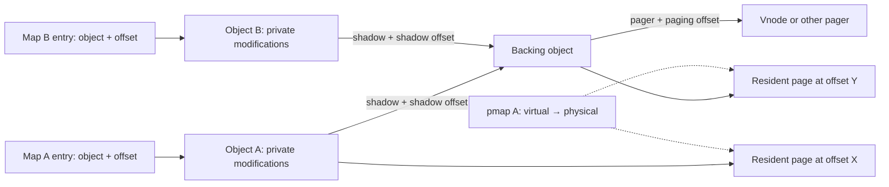
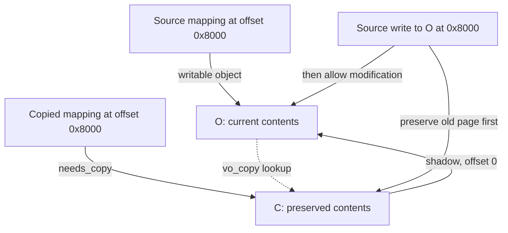
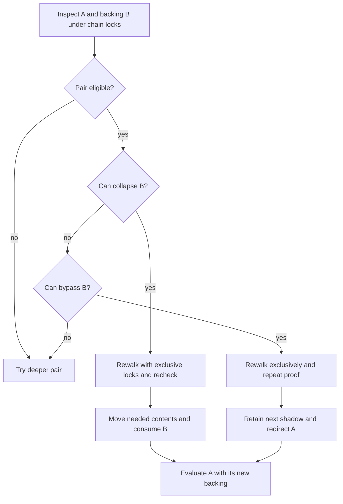
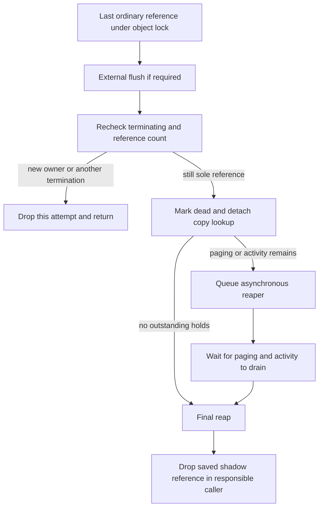

# VM objects and physical pages

[VM index](README.md) · [Address maps](virtual-address-maps.md) · [Fault resolution](fault-resolution.md) · [Pagers and UPLs](pagers-and-upl.md)

A map entry describes a virtual range. A `vm_object` describes the contents available at offsets within that range. A `vm_page` describes one resident page of those contents. A `pmap` describes hardware translations from virtual addresses to physical pages. These structures have different lifetimes: an object can exist without resident pages, a page can exist without a userspace mapping, and several mappings can refer to the same object or physical page.

This chapter follows object allocation, resident lookup, shadow relationships and reclamation in this checkout. [Fault resolution](fault-resolution.md) covers choosing a page for a particular access; [wiring and memory entries](wiring-and-memory-entries.md) covers holding and exporting contents. [MTE tag storage](mte-tag-storage-and-page-lifecycle.md) follows the additional backing/cell state that makes a free data page eligible for tagging, including ordinary reuse and relocation.

For detailed field and lifetime maps, read [VM objects and backing](../../structures/vm-objects-and-backing.md) and [VM pages and resident storage](../../structures/vm-pages-and-resident-storage.md). They separate object allocation from content acquisition, page descriptors from frames, and ordinary references from paging, busy, wire and queue protocols.

## The object is an offset namespace with backing policy

The actual private definition is [`struct vm_object` in vm_object_xnu.h](../../../xnu/osfmk/vm/vm_object_xnu.h#L136). It is not a list of virtual addresses. Its important relationships are:

| Fields | Meaning and constraint |
|---|---|
| `memq`, `memq_hint`, `resident_page_count` | Resident pages and a recent lookup hint. Missing offsets can still have backing in a pager or shadow. |
| `Lock` | Object reader/writer lock. Most resident-page state changes require exclusive ownership; read paths can use shared ownership where explicitly supported. |
| `ref_count` | Ordinary references held by mappings, shadow relationships and other owners. This is distinct from paging/activity holds. |
| `vo_size` | Size member of a union used for internal objects. External cached objects reuse this storage for scan bookkeeping; do not read it as a universal file length. |
| `shadow`, `vo_shadow_offset` | Backing object and translation into it. The offset storage is also a union; ownership/purgeable uses must be interpreted according to object state. |
| `vo_copy`, `vo_copy_version` | Copy relationship used by delayed-copy synchronization; the version detects changes while a caller drops locks. |
| `pager`, `pager_control`, `paging_offset` | Backing provider, its VM control association, and translation from object offsets into pager offsets. |
| `copy_strategy` | Whether copying uses symmetric COW, delayed copying or an immediate copy. |
| `wired_page_count`, `reusable_page_count` | Object accounting for resident pages with those properties; neither is an ordinary object reference count. |
| `internal`, `private`, `phys_contiguous`, `true_share` | Distinct backing/sharing properties. A private device object and a physically contiguous object do not follow every ordinary anonymous-page path. |
| `alive`, `terminating`, `pager_ready`, `named` | Lifecycle state used in faults, teardown and pager mapping notifications. |

The object-to-backing relationships appear together in [the structure definition](../../../xnu/osfmk/vm/vm_object_xnu.h#L168).

<!-- source-excerpt: ../../../xnu/osfmk/vm/vm_object_xnu.h#L168-L191 -->
```c
	struct vm_object        *vo_copy;       /* Object that should receive
	                                         * a copy of my changed pages,
	                                         * for copy_delay, or just the
	                                         * temporary object that
	                                         * shadows this object, for
	                                         * copy_call.
	                                         */
	uint64_t                vo_copy_version;
	struct vm_object        *shadow;        /* My shadow */
	memory_object_t         pager;          /* Where to get data */

	union {
		vm_object_offset_t vou_shadow_offset;   /* Offset into shadow */
		clock_sec_t     vou_cache_ts;   /* age of an external object
		                                 * present in cache
		                                 */
		task_t          vou_owner;      /* If the object is purgeable
		                                 * or has a "ledger_tag", this
		                                 * is the task that owns it.
		                                 */
	} vo_un2;

	vm_object_offset_t      paging_offset;  /* Offset into memory object */
	memory_object_control_t pager_control;  /* Where data comes back */
```

A useful offset calculation is `object_offset = entry_offset + (virtual_address - entry_start)`. Descending a shadow adds that object's `vo_shadow_offset`. Calling its pager adds `paging_offset`. These are separate translations; a virtual address, an object offset and a file offset are not interchangeable.



The diagram shows a possible relationship, not a requirement that every mapping immediately acquire a private shadow. The map/fault code can defer creating objects and shadows until an operation needs them.

## Allocation creates bookkeeping before contents

[`vm_object_allocate`](../../../xnu/osfmk/vm/vm_object.c#L539) obtains an object from `vm_object_zone` and calls `_vm_object_allocate`. The initializer copies a template, sets provenance and size, initializes resident and optional UPL queues, creates the lock and initializes the reference count. It does not allocate physical pages.

The core initialization is [here](../../../xnu/osfmk/vm/vm_object.c#L517).

<!-- source-excerpt: ../../../xnu/osfmk/vm/vm_object.c#L517-L527 -->
```c
	*object = vm_object_template;
	object->vmo_provenance = provenance;

	vm_page_queue_init(&object->memq);
#if UPL_DEBUG || CONFIG_IOSCHED
	queue_init(&object->uplq);
#endif
	vm_object_lock_init(object);
	vm_object_set_size(object, size, size);

	os_ref_init_raw(&object->ref_count, &vm_object_refgrp);
```

[`vm_object_template`](../../../xnu/osfmk/vm/vm_object.c#L280) starts an ordinary object internal and alive, with symmetric copy strategy, no pager and no shadow. Later operations change those properties. Anonymous mapping creation can also leave a map entry's object null until first use; therefore “the process allocated a range” does not imply either an object or resident RAM already exists.

Physical allocation is separate. [`vm_page_grab_options`](../../../xnu/osfmk/vm/vm_resident.c#L5261) first tries per-CPU free-page lists with preemption disabled, then slower free queues and optional secluded-memory paths. It considers whether the current thread is VM privileged. A privileged caller without `VM_PAGE_GRAB_NOPAGEWAIT` can wait and retry; an ordinary failed grab can return null. The caller chooses whether to wait, fail, reclaim something or retry. Neither object allocation nor the word “grab” justifies assuming all physical allocation is nonblocking or all allocation necessarily sleeps.

## Resident-page identity and lookup

[`struct vm_page`](../../../xnu/osfmk/vm/vm_page.h#L286) combines several roles:

| Field group | What it records |
|---|---|
| `vmp_object`, `vmp_offset` | Packed object identity and page-aligned offset while tabled. |
| `vmp_listq` | Membership in that object's resident-page list. |
| `vmp_next_m` | Resident lookup hash linkage, protected by a bucket lock as well as the relevant object invariants. |
| `vmp_pageq`, `vmp_q_state` | Reclaim/free/wired queue state. This is separate from membership in the object's resident list. |
| `vmp_busy`, `vmp_wanted` | An operation is stabilizing/working on the page; another thread may be waiting for that operation. |
| `vmp_absent`, `vmp_error`, `vmp_restart`, `vmp_unusual` | Contents are not yet available, failed, or require a restart/special handling. A descriptor's presence does not prove valid data. |
| `vmp_dirty`, `vmp_precious`, `vmp_cleaning`, `vmp_overwriting` | Data-return and I/O state, interpreted together with hardware modification information. |
| `vmp_wire_count` | References preventing ordinary pageable reclamation; it shares storage with a local-queue identifier. Interpret it using queue state. |
| `vmp_pmapped`, `vmp_xpmapped` | Historical mapping/use flags. They are not a current count of hardware mappings. |

The header documents locking with `O` for object lock and `P` for page-queue lock. Read the individual field comments: some transitions require both, some permit either for reading, and some mapping flags also allow shared object ownership with a pmap physical-page lock. The comments are a field-level contract, not permission to protect all `vm_page` fields using any one global lock. See [the locking explanation](../../../xnu/osfmk/vm/vm_page.h#L217).

The page's physical number must be obtained through `VM_PAGE_GET_PHYS_PAGE`. Some configurations derive it from a canonical descriptor's index in the linear page array instead of storing a physical number in every descriptor. Fictitious/private descriptors support additional cases such as device backing; they must not be returned to the ordinary free-page pool as though they owned canonical RAM. See [the physical-page representation](../../../xnu/osfmk/vm/vm_page.h#L513) and [private-page population](../../../xnu/osfmk/vm/vm_object.c#L5770).

[`vm_page_lookup`](../../../xnu/osfmk/vm/vm_resident.c#L3963) requires the object lock and an aligned offset. It first handles an empty object, then checks `memq_hint` and adjacent resident pages, then uses either a short linear resident-list search for small objects or the object/offset hash under its bucket lock. An empty hash bucket can also establish an immediate miss under the object lock. The hint accelerates locality without changing identity: the key remains object plus offset.

Returning a `vm_page_t` does not acquire a reference counted page handle and does not automatically set `vmp_busy`. The caller must obey the object lock and page state rules before dropping protection. If it must leave the lock and come back, it needs a suitable stabilization protocol or another lookup. This distinction explains many loops that look redundant on first reading.

[`vm_page_insert_internal`](../../../xnu/osfmk/vm/vm_resident.c#L3426) establishes the reverse relationship: validate alignment and locking, set object/offset, insert or replace the hash member, apply cache attributes as needed, and link the page into the object's resident list. The insertion point establishes content identity; allocating a free page alone did not attach it to any object.

## Ordinary references and I/O holds protect different things

The counters are not interchangeable:

- An ordinary reference keeps an object owned by a mapping, handle, shadow or explicit caller.
- `paging_in_progress` protects an ongoing pager operation, including assumptions about paging offsets and teardown.
- `activity_in_progress` protects broader operations such as queued pageout work and UPL participation. It lets teardown wait without pretending that every activity is a pager request.

The actual [activity helpers](../../../xnu/osfmk/vm/vm_object_internal.h#L684) require exclusive object ownership and wake paging waiters once both kinds of work have drained.

<!-- source-excerpt: ../../../xnu/osfmk/vm/vm_object_internal.h#L683-L705 -->
```c
static inline void
vm_object_activity_begin(vm_object_t object)
{
	vm_object_lock_assert_exclusive(object);
	VM_PIP_DEBUG_BEGIN(object);
	if (os_inc_overflow(&object->activity_in_progress)) {
		panic("vm_object_activity_begin(%p): overflow\n", object);
	}
}

static inline void
vm_object_activity_end(vm_object_t object)
{
	vm_object_lock_assert_exclusive(object);
	if (os_dec_overflow(&object->activity_in_progress)) {
		panic("vm_object_activity_end(%p): underflow\n", object);
	}
	if (object->paging_in_progress == 0 &&
	    object->activity_in_progress == 0) {
		vm_object_wakeup((object),
		    VM_OBJECT_EVENT_PAGING_IN_PROGRESS);
	}
}
```

These counters keep the object available; they do not necessarily freeze a particular page pointer at a particular offset. The external pageout worker demonstrates the distinction: under the page queues lock it snapshots object and offset, drops that lock, acquires the object lock and calls `vm_page_lookup` again. The page may have disappeared or changed even though the activity hold prevented final object reclamation. The object can already be marked terminating while that hold remains; the reaper waits for it to drain before freeing storage. See [the worker's explicit contract](../../../xnu/osfmk/vm/vm_pageout.c#L4520).

This is also why holding a map lock, an object reference, a page busy state and a physical-page wire are different obligations. They stabilize different relationships, and none should be inferred merely from another.

## Shadows and copy strategies

[`vm_object_copy_quickly`](../../../xnu/osfmk/vm/vm_object.c#L3704) handles the symmetric case without copying page bytes. It acquires another reference, marks the object shadowed and reports that both source and destination need COW. Its caller must arrange the corresponding map-entry state and write protection.

The central operation is [this symmetric branch](../../../xnu/osfmk/vm/vm_object.c#L3733).

<!-- source-excerpt: ../../../xnu/osfmk/vm/vm_object.c#L3732-L3745 -->
```c
		vm_object_reference_locked(object);
		VM_OBJECT_SET_SHADOWED(object, TRUE);
		vm_object_unlock(object);

		/*
		 *	Both source and destination must make
		 *	shadows, and the source must be made
		 *	read-only if not already.
		 */

		*_src_needs_copy = TRUE;
		*_dst_needs_copy = TRUE;

		break;
```

A later [`vm_object_shadow`](../../../xnu/osfmk/vm/vm_object.c#L4283) can allocate a new object backed by the existing one. The caller's former reference to the source becomes the new shadow relationship's reference: this is a transfer of ownership, not an unconditional extra retain followed by an unrelated release. It records the old offset as `vo_shadow_offset` and returns the new top object with an adjusted offset. Mixed map/object page sizes require retaining an intra-page adjustment. A single-reference same-sized source can sometimes avoid a new shadow, unless `always_shadow` requires it.

Delayed copying has a different relationship: an original object can carry `vo_copy` for preservation of old data before modifying the original. [`vm_object_copy_strategically`](../../../xnu/osfmk/vm/vm_object.c#L4159) selects delayed copying, a slow physical copy, or a restart for the symmetric strategy. `MEMORY_OBJECT_COPY_DELAY_FORK` is converted to delayed copy for fork and immediate copying otherwise. A delayed-copy result can itself require a later COW resolution by the destination. “Copy” therefore does not identify one algorithm.

The detailed first-write decision belongs in [fault resolution](fault-resolution.md). Here the essential invariant is that backing links and copy policy determine which object owns old contents and which object may receive new contents. A page's current pmap permissions enforce those decisions at the hardware boundary; the object relationship alone does not stop a CPU write through an already writable translation.

[`vm_object_collapse`](../../../xnu/osfmk/vm/vm_object.c#L5153) reduces shadow chains when safe. It can merge an exclusively referenced backing object into its parent, including compatible compressor backing, or bypass a backing object when no needed content would be lost. It checks paging/activity state, backing relationships, pager state and references. If shared locks must become exclusive, it can drop locks and restart to avoid upgrading two objects in a deadlocking order. Bypass must prove that lower contents cannot show through; counting resident pages alone is insufficient when pager contents may exist.

Collapsing is an optimization of representation, not permission to discard an object just because it has no resident pages. Nonresident compressed or external backing can remain the only copy of data.

## Delayed copies preserve snapshots by pushing old contents upward

Symmetric COW lets both mappings move into private shadows before writing. Delayed copying instead keeps the source object `O` as the write target and creates a copy object `C` above it. `C.shadow = O` owns a reference on `O`; `O.vo_copy = C` tells a source write where to preserve old contents. The latter is a lookup relationship, not a separate retain: `VM_OBJECT_COPY_SET` only assigns the pointer and updates a version. A fault must lock and explicitly reference `C` before dropping protection. [Copy construction and reference transfer](../../../xnu/osfmk/vm/vm_object.c#L4105-L4149), [copy-pointer setter](../../../xnu/osfmk/vm/vm_object_internal.h#L826-L836), [fault reference acquisition](../../../xnu/osfmk/vm/vm_fault.c#L2384-L2427).

This explanation concerns ordinary untagged objects and system-page offsets. With a 16 KiB system page, let a caller copy `[0x8000, 0x10000)` from `O`. The delayed copy has `C.vo_size = 0x10000`, `C.vo_shadow_offset = 0`, and the returned mapping starts at **object offset `0x8000`**, not zero. A copy can be reused by mappings of other source ranges; that is why its extent includes the prefix before this particular mapping. `vm_object_copy_strategically` returns `dst_needs_copy = TRUE`, so a destination writer will create its own symmetric shadow rather than modify the shared snapshot object directly. [Extent calculation](../../../xnu/osfmk/vm/vm_object.c#L3784-L3843), [strategy result](../../../xnu/osfmk/vm/vm_object.c#L4228-L4265).



The dashed arrow is a lookup relationship; solid shadow and mapping arrows identify content ownership. The source-write path may first need a page from a deeper shadow and then need to preserve it into `C`, so one fault can require **two** page copies. The comments and operations in [`vm_fault_page`](../../../xnu/osfmk/vm/vm_fault.c#L2280-L2381) make these two obligations explicit.

### Reuse, growth and insertion are distinct operations

`vm_object_copy_delayed` enters with the source locked and a caller-owned reference. It returns with the source unlocked. An allocation or lock-order retry can release that lock, so the function returns to `Retry` and rereads `src_object->vo_copy`; it cannot continue with a cached pointer from before the unlock. The initial shared-lock optimization is useful when an unchanged copy can simply be referenced. Mutation upgrades the protocol to exclusive ownership by dropping locks and restarting. [Entry contract](../../../xnu/osfmk/vm/vm_object.c#L3769-L3797), [retry and reverse-lock acquisition](../../../xnu/osfmk/vm/vm_object.c#L3844-L3912).

| State found under the relevant locks | Action and reason |
| --- | --- |
| No copy object | Allocate `new_copy` outside the source lock, reacquire locks, then restart before publishing it. Another copier may have installed one meanwhile. |
| Existing copy has no resident pages and no pager was created | Its preserved content has not diverged; return another reference to that same object. |
| That reusable copy is too small | Take exclusive ownership, write-protect the newly covered source pages, flush deferred pmap changes, grow `vo_size`, and increment the source's `vo_copy_version`. |
| Existing copy has resident contents or has created a pager | It may preserve an older version. Insert a new copy between it and the source: `C_old → C_new → O`. Subsequent source writes push into `C_new`; `C_old` still finds older preserved pages first. |
| A page requiring write-protection is wired | Abandon delayed copying and return null; `vm_object_copy_strategically` falls back to physical copying. Earlier protection changes can already have happened. |

Sources: [reuse/growth checks](../../../xnu/osfmk/vm/vm_object.c#L3914-L4020), [allocation/restart](../../../xnu/osfmk/vm/vm_object.c#L4024-L4065), [write protection and wired rejection](../../../xnu/osfmk/vm/vm_object.c#L4067-L4104), [chain insertion](../../../xnu/osfmk/vm/vm_object.c#L4105-L4149), [fallback](../../../xnu/osfmk/vm/vm_object.c#L4228-L4265).

A pointer comparison alone cannot detect growth of the same copy object. The version records a changed preservation obligation even though `O.vo_copy` still equals `C`. In the example, a later copy of `[0x10000, 0x18000)` can grow `C` to `0x18000`; an already-running fault at `O+0x14000` must now preserve that page before allowing a write.

[Source: `vm_object.c`, lines 3993–4003](../../../xnu/osfmk/vm/vm_object.c#L3993-L4003).

<!-- source-excerpt: ../../../xnu/osfmk/vm/vm_object.c#L3993-L4003 -->
```c
				old_copy->vo_size = copy_size;

				/*
				 * src_object's "vo_copy" object now covers
				 * a larger portion of src_object.
				 * Increment src_object's "vo_copy_version"
				 * to make any racing vm_fault() on
				 * "src_object" re-check if it needs to honor
				 * any new copy-on-write obligation.
				 */
				src_object->vo_copy_version++;
```

The source page scan removes write permission from existing aliases through `pmap_page_protect_options`, keeping execute permission for an `xpmapped` page. Calls accumulate `PMAP_OPTIONS_NOFLUSH` work and then flush it before publishing the larger extent or new relationship. A wired page can reject the operation after earlier pages were already protected; the function flushes that accumulated work even on this failure exit. Extra future faults are safe, but this is not an all-or-nothing restoration of the original PTEs. The reusable-copy growth branch skips busy-and-absent pages because they do not yet contain user-visible data; its corresponding new-copy scan does not contain that same exception. [Growth scan](../../../xnu/osfmk/vm/vm_object.c#L3937-L3988), [new-copy scan](../../../xnu/osfmk/vm/vm_object.c#L4080-L4104).

Pager/UPL coordination also qualifies the path. A configurable wait for paging/activity is skipped for `true_share` objects; its default differs between OSX and other targets. The separate `vmo_pl_req_in_progress` wait still occurs. These are inspected predicates, not a claim that every platform waits for all I/O before every delayed copy. [Defaults and waits](../../../xnu/osfmk/vm/vm_object.c#L3763-L3767), [retry preflight](../../../xnu/osfmk/vm/vm_object.c#L3844-L3868).

### A source write must finish preservation before receiving write access

In `vm_fault_internal`, a write to a delayed-copy object with a `vo_copy` leaves the fast path. `vm_fault_page` owns the selected source page busy and holds paging state while it resolves the preservation obligation. A read only needs to withhold WRITE. A write finds the corresponding copy offset, checks whether it is within `C.vo_size`, and looks for a resident page or known compressed contents there. Either is already a preserved version and must not be overwritten with today's source bytes. [Slow-path dispatch](../../../xnu/osfmk/vm/vm_fault.c#L5219-L5228), [copy range and existing content](../../../xnu/osfmk/vm/vm_fault.c#L2391-L2499).

The normal object-lock direction follows shadows downward, `C → O`. The writer already holds `O` and wants `C`, so waiting unconditionally for `C` would invert that order. It uses a try-lock and releases `O` on collision:

[Source: `vm_fault.c`, lines 2408–2419](../../../xnu/osfmk/vm/vm_fault.c#L2408-L2419).

<!-- source-excerpt: ../../../xnu/osfmk/vm/vm_fault.c#L2408-L2419 -->
```c
		/*
		 * Try to get the lock on the copy_object.
		 */
		if (!vm_object_lock_try(copy_object)) {
			vm_object_unlock(object);
			try_failed_count++;

			mutex_pause(try_failed_count);  /* wait a bit */
			vm_object_lock(object);

			continue;
		}
```

The busy source page and paging ownership survive that pause. Re-entering the loop reloads `first_object->vo_copy`; it does not assume the copy pointer stayed unchanged. Once `C` is locked, the fault takes a reference on it. If the destination page is itself busy, it releases the source page and fault state, relocks/relooks up the copy page, waits only if that page still exists and is busy, and returns retry/interrupted status. The original `copy_m` pointer cannot be reused across that cleanup. [Busy-copy handling](../../../xnu/osfmk/vm/vm_fault.c#L2422-L2479).

When no preserved resident/compressed page exists, the fault allocates and inserts one into `C`, copies the old source bytes, and disconnects the original physical page's mappings when `vmp_pmapped` is set. The disconnect is broad because users of `C` may still have translations directly to the old `O` page; those translations must fault back to the newly preserved page before `O` changes. A memory shortage releases the source page, copy reference and paging state and reports `VM_FAULT_MEMORY_SHORTAGE`. [Allocation/copy/disconnect](../../../xnu/osfmk/vm/vm_fault.c#L2490-L2530).

The newly preserved page is marked dirty and either activated/woken or handed to `vm_pageout_initialize_page`, according to pager state. The latter path unlocks the source object and may drop the copy lock internally. Afterward it checks `copy_object->shadow == object` and whether references other than its temporary one remain; if not, it deallocates through the full path and restarts the preservation loop. Waiters on the original busy page receive `THREAD_RESTART`, without clearing its busy bit, because pushing contents upward can change the correct starting point for their faults. [Pageout/recheck and restart wakeup](../../../xnu/osfmk/vm/vm_fault.c#L2532-L2627).

For the 16 KiB example, an initial source write at `O+0x8000` first places the old page at `C+0x8000`. A second delayed copy after that preservation inserts `C_new`: the old reader sees its page in `C_old`, while a new reader can fall through `C_new` to current `O`. A later source write at the same offset preserves the newer version into `C_new`. These are versions of page contents, not a chain of copied virtual addresses. A destination's own write follows its separate `needs_copy` shadow path, covered in [fault resolution](fault-resolution.md#resident-pages-and-copy-on-write).

## Collapse and bypass: remove a level without changing visible contents

For `A.shadow = B`, collapse consumes `B` and moves its needed contents into `A`. Bypass changes `A` to reference `B.shadow` while leaving `B` available to its other owners. Both must preserve the page selected by every offset in `A`; having no resident pages in `B` is insufficient if a pager owns its data. `vm_object_collapse` is called after selected COW faults, during fault completion and by pageout work, so this optimization must respect ongoing faults rather than assume a stopped process. [Main routine](../../../xnu/osfmk/vm/vm_object.c#L5153-L5188), [COW caller](../../../xnu/osfmk/vm/vm_fault.c#L2361-L2370), [completion caller](../../../xnu/osfmk/vm/vm_fault.c#L4395-L4416), [pageout caller](../../../xnu/osfmk/vm/vm_pageout.c#L4985-L5003).

### Eligibility is checked again after lock mode changes

The caller holds the original top object exclusively and does not hold page-queue locks. The first traversal takes shared locks on lower objects. For each pair, the implementation requires no paging/activity on either object and an internal backing object. If that pair is ineligible it can continue farther down the shadow chain while retaining the original top lock. Purgeable participation is treated as an invariant violation and panics. A backing object that is itself the next lower object's `vo_copy` cannot be collapsed/bypassed here: it needs its zero-offset preservation relationship. [Pair checks](../../../xnu/osfmk/vm/vm_object.c#L5209-L5293).

Collapse additionally requires `B.ref_count == 1` and compatible pager state: either compressor collapse is enabled or at least one object has not created a pager. The destructive pass needs exclusive ownership of both objects. It releases lower shared locks and starts again from the original object with exclusive descent; independently upgrading two shared locks could deadlock with another traversal doing the same thing. Reaching a candidate in the first pass is therefore not a promise that the same pair is still eligible in the second. [Collapse selection/restart](../../../xnu/osfmk/vm/vm_object.c#L5296-L5358), [bypass exclusive restart](../../../xnu/osfmk/vm/vm_object.c#L5549-L5568).



The diagram omits several rejecting predicates and the next iteration's possible exit. Both rewalk boxes include rerunning the decision checks, not just changing a lock bit.

### Resident-page movement is offset rebasing, not byte copying

Let the system page size be 16 KiB, `A.vo_size = 0xc000` (three pages), `A.vo_shadow_offset = 0x8000`, `B.shadow = D`, and `B.vo_shadow_offset = 0x4000`. Assume an eligible pair and `B.ref_count == 1`. `A` sees `B`'s interval `[0x8000, 0x14000)`. Collapse visits each resident page of `B` and computes `new_offset = B_page_offset - 0x8000`:

| Page/state before collapse | Action |
| --- | --- |
| `B+0x4000` | Outside `A`'s window; discard it because no other owner of `B` exists. |
| `B+0x8000`, with no `A+0` resident/compressed page | Rename the existing page into `A+0`; keep its physical contents. |
| `B+0xc000`, while `A+0x4000` already exists | Discard the backing version; the parent version already hides it. |
| `B+0x10000` compressed, with no `A+0x8000` contents | Preserve it through compressor-slot transfer or pager handoff, as described below. |
| Next-shadow lookup after collapse | `A+q` now reaches `D+(q+0xc000)`, preserving `0x8000 + 0x4000`. |

The resident branch checks both parent resident pages and compressor existence before renaming. `vm_page_rename` removes old object/hash membership and inserts new membership under the page-queue lock, with accounting adjustments; it does not allocate a replacement physical page and copy bytes. [Resident decisions](../../../xnu/osfmk/vm/vm_object.c#L4870-L4919), [rename implementation](../../../xnu/osfmk/vm/vm_resident.c#L4131-L4186).

[Source: `vm_object.c`, lines 4885–4899](../../../xnu/osfmk/vm/vm_object.c#L4885-L4899).

<!-- source-excerpt: ../../../xnu/osfmk/vm/vm_object.c#L4885-L4899 -->
```c
		if (p->vmp_offset < backing_offset || new_offset >= size) {
			VM_PAGE_FREE(p);
		} else {
			pp = vm_page_lookup(object, new_offset);
			if (pp == VM_PAGE_NULL) {
				if (vm_object_compressor_pager_state_get(object,
				    new_offset)
				    == VM_EXTERNAL_STATE_EXISTS) {
					/*
					 * Parent object has this page
					 * in the VM compressor.
					 * Throw away the backing
					 * object's page.
					 */
					VM_PAGE_FREE(p);
```

### Compressed contents have two different migration paths

If both objects have pagers and compressor collapse is enabled, `vm_object_do_collapse_compressor` iterates occupied backing slots within the parent's window. It converts a source pager offset to a backing object offset, subtracts `A.vo_shadow_offset`, and adds `A.paging_offset` to obtain the destination pager offset. A parent resident page or occupied compressor slot wins over the backing version. Otherwise `vm_compressor_pager_transfer` moves the slot ownership and adjusts each pager's occupied-slot count; this is not decompression followed by recompression. [Window/slot iteration](../../../xnu/osfmk/vm/vm_object.c#L4768-L4831), [slot transfer](../../../xnu/osfmk/vm/vm_compressor_pager.c#L1033-L1063).

If `A` has no pager and `B` does, the alternate path moves `pager`, `pager_control`, creation/readiness state and paging coordinates into `A`. It changes `A.paging_offset` to `B.paging_offset + old_A_shadow_offset` and updates the control's object association. The source explicitly notes that pager space outside the retained view is not trimmed here. These pager coordinates explain why an object offset and a compressor slot's byte offset must not be treated as interchangeable. [Pager handoff](../../../xnu/osfmk/vm/vm_object.c#L4921-L4967).

In both cases `A` then adopts `B.shadow` and accumulates shadow offsets. The existing reference formerly owned by `B.shadow` is **transferred**, rather than acquired again; `B` clears that pointer. If a pager remains on `B` after slot migration, normal termination releases leftover slots and pager state. Otherwise its empty object storage can be freed directly. [Shadow handoff and destruction](../../../xnu/osfmk/vm/vm_object.c#L4969-L5036).

### Bypass must prove there is no remaining dependency

Bypass cannot steal pages from `B`, because another mapping may still need it. Under the earlier invariants, a fully resident `A` (`resident_page_count == vo_size >> PAGE_SHIFT`) already hides the complete visible range. Otherwise this checkout refuses bypass when either object has `pager_created`: it does not attempt a comprehensive compressed-content proof in that branch. Older comments about pagemaps and the `EXISTS_IN_OBJECT` macro must be read together with these earlier guards. [Bypass entry and pager-created guards](../../../xnu/osfmk/vm/vm_object.c#L5365-L5423).

For eligible objects without pagers, the proof uses several increasingly expensive checks:

1. Compare counts. If even placing as many `B` pages as possible outside `A`'s window would still leave more pages inside than `A` owns, at least one backing page must show through; stop for this pair.
2. Check `cow_hint`, or a point up to eight system pages before the caller's hint. A known dependency often rejects the attempt immediately.
3. For a sparse backing object, inspect its resident list and convert each in-window offset into `A` coordinates.
4. If needed, walk remaining offsets around the window. An existing `B` page with no matching `A` page records the dependency in `cow_hint` and prevents bypass.

[Count bound](../../../xnu/osfmk/vm/vm_object.c#L5425-L5448), [hint](../../../xnu/osfmk/vm/vm_object.c#L5464-L5490), [sparse-list/offset passes](../../../xnu/osfmk/vm/vm_object.c#L5492-L5547).

For example, with a four-page `B` and a three-page `A` window, at most one backing page lies outside the window. If `B` owns three resident pages and `A` only one, at least two backing pages lie inside and one must remain uncovered: `3 - (4 - 3) > 1`. Bypass fails even without finding which offset is missing. If counts do not disprove bypass, the actual offset checks are still necessary; equal counts alone do not establish matching contents.

After proof and exclusive revalidation, `vm_object_do_bypass` acquires a **new** reference on the next shadow, redirects `A`, adds shadow offsets, and clears `B.vo_copy` if it pointed to `A`. It drops the old reference on `B`, which may need full `vm_object_deallocate` for last/named-reference behavior. That slow path temporarily drops `A`'s lock; an activity hold keeps `A` stable even when the caller has no independent ordinary reference. On return, the outer loop rechecks state. [Bypass references and activity hold](../../../xnu/osfmk/vm/vm_object.c#L5039-L5132).

Neither operation promises to shorten every chain in one call. Runtime enablement, outstanding operations, other references, copy relationships and pager state can leave levels intact. A skipped pair can still allow work below it; a successful rewrite can expose another eligible pair. The invariants describe preserved lookup results and ownership, not a maximum supported shadow depth.

## Last-reference teardown can outlive the last mapping

[`vm_object_deallocate`](../../../xnu/osfmk/vm/vm_object.c#L674) has shared-lock/refcount fast paths and an exclusive slow path. Special cases prevent blindly applying a decrement:

1. A named object reaching the “named association plus last mapping” situation may need `memory_object_last_unmap`. The call is made outside the object lock while mapping synchronization protects the transition.
2. An object whose pager was created but is not ready may require waiting before termination.
3. The last reference enters `vm_object_terminate`, which rechecks its assumptions after operations that may drop locks.
4. Live paging/activity can defer actual destruction to the reaper.

The decisive deferred-destruction branch is [in termination](../../../xnu/osfmk/vm/vm_object.c#L1487). It marks the object dead/terminating before giving the reaper responsibility; read the full surrounding path for cacheable external-object handling and reference rechecks.

<!-- source-excerpt: ../../../xnu/osfmk/vm/vm_object.c#L1510-L1520 -->
```c
		vm_object_reap_async(object);
		vm_object_unlock(object);
		/*
		 * Return KERN_FAILURE to let the caller know that we
		 * haven't completed the termination and it can't drop this
		 * object's reference on its shadow object yet.
		 * The reaper thread will take care of that once it has
		 * completed this object's termination.
		 */
		return KERN_FAILURE;
	}
```

[`vm_object_reaper_thread`](../../../xnu/osfmk/vm/vm_object.c#L2049) waits for both paging and activity holds to drain through `vm_object_paging_wait()`, remembers the ordinary shadow relationship when appropriate, invokes `vm_object_reap` and then drops that shadow reference. A pageout object's relationship has separate activity accounting and is treated specially.

[`vm_object_reap`](../../../xnu/osfmk/vm/vm_object.c#L1552) requires no outstanding paging or activity. It clears ownership/accounting, disconnects the pager/control, releases the last ordinary reference, reaps resident pages or performs pageout-object cleanup, terminates/releases the pager, destroys the lock and frees the object. After the call the original pointer is invalid. Reaping is not merely “empty the page list”; pager and accounting relationships must also disappear.

## From resident page to reusable physical memory

The queue-state enum in [vm_page.h](../../../xnu/osfmk/vm/vm_page.h#L240) includes free, active, inactive internal/external, speculative, pageout, throttled, wired and compressor-owned states. Some queue names and states depend on configuration. These states describe reclamation policy and work ownership, not different virtual address spaces. The [reclaim guide](reclaim-and-pressure.md) follows selection and compressor/swap decisions.

The final release helpers are [`vm_page_free_prepare`](../../../xnu/osfmk/vm/vm_resident.c#L5728), [`vm_page_free_prepare_object`](../../../xnu/osfmk/vm/vm_resident.c#L5881) and [`vm_page_free`](../../../xnu/osfmk/vm/vm_resident.c#L5967). Queue preparation removes reclaim/laundry/wire bookkeeping under the appropriate locks. Object preparation removes table/hash identity, wakes waiters and resets private/canonical state. Canonical pages cross `pmap_recycle_page` before reuse; fictitious descriptors have a separate release path.

The ordinary free wrapper makes this split visible [here](../../../xnu/osfmk/vm/vm_resident.c#L5967).

<!-- source-excerpt: ../../../xnu/osfmk/vm/vm_resident.c#L5967-L5978 -->
```c
vm_page_free(vm_page_t mem)
{
	vm_page_free_prepare(mem);

	if (vm_page_is_canonical(mem)) {
		/* page queues are locked */
		vm_page_release(mem, VMP_RELEASE_Q_LOCKED |
		    VMP_RELEASE_SKIP_FREE_CHECK);
	} else {
		vm_page_release_fictitious(mem);
	}
}
```

Do not interpret this small wrapper as a universal substitute for disconnecting translations. Higher-level reclaim, discard and teardown paths perform the required pmap disconnect/protection work before a physical page becomes reusable; `pmap_recycle_page` also enforces architecture-specific reuse requirements. The pmap guides cover those constraints. A free-list insertion is the end of an ownership transition, not the operation that independently discovers and removes every possible mapping.

A wired page follows a different transition: [`vm_page_wire`](../../../xnu/osfmk/vm/vm_resident.c#L6073) removes it from pageable queues on the first wire, updates object/global accounting and increments its wire count. [`vm_page_unwire`](../../../xnu/osfmk/vm/vm_resident.c#L6213) decrements the count and, on the last wire, makes it eligible for queue placement again. Unwiring is not synonymous with freeing.

## Sources inspected and limits

| Area | Inspection depth | Limits |
|---|---|---|
| `vm_object_xnu.h` / `vm_object_internal.h` | Object fields, union interpretations, paging/activity helpers and locking contracts | Optional accounting/debug fields are navigation references, not a field-by-field specification. |
| `vm_object.c` | Allocation, deallocation, termination/reaper, symmetric/delayed copy, preservation faults, shadow creation, collapse/bypass eligibility, page/slot/pager migration and private population | Selected ordinary-object flows and their retry/ownership boundaries are traced; this is not exhaustive configuration/interleaving verification or a live-kernel test. |
| `vm_page.h` / `vm_resident.c` | Page state/locking, lookup/insertion, allocation paths, final release and wire/unwire | Boot-time page enumeration, every queue optimization and all MTE-specific paths are not traced here. |
| `vm_pageout.c` | External worker object/offset relookup as a concrete lifetime example | Reclaim policy and compressor algorithms remain in the sibling guide. |

Read `vm_object_allocate → vm_page_grab_options → vm_page_insert_internal → vm_page_lookup` first. Then read `vm_object_copy_quickly → vm_object_shadow` and the map/fault guide together. Finish with `vm_object_deallocate → vm_object_terminate → vm_object_reap` to see how the relationships are dismantled.

## Termination retries, pager disconnection and accounting order

The last-reference path is a protocol, not an unconditional destructor call. For a cacheable external object, `vm_object_terminate()` can first reap/flush pages after clearing trusted-pager state. That operation may drop synchronization. The routine therefore checks both `terminating` and the reference count afterward: another path may already be terminating it, or somebody may have acquired a reference while cleanup ran. Those cases release this attempt's reference, unlock and return `KERN_FAILURE`; they do not proceed to free a still-referenced object. [Termination preflight/rechecks](../../../xnu/osfmk/vm/vm_object.c#L1422-L1461).

[Source: `osfmk/vm/vm_object.c`, lines 1450–1470](../../../xnu/osfmk/vm/vm_object.c#L1450-L1470).

<!-- source-excerpt: ../../../xnu/osfmk/vm/vm_object.c#L1450-L1470 -->
```c
	 * Did somebody get a reference to the object while we were
	 * cleaning it?
	 */
	if (os_ref_get_count_raw(&object->ref_count) != 1) {
		vm_object_lock_assert_exclusive(object);
		os_ref_release_live_locked_raw(&object->ref_count, &vm_object_refgrp);
		vm_object_unlock(object);
		return KERN_FAILURE;
	}

	/*
	 *	Make sure no one can look us up now.
	 */

	VM_OBJECT_SET_TERMINATING(object, TRUE);
	VM_OBJECT_SET_ALIVE(object, FALSE);

	if (!object->internal &&
	    object->cached_list.next &&
	    object->cached_list.prev) {
		vm_object_cache_remove(object);
```

Once committed, termination marks the object not alive/terminating, removes external cache-list membership, and disconnects `shadow->vo_copy` if this object was that copy. It deliberately leaves the owned shadow reference for the appropriate caller or asynchronous reaper. If paging/activity remains, waiting inline could deadlock against the operation that just dropped the last ordinary reference but still owns a paging hold. The reaper receives that obligation instead. [Commit and deferral](../../../xnu/osfmk/vm/vm_object.c#L1462-L1520).



`vm_object_reap()` first changes ownership/ledger attribution while the pager is still attached, because compressed contents are needed for correct accounting. It then clears `object->pager`, disables the memory-object control association and consumes the final reference. Internal purgeable objects leave their queues and retire applicable tokens before resident-page destruction. Pageout objects use `vm_pageout_object_terminate()` for their special shadow/activity relationship; ordinary objects reap remaining resident pages. [Accounting/control ordering](../../../xnu/osfmk/vm/vm_object.c#L1552-L1610), [purgeable and pageout branches](../../../xnu/osfmk/vm/vm_object.c#L1611-L1695).

The pager callback runs after unlocking the object. On return the routine completes terminating-waiter bookkeeping, destroys/frees storage and leaves no usable object pointer. The asynchronous reaper saves the ordinary shadow before reaping, then deallocates that saved object afterward. Its `KERN_FAILURE` handoff is therefore an ownership signal to the original caller, not proof that no destruction has started. [Pager release and final object cleanup](../../../xnu/osfmk/vm/vm_object.c#L1696-L1740), [reaper](../../../xnu/osfmk/vm/vm_object.c#L2049-L2100).

See [purgeability](purgeable-memory.md) for content loss without object death, [shared-region pagers](shared-regions-and-transforming-pagers.md) for independent map/pager cache references, and [deferred reclaim](deferred-reclamation.md) for shared user/kernel range reclamation. These mechanisms can eventually reach object deallocation but do not replace its reference/paging protocol.

<!-- BEGIN PLATYDOC DOCUMENTATION LICENSE -->
Original Platydoc text and diagrams are licensed under [CC BY 4.0](https://creativecommons.org/licenses/by/4.0/). Quoted source code and third-party material retain their respective licenses.
<!-- END PLATYDOC DOCUMENTATION LICENSE -->
