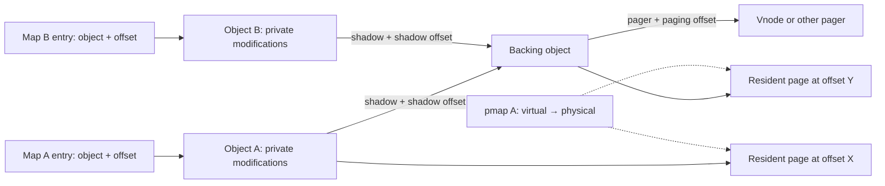

# VM objects and physical pages

[VM index](README.md) · [Address maps](virtual-address-maps.md) · [Fault resolution](fault-resolution.md) · [Pagers and UPLs](pagers-and-upl.md)

A map entry describes a virtual range. A `vm_object` describes the contents available at offsets within that range. A `vm_page` describes one resident page of those contents. A `pmap` describes hardware translations from virtual addresses to physical pages. These structures have different lifetimes: an object can exist without resident pages, a page can exist without a userspace mapping, and several mappings can refer to the same object or physical page.

This chapter follows object allocation, resident lookup, shadow relationships and reclamation in this checkout. [Fault resolution](fault-resolution.md) covers choosing a page for a particular access; [wiring and memory entries](wiring-and-memory-entries.md) covers holding and exporting contents.

## The object is an offset namespace with backing policy

The actual private definition is [`struct vm_object` in vm_object_xnu.h](../../../xnu/osfmk/vm/vm_object_xnu.h#L136). It is not a list of virtual addresses. Its important relationships are:

| Fields | Meaning and constraint |
|---|---|
| `memq`, `memq_hint`, `resident_page_count` | Resident pages and a recent lookup hint. Missing offsets can still have backing in a pager or shadow. |
| `Lock` | Object reader/writer lock. Most resident-page state changes require exclusive ownership; read paths can use shared ownership where explicitly supported. |
| `ref_count` | Ordinary references held by mappings, shadow relationships and other owners. This is distinct from paging/activity holds. |
| `vo_size` | Size member of a union used for internal objects. External cached objects reuse this storage for scan bookkeeping; do not read it as a universal file length. |
| `shadow`, `vo_shadow_offset` | Backing object and translation into it. The offset storage is also a union; ownership/purgeable uses must be interpreted according to object state. |
| `vo_copy`, `vo_copy_version` | Copy relationship used by delayed-copy synchronization; the version detects changes while a caller drops locks. |
| `pager`, `pager_control`, `paging_offset` | Backing provider, its VM control association, and translation from object offsets into pager offsets. |
| `copy_strategy` | Whether copying uses symmetric COW, delayed copying or an immediate copy. |
| `wired_page_count`, `reusable_page_count` | Object accounting for resident pages with those properties; neither is an ordinary object reference count. |
| `internal`, `private`, `phys_contiguous`, `true_share` | Distinct backing/sharing properties. A private device object and a physically contiguous object do not follow every ordinary anonymous-page path. |
| `alive`, `terminating`, `pager_ready`, `named` | Lifecycle state used in faults, teardown and pager mapping notifications. |

The object-to-backing relationships appear together in [the structure definition](../../../xnu/osfmk/vm/vm_object_xnu.h#L168).

<!-- source-excerpt: ../../../xnu/osfmk/vm/vm_object_xnu.h#L168-L191 -->
```c
	struct vm_object        *vo_copy;       /* Object that should receive
	                                         * a copy of my changed pages,
	                                         * for copy_delay, or just the
	                                         * temporary object that
	                                         * shadows this object, for
	                                         * copy_call.
	                                         */
	uint64_t                vo_copy_version;
	struct vm_object        *shadow;        /* My shadow */
	memory_object_t         pager;          /* Where to get data */

	union {
		vm_object_offset_t vou_shadow_offset;   /* Offset into shadow */
		clock_sec_t     vou_cache_ts;   /* age of an external object
		                                 * present in cache
		                                 */
		task_t          vou_owner;      /* If the object is purgeable
		                                 * or has a "ledger_tag", this
		                                 * is the task that owns it.
		                                 */
	} vo_un2;

	vm_object_offset_t      paging_offset;  /* Offset into memory object */
	memory_object_control_t pager_control;  /* Where data comes back */
```

A useful offset calculation is `object_offset = entry_offset + (virtual_address - entry_start)`. Descending a shadow adds that object's `vo_shadow_offset`. Calling its pager adds `paging_offset`. These are separate translations; a virtual address, an object offset and a file offset are not interchangeable.



The diagram shows a possible relationship, not a requirement that every mapping immediately acquire a private shadow. The map/fault code can defer creating objects and shadows until an operation needs them.

## Allocation creates bookkeeping before contents

[`vm_object_allocate`](../../../xnu/osfmk/vm/vm_object.c#L539) obtains an object from `vm_object_zone` and calls `_vm_object_allocate`. The initializer copies a template, sets provenance and size, initializes resident and optional UPL queues, creates the lock and initializes the reference count. It does not allocate physical pages.

The core initialization is [here](../../../xnu/osfmk/vm/vm_object.c#L517).

<!-- source-excerpt: ../../../xnu/osfmk/vm/vm_object.c#L517-L527 -->
```c
	*object = vm_object_template;
	object->vmo_provenance = provenance;

	vm_page_queue_init(&object->memq);
#if UPL_DEBUG || CONFIG_IOSCHED
	queue_init(&object->uplq);
#endif
	vm_object_lock_init(object);
	vm_object_set_size(object, size, size);

	os_ref_init_raw(&object->ref_count, &vm_object_refgrp);
```

[`vm_object_template`](../../../xnu/osfmk/vm/vm_object.c#L280) starts an ordinary object internal and alive, with symmetric copy strategy, no pager and no shadow. Later operations change those properties. Anonymous mapping creation can also leave a map entry's object null until first use; therefore “the process allocated a range” does not imply either an object or resident RAM already exists.

Physical allocation is separate. [`vm_page_grab_options`](../../../xnu/osfmk/vm/vm_resident.c#L5261) first tries per-CPU free-page lists with preemption disabled, then slower free queues and optional secluded-memory paths. It considers whether the current thread is VM privileged. A privileged caller without `VM_PAGE_GRAB_NOPAGEWAIT` can wait and retry; an ordinary failed grab can return null. The caller chooses whether to wait, fail, reclaim something or retry. Neither object allocation nor the word “grab” justifies assuming all physical allocation is nonblocking or all allocation necessarily sleeps.

## Resident-page identity and lookup

[`struct vm_page`](../../../xnu/osfmk/vm/vm_page.h#L286) combines several roles:

| Field group | What it records |
|---|---|
| `vmp_object`, `vmp_offset` | Packed object identity and page-aligned offset while tabled. |
| `vmp_listq` | Membership in that object's resident-page list. |
| `vmp_next_m` | Resident lookup hash linkage, protected by a bucket lock as well as the relevant object invariants. |
| `vmp_pageq`, `vmp_q_state` | Reclaim/free/wired queue state. This is separate from membership in the object's resident list. |
| `vmp_busy`, `vmp_wanted` | An operation is stabilizing/working on the page; another thread may be waiting for that operation. |
| `vmp_absent`, `vmp_error`, `vmp_restart`, `vmp_unusual` | Contents are not yet available, failed, or require a restart/special handling. A descriptor's presence does not prove valid data. |
| `vmp_dirty`, `vmp_precious`, `vmp_cleaning`, `vmp_overwriting` | Data-return and I/O state, interpreted together with hardware modification information. |
| `vmp_wire_count` | References preventing ordinary pageable reclamation; it shares storage with a local-queue identifier. Interpret it using queue state. |
| `vmp_pmapped`, `vmp_xpmapped` | Historical mapping/use flags. They are not a current count of hardware mappings. |

The header documents locking with `O` for object lock and `P` for page-queue lock. Read the individual field comments: some transitions require both, some permit either for reading, and some mapping flags also allow shared object ownership with a pmap physical-page lock. The comments are a field-level contract, not permission to protect all `vm_page` fields using any one global lock. See [the locking explanation](../../../xnu/osfmk/vm/vm_page.h#L217).

The page's physical number must be obtained through `VM_PAGE_GET_PHYS_PAGE`. Some configurations derive it from a canonical descriptor's index in the linear page array instead of storing a physical number in every descriptor. Fictitious/private descriptors support additional cases such as device backing; they must not be returned to the ordinary free-page pool as though they owned canonical RAM. See [the physical-page representation](../../../xnu/osfmk/vm/vm_page.h#L513) and [private-page population](../../../xnu/osfmk/vm/vm_object.c#L5770).

[`vm_page_lookup`](../../../xnu/osfmk/vm/vm_resident.c#L3963) requires the object lock and an aligned offset. It first handles an empty object, then checks `memq_hint` and adjacent resident pages, then uses either a short linear resident-list search for small objects or the object/offset hash under its bucket lock. An empty hash bucket can also establish an immediate miss under the object lock. The hint accelerates locality without changing identity: the key remains object plus offset.

Returning a `vm_page_t` does not acquire a reference counted page handle and does not automatically set `vmp_busy`. The caller must obey the object lock and page state rules before dropping protection. If it must leave the lock and come back, it needs a suitable stabilization protocol or another lookup. This distinction explains many loops that look redundant on first reading.

[`vm_page_insert_internal`](../../../xnu/osfmk/vm/vm_resident.c#L3426) establishes the reverse relationship: validate alignment and locking, set object/offset, insert or replace the hash member, apply cache attributes as needed, and link the page into the object's resident list. The insertion point establishes content identity; allocating a free page alone did not attach it to any object.

## Ordinary references and I/O holds protect different things

The counters are not interchangeable:

- An ordinary reference keeps an object owned by a mapping, handle, shadow or explicit caller.
- `paging_in_progress` protects an ongoing pager operation, including assumptions about paging offsets and teardown.
- `activity_in_progress` protects broader operations such as queued pageout work and UPL participation. It lets teardown wait without pretending that every activity is a pager request.

The actual [activity helpers](../../../xnu/osfmk/vm/vm_object_internal.h#L684) require exclusive object ownership and wake paging waiters once both kinds of work have drained.

<!-- source-excerpt: ../../../xnu/osfmk/vm/vm_object_internal.h#L683-L705 -->
```c
static inline void
vm_object_activity_begin(vm_object_t object)
{
	vm_object_lock_assert_exclusive(object);
	VM_PIP_DEBUG_BEGIN(object);
	if (os_inc_overflow(&object->activity_in_progress)) {
		panic("vm_object_activity_begin(%p): overflow\n", object);
	}
}

static inline void
vm_object_activity_end(vm_object_t object)
{
	vm_object_lock_assert_exclusive(object);
	if (os_dec_overflow(&object->activity_in_progress)) {
		panic("vm_object_activity_end(%p): underflow\n", object);
	}
	if (object->paging_in_progress == 0 &&
	    object->activity_in_progress == 0) {
		vm_object_wakeup((object),
		    VM_OBJECT_EVENT_PAGING_IN_PROGRESS);
	}
}
```

These counters keep the object available; they do not necessarily freeze a particular page pointer at a particular offset. The external pageout worker demonstrates the distinction: under the page queues lock it snapshots object and offset, drops that lock, acquires the object lock and calls `vm_page_lookup` again. The page may have disappeared or changed even though the activity hold prevented final object reclamation. The object can already be marked terminating while that hold remains; the reaper waits for it to drain before freeing storage. See [the worker's explicit contract](../../../xnu/osfmk/vm/vm_pageout.c#L4520).

This is also why holding a map lock, an object reference, a page busy state and a physical-page wire are different obligations. They stabilize different relationships, and none should be inferred merely from another.

## Shadows and copy strategies

[`vm_object_copy_quickly`](../../../xnu/osfmk/vm/vm_object.c#L3704) handles the symmetric case without copying page bytes. It acquires another reference, marks the object shadowed and reports that both source and destination need COW. Its caller must arrange the corresponding map-entry state and write protection.

The central operation is [this symmetric branch](../../../xnu/osfmk/vm/vm_object.c#L3733).

<!-- source-excerpt: ../../../xnu/osfmk/vm/vm_object.c#L3732-L3745 -->
```c
		vm_object_reference_locked(object);
		VM_OBJECT_SET_SHADOWED(object, TRUE);
		vm_object_unlock(object);

		/*
		 *	Both source and destination must make
		 *	shadows, and the source must be made
		 *	read-only if not already.
		 */

		*_src_needs_copy = TRUE;
		*_dst_needs_copy = TRUE;

		break;
```

A later [`vm_object_shadow`](../../../xnu/osfmk/vm/vm_object.c#L4283) can allocate a new object backed by the existing one. The caller's former reference to the source becomes the new shadow relationship's reference: this is a transfer of ownership, not an unconditional extra retain followed by an unrelated release. It records the old offset as `vo_shadow_offset` and returns the new top object with an adjusted offset. Mixed map/object page sizes require retaining an intra-page adjustment. A single-reference same-sized source can sometimes avoid a new shadow, unless `always_shadow` requires it.

Delayed copying has a different relationship: an original object can carry `vo_copy` for preservation of old data before modifying the original. [`vm_object_copy_strategically`](../../../xnu/osfmk/vm/vm_object.c#L4159) selects delayed copying, a slow physical copy, or a restart for the symmetric strategy. `MEMORY_OBJECT_COPY_DELAY_FORK` is converted to delayed copy for fork and immediate copying otherwise. A delayed-copy result can itself require a later COW resolution by the destination. “Copy” therefore does not identify one algorithm.

The detailed first-write decision belongs in [fault resolution](fault-resolution.md). Here the essential invariant is that backing links and copy policy determine which object owns old contents and which object may receive new contents. A page's current pmap permissions enforce those decisions at the hardware boundary; the object relationship alone does not stop a CPU write through an already writable translation.

[`vm_object_collapse`](../../../xnu/osfmk/vm/vm_object.c#L5153) reduces shadow chains when safe. It can merge an exclusively referenced backing object into its parent, including compatible compressor backing, or bypass a backing object when no needed content would be lost. It checks paging/activity state, backing relationships, pager state and references. If shared locks must become exclusive, it can drop locks and restart to avoid upgrading two objects in a deadlocking order. Bypass must prove that lower contents cannot show through; counting resident pages alone is insufficient when pager contents may exist.

Collapsing is an optimization of representation, not permission to discard an object just because it has no resident pages. Nonresident compressed or external backing can remain the only copy of data.

## Last-reference teardown can outlive the last mapping

[`vm_object_deallocate`](../../../xnu/osfmk/vm/vm_object.c#L674) has shared-lock/refcount fast paths and an exclusive slow path. Special cases prevent blindly applying a decrement:

1. A named object reaching the “named association plus last mapping” situation may need `memory_object_last_unmap`. The call is made outside the object lock while mapping synchronization protects the transition.
2. An object whose pager was created but is not ready may require waiting before termination.
3. The last reference enters `vm_object_terminate`, which rechecks its assumptions after operations that may drop locks.
4. Live paging/activity can defer actual destruction to the reaper.

The decisive deferred-destruction branch is [in termination](../../../xnu/osfmk/vm/vm_object.c#L1487). It marks the object dead/terminating before giving the reaper responsibility; read the full surrounding path for cacheable external-object handling and reference rechecks.

<!-- source-excerpt: ../../../xnu/osfmk/vm/vm_object.c#L1510-L1520 -->
```c
		vm_object_reap_async(object);
		vm_object_unlock(object);
		/*
		 * Return KERN_FAILURE to let the caller know that we
		 * haven't completed the termination and it can't drop this
		 * object's reference on its shadow object yet.
		 * The reaper thread will take care of that once it has
		 * completed this object's termination.
		 */
		return KERN_FAILURE;
	}
```

[`vm_object_reaper_thread`](../../../xnu/osfmk/vm/vm_object.c#L2049) waits for both paging and activity holds to drain through `vm_object_paging_wait()`, remembers the ordinary shadow relationship when appropriate, invokes `vm_object_reap` and then drops that shadow reference. A pageout object's relationship has separate activity accounting and is treated specially.

[`vm_object_reap`](../../../xnu/osfmk/vm/vm_object.c#L1552) requires no outstanding paging or activity. It clears ownership/accounting, disconnects the pager/control, releases the last ordinary reference, reaps resident pages or performs pageout-object cleanup, terminates/releases the pager, destroys the lock and frees the object. After the call the original pointer is invalid. Reaping is not merely “empty the page list”; pager and accounting relationships must also disappear.

## From resident page to reusable physical memory

The queue-state enum in [vm_page.h](../../../xnu/osfmk/vm/vm_page.h#L240) includes free, active, inactive internal/external, speculative, pageout, throttled, wired and compressor-owned states. Some queue names and states depend on configuration. These states describe reclamation policy and work ownership, not different virtual address spaces. The [reclaim guide](reclaim-and-pressure.md) follows selection and compressor/swap decisions.

The final release helpers are [`vm_page_free_prepare`](../../../xnu/osfmk/vm/vm_resident.c#L5728), [`vm_page_free_prepare_object`](../../../xnu/osfmk/vm/vm_resident.c#L5881) and [`vm_page_free`](../../../xnu/osfmk/vm/vm_resident.c#L5967). Queue preparation removes reclaim/laundry/wire bookkeeping under the appropriate locks. Object preparation removes table/hash identity, wakes waiters and resets private/canonical state. Canonical pages cross `pmap_recycle_page` before reuse; fictitious descriptors have a separate release path.

The ordinary free wrapper makes this split visible [here](../../../xnu/osfmk/vm/vm_resident.c#L5967).

<!-- source-excerpt: ../../../xnu/osfmk/vm/vm_resident.c#L5967-L5978 -->
```c
vm_page_free(vm_page_t mem)
{
	vm_page_free_prepare(mem);

	if (vm_page_is_canonical(mem)) {
		/* page queues are locked */
		vm_page_release(mem, VMP_RELEASE_Q_LOCKED |
		    VMP_RELEASE_SKIP_FREE_CHECK);
	} else {
		vm_page_release_fictitious(mem);
	}
}
```

Do not interpret this small wrapper as a universal substitute for disconnecting translations. Higher-level reclaim, discard and teardown paths perform the required pmap disconnect/protection work before a physical page becomes reusable; `pmap_recycle_page` also enforces architecture-specific reuse requirements. The pmap guides cover those constraints. A free-list insertion is the end of an ownership transition, not the operation that independently discovers and removes every possible mapping.

A wired page follows a different transition: [`vm_page_wire`](../../../xnu/osfmk/vm/vm_resident.c#L6073) removes it from pageable queues on the first wire, updates object/global accounting and increments its wire count. [`vm_page_unwire`](../../../xnu/osfmk/vm/vm_resident.c#L6213) decrements the count and, on the last wire, makes it eligible for queue placement again. Unwiring is not synonymous with freeing.

## Sources inspected and limits

| Area | Inspection depth | Limits |
|---|---|---|
| `vm_object_xnu.h` / `vm_object_internal.h` | Object fields, union interpretations, paging/activity helpers and locking contracts | Optional accounting/debug fields are navigation references, not a field-by-field specification. |
| `vm_object.c` | Allocation, deallocation, termination/reaper, symmetric copy, strategy dispatch, shadow creation, selected collapse/bypass branches, private population | Delayed-copy internals and every collapse/compressor migration case were not exhaustively audited. |
| `vm_page.h` / `vm_resident.c` | Page state/locking, lookup/insertion, allocation paths, final release and wire/unwire | Boot-time page enumeration, every queue optimization and all MTE-specific paths are not traced here. |
| `vm_pageout.c` | External worker object/offset relookup as a concrete lifetime example | Reclaim policy and compressor algorithms remain in the sibling guide. |

Read `vm_object_allocate → vm_page_grab_options → vm_page_insert_internal → vm_page_lookup` first. Then read `vm_object_copy_quickly → vm_object_shadow` and the map/fault guide together. Finish with `vm_object_deallocate → vm_object_terminate → vm_object_reap` to see how the relationships are dismantled.
