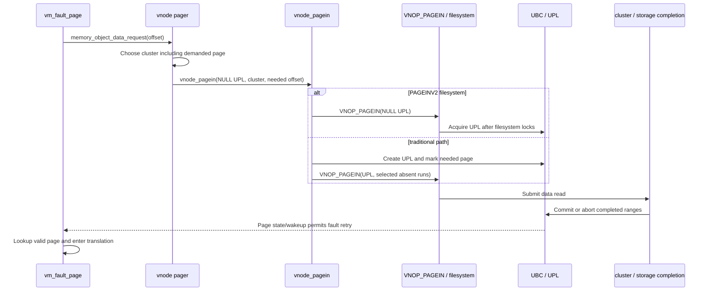

# Pagers, UBC, and page ownership during I/O

[VM index](README.md) · [Objects and pages](objects-and-pages.md) · [Wiring and memory entries](wiring-and-memory-entries.md) · [VFS I/O](../vfs/io-and-cache.md)

A pager supplies backing behavior for VM contents. A universal page list, or UPL, records pages participating in I/O and the work needed to finish with them. The unified buffer cache, or UBC, connects file vnodes to these VM objects and pages. Reading this path requires following both data movement and completion: a successful allocation or I/O submission does not complete page ownership.

For the general I/O-wire gather loop, copy synchronization, absent-but-busy pages, partial completion and vector ownership, continue with [UPL gathering and completion](upl-gather-and-completion.md).

[Executable pages and UPL I/O](executable-pages-and-upl-io.md) explains when mapping policy requires temporary copied backing before gathering, and how completion releases that backing after its kernel mapping has gone.

For the syscall-side resident hit, missing-page read and truncation paths, continue with [file-data caching](../vfs/file-data-cache-and-read-path.md). [Page-signature validation](../security/page-signature-validation.md) explains the additional integrity state, including why signed-object UPL commits suppress caller-supplied validation bits and how COW and transforming pagers propagate selected results.

For the concrete file-backed allocations, use [UBC and vnode pagers](../../structures/ubc-and-vnode-pagers.md) alongside this operation trace. It follows ubc_info/pager creation, control access, named and mapping holds, partial initialization, truncation and final association release.

## The pager boundary is an object interface

A VM object's `pager` is a `memory_object_t`, whose [generic header](../../../platydoc-data/xnu/osfmk/mach/memory_object_types.h#L120) supplies `mo_pager_ops`, `mo_control` and other bookkeeping. Individual pagers embed this header and supply an operation table: reference/deallocate, initialization/termination, data request/return, map/last-unmap and related operations.

[`memory_object_data_request`](../../../platydoc-data/xnu/osfmk/vm/memory_object.c#L1971) dispatches through that table:

<!-- source-excerpt: ../../../platydoc-data/xnu/osfmk/vm/memory_object.c#L1970-L1986 -->
```c
kern_return_t
memory_object_data_request
(
	memory_object_t memory_object,
	memory_object_offset_t offset,
	memory_object_cluster_size_t length,
	vm_prot_t desired_access,
	memory_object_fault_info_t fault_info
)
{
	return (memory_object->mo_pager_ops->memory_object_data_request)(
		memory_object,
		offset,
		length,
		desired_access,
		fault_info);
}
```

These calls are not automatically Mach messages to a userspace pager. In this checkout [`memory_object_control_allocate` and `memory_object_control_to_vm_object`](../../../platydoc-data/xnu/osfmk/vm/memory_object.c#L1845) are identity conversions between the control association and a VM object pointer. The control reference/deallocation helpers here do not implement a separate ordinary refcount; surrounding object/pager protocols supply lifetime protection. A `vm_named_entry` send right is a different interface, described in [memory entries](wiring-and-memory-entries.md).

The VM object translates its offsets with `paging_offset` when addressing its pager. A shadow traversal has its own offset translation, so “offset in the map,” “offset in the object” and “offset in the pager” need separate names in a trace. The vnode-backed UPL path asserts that an external object's paging offset is zero; do not infer arbitrary shifted file UPLs from the generic object fields.

[`vm_fault_page`](../../../platydoc-data/xnu/osfmk/vm/vm_fault.c#L1801) has distinct anonymous/compressor and external-pager paths. The compressor can be called directly when a compressed slot exists, whereas an externally backed miss uses the pager request interface. Sharing the generic object machinery does not make all pager implementations identical I/O engines.

## How a file becomes VM backing

[`ubc_info_init_internal`](../../../platydoc-data/xnu/bsd/kern/ubc_subr.c#L1096) creates or reuses the vnode's `ubc_info`, attaches it through `v_ubcinfo` and records `ui_vnode`. It creates a vnode pager, stores `ui_pager` and calls `memory_object_create_named` to establish the VM association. The returned control is cached in `ui_control`; `UI_HASOBJREF` and `VNAMED_UBC` record the named association.

The lifetime handoff is explicit [in UBC setup](../../../platydoc-data/xnu/bsd/kern/ubc_subr.c#L1156).

<!-- source-excerpt: ../../../platydoc-data/xnu/bsd/kern/ubc_subr.c#L1156-L1165 -->
```c
	kret = memory_object_create_named(pager,
	    (memory_object_size_t)uip->ui_size, &control);
	vnode_pager_deallocate(pager);
	if (kret != KERN_SUCCESS) {
		panic("ubc_info_init: memory_object_create_named returned %d", kret);
	}

	assert(control);
	uip->ui_control = control;      /* cache the value of the mo control */
	SET(uip->ui_flags, UI_HASOBJREF);       /* with a named reference */
```

The temporary pager reference returned by setup is released because the named association took its own reference. A file's VM object can therefore outlive one mapping, one file descriptor and one resident page. `ui_size` is established from the vnode or supplied file size; it should not be confused with the internal-object size union described in [objects and pages](objects-and-pages.md).

[`vnode_pager_init`](../../../platydoc-data/xnu/osfmk/vm/bsd_vm.c#L400-L439) stores the control and requests delayed-copy/cacheable backing. Its argument also supplies a one-page `cluster_size` and `temporary = TRUE`, but this snapshot's [`MEMORY_OBJECT_ATTRIBUTE_INFO` handler](../../../platydoc-data/xnu/osfmk/vm/memory_object.c#L1191-L1205) consumes only `copy_strategy` and `may_cache_object`; the [common setter](../../../platydoc-data/xnu/osfmk/vm/memory_object.c#L1063-L1083) updates strategy, persistence and readiness. The [control-reference helper](../../../platydoc-data/xnu/osfmk/vm/memory_object.c#L1882-L1898) is a no-op here. Fault clustering is selected separately by [`vnode_pager_data_request`](../../../platydoc-data/xnu/osfmk/vm/bsd_vm.c#L647-L675).

[`vnode_pager_map` / `vnode_pager_last_unmap`](../../../platydoc-data/xnu/osfmk/vm/bsd_vm.c#L731) call the UBC mapping notifications. This is why object reference transitions can trigger pager notifications even without transferring file data.

BSD [`mmap`](../../../platydoc-data/xnu/bsd/kern/kern_mman.c#L833) obtains the UBC control with `ubc_getobject` and maps backing into the process. A private mapping can put COW contents above file backing; shared mapping writes stay associated with the file object. [`ubc_info_free`](../../../platydoc-data/xnu/bsd/kern/ubc_subr.c#L1198) releases credentials, the control association, cluster state and code-signing state. It is one teardown stage; it does not by itself describe the entire vnode/named-object release protocol.

## A missing file page: demand, cluster, filesystem, completion

The main path is:



[`vnode_pager_data_request`](../../../platydoc-data/xnu/osfmk/vm/bsd_vm.c#L647) chooses a cluster around the demanded offset using `memory_object_cluster_size`, falling back to one page. The original offset must remain inside the selected extent. [`vnode_pager_cluster_read`](../../../platydoc-data/xnu/osfmk/vm/bsd_vm.c#L855) passes a null UPL and the demanded page's displacement within that extent to `vnode_pagein`.

[`vnode_pagein`](../../../platydoc-data/xnu/bsd/vm/vnode_pager.c#L612) takes a vnode I/O count using a pager-specific helper, with paging/I/O synchronization preventing reclaim. The two UPL-creation routes matter for lock order:

- A filesystem advertising `VFC_VFSVNOP_PAGEINV2` receives a null UPL in `VNOP_PAGEIN`. It must gather the requested range into a UPL after acquiring whatever filesystem locks it needs. It may clip the extent while preserving the demanded page.
- The traditional path calls `ubc_create_upl_kernel` itself, marks the demanded page with `ubc_upl_range_needed` and scans the UPL to issue runs of present-but-invalid page slots. Already valid or unavailable slots do not become ordinary disk-read requests.

The filesystem-owned route is documented [at the call site](../../../platydoc-data/xnu/bsd/vm/vnode_pager.c#L671).

<!-- source-excerpt: ../../../platydoc-data/xnu/bsd/vm/vnode_pager.c#L671-L685 -->
```c
		if (vp->v_mount->mnt_vtable->vfc_vfsflags & VFC_VFSVNOP_PAGEINV2) {
			/*
			 * filesystem has requested the new form of VNOP_PAGEIN for file
			 * backed objects... we will not grab the UPL befofe calling VNOP_PAGEIN...
			 * it is the fileystem's responsibility to grab the range we're denoting
			 * via 'f_offset' and 'size' into a UPL... this allows the filesystem to first
			 * take any locks it needs, before effectively locking the pages into a UPL...
			 * so we pass a NULL into the filesystem instead of a UPL pointer... the 'upl_offset'
			 * is used to identify the "must have" page in the extent... the filesystem is free
			 * to clip the extent to better fit the underlying FS blocksize if it desires as
			 * long as it continues to include the "must have" page... 'f_offset' + 'upl_offset'
			 * identifies that page
			 */
			if ((error = VNOP_PAGEIN(vp, NULL, upl_offset, (off_t)f_offset,
			    size, flags, vfs_context_current()))) {
```

The request can complete asynchronously, or return errors that require restart/abort handling. `EAGAIN` from decompression and `EPERM` from content protection have explicit abort handling at this layer. Do not assume every failing `VNOP_PAGEIN` leaves the same layer responsible for all cleanup; the flags and comments identify which lower layer normally commits/aborts.

A filesystem can use [`cluster_pagein_ext`](../../../platydoc-data/xnu/bsd/vfs/vfs_cluster.c#L2871). It validates file bounds/alignment, clips to EOF, aborts unusable tail ranges and calls `cluster_io` with `CL_READ | CL_PAGEIN`. Without `UPL_IOSYNC` it selects asynchronous operation; without `UPL_NOCOMMIT` it requests completion of the UPL. Split page-in can prioritize the needed page for large reads on supported storage.

The cluster completion path accounts for residual I/O/errors, zeroes an EOF tail where needed, performs verification callbacks where configured and then commits or aborts UPL ranges. Its [commit decision](../../../platydoc-data/xnu/bsd/vfs/vfs_cluster.c#L1230) is the point at which successful storage completion becomes a VM page-state transition. The filesystem's own block mapping and device transport are outside this generic VM trace; see [VFS I/O](../vfs/io-and-cache.md).

## What a UPL owns and what its page list means

The private [`struct upl`](../../../platydoc-data/xnu/osfmk/vm/vm_pageout_xnu.h#L206) has its own mutex and reference counts, flags, byte offset/size, mapped range state, `map_object`, optional vector association, completion callback and per-page metadata. The offsets/sizes are byte-oriented for mixed page-size support; individual creators can impose stronger alignment requirements.

The central fields are [defined here](../../../platydoc-data/xnu/osfmk/vm/vm_pageout_xnu.h#L206).

<!-- source-excerpt: ../../../platydoc-data/xnu/osfmk/vm/vm_pageout_xnu.h#L206-L221 -->
```c
struct upl {
	decl_lck_mtx_data(, Lock);      /* Synchronization */
	int             ref_count;
	int             ext_ref_count;
	int             flags;
	ctid_t          map_addr_owner; /* owning thread for upl_map_range */
	/*
	 * XXX CAUTION: to accomodate devices with "mixed page sizes",
	 * u_offset and u_size are now byte-aligned and no longer
	 * page-aligned, on all devices.
	 */
	vm_object_offset_t u_offset;
	upl_size_t      u_size;       /* size in bytes of the address space */
	upl_size_t      u_mapped_size;       /* size in bytes of the UPL that is mapped */
	vm_offset_t     kaddr;      /* secondary mapping in kernel */
	vm_object_t     map_object;
```

An internal UPL has its `upl_page_info` array allocated with the UPL. A lite UPL uses a bitmap to identify participating pages while referring to the original object, avoiding a full alias-object page list. A non-lite UPL can create a temporary pageout object shadowing the original, with alias descriptors for its pages. `UPL_SHADOWED` records that arrangement. “Internal UPL” describes metadata placement; it is not a claim that all backing pages are anonymous/internal VM objects.

[`upl_create`](../../../platydoc-data/xnu/osfmk/vm/vm_pageout.c#L6139) creates the header, optional internal page array and lite bitmap, initializes the reference count and lock, and may enable I/O tracking. [`upl_page_info`](../../../platydoc-data/xnu/osfmk/mach/memory_object_types.h#L482) supplies physical page number and flags such as absent, dirty, precious, needed and code-signing state. A zero physical-address slot can mean that the page was deliberately omitted. A UPL's requested span need not contain a participating page at every offset.

`u_offset` and `u_size` describe the transfer; `kaddr` and `u_mapped_size` describe a secondary mapping if one was created. [`vm_upl_map_range`](../../../platydoc-data/xnu/osfmk/vm/vm_upl.c#L79) rounds for the destination map's page size and calls `vm_map_enter_upl_range`; this implementation [asserts that the map is `kernel_map`](../../../platydoc-data/xnu/osfmk/vm/vm_pageout.c#L7876). It can create an alias/pageout object when busy pages cannot be mapped directly. Unmap uses the matching remove path. Collecting physical pages into a UPL does not itself guarantee a CPU virtual mapping or a device DMA mapping.

## Creating the UBC UPL

[`ubc_create_upl_kernel`](../../../platydoc-data/xnu/bsd/kern/ubc_subr.c#L2577) translates filesystem intentions before invoking `memory_object_upl_request`:

| Intention | Selected VM behavior |
|---|---|
| `UPL_UBC_PAGEIN` | Select absent pages; internal/lite metadata; no unnecessary synchronization; larger requests may be nonblocking. |
| `UPL_UBC_PAGEOUT` | Copy contents out, clean in place and identify pageout work; dirty-only requests can use `UPL_NOBLOCK`. |
| `UPL_UBC_MSYNC` | Copy contents out and clean in place, with optional dirty-only selection. |

For clustered page-in, `UPL_NOBLOCK` is omitted when requesting exactly one VM page. That permits recovery from an earlier partial cluster without pinning many pages while waiting for more free memory.

[`vm_object_upl_request`](../../../platydoc-data/xnu/osfmk/vm/vm_pageout.c#L6567) rejects unknown flags, asserts object/page alignment, clamps maximum size and chooses lite versus shadow-object representation. It then locks the original object and [takes an activity hold](../../../platydoc-data/xnu/osfmk/vm/vm_pageout.c#L6706). The comment may speak of “paging references,” but the current call is `vm_object_activity_begin`:

<!-- source-excerpt: ../../../platydoc-data/xnu/osfmk/vm/vm_pageout.c#L6706-L6712 -->
```c
	vm_page_grab_prime();
	vm_object_lock(object);
	vm_object_activity_begin(object);
	if (cntrl_flags & UPL_WILL_MODIFY) {
		token = thread_priority_floor_start();
		vm_object_pl_req_begin(object);
	}
```

For a modifying operation, it synchronizes with `vo_copy` using `vm_object_update(..., MEMORY_OBJECT_COPY_SYNC, ...)`. If it drops the object lock and the copy pointer or version changes, it repeats synchronization for the remaining range. This preserves delayed-copy obligations before I/O changes original contents; making pages resident alone would not preserve an old snapshot.

The page-in side looks up each offset. If missing, it can grab and insert a page, set `vmp_absent` and mark clustered read-ahead. With absent-only/nonblocking flags, allocation shortage can leave empty slots instead of stalling while already holding a large collection. Private device-backed objects cannot fabricate their physical backing by this ordinary allocation path; their missing slots are left for faults/provider handling.

Participating pages become `vmp_overwriting`. An ordinary unwired target becomes busy to block competing use; an already wired page can receive an additional wire instead. Depending on flags/configuration, old mappings are disconnected and hardware ref/mod state gathered. The result's page-info fields describe the pages selected, while the activity hold remains until completion.

The copyout-from/pageout side instead selects resident pages, rejects unsuitable absent/error/already-cleaning/wired pages, inspects hardware modification state and applies dirty/precious selection. Lite cleaning sets its participation bit and `vmp_cleaning`; non-lite cleaning creates alias state. `UPL_CLEAN_IN_PLACE` influences whether a cleaned page should remain cached or be freed when done.

## Commit, abort and deallocate are separate operations

The completion entry points [`upl_commit_range`](../../../platydoc-data/xnu/osfmk/vm/vm_upl.c#L596) and [`upl_abort_range`](../../../platydoc-data/xnu/osfmk/vm/vm_upl.c#L165) lock the UPL, resolve vector sub-UPLs if present, lock the associated objects and process only the participating range. They use delayed page work to batch queue-changing operations rather than holding every lock for the entire operation.

For an ordinary successful page-in, commit clears the absent/overwriting/cleaning state and releases the busy state or additional wire that stabilized the page. Clustered read-ahead can enter speculative queues; referenced pages can become active; flags can request inactivation or dirty accounting. Waiters are woken after the state permits progress.

The central nonwired overwrite completion is [visible in commit](../../../platydoc-data/xnu/osfmk/vm/vm_upl.c#L1067).

<!-- source-excerpt: ../../../platydoc-data/xnu/osfmk/vm/vm_upl.c#L1067-L1075 -->
```c
				assert(m->vmp_busy);
#if CONFIG_PHANTOM_CACHE
				if (m->vmp_absent && !m_object->internal) {
					dwp->dw_mask |= DW_vm_phantom_cache_update;
				}
#endif
				m->vmp_absent = FALSE;

				dwp->dw_mask |= DW_clear_busy;
```

Commit does not universally mean “free the page.” If cleaning requested free-when-done, commit rechecks whether it was modified again; a redirtied page must remain resident and dirty because the storage copy may be stale. Other successful pages remain cached. Code-signing validity can also be cleared after modification unless an authorized validated completion path supplies the appropriate state.

Abort likewise is not a synonym for dropping everything:

| Abort condition | Representative effect |
|---|---|
| `UPL_ABORT_RESTART` | Mark restart/unusual state so the consumer can retry instead of accepting incomplete contents. |
| `UPL_ABORT_ERROR` | Record an error for the demanded page and wake waiters. |
| `UPL_ABORT_UNAVAILABLE` | Preserve the relevant unavailable/absent condition. |
| `UPL_ABORT_DUMP_PAGES` | Disconnect/discard pages where supported; this is stronger than a normal I/O abort. |
| Unneeded failed read-ahead page | Can be freed rather than leave an error state nobody is waiting to consume. |

An I/O-wired UPL without dump-pages is explicitly routed to commit with `UPL_COMMIT_FREE_ABSENT`. The [early branch](../../../platydoc-data/xnu/osfmk/vm/vm_upl.c#L199) prevents applying a simplistic “abort always frees data” model:

<!-- source-excerpt: ../../../platydoc-data/xnu/osfmk/vm/vm_upl.c#L199-L201 -->
```c
	if ((upl->flags & UPL_IO_WIRE) && !(error & UPL_ABORT_DUMP_PAGES)) {
		return upl_commit_range(upl, offset, size, UPL_COMMIT_FREE_ABSENT, NULL, 0, empty);
	}
```

When all participating pages are gone, the lite/nonshadow path releases the object's activity hold. A shadowed pageout object owns the corresponding deferred cleanup; `vm_pageout_object_terminate` handles that relationship. Optional I/O tracking can hold another activity reference until UPL destruction. Bitmap emptiness, not just processed byte count, determines whether a lite UPL is finished.

`upl_deallocate` releases the UPL's own reference and destroys its metadata on the last reference. It is not a substitute for completing busy/absent/cleaning pages. The UBC convenience wrapper [`ubc_upl_commit_range`](../../../platydoc-data/xnu/bsd/kern/ubc_subr.c#L2844) converts `UPL_COMMIT_FREE_ON_EMPTY` into notification, calls commit and deallocates only when empty:

<!-- source-excerpt: ../../../platydoc-data/xnu/bsd/kern/ubc_subr.c#L2864-L2871 -->
```c
	kr = upl_commit_range(upl, offset, size, flags,
	    pl, MAX_UPL_SIZE_BYTES >> PAGE_SHIFT, &empty);

	if ((flags & UPL_COMMIT_FREE_ON_EMPTY) && empty) {
		upl_deallocate(upl);
	}

	return kr;
```

This separation is the practical ownership contract: finish each selected page range, release any secondary mapping as required, and release the UPL metadata reference. A buffer completion callback can discharge these obligations later than the submitting thread.

## Dirty file pages travel back through the vnode

The external worker [`vm_pageout_iothread_external_continue`](../../../platydoc-data/xnu/osfmk/vm/vm_pageout.c#L4494) removes work from the pending pageout queue under the page-queue lock. It snapshots the page's object and offset, drops that lock, acquires the object lock and looks the page up again. The queued activity hold preserves the object, but not the identity or continued presence of the original page.

The relookup is [unambiguous in the implementation](../../../platydoc-data/xnu/osfmk/vm/vm_pageout.c#L4528).

<!-- source-excerpt: ../../../platydoc-data/xnu/osfmk/vm/vm_pageout.c#L4530-L4540 -->
```c
			object = VM_PAGE_OBJECT(m);
			offset = m->vmp_offset;

			m->vmp_q_state = VM_PAGE_NOT_ON_Q;
			VM_PAGE_ZERO_PAGEQ_ENTRY(m);

			vm_page_unlock_queues();

			vm_object_lock(object);

			m = vm_page_lookup(object, offset);
```

If the page was cleaned, removed or changed state, the worker releases the activity and skips it. Otherwise it exchanges that hold for `paging_in_progress`, releases the object lock and calls `memory_object_data_return`. The paging hold stabilizes the pager association and offset during the call; it ends after the call returns.

[`vnode_pager_data_return`](../../../platydoc-data/xnu/osfmk/vm/bsd_vm.c#L446) reaches [`vnode_pager_cluster_write`](../../../platydoc-data/xnu/osfmk/vm/bsd_vm.c#L774). Ordinary pageout chooses a cluster bounded by file size and passes it to `vnode_pageout`; `UPL_MSYNC` iterates requested chunks and handles residual/error reporting separately. The filesystem/cluster completion eventually commits or aborts the selected UPL pages. Sending one page to the pager can therefore drive a larger I/O, but completion still reconciles each selected page's state.

## Map-based UPL creation

[`vm_map_create_upl`](../../../platydoc-data/xnu/osfmk/vm/vm_pageout.c#L7484) translates a virtual range into the object-based I/O request. Its range-lock preflight prepares the object for sharing and resolves pending COW/submap cases before releasing map protection. It can shorten the returned size to the current entry's extent or the maximum UPL size, so callers must use the returned size. Read/write permission checks depend on transfer direction. Some executable-memory policy cases require copying through a temporary kernel buffer instead of wiring the original pages.

Before dropping the range lock, it marks the object shared and takes an ordinary reference. It then calls [`vm_object_iopl_request`](../../../platydoc-data/xnu/osfmk/vm/vm_pageout.c#L7829) with the translated object offset and releases that temporary reference afterward. The UPL establishes its own page/activity obligations. This ordering prevents a disappearing map entry from invalidating the object pointer, while still allowing I/O gathering to proceed without the map range lock held.

## Device backing and I/O-wired UPLs

[`device_pager_setup`](../../../platydoc-data/xnu/osfmk/vm/device_vm.c#L138) creates a named object, marks the control trusted for VM pager handling and establishes permanent sharing. “Trusted” here is a VM pager attribute, not a statement that arbitrary user memory has passed code-signing validation. [`device_pager_init`](../../../platydoc-data/xnu/osfmk/vm/device_vm.c#L247) marks the object private, applies contiguous/cache flags and sets copy strategy `MEMORY_OBJECT_COPY_NONE`.

A data request reaches [`device_pager_data_action`](../../../platydoc-data/xnu/osfmk/vm/device_vm.c#L306), which validates the requested extent and calls `device_data_action`. The [IOKit callback](../../../platydoc-data/xnu/iokit/Kernel/IOMemoryDescriptor.cpp#L217) retains the descriptor while invoking `handleFault` under its synchronization. [`device_pager_populate_object`](../../../platydoc-data/xnu/osfmk/vm/device_vm.c#L180) can install private physical-page descriptions through `vm_object_populate_with_private`; these are not newly allocated anonymous RAM pages.

[`vm_object_iopl_request`](../../../platydoc-data/xnu/osfmk/vm/vm_pageout.c#L8618) is a distinct I/O-oriented gathering path used behind map/descriptor operations. It rounds object coordinates while preserving original byte offsets, derives read versus read/write fault access from transfer direction, validates low-address requirements, and has special physically contiguous/device-memory representation. It can block access until completion and has its own physical wire and completion accounting. The [gathering companion](upl-gather-and-completion.md#resident-fast-paths-and-the-general-fault-loop) traces its fast and faulting paths, delayed work, failure unwind and completion state.

A physical page list still does not define device-visible addresses, DMA permissions or cache synchronization for every device. The descriptor, I/O mapper and driver protocols supply those additional steps; see [driver memory and DMA](../drivers/memory-and-dma.md). CPU pmap translations and IOMMU mappings belong to different translation domains even when they refer to the same physical RAM.

## Sources inspected and limits

| Area | Inspection depth | Limits |
|---|---|---|
| Pager/control and vnode pager | Generic header/dispatch, control identity, vnode setup/init, request/return, cluster boundaries and pager lifetime | Other pager operation tables are identified, not each implementation exhaustively traced. |
| UBC and `vnode_pagein` | Named association, UPL flag translation, traditional versus PAGEINV2 creation, selected error paths | Filesystem-private implementations and full vnode reclaim/truncation coordination are outside this chapter. |
| UPL request/commit/abort/destruction | Lite versus alias representation, activity holds, COW synchronization, page state, empty detection, UBC deallocation | The companion covers IOPL gathering and vector completion; every I/O tracking/MTE branch and mixed-page-size combination remain partial coverage. |
| Cluster I/O and pageout | Page-in bounds/submission, completion-to-UPL boundary, external worker relookup and data-return | Device transport and all filesystem writeback policies are covered only at their interface here. |
| Device pager | Setup, private population, request callback, deallocation boundary | Driver-specific fault providers, DMA translation hardware and external filesystems cannot be inferred from this generic adapter. |

For a first complete read, follow `ubc_info_init_internal → vnode_pager_data_request → vnode_pagein → ubc_create_upl_kernel → vm_object_upl_request`, then pair each successful allocation with `upl_commit_range` or `upl_abort_range` and the eventual `upl_deallocate`. Keep the filesystem's asynchronous completion in the trace; it is where the page ownership returns.

[Shared regions and transforming pagers](shared-regions-and-transforming-pagers.md) follows the shared-cache installation and dyld/shared-region fault paths, including source busy/paging ownership, destination UPL validation metadata, fixups and pager teardown.

<!-- BEGIN PLATYDOC DOCUMENTATION LICENSE -->
Original Platydoc text and diagrams are licensed under [CC BY 4.0](https://creativecommons.org/licenses/by/4.0/). Quoted source code and third-party material retain their respective licenses.
<!-- END PLATYDOC DOCUMENTATION LICENSE -->
