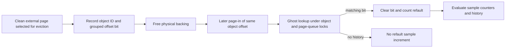

# Phantom cache: recording eviction and measuring refaults

[VM guide](README.md) · [Reclaim and pressure](reclaim-and-pressure.md) · [Compressor/swap](compressor-segments-and-swapfiles.md) · [Pagers and UPL](pagers-and-upl.md)

The phantom cache records that a file-backed page was recently evicted. It does not retain the page's bytes or a physical-page reference. A later page-in can match that history, allowing the compressor policy to distinguish repeated loss of the same working set from a stream of unrelated reads. Both recording and use are configuration-dependent; the compressor thrashing decision examined here explicitly excludes this pressure path on macOS ARM64. [Implementation](../../../xnu/osfmk/vm/vm_phantom_cache.c#L172-L360), [policy guard](../../../xnu/osfmk/vm/vm_compressor.c#L2859-L2884).

## History entries have object identity and a small page bitmap

`struct vm_ghost` contains a hash-chain index, page-presence bits, a grouped object offset and a numeric object identity. This checkout groups four VM pages per entry. `vm_object.phantom_object_id` and `phantom_isssd` identify the backing and latency class; the record does not point to a live `vm_page` or retain a vnode. The bounded identity/offset representation makes it a policy history structure rather than a correctness-critical backing store. [Representation constants](../../../xnu/osfmk/vm/vm_phantom_cache_internal.h#L31-L45), [identity allocation](../../../xnu/osfmk/vm/vm_phantom_cache.c#L172-L218).

[Source: `osfmk/vm/vm_phantom_cache_internal.h`, lines 31–43](../../../xnu/osfmk/vm/vm_phantom_cache_internal.h#L31-L43).

<!-- source-excerpt: ../../../xnu/osfmk/vm/vm_phantom_cache_internal.h#L31-L43 -->
```c
#define         VM_GHOST_OFFSET_BITS    39
#define         VM_GHOST_OFFSET_MASK    0x7FFFFFFFFF
#define         VM_GHOST_PAGES_PER_ENTRY 4
#define         VM_GHOST_PAGE_MASK      0x3
#define         VM_GHOST_PAGE_SHIFT     2
#define         VM_GHOST_INDEX_BITS     (64 - VM_GHOST_OFFSET_BITS - VM_GHOST_PAGES_PER_ENTRY)

struct  vm_ghost {
	uint64_t        g_next_index:VM_GHOST_INDEX_BITS,
	    g_pages_held:VM_GHOST_PAGES_PER_ENTRY,
	    g_obj_offset:VM_GHOST_OFFSET_BITS;
	uint32_t        g_obj_id;
} __attribute__((packed));
```

Initialization requires the compressor to be active. It sizes a power-of-two entry table from physical-memory/page counts with target-specific ratios and bounds the index width. Ghost and hash tables are permanent kernel allocations. Zero index is the end-of-chain sentinel; insertion rotates through usable records and reuses their storage. [Initialization](../../../xnu/osfmk/vm/vm_phantom_cache.c#L107-L168), [replacement](../../../xnu/osfmk/vm/vm_phantom_cache.c#L220-L272).

For a concrete geometry example, take an object page index `j = offset >> PAGE_SHIFT`. Its grouped offset is `j >> 2`, and one of four bits identifies `j & 3`. The physical-page number is absent from this key. If a page returns at a different physical address, it can still match the same recently evicted object offset. The example applies to the selected VM page size rather than assuming four-kilobyte pages.

## Insertion and refault update hold both relevant locks

The pageout clean-page branch records a ghost for an external object before reclaiming that page. `vm_phantom_cache_add_ghost()` asserts page-queue and exclusive object locking. It skips a disabled table and an object whose pager has disappeared, such as after force-unmount: that backing will not produce a meaningful future refault. The first record allocates an object ID and queries the vnode pager's SSD classification. Existing grouped history can simply set another page bit. [Pageout caller](../../../xnu/osfmk/vm/vm_pageout.c#L4327-L4343), [insertion](../../../xnu/osfmk/vm/vm_phantom_cache.c#L172-L218).

When a new record replaces old history, it first unlinks the old record from its hash chain, writes identity/group/bitmap and inserts it into the new chain. The cursor is circular; despite the source comment's “LRU” wording, the body here advances a replacement index rather than updating a global recency list on every lookup. [Replacement body](../../../xnu/osfmk/vm/vm_phantom_cache.c#L220-L272).

`vm_phantom_cache_update()` performs the reverse lookup under the same locks. On a matching bit, it clears that bit and increments refault counters. This prevents repeated reporting of the same historical eviction without a fresh insertion. The deferred page-operation path calls it for `DW_vm_phantom_cache_update`; it is not a callback from every arbitrary `vm_page_lookup()`. [Update](../../../xnu/osfmk/vm/vm_phantom_cache.c#L330-L360), [delayed-work dispatch](../../../xnu/osfmk/vm/vm_resident.c#L8537-L8541).



No arrow from the ghost record supplies page bytes: the vnode pager and I/O path still provide the contents. History replacement simply forgets a possible future sample; it cannot lose the sole backing of a file page.

## Sampling detects repeated turnover, not just high read volume

`is_thrashing(added, found, threshold)` first requires enough evictions and refaults, then requires at least roughly half the eviction count to be found again. A newly launched workload can generate heavy reads with few history hits, so throughput alone is insufficient. SSD and non-SSD backing have separate counts/thresholds. [Predicate](../../../xnu/osfmk/vm/vm_phantom_cache.c#L380-L411).

[Source: `osfmk/vm/vm_phantom_cache.c`, lines 386–408](../../../xnu/osfmk/vm/vm_phantom_cache.c#L386-L408).

<!-- source-excerpt: ../../../xnu/osfmk/vm/vm_phantom_cache.c#L386-L408 -->
```c
static boolean_t
is_thrashing(uint32_t added, uint32_t found, uint32_t threshold)
{
	/* Ignore normal activity below the threshold. */
	if (added < threshold || found < threshold) {
		return FALSE;
	}

	/*
	 * When thrashing in a way that we can mitigate, most of the pages read
	 * into the file cache were recently evicted, and 'found' will be close
	 * to 'added'.
	 *
	 * When replacing the current working set because a new app is
	 * launched, we see very high read traffic with sporadic phantom cache
	 * hits.
	 *
	 * This is not thrashing, or freeing up memory wouldn't help much
	 * anyway.
	 */
	if (found < added / 2) {
		return FALSE;
	}
```

`vm_phantom_cache_check_pressure()` ages a bit history across sampling intervals, resets counters when an interval expires or restart is requested, and sets the current bit when a threshold is met. It requires a configured number of consecutive periods and suppresses the result when pageable external memory exceeds its available-memory comparison. `vm_phantom_cache_restart_sample()` requests a new interval after conditions change. These heuristics influence pressure decisions; they do not provide an exact accounting of all file-cache misses. [Sampling/history](../../../xnu/osfmk/vm/vm_phantom_cache.c#L421-L515).

## ARM64 configuration boundary and policy effect

The compressor's `compressor_needs_to_swap()` first considers ripe segments and ordinary active-swap/free-memory conditions. Its later compressor-thrashing/phantom-cache block is excluded by `XNU_TARGET_OS_OSX && __arm64__`; within the other branch, phantom use also requires `CONFIG_PHANTOM_CACHE`. Where that code runs, a positive result publishes `memorystatus_phantom_cache_pressure` and requests swap consideration. This is not a statement that every ARM64 device runs that policy, or that any recorded ghost automatically triggers disk I/O. [Exact decision context](../../../xnu/osfmk/vm/vm_compressor.c#L2844-L2884).

[Source: `osfmk/vm/vm_compressor.c`, lines 2859–2884](../../../xnu/osfmk/vm/vm_compressor.c#L2859-L2884).

<!-- source-excerpt: ../../../xnu/osfmk/vm/vm_compressor.c#L2859-L2884 -->
```c
#if (XNU_TARGET_OS_OSX && __arm64__)
	/*
	 * Thrashing detection disabled.
	 */
#else /* (XNU_TARGET_OS_OSX && __arm64__) */

	bool compressor_is_thrashing = vm_compressor_is_thrashing();
	if (compressor_is_thrashing) {
		should_swap = true;
		vmcs_stats.thrashing_detected++;
	}

#if CONFIG_PHANTOM_CACHE
	if (vm_phantom_cache_check_pressure()) {
		os_atomic_store(&memorystatus_phantom_cache_pressure, true, release);
		should_swap = true;
	}
#endif
	if (swapout_target_age) {
		should_swap = true;
	}
#endif /* (XNU_TARGET_OS_OSX && __arm64__) */

check_if_low_space:

#if CONFIG_JETSAM
```

Recording may exist even where this particular consumer is compiled out. Preserve that distinction when discussing macOS Apple-silicon behavior: an available structure or source file is not evidence that its pressure branch participates in the selected product. The present trace covers bounded history, locking, refault updates and this compressor consumer; it does not claim all tunables represent shipping defaults or that every pressure consumer has been reviewed.

<!-- BEGIN PLATYDOC DOCUMENTATION LICENSE -->
Original Platydoc text and diagrams are licensed under [CC BY 4.0](https://creativecommons.org/licenses/by/4.0/). Quoted source code and third-party material retain their respective licenses.
<!-- END PLATYDOC DOCUMENTATION LICENSE -->
