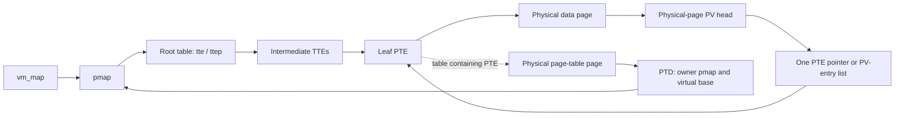

# ARM64 pmap: address spaces, page tables, and reverse mappings

For concrete 4 KiB/16 KiB address walks, descriptor locations, and decoded PTE values, start with [pmap translation walkthroughs](pmap-translation-walkthroughs.md).

A `vm_map` records which virtual ranges exist and how VM obtains their contents. Its `pmap` records the hardware translations currently installed for those ranges. A valid VM mapping can have no PTE because it has never faulted, has been paged out, or had translations reclaimed. Conversely, kernel physical-aperture mappings exist for accessing physical memory without representing a separate pageable user allocation. Begin with [virtual-address maps](virtual-address-maps.md) and [fault resolution](fault-resolution.md) for the policy and residency side; this page follows the structures that a fault eventually updates. The handoff is `vm_fault_enter()` and the pmap-enter wrappers in [vm_fault.c](../../../xnu/osfmk/vm/vm_fault.c#L3813).

There are two ARM64 implementations in this checkout. The legacy implementation under `osfmk/arm/pmap/` can run with `XNU_MONITOR` protection through the Page Protection Layer (PPL). The SPTM implementation under `osfmk/arm64/sptm/pmap/` requests protected changes through `sptm_*` interfaces. The build selects these through [files.arm64](../../../xnu/osfmk/conf/files.arm64#L10). Similar exported function names conceal substantially different synchronization and table ownership. Read [mapping lifecycle](pmap-mapping-lifecycle.md) next, followed by [TLB and cache completion](pmap-tlb-and-cache.md). The [monitor guide](../platform/exception-levels-and-monitors.md) describes the visible crossing interfaces and the missing external monitor implementation.

## The objects behind one translation

For the protected side of these operations, continue into [SPTM frame authority and entry/exit](../security/sptm.md), [TXM signature and address-space lifetimes](../security/txm.md), and [Exclaves page donation and sharing](../security/exclaves-resources-and-memory.md). These guides distinguish XNU's mapping metadata from protected frame ownership and the state retained across external calls.



The forward walk is virtual address → table entries → physical address. The reverse walk is physical page → all tracked PTE pointers → each table's PTD → owning pmap and virtual address. That reverse walk makes it possible to disconnect aliases or change reference/modify tracking for a physical page without searching every process. The implementation lives in [SPTM pmap_vtophys](../../../xnu/osfmk/arm64/sptm/pmap/pmap.c#L7214), the [PV-head representation](../../../xnu/osfmk/arm64/sptm/pmap/pmap_data.h#L153), and [PTD accessors](../../../xnu/osfmk/arm64/sptm/pmap/pmap_data.h#L1010).

| Structure or field | Meaning and use |
| --- | --- |
| `pmap.tte`, `pmap.ttep` | Kernel virtual pointer to the root and its physical address. Software walkers use the former; root registration, activation, and monitor operations use the latter. |
| `pmap.min`, `pmap.max` | Inclusive lower/exclusive upper bounds supported by the hardware hierarchy. They do not replace `vm_map` protection and allocation policy. |
| `pmap.pmap_pt_attr` | Per-pmap geometry when parameterized page tables are enabled; accessor macros select native geometry otherwise. |
| `pmap.ledger` | Task accounting destination for resident mappings, page tables, wired mappings, compressed mappings, and footprint-related categories. |
| `pmap.ref_count`, `type` | Lifetime reference and distinction among user, kernel, commpage, and nested pmaps. |
| `pmap.nested_pmap` and region fields | Describe the shared hierarchy nested into a user pmap; a nested pmap instead uses associated bookkeeping, including the unnest bitmap. |
| Legacy `rwlock`, `tt_entry_free` | Pmap-wide reader/writer synchronization and reusable table chunks. These are absent from the corresponding SPTM core pmap representation. |
| Legacy `hw_asid`, `sw_asid`; SPTM `asid` | Legacy separately records hardware tag and software identity for reuse detection. SPTM stores a virtual ASID and extracts its hardware portion with `PMAP_HWASID`. |

Compare the actual declarations in [legacy pmap.h](../../../xnu/osfmk/arm/pmap/pmap.h#L334) and [SPTM pmap.h](../../../xnu/osfmk/arm64/sptm/pmap/pmap.h#L307). Absence of the legacy `rwlock` does not mean that SPTM pmap code is unsynchronized: it uses physical-page locks, monitor serialization, epochs, and temporary pins; code-signing operations can also need TXM synchronization. Those mechanisms protect different objects.

## Page size is a property of several different layers

Three sizes matter independently: VM's allocation/accounting unit `PAGE_SIZE`, the selected pmap's translation granule `pt_attr_page_size()`, and the storage allocated to hold tables. A 16 KiB VM page can hold several 4 KiB page-table chunks. A process with 4 KiB mappings on a mixed-page-size kernel can also map a subrange of a larger VM page. The fault path therefore passes a physical byte address to `pmap_enter_options_addr()`, not only a VM physical-page number. The geometry and chunk handling are explicit in [SPTM pmap_expand](../../../xnu/osfmk/arm64/sptm/pmap/pmap.c#L7350) and [legacy pmap_tt_allocate](../../../xnu/osfmk/arm/pmap/pmap.c#L3635).

`PAGE_RATIO` relates VM's `PAGE_SHIFT` to the native hardware granule `ARM_PGSHIFT`. It can be a compile-time constant, but the legacy `write_pte_fast()` explicitly handles configurations where `PAGE_SHIFT`, and therefore the ratio, varies at runtime. It is not a universal substitute for `PAGE_SIZE / pt_attr_page_size(pmap_get_pt_attr(pmap))` when a particular pmap has non-native geometry. Both forms appear because they answer different questions: how many PTEs one native VM-page operation covers, and how many selected-geometry tables fit in allocated storage. See [SPTM pmap.h](../../../xnu/osfmk/arm64/sptm/pmap/pmap.h#L220), [legacy ratio handling](../../../xnu/osfmk/arm/pmap/pmap.c#L677), and the explicit `page_ratio` in [pmap_tte_trim](../../../xnu/osfmk/arm64/sptm/pmap/pmap.c#L3587).

`page_table_attr` collects the root and leaf levels, shifts and masks, permission encodings, TCR value, commpage attachment level, and monitor geometry ID. `page_table_ops` supplies geometry/domain-dependent operations such as ASID allocation, TLB invalidation, and cache-attribute conversion. The declarations mention stage-2 generalization, but that is not evidence that the public create path builds guest stage-2 tables: this checkout's SPTM `pmap_create_options_internal()` initializes `is_stage2` to false. See [geometry declarations](../../../xnu/osfmk/arm64/sptm/pmap/pmap_pt_geometry.h#L60) and [pmap creation](../../../xnu/osfmk/arm64/sptm/pmap/pmap.c#L2676).

The following is the actual 16 KiB user geometry. It starts at L1, so a generic four-level ARM drawing would be wrong for this configuration.

[pmap.c, lines 339–357](../../../xnu/osfmk/arm64/sptm/pmap/pmap.c#L339-L357)

<!-- source-excerpt: ../../../xnu/osfmk/arm64/sptm/pmap/pmap.c#L339-L357 -->
```c
const struct page_table_attr pmap_pt_attr_16k = {
	.pta_level_info = pmap_table_level_info_16k,
	.pta_root_level = PMAP_TT_L1_LEVEL,
	.pta_commpage_level = PMAP_TT_L2_LEVEL,
	.pta_max_level  = PMAP_TT_L3_LEVEL,
	.pta_ops = &native_pt_ops,
	.ap_ro = ARM_PTE_AP(AP_RORO),
	.ap_rw = ARM_PTE_AP(AP_RWRW),
	.ap_rona = ARM_PTE_AP(AP_RONA),
	.ap_rwna = ARM_PTE_AP(AP_RWNA),
	.ap_xn = ARM_PTE_PNX | ARM_PTE_NX,
	.ap_x = ARM_PTE_PNX,
#if __ARM_MIXED_PAGE_SIZE__
	.pta_tcr_value  = TCR_EL1_16KB,
#endif /* __ARM_MIXED_PAGE_SIZE__ */
	.pta_page_size  = 16384,
	.pta_page_shift = 14,
	.geometry_id = SPTM_PT_GEOMETRY_16K,
	.pta_va_valid_mask = ARM_PTE_T0_REGION_MASK(TCR_EL1_16KB),
```

The table below derives address coverage from the shifts in [proc_reg.h](../../../xnu/osfmk/arm64/proc_reg.h#L1835). Coverage means bytes translated by one entry at that level; a table page holds many such entries.

| Geometry | Entries in a full table | L0 entry coverage / shift | L1 entry coverage / shift | L2 entry coverage / shift | L3 entry coverage / shift |
| --- | ---: | --- | --- | --- | --- |
| 4 KiB | 512 | 512 GiB / 39 | 1 GiB / 30 | 2 MiB / 21 | 4 KiB / 12 |
| 16 KiB | 2,048 | 128 TiB / 47, defined but not the root here | 64 GiB / 36 | 32 MiB / 25 | 16 KiB / 14 |

Thus one 4 KiB L3 table describes 2 MiB of virtual addresses, and one 16 KiB L3 table describes 32 MiB. “Twig” in pmap code means the level immediately above leaf PTEs: L2 in these geometries. The 4 KiB root level is computed from `T0SZ_BOOT`, and root allocation can use less than a complete table. Do not infer a process's supported VA width merely from the largest constants. [4 KiB geometry](../../../xnu/osfmk/arm64/sptm/pmap/pmap.c#L289), [leaf/table size definitions](../../../xnu/osfmk/arm64/proc_reg.h#L1939).

For example, with 16 KiB geometry, a VA's low 14 bits are the byte offset; bits 24:14 select an L3 entry; bits 35:25 select an L2 entry; the configured significant upper bits select the root. Software computes indices using `ttn_index()` and the selected level masks, loads an entry, and either follows its output address to another table or completes the translation at a block/leaf. The same algorithm handles intermediate block mappings rather than assuming every valid TTE points to another table. The decisive operation in `pmap_vtophys()` is:

[pmap.c, lines 7253–7268](../../../xnu/osfmk/arm64/sptm/pmap/pmap.c#L7253-L7268)

<!-- source-excerpt: ../../../xnu/osfmk/arm64/sptm/pmap/pmap.c#L7253-L7268 -->
```c
		const uint64_t valid_mask = pt_attr->pta_level_info[cur_level].valid_mask;
		const uint64_t type_mask = pt_attr->pta_level_info[cur_level].type_mask;
		const uint64_t type_block = pt_attr->pta_level_info[cur_level].type_block;
		const uint64_t offmask = pt_attr->pta_level_info[cur_level].offmask;

		if ((tte & valid_mask) != valid_mask) {
			break;
		}

		/* This detects both leaf entries and intermediate block mappings. */
		if ((tte & type_mask) == type_block) {
			pa = ((tte & ARM_TTE_PA_MASK & ~offmask) | (va & offmask));
			break;
		}

		ttp = (tt_entry_t*)phystokv(tte & ARM_TTE_TABLE_MASK);
```

That function returns an address snapshot. It does not retain the backing page or promise the mapping will survive a subsequent unmap. On SPTM it enters an epoch before following the twig into an ordinarily reclaimable leaf table and leaves after reading the leaf entry; panic/debugger handling deliberately avoids nesting epochs. [Complete walker](../../../xnu/osfmk/arm64/sptm/pmap/pmap.c#L7214).

## What the PTE actually encodes

A leaf PTE is a 64-bit value combining address, access, memory type, and software state. A table descriptor has its own interpretation: valid table versus block, next-table physical address, and table-level restrictions. Inspect the level-specific validity/type masks rather than treating all descriptors as leaf PTEs. [TTE definitions](../../../xnu/osfmk/arm64/proc_reg.h#L2040), [PTE definitions](../../../xnu/osfmk/arm64/proc_reg.h#L2338).

| PTE field | How this implementation uses it |
| --- | --- |
| Low type bits, `ARM_PTE_TYPE_VALID` | A valid L3 page descriptor has low bits `11`; zero is invalid. |
| `ARM_PTE_PAGE_MASK` | Extracts the output physical page address; the common mask includes bits 12–47, with bits 12–13 naturally zero for 16 KiB alignment. |
| `AP`, bits 7:6 | `AP_RWNA`/`AP_RONA` allow privileged access only; `AP_RWRW`/`AP_RORO` allow corresponding user access. Execute-only construction uses a separately checked path. |
| `AF`, bit 10 | Access flag. Clearing it can deliberately force an access fault for reference tracking. |
| `NG`, bit 11 | Non-global translation. User mappings normally carry it; shared nested mappings need special handling when unnested. |
| `AttrIdx`, `SH` | Select the configured memory attribute and shareability; optional AIE extends the attribute index. These are separate from permissions. |
| `PNX/PXN`, `NX/XN` | Privileged and unprivileged execution restrictions. |
| `WIRED`, bit 58 | Software wired-mapping state, also reflected in table counts and ledgers. |
| `WRITEABLE`, bit 59 | Software “was writable” state used when temporarily denying writes for dirty tracking. It is not the hardware permission itself. |
| Compressed markers, bits 63–62 in an invalid entry | Preserve compressed/alternate-accounting state after the resident mapping is removed. They are neither a physical address nor a valid translation. |

These definitions and [AP encodings](../../../xnu/osfmk/arm64/proc_reg.h#L1818) are the basis for reading the enter and fast-fault paths. In particular, a read-only hardware PTE can represent a VM-writable page that has not yet been written since dirty tracking was reset. Only the software marker permits the fast-fault path to restore write access; an actual VM protection restriction clears that permission to restore.

[proc_reg.h, lines 2338–2351](../../../xnu/osfmk/arm64/proc_reg.h#L2338-L2351)

<!-- source-excerpt: ../../../xnu/osfmk/arm64/proc_reg.h#L2338-L2351 -->
```c
#define ARM_PTE_EMPTY           0x0000000000000000ULL /* unassigned - invalid entry */

/* markers for (invalid) PTE for a page sent to compressor */
#define ARM_PTE_COMPRESSED      0x8000000000000000ULL /* compressed... */
#define ARM_PTE_COMPRESSED_ALT  0x4000000000000000ULL /* ... and was "alt_acct" */
#define ARM_PTE_COMPRESSED_MASK 0xC000000000000000ULL

#define ARM_PTE_TYPE_VALID         0x0000000000000003ULL /* valid L3 entry: includes bit #1 (counterintuitively) */
#define ARM_PTE_TYPE_FAULT         0x0000000000000000ULL /* invalid L3 entry */
#define ARM_PTE_TYPE_MASK          0x0000000000000003ULL /* mask to get pte type */

/* This mask works for both 16K and 4K pages because bits 12-13 will be zero in 16K pages */
#define ARM_PTE_PAGE_MASK          0x0000FFFFFFFFF000ULL /* output address mask for page */
#define ARM_PTE_PAGE_SHIFT         12                    /* page shift for the output address in the entry */
```

`ARM_PTE_HINT` describes contiguous-entry hints, and `ARM_PTE_GP` marks guarded code pages. Their existence does not mean every ordinary user mapping receives those bits. The construction routines determine which bits apply to the specific request. The reserved-bit mask explicitly lists the software bits used here, so it is also a useful check against assuming a generic ARM hardware dirty-bit scheme. [PTE flags and reserved mask](../../../xnu/osfmk/arm64/proc_reg.h#L2373), [SPTM pmap_construct_pte](../../../xnu/osfmk/arm64/sptm/pmap/pmap.c#L6156).

## Physical-page metadata and the reverse walk

Managed physical memory has a `pv_head_table` entry indexed by `pa_index(pa)` and a corresponding `pp_attr_table` element. The head's low tag bits select an empty head, an inline single PTE pointer, a linked list of `pv_entry` objects, or a PTD pointer for a page used as table storage. A `pv_entry` carries two PTE pointers plus its link. Packing the one-mapping case directly into the head avoids a separately allocated node. [PV declarations](../../../xnu/osfmk/arm64/sptm/pmap/pmap.h#L141), [PVH tags](../../../xnu/osfmk/arm64/sptm/pmap/pmap_data.h#L153).

The physical aperture is not represented as another ordinary CPU mapping in this list. An empty PV head therefore does not imply that XNU lacks a kernel virtual route to the physical page. Some entries can also describe IOMMU mappings, tagged so CPU-pmap operations can recognize them. `pmap_page_protect()` skips those entries when disconnecting CPU translations; it is not a universal DMA-unmap primitive. [SPTM physical-page protection](../../../xnu/osfmk/arm64/sptm/pmap/pmap.c#L4930), [cache-update PAPT header](../../../xnu/osfmk/arm64/sptm/pmap/pmap.c#L10630).

A PTD reverses the next part of the relationship. Given a PTE pointer, its containing table's physical page leads to the PTD. The PTD identifies the owning pmap and the virtual base used to reconstruct that PTE's VA. Legacy PTDs carry `va[PT_INDEX_MAX]` and a parallel array of `ptd_info` records because one VM page may contain independent table chunks. Legacy `ptd_info.refcnt` counts non-empty leaf entries, including compressed markers; `wiredcnt` counts wired entries and is also used transiently. Non-leaf tables and IOMMU use special refcount conventions. [Legacy PTD](../../../xnu/osfmk/arm/pmap/pmap_data.h#L825).

SPTM PTDs have a scalar base VA and separate count storage. The mapping reference count is obtained from `sptm_get_page_table_refcnt()`, whereas XNU's `wiredcnt` remains necessary for wired mappings and temporary lifetime pins. These are independent counts: zero monitor mapping references is insufficient to free a table while an XNU operation still holds a pin. [SPTM PTD](../../../xnu/osfmk/arm64/sptm/pmap/pmap_data.h#L1010), [leaf pinning](../../../xnu/osfmk/arm64/sptm/pmap/pmap.c#L3705).

Physical-page attributes include referenced/modified state, fault-tracking state, and cache attributes. Internal/alternate accounting also follows mappings through PV bookkeeping. This is why insertion reserves PV metadata before committing a PTE and why removal must not debit an entry twice if a physical disconnect races with a VA-range removal. The detailed transaction appears in [mapping lifecycle](pmap-mapping-lifecycle.md).

## Creating an address space and its root

SPTM `pmap_create_options_internal()` validates creation flags, allocates the pmap object, attaches its ledger, selects native or forced-4-KiB geometry, computes address bounds, allocates an ASID, and allocates/registers the root. It initializes the reference and global list membership and registers the address space with TXM at the relevant stage. Error paths release the ASID and pmap storage; creation can fail before any user mapping exists. [Creation body](../../../xnu/osfmk/arm64/sptm/pmap/pmap.c#L2676).

Root allocation has a distinct path from lower tables. `pmap_tt1_allocate()` can use a supported subpage-user-root container, claim a free root slot through `sptm_surt_alloc()`, or allocate a whole page and retype it as `XNU_USER_ROOT_TABLE`. Root registration supplies geometry and ASID. Before retyping a reused physical page, it drains prior pmap epochs that might still carry operations concerning its former use. A container is published for reuse only after its first slot is claimed. [SPTM root allocation](../../../xnu/osfmk/arm64/sptm/pmap/pmap.c#L3120).

On root free, `sptm_surt_free()` releases a slot before XNU makes its availability visible. The final slot permits the container page to return to the default frame type and the VM allocator; a still-shared container remains allocated. Ordinary root pages are also retyped before being freed. This is root-storage sharing, not address-space sharing: independent roots still identify independent pmaps. [SPTM root deallocation](../../../xnu/osfmk/arm64/sptm/pmap/pmap.c#L3270).

The ordinary table allocator obtains VM pages, records their owner in PTD/PVH metadata, and retypes them to the appropriate table frame type. `pmap_expand()` then publishes the missing parent TTE. Allocating a table does not reserve a permanent translation at the requested VA, nor does successful expansion pin the leaf indefinitely; a concurrent empty-table remover may win before a later enter, which must retry. [Table allocation](../../../xnu/osfmk/arm64/sptm/pmap/pmap.c#L3353), [expansion](../../../xnu/osfmk/arm64/sptm/pmap/pmap.c#L7350).

## Nested pmaps and ASIDs describe different sharing

A nested pmap is shared table storage for a virtual region, not a second address space activated on the CPU. SPTM `pmap_set_nested_internal()` changes the type and frees the ASID; nested pmaps have no independently usable hardware identity. `pmap_nest_internal()` expands the parent's hierarchy to the twig level and asks `sptm_nest_region()` to attach the subordinate tables. Operations are split so the monitor's run of TTE updates does not span multiple L2 table pages. [Nested conversion](../../../xnu/osfmk/arm64/sptm/pmap/pmap.c#L9408), [nesting](../../../xnu/osfmk/arm64/sptm/pmap/pmap.c#L9893).

Unnesting requires more than clearing a parent's table pointer. Shared translations may have been global. SPTM first records an unnest-in-progress bit, orders that store, drains earlier enter operations, and changes the subordinate mappings to non-global. New enters inspect the bitmap inside their epoch and already request `ARM_PTE_NG`. It then clears the parent's nested TTEs through `sptm_unnest_region()`; subsequent faults can populate private translations. Teardown can request `PMAP_UNNEST_CLEAN` to omit the ordinary non-global conversion phase. [Unnesting](../../../xnu/osfmk/arm64/sptm/pmap/pmap.c#L10009), [enter's bitmap check](../../../xnu/osfmk/arm64/sptm/pmap/pmap.c#L6433).

ASIDs instead distinguish cached translations for activated address spaces. Legacy allocates a software/hardware identity pair, reserving zero for the kernel and, under kernel protection, assigning an EL0/EL1 hardware-ASID pair. SPTM stores a virtual ASID and passes root identity through the monitor; the public code still maintains allocator bitmaps and replacement heuristics. Freeing an ASID allows eventual reuse, so activation must account for stale translations associated with a reused hardware identity. The two activation mechanisms and their barriers are described in [TLB and cache completion](pmap-tlb-and-cache.md). [Legacy ASID allocator](../../../xnu/osfmk/arm/pmap/pmap.c#L1705), [SPTM ASID allocator](../../../xnu/osfmk/arm64/sptm/pmap/pmap.c#L1179).

## Reading route and limits

Read `pmap.h` for object layout, `pmap_pt_geometry.h` and `proc_reg.h` for interpretation, then one forward walk in `pmap_vtophys()`. Follow one managed-page enter before reading the PV-based physical operations; otherwise the pointer packing obscures the purpose of the metadata. After that, table removal explains why epochs and wired-count pins both exist.

| Sources inspected | Depth and limits |
| --- | --- |
| Both ARM pmap headers, geometry declarations, `proc_reg.h` | Structures, geometry, descriptor masks, and selected accessors read directly. This is the geometry configured by this checkout, not every ARM architectural feature. |
| SPTM creation, root/table allocation, walking, nesting, unnesting | Bodies traced through selected success, retry, and release paths. Root storage and normal leaf-table lifetime are covered; every bootstrap arrangement is not. |
| Legacy ASID allocator, table allocation and PTD declarations | Direct comparison of identity, storage, and bookkeeping. Other legacy architectures/configuration combinations were not compiled. |
| `arm_vm_init.c`, `arm_init_sptm.c` aperture helpers | Public physical/virtual conversion boundaries inspected; protected mapping construction inside external SPTM is unavailable. |

The geometry header references `doc/arm/arm_pmap.md`, but that file is absent from this release. This documentation is based on the available implementations. It does not infer external SPTM/TXM enforcement algorithms, and no kernel execution or hardware tests were performed.

<!-- BEGIN PLATYDOC DOCUMENTATION LICENSE -->
Original Platydoc text and diagrams are licensed under [CC BY 4.0](https://creativecommons.org/licenses/by/4.0/). Quoted source code and third-party material retain their respective licenses.
<!-- END PLATYDOC DOCUMENTATION LICENSE -->
