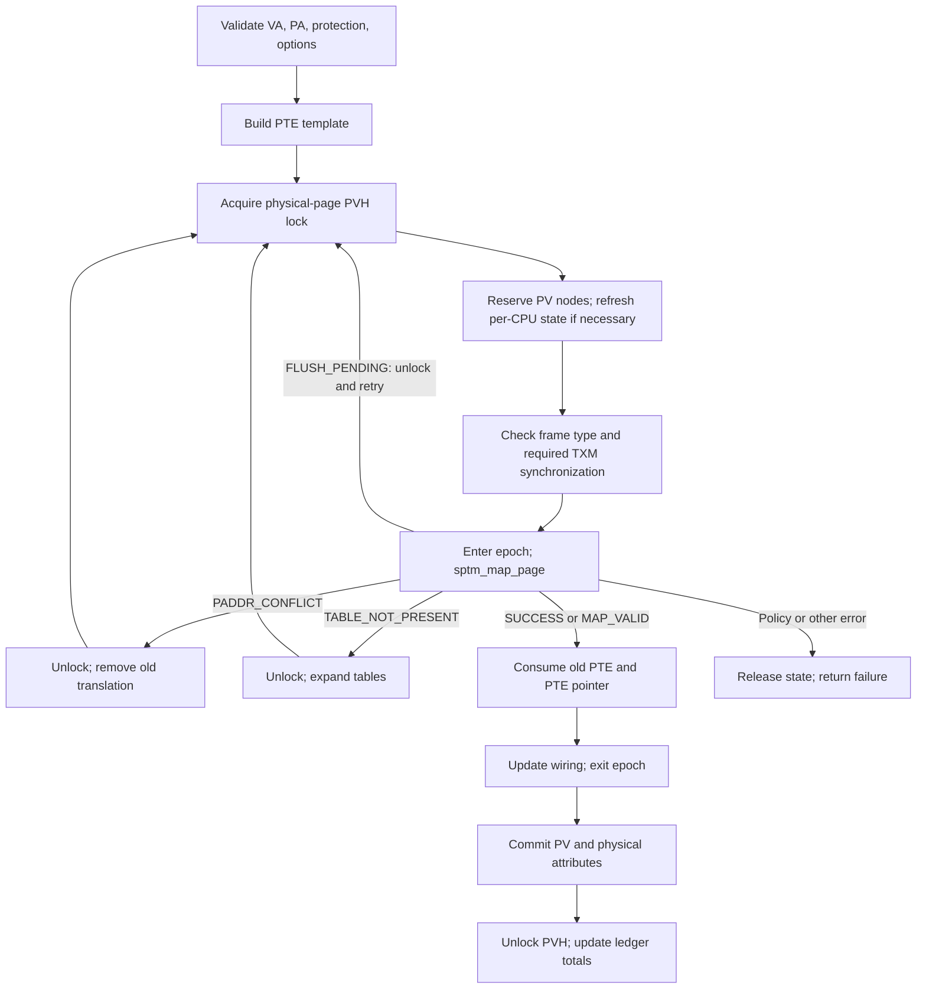

# ARM64 mapping lifecycle: enter, restrict, disconnect, reclaim

For concrete 4 KiB/16 KiB address walks, descriptor locations, and decoded PTE values, start with [pmap translation walkthroughs](pmap-translation-walkthroughs.md).

A pmap update has more state to reconcile than a hardware PTE. A managed mapping also needs reverse-map metadata, physical-page attributes, table lifetime protection, ledger accounting, and completed translation maintenance. The legacy and SPTM implementations expose similar APIs but commit this state differently. This page follows one managed user mapping through both implementations, then explains the removal and reference/modify paths. Keep the [structure guide](pmap-arm64.md) open for `pmap`, PVH, and PTD layouts; use [TLB and cache completion](pmap-tlb-and-cache.md) for the hardware visibility rules.

Use [pmap and translation storage](../../structures/pmap-and-translation-storage.md) for the allocation graph and exact lifetime holders behind these operations, including empty-table detachment versus final table release.

## The contract at the VM boundary

`vm_fault_enter()` prepares and queues the selected page, then reaches `vm_fault_pmap_enter_with_object_lock()` and `vm_fault_attempt_pmap_enter()`. The checked wrappers convert the selected page number to a physical byte address and add `fault_phys_offset` before calling `pmap_enter_options_addr()`; this preserves subpage displacement for mappings smaller than VM's page unit. VM still owns the object/page decision: pmap does not choose the pager, resolve a shadow chain, or perform copy-on-write. Its job is to install the supplied physical page with permitted hardware access and relevant accounting options. [Fault entry and pmap helpers](../../../xnu/osfmk/vm/vm_fault.c#L3813), [physical-address construction](../../../xnu/osfmk/vm/vm_fault.c#L3684), [complete common-VM trace](fault-resolution.md).

Holding an object lock constrains allocation. The fault path adds `PMAP_OPTIONS_NOWAIT`; if pmap cannot acquire required table/PV resources, the fault can request a retry. On the slow-fault path, VM releases object locks and page-busy state, uses `PMAP_OPTIONS_NOENTER` to expand pmap resources, then retries the fault. The map/range context is unlocked later in that sequence, so “all VM locks are dropped before expansion” would be too broad. `NOENTER` does not commit the eventual data-page translation. [Retry sequence](../../../xnu/osfmk/vm/vm_fault.c#L7000), [SPTM NOENTER handling](../../../xnu/osfmk/arm64/sptm/pmap/pmap.c#L6650).

An enter request supplies two different permission facts: `prot` describes the allowed mapping, whereas `fault_type` describes the access currently being serviced. This distinction permits initially read-only hardware access to a logically writable clean page. On a later write, pmap can mark the physical page modified and restore write access without asking VM to resolve residency again. [SPTM pmap_construct_pte](../../../xnu/osfmk/arm64/sptm/pmap/pmap.c#L6180).

[pmap.c, lines 6246–6264](../../../xnu/osfmk/arm64/sptm/pmap/pmap.c#L6246-L6264)

<!-- source-excerpt: ../../../xnu/osfmk/arm64/sptm/pmap/pmap.c#L6246-L6264 -->
```c
		} else if (prot & VM_PROT_WRITE) {
			assert(pmap->type != PMAP_TYPE_NESTED);
			if (pa_valid(pa) && (!ppattr_pa_test_bits(pa, PP_ATTR_MODIFIED))) {
				if (fault_type & VM_PROT_WRITE) {
					pte |= pt_attr_leaf_rw(pt_attr);
					*pp_attr_bits |= PP_ATTR_REFERENCED | PP_ATTR_MODIFIED;
				} else {
					pte |= pt_attr_leaf_ro(pt_attr);
					/*
					 * Mark the page as MODFAULT so that a subsequent write
					 * may be handled through arm_fast_fault().
					 */
					*pp_attr_bits |= PP_ATTR_REFERENCED | PP_ATTR_MODFAULT;
					pte_set_was_writeable(pte, true);
				}
			} else {
				pte |= pt_attr_leaf_rw(pt_attr);
				*pp_attr_bits |= (PP_ATTR_REFERENCED | PP_ATTR_MODIFIED);
			}
```

## SPTM enter is a retryable transaction

The ordinary managed-page path is `pmap_enter_options_addr()` → `pmap_enter_options_internal()` → `pmap_enter_pte()` → `sptm_map_page()`. The protected monitor changes the PTE; XNU reconciles the other metadata using the result. The monitor implementation is external, so the return handling is the observable contract here. [Public wrappers and internal enter](../../../xnu/osfmk/arm64/sptm/pmap/pmap.c#L6620), [monitor helper](../../../xnu/osfmk/arm64/sptm/pmap/pmap.c#L6356).



The main steps are:

1. **Validate and prepare.** Check geometry alignment, supported VA range, executable-mapping restrictions, and options. A `NOENTER` call only expands tables. Build the initial protection template without committing state. The cache bits are refreshed within retries because physical-page cache attributes may change concurrently. [Validation/template setup](../../../xnu/osfmk/arm64/sptm/pmap/pmap.c#L6620).
2. **Serialize the physical page.** A managed PA acquires its PVH lock. Before installing a new hardware mapping, reserve enough PV entries for the worst-case conversion of an inline head to a list. Allocation can drop locks or allow migration; the code must reestablish the transaction and reload per-CPU pointers. Hardware publication cannot succeed and then discover that reverse-map allocation is impossible. [Reservation and retry](../../../xnu/osfmk/arm64/sptm/pmap/pmap.c#L6700).
3. **Reconcile protected frame type.** `pmap_frame_type_for_pte()` selects the requested type, including special executable/JIT/debug and caller-specified mapping categories. If a type transition requires aliases to disappear, the helper disconnects them while retaining physical-page serialization and prepares the retype. Executable user mappings may need TXM synchronization; a failed try-lock causes a retry that obtains the needed lock before reacquiring PVH. This avoids sleeping for that lock while holding a physical-page spin lock. [Frame-type selection](../../../xnu/osfmk/arm64/sptm/pmap/pmap.c#L6048), [pmap_enter_pte](../../../xnu/osfmk/arm64/sptm/pmap/pmap.c#L6356).
4. **Invoke the monitor in an epoch.** The epoch protects in-flight operations from concurrent page/table retyping. It also pairs with unnesting: new enters inspect the unnest bitmap inside the epoch and set non-global when required. The result contains both the prior PTE and the actual PTE pointer in per-CPU output storage. The helper updates table wiring state before leaving the epoch because that still accesses the PTD. [Map operation/result](../../../xnu/osfmk/arm64/sptm/pmap/pmap.c#L6433).
5. **Commit bookkeeping.** A newly created mapping receives a PV entry, internal/alternate-accounting flags, and physical-page attributes under PVH ownership. Existing mappings take a different accounting path. The code can then release the PVH lock and apply ledger deltas while retaining the required preemption discipline. [PV commit and ledger updates](../../../xnu/osfmk/arm64/sptm/pmap/pmap.c#L6830).

The ordering at the final commit is explicit:

[pmap.c, lines 6830–6840](../../../xnu/osfmk/arm64/sptm/pmap/pmap.c#L6830-L6840)

<!-- source-excerpt: ../../../xnu/osfmk/arm64/sptm/pmap/pmap.c#L6830-L6840 -->
```c
			const bool had_valid_mapping = (sptm_status == SPTM_MAP_VALID);
			/* End of transaction. Commit pv changes, pa bits, and memory accounting. */
			if (!had_valid_mapping) {
				pv_entry_t *new_pve_p = PV_ENTRY_NULL;
				int pve_ptep_idx = 0;
				pv_alloc_return_t pv_status = pmap_enter_pv(pmap, pte_p, options, &locked_pvh, &new_pve_p, &pve_ptep_idx);
				/* We did all the allocations up top. So this shouldn't be able to fail. */
				if (pv_status != PV_ALLOC_SUCCESS) {
					panic("%s: unexpected pmap_enter_pv ret code: %d. new_pve_p=%p pmap=%p",
					    __func__, pv_status, new_pve_p, pmap);
				}
```

`SPTM_MAP_VALID` is a successful existing-mapping outcome, not an error. `SPTM_MAP_PADDR_CONFLICT` means the VA is already mapped to a different physical page: XNU drops the new page's PVH lock, removes the previous mapping, and retries. This supplies the break-before-make sequence needed when the PTE's output address changes. `SPTM_TABLE_NOT_PRESENT` requests expansion and retry. `SPTM_MAP_FLUSH_PENDING` also retries after releasing the lock. A code-signing rejection becomes `KERN_CODESIGN_ERROR`; other unexpected failures become `KERN_FAILURE`. [Status handling](../../../xnu/osfmk/arm64/sptm/pmap/pmap.c#L6793).

[pmap.c, lines 6802–6819](../../../xnu/osfmk/arm64/sptm/pmap/pmap.c#L6802-L6819)

<!-- source-excerpt: ../../../xnu/osfmk/arm64/sptm/pmap/pmap.c#L6802-L6819 -->
```c
				/*
				 * There is already a mapping here & it's for a different physical page.
				 * Remove that mapping and retry the operation.
				 * Removing the mapping will also employ the break-before-make sequence
				 * required by the architecture when changing the PTE output address.
				 */
				pmap_remove_range(pmap, v, v + PAGE_SIZE);
				continue;
			} else if (sptm_status == SPTM_TABLE_NOT_PRESENT) {
				pvh_unlock(&locked_pvh);
				kr = pmap_expand(pmap, v, options, pt_attr_leaf_level(pt_attr));
				if (kr != KERN_SUCCESS) {
					break;
				}
				continue;
			} else if (sptm_status == SPTM_MAP_FLUSH_PENDING) {
				pvh_unlock(&locked_pvh);
				continue;
```

A failed monitor operation also rolls back a frame-type change made by this attempt. The comment explains the non-obvious case: even a flush-pending retry must undo the retype, because dropping PVH allows state to change and the next attempt might fail for a different reason. Otherwise the previous type would be lost and failure would leave inconsistent state. [Rollback](../../../xnu/osfmk/arm64/sptm/pmap/pmap.c#L6454).

Unmanaged/device addresses use a separate path. They do not acquire ordinary managed-page PV bookkeeping; the code still keeps monitor/per-CPU operations on one CPU and disallows inappropriate executable mappings. Do not generalize the DRAM transaction's ledger or reverse-map behavior to every physical address. [Unmanaged enter branch](../../../xnu/osfmk/arm64/sptm/pmap/pmap.c#L6910).

## The legacy commit uses a pmap lock and PTE compare-exchange

Legacy `pmap_enter_options_internal()` ordinarily takes the pmap lock shared. Executable mappings and the configuration that updates four hardware PTEs together require exclusive ownership. A missing table causes unlock → expansion → relock/revalidate. Mapping a different PA upgrades to exclusive ownership, removes the old translation, and retries if the lock upgrade lost its original state. The managed physical page also has a PVH lock; pmap-lock ownership alone does not serialize all aliases of one physical page. [Legacy enter](../../../xnu/osfmk/arm/pmap/pmap.c#L6184).

With one PTE to update, `pmap_enter_pte()` commits using compare-exchange with acquire/release ordering. A failed comparison leaves table/accounting changes uncommitted so the caller can retry with the current PTE. When four PTEs represent the operation, the helper requires the exclusive pmap lock and uses the grouped write path. [Commit helper](../../../xnu/osfmk/arm/pmap/pmap.c#L5892).

[pmap.c, lines 5911–5925](../../../xnu/osfmk/arm/pmap/pmap.c#L5911-L5925)

<!-- source-excerpt: ../../../xnu/osfmk/arm/pmap/pmap.c#L5911-L5925 -->
```c
		*old_pte = *pte_p;
		if (*old_pte == new_pte) {
			/* Another thread completed this operation. Nothing to do here. */
			success = true;
		} else if (pa_valid(pte_to_pa(new_pte)) && pte_to_pa(*old_pte) != pte_to_pa(new_pte) &&
		    pte_is_valid(*old_pte)) {
			/* pte has been modified by another thread and we hold the wrong PVH lock. Retry. */
			success = false;
		} else {
			write_pte_fast(pte_p, new_pte);
			success = true;
		}
	} else {
		success = os_atomic_cmpxchgv(pte_p, *old_pte, new_pte, old_pte, acq_rel);
	}
```

A successful change of a previously valid PTE performs the stronger PTE-store synchronization and TLB invalidation; insertion into an invalid entry follows the lighter synchronization path. Wiring-count changes and ledger updates occur only after a successful commit. The enter code holds temporary table references/pins while it may drop locks to allocate PV metadata, and removes those provisional references on completion. These details explain why “legacy always holds an exclusive lock while entering” and “the atomic PTE store completes the whole mapping” are both inaccurate. [PTE synchronization and wiring](../../../xnu/osfmk/arm/pmap/pmap.c#L5928), [enter table-reference handling](../../../xnu/osfmk/arm/pmap/pmap.c#L6250).

On `XNU_MONITOR` configurations the public wrappers cross into PPL-protected implementations; the internal pmap logic remains visible here. The release contains incomplete low-level PPL crossing fragments, so this comparison does not reconstruct an absent monitor implementation. [PPL interface](../../../xnu/osfmk/arm/pmap/pmap_ppl_interface.c), [protected-domain limits](../platform/exception-levels-and-monitors.md).

## Allocate, initialize, then publish a table

SPTM `pmap_tt_allocate()` gets a physical VM page and PTD, confirms that its PV head is available, records accounting, and publishes the PTD association. It samples/drains prior epochs before retyping the page from default storage to a page-table type. A table's XNU metadata must be initialized before `sptm_map_table()` can make it reachable through the parent hierarchy. [Allocation/retype](../../../xnu/osfmk/arm64/sptm/pmap/pmap.c#L3353), [pmap_init_pte_page](../../../xnu/osfmk/arm64/sptm/pmap/pmap.c#L7286).

`pmap_expand()` walks from root toward the requested level. When it finds an empty parent, it allocates outside the protected traversal, rechecks the parent, and attempts publication. Another thread may have installed a table meanwhile; `SPTM_TABLE_ALREADY_PRESENT` handling frees the unused candidate and follows the existing table. With 4 KiB tables inside a larger VM allocation, the implementation may install a group of adjacent table descriptors and aligns the lookup to the correct chunk. A map-table epoch also protects the monitor operation from concurrent empty-leaf deletion. [Expansion loop](../../../xnu/osfmk/arm64/sptm/pmap/pmap.c#L7350).

This traversal depends on a specific lifetime property: ordinary concurrent removal frees regular user leaf tables, whereas the higher-level tables traversed before the leaf remain stable in this path. That is why the loop can allocate and recheck without a legacy pmap-wide lock. It does not license arbitrary unlocked traversal during final pmap destruction. [Expansion lifetime comment](../../../xnu/osfmk/arm64/sptm/pmap/pmap.c#L7350), [destruction](../../../xnu/osfmk/arm64/sptm/pmap/pmap.c#L2985).

Legacy expansion first tests under a shared pmap lock, allocates outside it, then takes exclusive ownership and rechecks before publishing the parent descriptor. Legacy `pmap_tt_allocate()` can draw a table chunk from `tt_entry_free`; otherwise it allocates a VM page, initializes its PTD, and makes extra geometry-sized chunks available on that free list. Deallocation can return one chunk to the pmap without releasing the entire physical page until all its chunks are free. [Legacy expansion](../../../xnu/osfmk/arm/pmap/pmap.c#L7092), [table allocation/deallocation](../../../xnu/osfmk/arm/pmap/pmap.c#L3635).

## Restricting a range is different from disconnecting a page

| Operation | Primary input and effect | Important boundary |
| --- | --- | --- |
| `pmap_protect_options()` | A pmap and VA range; reduce installed access or remove mappings. | Normal writable protection requests are a no-op here; this API is principally restrictive. |
| `pmap_remove_options()` | A pmap and VA range; remove installed translations, optionally compressed markers. | Does not delete the corresponding `vm_map_entry` by itself. |
| `pmap_page_protect_options()` | A physical page; walk its CPU aliases and restrict or remove them. | Uses PV metadata and does not detach IOMMU mappings. |
| `pmap_disconnect_options()` | A physical page; remove CPU mappings and return reference/modify information. | VM remains responsible for freeing, compressing, or otherwise reusing the data page. |
| `pmap_clear_refmod*()` / physical-attribute helpers | A physical page or range; reset tracking and induce future faults. | A temporary write denial can retain permission to restore writes through the fast path. |

Bodies: [range protect](../../../xnu/osfmk/arm64/sptm/pmap/pmap.c#L5584), [range remove](../../../xnu/osfmk/arm64/sptm/pmap/pmap.c#L4040), [physical protect](../../../xnu/osfmk/arm64/sptm/pmap/pmap.c#L4930), [disconnect](../../../xnu/osfmk/arm64/sptm/pmap/pmap.c#L8162), [attribute clear](../../../xnu/osfmk/arm64/sptm/pmap/pmap.c#L7643).

SPTM range protection handles read/read-execute by removing write access, and execute-only where allowed. Writable/full-access requests do not normally upgrade existing mappings; development-only options are exceptions. If execute is not allowed, the update adds execute-never; otherwise it preserves existing execute restrictions rather than granting execution. It submits bounded `sptm_update_region()` batches and reloads traversal/per-CPU state after epochs end. [Protection classification and batching](../../../xnu/osfmk/arm64/sptm/pmap/pmap.c#L5584).

Physical-page protection holds the page's PVH ownership while visiting its aliases. It reconstructs each `(pmap, VA)` from the PTE's table metadata and tolerates a PTE already cleared by a concurrent range unmap. It skips IOMMU-tagged entries. A real protection reduction clears “was writable,” preventing a later fast fault from silently restoring the access VM removed. Disconnect builds empty PTEs, or compressed/alternate-accounting markers when the requested compressor transition needs them. Monitor disjoint operations update mappings across multiple address spaces. [PV walk and templates](../../../xnu/osfmk/arm64/sptm/pmap/pmap.c#L5100), [disjoint unmap helper](../../../xnu/osfmk/arm64/sptm/pmap/pmap.c#L4488).

Internal, external, reusable, alternate, compressed, and footprint charges are not interchangeable totals. Physical disconnect records per-mapping accounting flags before clearing reverse-map state, while range removal debits only mappings whose PV entry it actually removes. If a concurrent disconnect already removed that PV entry, range removal must avoid a second debit. Compressed markers let later removal/decompression repair accounting even though no valid CPU translation remains. [Enter accounting](../../../xnu/osfmk/arm64/sptm/pmap/pmap.c#L6830), [remove reconciliation](../../../xnu/osfmk/arm64/sptm/pmap/pmap.c#L3930), [physical disconnect bookkeeping](../../../xnu/osfmk/arm64/sptm/pmap/pmap.c#L5210).

## Why removing the last PTE does not immediately free its table

SPTM range removal first reads the twig inside an epoch and increments the leaf table's `wiredcnt` as a temporary pin. It then asks `sptm_unmap_region()` to remove a bounded batch. That operation returns previous PTEs in per-CPU storage. Before allowing migration, XNU copies the needed physical indices into a local array. It can then acquire each physical-page lock, remove PV entries, and reconcile accounting without retaining a long preemption-disabled epoch. [Removal implementation](../../../xnu/osfmk/arm64/sptm/pmap/pmap.c#L3810).

The pin spans the interval between hardware unmap and reverse-map removal. During that interval another remover can see an empty hardware table, while a PV consumer can still hold a PTE pointer into it and need the PTD to recover its owner. The PTE may safely be invalid; the storage containing it must still exist. `pmap_pin_leaf_table()` increments under an epoch, and unpin uses release ordering so a freeing observer cannot overtake earlier table accesses. [Pinning rationale and helper](../../../xnu/osfmk/arm64/sptm/pmap/pmap.c#L3705), [removal's specific race](../../../xnu/osfmk/arm64/sptm/pmap/pmap.c#L3841).

[pmap.c, lines 3762–3773](../../../xnu/osfmk/arm64/sptm/pmap/pmap.c#L3762-L3773)

<!-- source-excerpt: ../../../xnu/osfmk/arm64/sptm/pmap/pmap.c#L3762-L3773 -->
```c
static inline void
pmap_unpin_leaf_table(uint16_t *wiredcnt)
{
	/**
	 * This call may happen outside of an epoch, so we must employ a release barrier
	 * here to ensure prior accesses to the leaf table or its PTD must not be reordered
	 * after the wiredcnt decrement.
	 */
	if ((wiredcnt != NULL) && __improbable(os_atomic_dec_orig(wiredcnt, release) == 0)) {
		panic("%s: wiredcnt %p underflow", __func__, wiredcnt);
	}
}
```

After removing mappings, the ordinary user-pmap path attempts to reclaim the leaf:

1. Enter an epoch, reload the parent TTE, and reject an absent or already condemned table. Read the monitor's mapping reference count; a nonzero count ends reclamation.
2. Disable preemption across condemnation and the ensuing decision, so concurrent enters are not left retrying while the condemning thread is scheduled out. `sptm_condemn_leaf_table()` selects one remover and prevents a replacement table from being inserted at that parent while condemnation holds.
3. Drain epochs that could include an enter that raced with condemnation. Re-read the mapping count. If a mapping won the race, uncondemn the table inside an epoch and leave it installed.
4. With an empty condemned table, call `sptm_unmap_table()` to unlink it from the parent. Drain again so software walkers have either observed the empty parent or finished using the old table.
5. Check the XNU `wiredcnt` with acquire ordering. Free immediately if no pins remain; otherwise enqueue delayed free. Final deallocation retypes the physical page, releases PTD/PVH state, updates ledgers, and returns it to VM.

This complete ordering is in [pmap_remove_options_internal](../../../xnu/osfmk/arm64/sptm/pmap/pmap.c#L4080), [pmap_tte_remove](../../../xnu/osfmk/arm64/sptm/pmap/pmap.c#L3610), and [pmap_tt_deallocate](../../../xnu/osfmk/arm64/sptm/pmap/pmap.c#L3419). The two drains serve different races: first an entering mapping, then a reader/pin of the unlinked table.

```mermaid
stateDiagram-v2
    [*] --> Installed
    Installed --> Empty: last mapping removed
    Empty --> Condemned: monitor grants condemnation
    Condemned --> Installed: drain reveals racing mapping; uncondemn
    Condemned --> Unlinked: empty after first drain; unmap parent
    Unlinked --> Freed: second drain and no pins
    Unlinked --> Delayed: second drain finds pins
    Delayed --> Freed: wiredcnt reaches zero
```



The delayed queue owns a pmap reference. A thread call checks the remaining pin count, invokes `pmap_tt_deallocate()` when it reaches zero, and drops that reference through `pmap_destroy()`. The queue therefore preserves both table storage and the owner needed to free/account it. It also diagnoses a table that remains pinned too long. [Delayed free worker](../../../xnu/osfmk/arm64/sptm/pmap/pmap_data.c#L2542), [enqueue/reference](../../../xnu/osfmk/arm64/sptm/pmap/pmap_data.c#L2623).

[pmap_data.c, lines 2623–2634](../../../xnu/osfmk/arm64/sptm/pmap/pmap_data.c#L2623-L2634)

<!-- source-excerpt: ../../../xnu/osfmk/arm64/sptm/pmap/pmap_data.c#L2623-L2634 -->
```c
pmap_free_pt_delayed_enqueue(pmap_t pmap, pmap_paddr_t pa)
{
	pmap_reference(pmap);
	vm_page_t page = vm_page_find_canonical((ppnum_t)atop(pa));
	assert(page != VM_PAGE_NULL);
	lck_mtx_lock(&delayed_free_pt_lock);
	++total_delayed_free_pt_count;
	++current_delayed_free_pt_count;
	vm_page_queue_enter(&pmap_delayed_free_pt_q, page, vmp_pageq);
	lck_mtx_unlock(&delayed_free_pt_lock);
	thread_call_enter(pmap_delayed_free_pt_thread_call);
}
```

## Legacy reclaim can deliberately discard live translations

Legacy range removal holds the pmap lock exclusively, updates PTEs and PV metadata under the relevant physical-page locks, and checks the local PTD reference count to remove empty ordinary-user leaf tables. The TTE deletion path handles the necessary TLB maintenance before storage reuse. [Legacy remove](../../../xnu/osfmk/arm/pmap/pmap.c#L4146), [empty-table decision](../../../xnu/osfmk/arm/pmap/pmap.c#L4411).

There is also an emergency path that is easy to miss by reading only `pmap.c`. `pmap_page_reclaim()` in `pmap_data.c` seeks a user table page with non-empty mappings but no wired entries. It skips nested/kernel pmaps, tables whose pmap cannot be try-locked exclusively, and storage containing a non-leaf table. If several table chunks share a VM page, all must be eligible. It then removes their mappings and frees the table storage, making that page available to a high-priority reclaim list. [Eligibility scan](../../../xnu/osfmk/arm/pmap/pmap_data.c#L747), [reclaim loop](../../../xnu/osfmk/arm/pmap/pmap_data.c#L982).

This sacrifices cached translations, not the VM objects' data pages or allocation policy. Later accesses fault and recreate mappings. The removal intentionally clears compressed markers too, accepting the documented accounting tradeoff; keeping markers without the table that identifies them would make future accounting drift. Pending preemption can abort a partially completed reclaim after the necessary flush. `pmap_gc()` being a TODO stub does not imply there is no legacy table reclaim. [Reclaim removal](../../../xnu/osfmk/arm/pmap/pmap_data.c#L840), [legacy pmap_gc](../../../xnu/osfmk/arm/pmap/pmap.c#L7180). The SPTM empty-leaf path above should not be described as this same emergency victim-selection algorithm.

## Referenced/modified tracking and fast faults

`phys_attribute_clear_with_flush_range()` translates clearing reference/modify state into temporary restrictions across physical-page aliases. Clearing reference state removes allowed read/execute for tracking purposes; clearing modified state removes allowed write. `arm_force_fast_fault_with_flush_range()` clears AF and/or downgrades hardware write access, retaining “was writable” where later restoration is permitted. It rejects or skips cases such as wired mappings according to options and only clears recorded attributes when the operation's result permits it. [Attribute-clear policy](../../../xnu/osfmk/arm64/sptm/pmap/pmap.c#L7643), [forced faults](../../../xnu/osfmk/arm64/sptm/pmap/pmap.c#L8345).

`arm_fast_fault()` first obtains a stable candidate PTE inside an epoch. It skips missing/compressed/unmanaged mappings as appropriate, tries the physical-page lock, and validates that the PTE still describes the same page after acquiring it. If blocking would be required while the caller was already nonpreemptible, it can return failure rather than sleep. Otherwise it drops the epoch, acquires PVH normally, and reloads/revalidates. A lock acquired from a stale PTE is not sufficient evidence about the current mapping. [Fast-fault lookup and locking](../../../xnu/osfmk/arm64/sptm/pmap/pmap.c#L8962).

`arm_clear_fast_fault()` restores write only when the PTE's software marker says it was writable, sets AF, records referenced/modified attributes, and clears the temporary marker. A read fault with AF cleared restores AF and records reference. It submits monitor permission upgrades with an explicit allow-upgrade flag. [Restoration helper](../../../xnu/osfmk/arm64/sptm/pmap/pmap.c#L8805).

[pmap.c, lines 8871–8893](../../../xnu/osfmk/arm64/sptm/pmap/pmap.c#L8871-L8893)

<!-- source-excerpt: ../../../xnu/osfmk/arm64/sptm/pmap/pmap.c#L8871-L8893 -->
```c
		if ((fault_type & VM_PROT_WRITE) && (pte_was_writeable(spte))) {
			assert(pmap);
			{
				if (pmap == kernel_pmap) {
					tmplate = ((spte & ~ARM_PTE_APMASK) | ARM_PTE_AP(AP_RWNA));
				} else {
					assert(pmap->type != PMAP_TYPE_NESTED);
					tmplate = ((spte & ~ARM_PTE_APMASK) | pt_attr_leaf_rw(pmap_get_pt_attr(pmap)));
				}
			}

			tmplate |= ARM_PTE_AF;

			pte_set_was_writeable(tmplate, false);
			attrs_to_set |= (PP_ATTR_REFERENCED | PP_ATTR_MODIFIED);
		} else if ((fault_type & VM_PROT_READ) && ((spte & ARM_PTE_AF) != ARM_PTE_AF)) {
			assert(pmap);
			tmplate = spte | ARM_PTE_AF;

			{
				attrs_to_set |= PP_ATTR_REFERENCED;
			}
		}
```

The helper stops when queued updates plus explicitly counted skipped IOMMU or invalid aliases reach `SPTM_MAPPING_LIMIT`. Valid aliases that already need no change increment neither counter, so this is not a strict bound on every PV entry visited. If an initial broad repair did not reach the faulting alias, `arm_fast_fault()` tries that specific PTE. It can also return success when another CPU already repaired the permission. A COW write, forbidden execute, or genuinely missing page remains a VM/security matter rather than a fast reference/modify fix. [Skip accounting](../../../xnu/osfmk/arm64/sptm/pmap/pmap.c#L8851), [update limit](../../../xnu/osfmk/arm64/sptm/pmap/pmap.c#L8909), [targeted retry](../../../xnu/osfmk/arm64/sptm/pmap/pmap.c#L9147).

## Locking rules that make these paths fit together

| Mechanism | What it protects | What it does not guarantee |
| --- | --- | --- |
| Legacy shared/exclusive pmap lock | Table hierarchy and operations needing global pmap serialization. Shared enter additionally uses PTE compare-exchange. | All aliases of a physical page across pmaps; those need PVH serialization. |
| SPTM PVH lock | Reverse-map/physical-page attributes and operations serialized by PA. | Every PTE in a VA range, or independent concurrent monitor activity lacking that PVH lock. |
| SPTM epoch | Short in-flight operations/readers that must finish before retype or table storage reuse. | Permission to sleep, nested epoch use, or a long-lived pin after epoch exit. |
| Leaf `wiredcnt` pin | Table/PTD lifetime across work that cannot stay inside a short epoch. | Continued existence or unchanged contents of any individual PTE. |
| Preemption disable | Keeps per-CPU operation buffers/results and epoch identity associated with this CPU. | Mutual exclusion against other CPUs. |

The SPTM PVH lock has a sleep mode for long alias walks. Under controlled conditions it sets the sleep bit, applies a priority floor, releases the spin component, and lets contenders wait while logical exclusive ownership remains. Code that then uses per-CPU monitor arrays must explicitly disable preemption again. This separates physical-page exclusion from a potentially unbounded preemption-disabled interval. [PVH lock and sleep-mode implementation](../../../xnu/osfmk/arm64/sptm/pmap/pmap_data.h#L330).

Epoch entry disables preemption, prohibits interrupt-context use, asserts non-nesting, publishes a new sequence, and issues a store/load fence. Exit stores zero with release ordering and balances preemption. Drain samples active sequences and waits only for those sampled generations to end or advance. The caller must first order the state change that stops new operations from observing obsolete state; prepare-drain explicitly does not supply that preceding store/load ordering itself. [Epoch implementation](../../../xnu/osfmk/arm64/sptm/pmap/pmap_data.h#L2077).

[pmap_data.h, lines 2088–2100](../../../xnu/osfmk/arm64/sptm/pmap/pmap_data.h#L2088-L2100)

<!-- source-excerpt: ../../../xnu/osfmk/arm64/sptm/pmap/pmap_data.h#L2088-L2100 -->
```c
	/* Must not already be in a pmap epoch on this CPU. */
	assert3u(pmap_epoch->local_seq, ==, 0);
	pmap_epoch->local_seq = ++pmap_epoch->next_seq;
	/* Unsigned 64-bit per-CPU integer should never overflow on any human timescale. */
	assert(pmap_epoch->local_seq != 0);

	/**
	 * Issue a store-load barrier to ensure that remote observers of any ensuing
	 * SPTM accesses will also observe the epoch update.
	 */
	os_atomic_thread_fence(seq_cst);

	return pmap_epoch;
```

A stale comment above SPTM `pmap_tte_deallocate()` still mentions an exclusive pmap lock and a `locked_pvh` argument that its current signature does not have. The actual callers, structure definitions, and epoch/pin code determine the lifetime protocol described here. [Comment and current function](../../../xnu/osfmk/arm64/sptm/pmap/pmap.c#L3647).

## Sources inspected and limits

| Sources inspected | Depth and limits |
| --- | --- |
| SPTM enter, table allocation/expansion, protect/remove, disconnect, forced/fast faults | Selected managed-page success paths, retries, accounting boundaries, and races traced through bodies. Special code-signing types and device paths covered at interfaces, not exhaustively audited. |
| SPTM PVH/epoch helpers and delayed table free | Lock transitions, sequence ordering, pin acquire/release, owner reference, and worker behavior read directly. |
| Legacy enter/commit, expansion, remove, and emergency table reclaim | Compared actual shared/exclusive locking, atomic commit, local PTD counts, and live-mapping reclaim. Every legacy build combination was not compiled or executed. |
| Common VM fault handoff | Caller allocation/retry contract covered; object lookup, paging, COW, and wiring are developed in the other VM guides. |

External SPTM/TXM bodies are unavailable. The discussion identifies monitor requests, inputs, return values, and the ordering XNU relies on; it does not claim to prove the monitor's implementation or hardware behavior.

<!-- BEGIN PLATYDOC DOCUMENTATION LICENSE -->
Original Platydoc text and diagrams are licensed under [CC BY 4.0](https://creativecommons.org/licenses/by/4.0/). Quoted source code and third-party material retain their respective licenses.
<!-- END PLATYDOC DOCUMENTATION LICENSE -->
