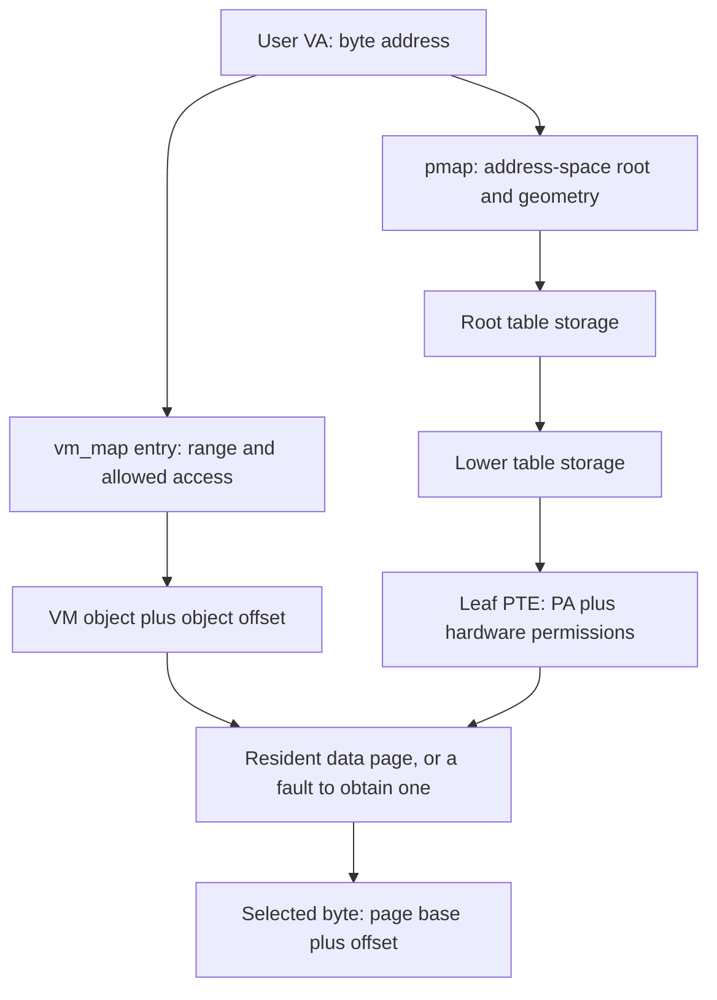
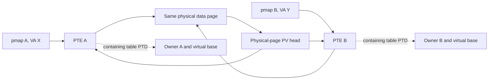
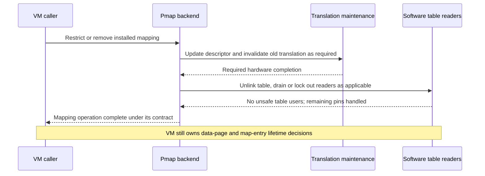

# Pmap fundamentals through concrete address translations

Start with a byte load from a userspace virtual address. There are several separate questions: is the address allowed by the process's `vm_map`; which object supplies its contents; is the relevant physical page resident; and does the current `pmap` have a usable hardware translation? A successful virtual allocation does not answer all four. `vm_fault_attempt_pmap_enter()` is one point where VM has selected the page and asks pmap to establish hardware access, including a physical subpage offset where needed. [Fault handoff](../../../platydoc-data/xnu/osfmk/vm/vm_fault.c#L3813-L3862), [virtual-address maps](virtual-address-maps.md), [cross-layer mapping examples](mapping-walkthroughs.md).

This chapter makes the translation arithmetic and state changes concrete. The addresses, table contents, and PTE values below are **illustrative values**, calculated against this checkout's constants. They are not dumps from a running kernel. The worked examples assume ordinary untagged user addresses, managed RAM, and the explicitly selected geometry. The existing [ARM64 structures](pmap-arm64.md), [mapping lifecycle](pmap-mapping-lifecycle.md), and [TLB/cache guide](pmap-tlb-and-cache.md) provide the full implementation paths behind each step; [x86 pmap](pmap-x86.md) covers that architecture's different descriptors and invalidation protocol.

The ARM64 build selects separate legacy/PPL and SPTM implementations. The examples use their common descriptor constants and the visible SPTM software walker; the mutation sections explicitly distinguish the two backends. PPL protects the legacy implementation in the relevant configurations, while SPTM mapping changes pass through an external protected-monitor interface. [Source selection](../../../platydoc-data/xnu/osfmk/conf/files.arm64#L10-L22), [protected-domain boundaries](../platform/exception-levels-and-monitors.md).

## 1. Keep the virtual range, table storage, and data page separate

A `pmap` has a root-table kernel pointer, `tte`, and the root's physical address, `ttep`. An entry in that table can name another **physical table page**. Eventually a leaf names the **physical data page** being accessed. XNU's software walker uses `phystokv()` to access the next table's physical storage through a kernel mapping; that conversion is not another lookup in the user's `vm_map`. The CPU's translation structures likewise contain physical table addresses rather than C pointers. [Pmap fields](../../../platydoc-data/xnu/osfmk/arm64/sptm/pmap/pmap.h#L307-L369), [software walk](../../../platydoc-data/xnu/osfmk/arm64/sptm/pmap/pmap.c#L7214-L7276).



These are distinct objects even when every box ultimately occupies RAM. Allocating an L3 table creates room for many **descriptors**; it does not allocate all the data pages those descriptors could eventually map. Conversely, a resident data page may exist with no user PTE. `pmap_expand()` can return after allocating the required hierarchy, while `PMAP_OPTIONS_NOENTER` deliberately skips entering a data mapping. [Expansion](../../../platydoc-data/xnu/osfmk/arm64/sptm/pmap/pmap.c#L7350-L7485), [NOENTER branch](../../../platydoc-data/xnu/osfmk/arm64/sptm/pmap/pmap.c#L6676-L6679).

There are also multiple page sizes. VM's `PAGE_SIZE`, the selected pmap's `pta_page_size`, and the storage allocation containing one or several tables need not coincide. A 16 KiB VM allocation may contain four 4 KiB tables; a fault in a 4 KiB mapping may select a subpage of a larger resident VM page. The fault helper checks `fault_phys_offset`, while expansion calculates table grouping from `PAGE_SIZE / pmap_page_size`. Keep the data-page suboffset and the table-allocation subdivision separate. [Subpage fault checks](../../../platydoc-data/xnu/osfmk/vm/vm_fault.c#L3829-L3844), [table grouping](../../../platydoc-data/xnu/osfmk/arm64/sptm/pmap/pmap.c#L7356-L7362), [grouped table selection](../../../platydoc-data/xnu/osfmk/arm64/sptm/pmap/pmap.c#L7444-L7453).

## 2. Select the geometry before dividing an address

A page-table entry is eight bytes in these ARM64 hierarchies. A full 4 KiB table has 512 slots; a full 16 KiB table has 2,048. But the root can use fewer slots and can start below L0. `pmap_pt_attr_4k` computes its root as `(T0SZ_BOOT - 16) / 9`, while the 16 KiB geometry starts at L1. `T0SZ_BOOT` depends on the native build and subpage-root configuration, not just on the requested mapping's granule. [Geometry initializers](../../../platydoc-data/xnu/osfmk/arm64/sptm/pmap/pmap.c#L289-L357), [size configuration](../../../platydoc-data/xnu/osfmk/arm64/proc_reg.h#L1066-L1096).

| Selected example/configuration | `T0SZ_BOOT` | Root and significant user address bits | Ordinary index/offset partition |
|---|---:|---|---|
| Native 4 KiB, full L1 | 25 | L1, 39 bits | L1 `[38:30]`, L2 `[29:21]`, L3 `[20:12]`, offset `[11:0]` |
| Native 4 KiB, subpage L1 | 26 | L1, 38 bits | Root uses `[37:30]`; lower levels as above |
| Native 16 KiB, full L1 | 17 | L1, 47 bits | L1 `[46:36]`, L2 `[35:25]`, L3 `[24:14]`, offset `[13:0]` |
| Native 16 KiB, subpage L1 | 25 | L1, 39 bits | Root uses `[38:36]`; lower levels as above |
| Forced 4 KiB pmap with native 16 KiB/full-L1 configuration | 17 | L0, 47 bits | L0 `[46:39]`, then ordinary 4 KiB L1/L2/L3/offset |

This table derives the selected root and bit widths from the local macros; it does not assert that every row is enabled in a shipped product. Forced 4 KiB selection is conditional on `__ARM_MIXED_PAGE_SIZE__`. An additional 4 KiB concatenated-L1 mask is defined under the stated 42-bit-PA/mixed-page configuration, so use the selected `pta_level_info` rather than hardcoding nine bits at every level. The numeric examples below use the ordinary non-concatenated mask. Kernel and early-boot bounds can differ from the final user bound. [Forced geometry selection](../../../platydoc-data/xnu/osfmk/arm64/sptm/pmap/pmap.c#L2747-L2756), [concatenated mask conditions](../../../platydoc-data/xnu/osfmk/arm64/proc_reg.h#L1904-L1916), [TCR variants](../../../platydoc-data/xnu/osfmk/arm64/proc_reg.h#L1098-L1176).

The implementation performs exactly the useful operation for these exercises: first apply the geometry's valid-address mask, then isolate and shift the selected level's index.

[pmap_pt_geometry.h, lines 509–515](../../../platydoc-data/xnu/osfmk/arm64/sptm/pmap/pmap_pt_geometry.h#L509-L515)

<!-- source-excerpt: ../../../platydoc-data/xnu/osfmk/arm64/sptm/pmap/pmap_pt_geometry.h#L509-L515 -->
```c
static inline unsigned int
ttn_index(const pt_attr_t * const pt_attr, vm_map_address_t addr, unsigned int pt_level)
{
	const uint64_t addr_masked = addr & pt_attr_va_valid_mask(pt_attr);
	const uint64_t index_unshifted = addr_masked & pt_attr_ln_index_mask(pt_attr, pt_level);
	return (unsigned int)(index_unshifted >> pt_attr_ln_shift(pt_attr, pt_level));
}
```

For a table at physical address `T` and computed index `i`, the descriptor resides at `T + 8*i`. The descriptor's output address either points to the next table or, for a block/leaf, forms the translated address together with the appropriate low bits of the VA. Validity and descriptor type must be checked **before** interpreting that output as a next-table address. [Descriptor masks](../../../platydoc-data/xnu/osfmk/arm64/proc_reg.h#L2139-L2156), [walker checks](../../../platydoc-data/xnu/osfmk/arm64/sptm/pmap/pmap.c#L7253-L7268).

## 3. Walk one address using 4 KiB pages

Choose the native 4 KiB/full-L1 row: 39 significant address bits, L1 root, and a 12-bit offset. Let the byte address be `VA = 0x000000123456789a`. Applying the masks in `proc_reg.h` gives:

| Component | Calculation | Result |
|---|---|---:|
| L1 index | `(VA & 0x0000007fc0000000) >> 30` | `0x48` = 72 |
| L2 index | `(VA & 0x000000003fe00000) >> 21` | `0x1a2` = 418 |
| L3 index | `(VA & 0x00000000001ff000) >> 12` | `0x167` = 359 |
| Byte offset | `VA & 0xfff` | `0x89a` |
| Virtual page base | `VA & ~0xfff` | `0x0000001234567000` |

The constants are the checkout's [4 KiB L1 mask](../../../platydoc-data/xnu/osfmk/arm64/proc_reg.h#L1900-L1904), [L2 mask](../../../platydoc-data/xnu/osfmk/arm64/proc_reg.h#L1946-L1949), and [L3 mask](../../../platydoc-data/xnu/osfmk/arm64/proc_reg.h#L1972-L1975). As an arithmetic check, `(0x48 << 30) | (0x1a2 << 21) | (0x167 << 12) | 0x89a` reconstructs the original VA.

Assume the root is at PA `0x90000000`, its selected L1 descriptor names an L2 table at `0x90001000`, and that L2 descriptor names an L3 table at `0x90002000`. The final PTE names data-page base `0x12345000`. These aligned addresses are invented for the example; the descriptor-selection arithmetic is the one used by the walker. [Walk body](../../../platydoc-data/xnu/osfmk/arm64/sptm/pmap/pmap.c#L7240-L7268).


The three numbers `0x90002b38`, `0x12345000`, and `0x1234589a` answer different questions: where the PTE itself is stored; where the mapped data page begins; and which physical byte the user address selects. Confusing the first two makes reverse-map and page-table reclamation code difficult to read. The walker extracts the output PA and combines it with the VA offset; it does not return the PTE's own address. [Translation construction](../../../platydoc-data/xnu/osfmk/arm64/sptm/pmap/pmap.c#L7262-L7265).

A missing L1/L2 descriptor ends this walk before there is even an L3 slot to inspect. An existing L3 table with an invalid entry is a different state: table storage exists, but the requested translation does not. `pmap_ttne()` returns no lower-level pointer when an intermediate entry is not a valid table; `pmap_vtophys()` stops on an invalid descriptor. Neither performs a VM fault to obtain contents. [Table-pointer lookup](../../../platydoc-data/xnu/osfmk/arm64/sptm/pmap/pmap_pt_geometry.h#L618-L656), [address query](../../../platydoc-data/xnu/osfmk/arm64/sptm/pmap/pmap.c#L7214-L7276).

## 4. Walk the same address using 16 KiB pages, then include L0

Now choose native 16 KiB/full-L1 geometry. The byte address is unchanged, but the partitions are different:

| Component | Result for `0x000000123456789a` | Descriptor byte offset within its table |
|---|---:|---:|
| L1 index, shift 36 | `0x1` = 1 | `0x8` |
| L2 index, shift 25 | `0x11a` = 282 | `0x8d0` |
| L3 index, shift 14 | `0x159` = 345 | `0xac8` |
| Byte offset | `0x389a` | Not a descriptor index |
| Virtual page base | `0x0000001234564000` | — |

These results use [16 KiB L1](../../../platydoc-data/xnu/osfmk/arm64/proc_reg.h#L1894-L1897), [L2](../../../platydoc-data/xnu/osfmk/arm64/proc_reg.h#L1940-L1943), and [L3](../../../platydoc-data/xnu/osfmk/arm64/proc_reg.h#L1966-L1969) masks. Reconstructing `(1 << 36) | (0x11a << 25) | (0x159 << 14) | 0x389a` yields the same VA as before. A 16 KiB page boundary occurs earlier than the 4 KiB boundary used in the previous example.

Use aligned table bases `0x90000000`, `0x90004000`, and `0x90008000`, then data-page base `0x12344000`:


There is no L0 step for this 16 KiB geometry. A single L3 table covers `2048 * 16 KiB = 32 MiB`; its parent L2 descriptor therefore identifies a 32 MiB virtual region. In the 4 KiB example the corresponding region is `512 * 4 KiB = 2 MiB`. These sizes explain the code's **twig** alignment: the twig is the level immediately above the leaf, L2 here, and a range operation can be split at its coverage boundary. [Level sizes](../../../platydoc-data/xnu/osfmk/arm64/proc_reg.h#L1930-L1975), [range bound check](../../../platydoc-data/xnu/osfmk/arm64/sptm/pmap/pmap.c#L5600-L5605).

For a configuration that actually selects an L0 root, take the table's forced-4-KiB/47-bit case and ordinary L1 mask. At `VA = 0x0000123456789abc`, the indices are L0 `0x24`, L1 `0xd1`, L2 `0xb3`, L3 `0x189`, with offset `0xabc`. Using consecutive 4 KiB table bases gives this additional root step:

| Level | Table PA | Index | Selected descriptor PA |
|---|---:|---:|---:|
| L0 | `0x90000000` | 36 | `0x90000120` |
| L1 | `0x90001000` | 209 | `0x90001688` |
| L2 | `0x90002000` | 179 | `0x90002598` |
| L3 | `0x90003000` | 393 | `0x90003c48` |

With data-page base `0x12345000`, the result is `0x12345abc`. The reconstruction includes `(0x24 << 39)`; omitting L0 would lose high address bits. The root formula and masked `ttn_index()` are the reason to read the selected attributes rather than infer the number of levels from the processor name. [4 KiB root formula](../../../platydoc-data/xnu/osfmk/arm64/sptm/pmap/pmap.c#L289-L292), [L0 mask](../../../platydoc-data/xnu/osfmk/arm64/proc_reg.h#L1874-L1877).

Not every valid nonleaf descriptor points to another table. The software address query also accepts level-appropriate block descriptors and combines a larger VA offset with the aligned block output. For example, an allowed 16 KiB L2 block covers 32 MiB, so the offset mask is `0x1ffffff` and there is no L3 lookup. This is a decoding rule, not a claim that ordinary pageable user enters install blocks. The mutation helpers used above expect table/leaf structure and can reject attempts to descend through a block. [Block-aware query](../../../platydoc-data/xnu/osfmk/arm64/sptm/pmap/pmap.c#L7253-L7268), [table-only descent](../../../platydoc-data/xnu/osfmk/arm64/sptm/pmap/pmap_pt_geometry.h#L642-L654).

## 5. Decode a complete PTE example

A descriptor combines the output physical address with access and memory attributes. Take the 16 KiB example's page base `0x12344000`; assume an ordinary nonnested user mapping of a write-faulted or already-modified page, read/write data, execute disabled, access already established, and copyback RAM attributes. The locally constructed fields can be combined as follows:

| Field | Contribution to this illustrative PTE | Interpretation |
|---|---:|---|
| Output PA | `0x0000000012344000` | 16 KiB-aligned physical data-page base |
| Valid L3 type | `0x3` | Low bits `11` |
| `AP_RWRW` | `0x40` | Privileged and user read/write |
| `SH_OUTER_MEMORY` | `0x200` | Shareability selected by this copyback conversion |
| `AF` | `0x400` | Access flag set |
| `NG` | `0x800` | Nonnested user mapping is non-global |
| `AttrIdx(WRITEBACK)` | `0` | Memory-attribute index zero, not an assertion that all memory attributes are absent |
| `PNX` plus `NX` | `0x0060000000000000` | Privileged and unprivileged execution disabled |
| **Combined** | **`0x0060000012344e43`** | Data-page mapping with the assumptions above |

The field definitions are [AP encodings](../../../platydoc-data/xnu/osfmk/arm64/proc_reg.h#L1818-L1822), [PTE type/address/access/shareability](../../../platydoc-data/xnu/osfmk/arm64/proc_reg.h#L2345-L2368), and [execute-never bits](../../../platydoc-data/xnu/osfmk/arm64/proc_reg.h#L2394-L2403). The implementation composes permissions in `pmap_construct_pte()` and adds cache/shareability bits through `wimg_to_pte()`; `VM_WIMG_COPYBACK` selects writeback/outer shareability. Other frame types and features can require other bits. [Constructor](../../../platydoc-data/xnu/osfmk/arm64/sptm/pmap/pmap.c#L6180-L6280), [copyback conversion](../../../platydoc-data/xnu/osfmk/arm64/sptm/pmap/pmap.c#L6584-L6587).

Masking this value with `ARM_PTE_PAGE_MASK` yields `0x12344000`; adding offset `0x389a` yields `0x1234789a`, matching the walk. The common page-address mask begins at bit 12; alignment makes bits 12 and 13 zero in a 16 KiB mapping. This does not change the byte offset to 12 bits: that still comes from the selected geometry. [Address-mask definition](../../../platydoc-data/xnu/osfmk/arm64/proc_reg.h#L2350-L2351), [level-specific output calculation](../../../platydoc-data/xnu/osfmk/arm64/sptm/pmap/pmap.c#L7262-L7265).

Change only the AP field from `AP_RWRW` to `AP_RORO`: the illustrative value becomes `0x0060000012344ec3`. The physical byte selected by a permitted read is unchanged, but a user write cannot proceed through that hardware permission. Clear AF instead, and `0x0060000012344a43` describes a different tracking condition. Setting an invalid/compressed marker is different again: high software bits do not make a valid hardware translation. [AP extraction and AF](../../../platydoc-data/xnu/osfmk/arm64/proc_reg.h#L2353-L2365), [compressed versus valid entries](../../../platydoc-data/xnu/osfmk/arm64/proc_reg.h#L2338-L2347).

**Read-only does not identify the cause of a future write fault.** For a logically writable but clean managed page, `pmap_construct_pte()` can deliberately install read-only hardware access, set `PP_ATTR_MODFAULT`, and mark the PTE as previously writable. A write fault can then restore permission while recording modification. A genuine VM restriction or copy-on-write setup must not be bypassed by that shortcut. [Dirty-tracking construction](../../../platydoc-data/xnu/osfmk/arm64/sptm/pmap/pmap.c#L6246-L6264), [reference/modify implementation](pmap-mapping-lifecycle.md#referencedmodified-tracking-and-fast-faults), [COW setup](../../../platydoc-data/xnu/osfmk/vm/vm_map_lock.c#L997-L1044).

[pmap.c, lines 6248–6260](../../../platydoc-data/xnu/osfmk/arm64/sptm/pmap/pmap.c#L6248-L6260)

<!-- source-excerpt: ../../../platydoc-data/xnu/osfmk/arm64/sptm/pmap/pmap.c#L6248-L6260 -->
```c
			if (pa_valid(pa) && (!ppattr_pa_test_bits(pa, PP_ATTR_MODIFIED))) {
				if (fault_type & VM_PROT_WRITE) {
					pte |= pt_attr_leaf_rw(pt_attr);
					*pp_attr_bits |= PP_ATTR_REFERENCED | PP_ATTR_MODIFIED;
				} else {
					pte |= pt_attr_leaf_ro(pt_attr);
					/*
					 * Mark the page as MODFAULT so that a subsequent write
					 * may be handled through arm_fast_fault().
					 */
					*pp_attr_bits |= PP_ATTR_REFERENCED | PP_ATTR_MODFAULT;
					pte_set_was_writeable(pte, true);
				}
```

The practical diagnostic question is therefore not merely “is WRITE clear in this PTE?” It is “what access does the map permit, which object/page is selected, and does pmap retain permission to restore writes?” VM's `vm_map_protect()` can update logical protection while deliberately withholding WRITE from the pmap request so a later fault still checks copy semantics. [Logical permission update](../../../platydoc-data/xnu/osfmk/vm/vm_map.c#L5987-L5995), [withholding hardware write](../../../platydoc-data/xnu/osfmk/vm/vm_map.c#L6049-L6056), [fault resolution](fault-resolution.md).

A useful fault-state checklist follows from those distinctions:

| Observed state | What still needs to be decided |
|---|---|
| No VM entry authorizes the VA | The missing PTE cannot be repaired merely by choosing an arbitrary resident page. |
| VM entry exists, contents are not resident | VM must obtain or construct the object contents before installing the translation. |
| Contents are resident, a table or PTE is missing | Pmap may need table/PV resources even though no data-page input is missing. |
| Logically writable page, read-only PTE, “was writable” marker | The pmap fast-fault path may restore write access and record modification. |
| Logically writable private/COW mapping, read-only PTE | VM must resolve the copy relationship before authorizing a private writable mapping. |
| VM entry itself denies write | A read-only PTE can be the intended stable policy, rather than temporary tracking. |

The first, second, and fifth cases belong to [common fault resolution](fault-resolution.md); table-resource retry is visible in [the pmap handoff](../../../platydoc-data/xnu/osfmk/vm/vm_fault.c#L3895-L3925), fast restoration in [`arm_clear_fast_fault`](../../../platydoc-data/xnu/osfmk/arm64/sptm/pmap/pmap.c#L8871-L8893), and logical access changes in [`vm_map_protect`](../../../platydoc-data/xnu/osfmk/vm/vm_map.c#L5987-L5995). The PTE alone cannot distinguish all these cases.

## 6. Turn an absent translation into the tables shown above

Suppose the map authorizes a read at the example VA and VM has obtained the appropriate resident page. The caller supplies both `prot` (allowed mapping access) and `fault_type` (the access being handled). It supplies a physical byte address derived from the VM page and possible subpage offset. Pmap validates alignment against the **selected** granule and rejects an out-of-range VA. It does not choose a pager, walk a shadow chain, or make the COW copy itself. [Fault-to-pmap call](../../../platydoc-data/xnu/osfmk/vm/vm_fault.c#L3813-L3862), [SPTM enter validation](../../../platydoc-data/xnu/osfmk/arm64/sptm/pmap/pmap.c#L6643-L6679).

There are three separate allocations to follow:

| Allocation/state | What it creates | What it does not establish |
|---|---|---|
| Pmap creation | Pmap object, geometry, address bounds, identity/ASID, root storage | Every lower table or every data page |
| Expansion | Missing lower table storage and published parent descriptors | A committed data-page mapping at the requested VA |
| Enter | Leaf translation plus reverse mapping, attributes, wiring/accounting updates | The high-level VM entry or backing object's complete lifetime |

The concrete SPTM paths are [pmap creation](../../../platydoc-data/xnu/osfmk/arm64/sptm/pmap/pmap.c#L2676-L2785), [expansion](../../../platydoc-data/xnu/osfmk/arm64/sptm/pmap/pmap.c#L7350-L7485), and [enter transaction](../../../platydoc-data/xnu/osfmk/arm64/sptm/pmap/pmap.c#L6793-L6865). Root allocation can use a subpage-root container; sharing allocation storage does not make two pmaps share an address space. Root selection and bounds remain properties of each pmap. [Root allocation](../../../platydoc-data/xnu/osfmk/arm64/sptm/pmap/pmap.c#L3120-L3270).

While VM holds an object lock, it requests `PMAP_OPTIONS_NOWAIT` to avoid blocking for memory inside pmap. Resource shortage can force a cleanup/expansion/retry. `PMAP_OPTIONS_NOENTER` then permits hierarchy preparation without pretending that the original data-page choice remains valid indefinitely. The slow-fault path releases page-busy/object state before that expansion, but unlocks the range context later; do not summarize this as dropping every VM lock first. [NOWAIT handoff](../../../platydoc-data/xnu/osfmk/vm/vm_fault.c#L3895-L3903), [slow retry ordering](../../../platydoc-data/xnu/osfmk/vm/vm_fault.c#L7000-L7034).

For the SPTM backend, expansion allocates a candidate table, initializes its PTD metadata, and asks `sptm_map_table()` to attach it. Another thread may already have won: XNU follows the installed hierarchy and frees its unused candidate. The requested leaf can also disappear before a subsequent enter, which must retry. The metadata-before-publication requirement is explicit:

[pmap.c, lines 7401–7411](../../../platydoc-data/xnu/osfmk/arm64/sptm/pmap/pmap.c#L7401-L7411)

<!-- source-excerpt: ../../../platydoc-data/xnu/osfmk/arm64/sptm/pmap/pmap.c#L7401-L7411 -->
```c
			old_tte = os_atomic_load(ttep, relaxed);
			if (!tte_is_valid_table(old_tte)) {
				tt_entry_t *new_ttep = (tt_entry_t*)phystokv(pa);
				/**
				 * This call must be issued prior to sptm_map_table() so that the page table's
				 * PTD info is valid by the time the new table becomes visible in the paging
				 * hierarchy. sptm_map_table() is expected to issue a barrier that effectively
				 * guarantees the PTD update will be visible to concurrent observers as soon as
				 * the new table becomes visible in the paging hierarchy.
				 */
				pmap_init_pte_page(pmap, pa, v, ttlevel + 1, FALSE);
```

The legacy backend instead uses its pmap lock around validation/publication, drops it for table allocation, then takes exclusive ownership and rechecks. During a single-PTE enter, compare-exchange can fail because the mapping changed; metadata changes must not be committed for a failed update. Four-hardware-PTE configurations use the grouped write path under exclusive ownership. [Legacy expansion](../../../platydoc-data/xnu/osfmk/arm/pmap/pmap.c#L7092-L7215), [commit helper](../../../platydoc-data/xnu/osfmk/arm/pmap/pmap.c#L5892-L5925).

SPTM entry uses the destination physical page's PVH lock, reserved reverse-map metadata, and an epoch around the monitor operation. XNU asks `sptm_map_page()` to change the protected translation and consumes its previous-PTE/output-pointer result. A different-PA conflict removes the old mapping before retrying; a missing table expands; a pending flush retries; a code-signing rejection becomes a distinct failure. A numeric PTE assembled by the caller is therefore a request subject to the monitor contract, not proof that XNU can directly install arbitrary permissions. [Monitor call and results](../../../platydoc-data/xnu/osfmk/arm64/sptm/pmap/pmap.c#L6433-L6496), [status handling](../../../platydoc-data/xnu/osfmk/arm64/sptm/pmap/pmap.c#L6793-L6828).

[pmap.c, lines 6809–6819](../../../platydoc-data/xnu/osfmk/arm64/sptm/pmap/pmap.c#L6809-L6819)

<!-- source-excerpt: ../../../platydoc-data/xnu/osfmk/arm64/sptm/pmap/pmap.c#L6809-L6819 -->
```c
				continue;
			} else if (sptm_status == SPTM_TABLE_NOT_PRESENT) {
				pvh_unlock(&locked_pvh);
				kr = pmap_expand(pmap, v, options, pt_attr_leaf_level(pt_attr));
				if (kr != KERN_SUCCESS) {
					break;
				}
				continue;
			} else if (sptm_status == SPTM_MAP_FLUSH_PENDING) {
				pvh_unlock(&locked_pvh);
				continue;
```

## 7. Protect, remove, and disconnect the same example

These operations start from different coordinates. A VA-range operation begins at one pmap's hierarchy. A physical-page operation begins at the page's reverse mappings, which can point into several pmaps. The PTD attached to each table permits reconstruction of the owning pmap and VA from a PTE pointer. [Physical walk and PTD recovery](../../../platydoc-data/xnu/osfmk/arm64/sptm/pmap/pmap.c#L5167-L5183).



**Protect:** Reducing the example range to read-only changes access, not the output PA. In the ordinary SPTM path, read/read-execute requests select restrictive updates; read/write or full-access requests return without granting access. Execute permissions likewise cannot generally be increased through this operation. The public path routes a removal request differently from the internal protection worker. Legacy protection follows the corresponding restrictive API role with its own locking/PTE maintenance. [SPTM classification](../../../platydoc-data/xnu/osfmk/arm64/sptm/pmap/pmap.c#L5615-L5640), [execute preservation](../../../platydoc-data/xnu/osfmk/arm64/sptm/pmap/pmap.c#L5731-L5748), [legacy protection](../../../platydoc-data/xnu/osfmk/arm/pmap/pmap.c#L5451-L5525).

**Remove:** Removing the leaf at our VA invalidates that installed translation. It does not, by itself, remove the `vm_map_entry` or free the data page. If VM still permits access and still owns suitable contents, a later fault can reinstall a translation. In SPTM range removal, the monitor returns old PTEs; XNU reconciles PV links and accounting afterward. It pins the leaf table during this interval because reverse-map users may still need its PTD after the hardware PTE has already been cleared. [Range removal](../../../platydoc-data/xnu/osfmk/arm64/sptm/pmap/pmap.c#L3809-L3898), [VM map removal ownership](virtual-address-maps.md#removal-deferred-release-and-teardown).

**Disconnect:** Starting with the physical data page reaches both aliases in the diagram. `pmap_disconnect_options()` requests physical-page protection zero, then returns reference/modify information. CPU aliases are removed through the PV walk; IOMMU-tagged entries have a separate rule and are not discarded by that CPU-mapping operation. VM decides whether to reuse, compress, or retain the page afterward. [Disconnect wrapper](../../../platydoc-data/xnu/osfmk/arm64/sptm/pmap/pmap.c#L8161-L8172), [IOMMU distinction](../../../platydoc-data/xnu/osfmk/arm64/sptm/pmap/pmap.c#L5138-L5159).

[pmap.c, lines 8161–8172](../../../platydoc-data/xnu/osfmk/arm64/sptm/pmap/pmap.c#L8161-L8172)

<!-- source-excerpt: ../../../platydoc-data/xnu/osfmk/arm64/sptm/pmap/pmap.c#L8161-L8172 -->
```c
__mockable unsigned int
pmap_disconnect_options(
	ppnum_t pn,
	unsigned int options,
	void *arg)
{
	/* disconnect the page */
	pmap_page_protect_options(pn, 0, options, arg);

	/* return ref/chg status */
	return pmap_get_refmod(pn);
}
```

The last valid PTE disappearing does not make its table immediately reusable. SPTM leaf reclamation checks the monitor reference count, condemns the table, drains racing enters, and rechecks. A racing successful enter requires uncondemnation. Otherwise XNU unlinks the table, drains software readers again, and checks temporary pins before freeing or enqueueing delayed free. Data-page lifetime, PTE validity, table reachability, and table-storage lifetime therefore have different completion points. [Condemn/recheck](../../../platydoc-data/xnu/osfmk/arm64/sptm/pmap/pmap.c#L4140-L4177), [unlink/drain/pin test](../../../platydoc-data/xnu/osfmk/arm64/sptm/pmap/pmap.c#L3625-L3645), [free versus delay](../../../platydoc-data/xnu/osfmk/arm64/sptm/pmap/pmap.c#L3686-L3701).

## 8. Finish the change before using or reusing the address

The CPU may have cached an earlier translation, so changing descriptor memory is only one part of a mapping change. For a legacy successful update of an already valid PTE, the implementation orders the PTE write and performs the selected TLB update. An insertion replacing an invalid entry uses a different synchronization branch:

[pmap.c, lines 5928–5943](../../../platydoc-data/xnu/osfmk/arm/pmap/pmap.c#L5928-L5943)

<!-- source-excerpt: ../../../platydoc-data/xnu/osfmk/arm/pmap/pmap.c#L5928-L5943 -->
```c
	if (success && *old_pte != new_pte) {
		uint64_t amount = pt_attr_page_size(pt_attr) * PAGE_RATIO;

		if (pte_is_valid(*old_pte)) {
			bool need_strong_sync = false;
			FLUSH_PTE_STRONG();
#if HAS_FEAT_XS
			if (pte_is_xs(pt_attr, *old_pte)) {
				need_strong_sync = true;
			}
#endif /* HAS_FEAT_XS */
			PMAP_UPDATE_TLBS(pmap, v, v + amount, need_strong_sync, true);
		} else {
			FLUSH_PTE();
			__builtin_arm_isb(ISB_SY);
		}
```

The TLB helpers distinguish invalidation issuance from completion. Their synchronization function uses the configured DSB variant followed by ISB; it is not replaced by the C atomic ordering on the descriptor. SPTM normally performs the hardware maintenance for its mapping operations, while selected deferred/range paths explicitly assign invalidation work back to XNU. The available source establishes caller behavior and interface expectations; the external monitor's internal TLBI sequence is not in this tree. [TLB completion](../../../platydoc-data/xnu/osfmk/arm64/tlb.h#L51-L89), [SPTM deferred-flush contract](../../../platydoc-data/xnu/osfmk/arm64/sptm/pmap/pmap.c#L5096-L5109), [monitor boundary](../platform/exception-levels-and-monitors.md).



The diagram summarizes boundaries, not one universal instruction order for every backend. In particular, an epoch drain answers whether software operations still hold table state; it is not a TLB flush. Conversely, completing TLBI does not release a PTE pointer held through a software pin. Follow the exact [table-removal sequence](pmap-mapping-lifecycle.md#why-removing-the-last-pte-does-not-immediately-free-its-table) when deciding whether storage may be recycled.

Finally, a correct hierarchy must be selected for the running address space. ASID/root activation is separate from creating its PTEs. The SPTM switch path supplies the previously registered root through its protected interface; geometry was supplied when that root was allocated/registered. Legacy activation handles root installation and ASID reuse with its own per-CPU bookkeeping. Two pmaps may map the same numeric VA to different PAs. Nested pmaps deliberately share subordinate hierarchy over a region, and subpage-root containers merely share root storage—neither should be inferred from a shared numeric address. [SPTM activation](../../../platydoc-data/xnu/osfmk/arm64/sptm/pmap/pmap.c#L4354-L4395), [root geometry registration](../../../platydoc-data/xnu/osfmk/arm64/sptm/pmap/pmap.c#L3233-L3247), [legacy activation](../../../platydoc-data/xnu/osfmk/arm/pmap/pmap.c#L4613-L4790), [nested attachment](../../../platydoc-data/xnu/osfmk/arm64/sptm/pmap/pmap.c#L9893-L9990), [root and sharing guide](pmap-arm64.md#nested-pmaps-and-asids-describe-different-sharing).

Kernel bootstrap mappings and the physical aperture also belong to different address-space and ownership rules from the example user mapping. Releasing boot storage to VM can leave its aperture mapping present, while final protection and stack handoff occur at explicit boot phases. Use [boot](../platform/boot.md), [hardware mappings](../platform/hardware-mappings.md), and [physical-address/aperture queries](pmap-tlb-and-cache.md#physical-addresses-aperture-aliases-and-translation-queries) when following those addresses. The local legacy finalizer illustrates release-to-VM versus unmapping explicitly. [Bootstrap finalization](../../../platydoc-data/xnu/osfmk/arm64/arm_vm_init.c#L1654-L1693).

## Inspection scope and reproducible reading checks

| Area | Evidence used here | Limits |
|---|---|---|
| Geometry and arithmetic | `proc_reg.h`, SPTM attribute initializers, `ttn_index()`, `pmap_vtophys()`; three numeric reconstructions and descriptor-location calculations | Examples are arithmetic, not runtime observations; tagged addresses, every concatenated/root variant, and stage-2 translation are excluded. |
| PTE encoding and access | Permission constructor, WIMG conversion, AP/AF/NX/software markers, VM protection handoff | Illustrative ordinary data mapping; monitor approval, special frame types, and full executable policy are not inferred from the hex value. |
| Creation/enter | Selected root/geometry selection, expansion and publication, NOWAIT/NOENTER retry, SPTM result handling, legacy commit | Detailed allocator/PV/ledger and TXM paths remain in the linked implementation guides. |
| Restriction/removal | Selected protect/remove/disconnect bodies, PV/PTD ownership, pinning, condemnation and drain | Does not claim every option or unmanaged/IOMMU path was traced. |
| Visibility and activation | Legacy commit and TLB helpers, visible SPTM deferral/activation contracts | No monitor/firmware implementation reconstructed; no kernel build or execution performed. |

To reproduce a walk while reading source, record the pmap's bounds and geometry first; compute each index; record the descriptor's **storage address** separately from its **output address**; stop on invalid/block/leaf as appropriate; then inspect access bits. To explain a fault or teardown, add the map/object decision, reverse-map ownership, and completion boundary. These are the distinct questions exposed by the lookup, construction, and removal bodies above.

<!-- BEGIN PLATYDOC DOCUMENTATION LICENSE -->
Original Platydoc text and diagrams are licensed under [CC BY 4.0](https://creativecommons.org/licenses/by/4.0/). Quoted source code and third-party material retain their respective licenses.
<!-- END PLATYDOC DOCUMENTATION LICENSE -->
