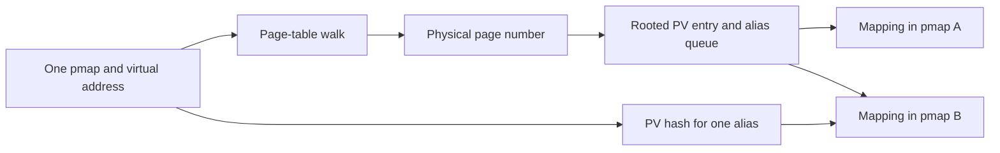

# x86_64 pmap: tables, reverse mappings, PCIDs, and invalidation

[VM overview](README.md) · [ARM64 pmap](pmap-arm64.md) · [Mapping lifecycle](pmap-mapping-lifecycle.md) · [Fault resolution](fault-resolution.md)

The common VM supplies an address, physical page, allowed protection, wiring state, and accounting options. The x86 pmap implements that request through four-level page tables, physical-to-virtual mapping lists, and CPU translation-cache coordination. It does not decide which file offset supplies a missing page or whether a process's map permits a write. Those decisions precede `pmap_enter_options_addr`. The selected implementation is distributed across [`pmap_x86_common.c`](../../../xnu/osfmk/i386/pmap_x86_common.c#L637), [`x86_64/pmap.c`](../../../xnu/osfmk/x86_64/pmap.c), [`pmap_common.c`](../../../xnu/osfmk/i386/pmap_common.c), and [`pmap_pcid.c`](../../../xnu/osfmk/x86_64/pmap_pcid.c); all four are selected by [`files.x86_64`](../../../xnu/osfmk/conf/files.x86_64#L7-L10).

## 1. The pmap has roots, table-page owners, and per-CPU identity

| Field or structure | Role |
| --- | --- |
| `pmap_rwl` | Reader/writer protection used in shared mode during ordinary insertion and exclusive mode for hierarchy mutation/removal |
| `pm_pml4`, `pm_cr3` | Kernel virtual pointer to the main root and its physical root address |
| `pm_upml4`, `pm_ucr3` | Separate root used for the user view; user hierarchy pointers are mirrored into it |
| `pm_eptp` | Root/format value for an EPT pmap, distinguished from ordinary CR3 mappings |
| `pm_obj_pml4`, `pm_obj_pdpt`, `pm_obj` | VM objects owning dynamically allocated lower-level table pages |
| `pmap_pcid_cpus[]` | Tag assigned to this pmap on each CPU |
| `pmap_pcid_coherency_vector[]` | Pending invalidation state for those CPU/pmap associations |
| `pm_shared` | Marks hierarchy shared through pmap nesting and affects invalidation targeting |
| `ledger`, `ref_count` | Accounting destination and pmap allocation lifetime |

The root and CPU identity fields are visible together in the structure:

[Source: pmap.h, lines 583–600](../../../xnu/osfmk/i386/pmap.h#L583-L600)

<!-- source-excerpt: ../../../xnu/osfmk/i386/pmap.h#L583-L600 -->
```c
struct pmap {
	lck_rw_new_t    pmap_rwl __attribute((aligned(64)));
	pmap_paddr_t    pm_cr3 __attribute((aligned(64))); /* Kernel+user shared PML4 physical*/
	pmap_paddr_t    pm_ucr3;        /* Mirrored user PML4 physical */
	pml4_entry_t    *pm_pml4;       /* VKA of top level */
	pml4_entry_t    *pm_upml4;      /* Shadow VKA of top level */
	pmap_paddr_t    pm_eptp;        /* EPTP */

	task_map_t      pm_task_map;
	boolean_t       pagezero_accessible;
	boolean_t       pm_vm_map_cs_enforced; /* is vm_map cs_enforced? */
#define PMAP_PCID_MAX_CPUS      MAX_CPUS        /* Must be a multiple of 8 */
	pcid_t          pmap_pcid_cpus[PMAP_PCID_MAX_CPUS];
	volatile uint8_t pmap_pcid_coherency_vector[PMAP_PCID_MAX_CPUS];
	boolean_t       pm_shared;
	os_refcnt_t     ref_count;
	pdpt_entry_t    *pm_pdpt;       /* KVA of 3rd level page */
	vm_object_t     pm_obj;         /* object to hold pde's */
```

`pmap_create_options` allocates the pmap, initializes its lock/reference/ledger association, allocates and zeroes both root pages, and creates the three VM objects. For an ordinary pmap it obtains `pm_cr3`/`pm_ucr3` from the roots' physical addresses. For an EPT pmap it sets `pm_eptp` and leaves `pm_cr3` zero. `is_ept_pmap` asserts the exclusivity of those representations. A nonzero legacy `sz` argument returns `PMAP_NULL`: the preceding historical comment about software-only maps should not be interpreted as allocating another hardware hierarchy. [`creation`](../../../xnu/osfmk/x86_64/pmap.c#L1613-L1728), [`type test`](../../../xnu/osfmk/i386/pmap.h#L617-L629).

The main host root copies the kernel, kext, physical-aperture, and double-map entries from `kernel_pmap`; the user root initially copies only the double-map entry. Later user hierarchy expansion publishes matching user entries to both roots. Thus two root addresses do not imply two independent copies of every user leaf table. The double-map region supports the entry/exit boundary; this page follows pmap's root publication and activation, not every instruction of that boundary. [`root initialization`](../../../xnu/osfmk/x86_64/pmap.c#L1702-L1723), [`dual publication`](../../../xnu/osfmk/x86_64/pmap.c#L2173-L2184).

## 2. Decode a virtual address using this checkout's geometry

The header defines 64-bit entries, 512 entries per level, and shifts 39, 30, 21, and 12. The ordinary base-page walk therefore selects the following indices:

| Table | Address bits | Address range covered by one entry | Normal next step |
| --- | --- | --- | --- |
| PML4 | 47:39 | 512 GiB | PDPT page |
| PDPT | 38:30 | 1 GiB | Page-directory page |
| Page directory | 29:21 | 2 MiB | Leaf page-table page, or a 2 MiB superpage |
| Leaf page table | 20:12 | 4 KiB | Physical frame |
| Byte offset | 11:0 | Within the selected base page | Add to the physical frame address |

These ranges are derived from the [local shifts/masks](../../../xnu/osfmk/i386/pmap.h#L105-L145). They describe the implemented four-level walk, not a claim that XNU uses every paging mode supported by later processors. `pmap64_pml4` rejects the noncanonical gap between the lower and upper 48-bit address ranges. Each lower-level helper extracts the next page's physical address with `PG_FRAME`, translates it through `PHYSMAP_PTOV`, and indexes that page. A physical table address is not directly a dereferenceable C pointer. [`walk helpers`](../../../xnu/osfmk/i386/pmap_internal.h#L1128-L1263).

The leaf helper explicitly recognizes the shorter superpage walk:

[Source: pmap_internal.h, lines 1230–1245](../../../xnu/osfmk/i386/pmap_internal.h#L1230-L1245)

<!-- source-excerpt: ../../../xnu/osfmk/i386/pmap_internal.h#L1230-L1245 -->
```c

static inline pt_entry_t *
pmap_pte_internal(vm_map_offset_t vaddr, boolean_t is_ept, pd_entry_t *pde)
{
	if (*pde & PTE_VALID_MASK(is_ept)) {
		if (__improbable(*pde & PTE_PS)) {
			return pde;
		}
		pd_entry_t      newpf = *pde & PG_FRAME;

		return &((pt_entry_t *)PHYSMAP_PTOV(newpf))
		       [i386_btop(vaddr) & (ppnum_t)(NPTEPG - 1)];
	} else {
		return NULL;
	}
}
```

`VM_MEM_SUPERPAGE` selects the PDE path in `pmap_enter_options`; the implementation describes these mappings as 2 MiB. The normal helper shown above does not implement a PDPT-level 1 GiB leaf. Nor does a shared 1 GiB hierarchy in `pmap_nest` imply such a leaf: sharing a pointer to a directory of smaller mappings is a different operation. [`enter selection`](../../../xnu/osfmk/i386/pmap_x86_common.c#L680-L768), [`nesting`](../../../xnu/osfmk/i386/pmap_x86_common.c#L125).

## 3. A PTE combines hardware state with software metadata

| Bits | Meaning in this implementation |
| --- | --- |
| `INTEL_PTE_VALID`, `WRITE`, `USER` | Present translation, writable access, and user accessibility |
| `INTEL_PTE_NX` | Execution prohibited for an ordinary host PTE |
| `PG_FRAME` / `INTEL_PTE_PFN` | Physical frame or next-table address |
| `INTEL_PTE_REF`, `MOD` | Referenced and modified state collected for VM |
| `WTHRU`, `NCACHE`, `PAT` | Cache/memory-type controls; PAT/PS share a bit position whose meaning depends on level |
| `INTEL_PTE_PS` | PDE maps a large page instead of pointing to a leaf table |
| `INTEL_PTE_SWLOCK`, `WIRED` | Software synchronization and wiring metadata |
| `INTEL_PTE_COMPRESSED`, `COMPRESSED_ALT` | Invalid-entry markers preserving compressed/alternate accounting, not a physical translation |

The bit definitions explicitly separate hardware permission state from software-reserved fields:

[Source: pmap.h, lines 279–291](../../../xnu/osfmk/i386/pmap.h#L279-L291)

<!-- source-excerpt: ../../../xnu/osfmk/i386/pmap.h#L279-L291 -->
```c

/* These markers use software available bits ignored by the
 * processor's 4-level and EPT pagetable walkers.
 * N.B.: WIRED was originally bit 10, but that conflicts with
 * execute permissions for EPT entries iff mode-based execute controls
 * are enabled.
 */
#define INTEL_PTE_SWLOCK        (0x1ULL << 52)
#define INTEL_PDPTE_NESTED      (0x1ULL << 53)
#define INTEL_PTE_WIRED         (0x1ULL << 54)
/* TODO: Compressed markers, potential conflict with protection keys? */
#define INTEL_PTE_COMPRESSED_ALT (1ULL << 61) /* compressed but with "alternate accounting" */
#define INTEL_PTE_COMPRESSED    (1ULL << 62) /* marker, for invalid PTE only -- ignored by hardware for both regular/EPT entries*/
```

An invalid PTE may therefore contain meaningful accounting state. `PTE_IS_COMPRESSED` checks both absence of validity and the compressed marker; it also checks for unexpected extra bits. When a fault later restores residency, insertion removes the old compressed charges before publishing the new mapping. The marker does not contain the compressed bytes or compressor slot; those belong to the [object's compressor backing](reclaim-and-pressure.md). [`marker test`](../../../xnu/osfmk/i386/pmap.h#L302-L308), [`insertion accounting`](../../../xnu/osfmk/i386/pmap_x86_common.c#L800-L819).

## 4. Missing tables are allocated outside the insertion lock

Ordinary insertion takes `PMAP_LOCK_SHARED`, then calls `pmap_pte`. If the needed table is absent it drops that lock, calls `pmap_expand`, and retries. The superpage path similarly expands the hierarchy only down to a PDE. `PMAP_EXPAND_OPTIONS_NOENTER` can stop after preparing tables, without installing a data-page translation. [`insertion preparation`](../../../xnu/osfmk/i386/pmap_x86_common.c#L727-L776).

`pmap_expand` first ensures that the directory exists. It grabs a VM page, waits unless `NOWAIT` forbids waiting, zeroes the page, and wires it as `VM_KERN_MEMORY_PTE`. It then locks the owning table-page VM object **before** acquiring the pmap's exclusive lock. This is a different phase from the earlier shared lookup. The code rechecks whether another thread expanded the hierarchy while allocation was in progress. If so, it frees its unused page and returns success. [`leaf-table expansion`](../../../xnu/osfmk/x86_64/pmap.c#L2300-L2404).

Only the winner inserts the page into `pm_obj` at its computed table index, records table allocation accounting, and publishes the directory entry. `pmap_expand_pdpt` and `pmap_expand_pml4` apply the analogous pattern at higher levels. Table pages therefore have ordinary VM page descriptors and object ownership, but they are wired metadata, distinct from the user data pages whose addresses they contain. [`upper expansion`](../../../xnu/osfmk/x86_64/pmap.c#L2086-L2283).

For a newly allocated PDPT, the root publication appears twice:

[Source: pmap.c, lines 2173–2184](../../../xnu/osfmk/x86_64/pmap.c#L2173-L2184)

<!-- source-excerpt: ../../../xnu/osfmk/x86_64/pmap.c#L2173-L2184 -->
```c
	pmap_store_pte(is_ept, pml4p, pa_to_pte(pa)
	    | PTE_READ(is_ept)
	    | (is_ept ? (INTEL_EPT_EX | INTEL_EPT_UEX) : INTEL_PTE_USER)
	    | PTE_WRITE(is_ept));
	pml4_entry_t    *upml4p;

	upml4p = pmap64_user_pml4(map, vaddr);
	pmap_store_pte(is_ept, upml4p, pa_to_pte(pa)
	    | PTE_READ(is_ept)
	    | (is_ept ? (INTEL_EPT_EX | INTEL_EPT_UEX) : INTEL_PTE_USER)
	    | PTE_WRITE(is_ept));

```

`pmap_destroy` requires the caller to have removed valid mappings. On the final pmap reference it invalidates translations and releases PCID associations, then frees root allocations and deallocates the table-page objects. Its teardown is not a substitute for removing every live mapping first. [`destruction`](../../../xnu/osfmk/x86_64/pmap.c#L1755-L1829).

## 5. Insert or replace one mapping

Once the hierarchy is available, `pmap_enter_options` takes the PTE software lock, inspects the old translation, and locks the old physical page's PV head when that page is managed RAM. It rechecks the PTE after taking the PV lock because a physical-page operation may have changed it. [`PTE/PV locking`](../../../xnu/osfmk/i386/pmap_x86_common.c#L791-L842).

There are two important cases:

1. **Same physical frame.** Rebuild permissions/cache/wiring state, preserve referenced/modified bits, adjust wired accounting, and decide whether an invalidation is required. The current code avoids a flush for only changing the software wired bit and has a specific optimization for only adding writability. These are local conditions, not permission to skip flushes for arbitrary mapping changes.
2. **Different frame.** Invalidate the old translation, complete the required TLB operation, collect its access history, remove its reverse mapping/accounting, then install metadata and a translation for the new frame.

The same-frame update uses a compare/exchange loop so an intervening hardware reference/modified update is retained:

[Source: pmap_x86_common.c, lines 929–938](../../../xnu/osfmk/i386/pmap_x86_common.c#L929-L938)

<!-- source-excerpt: ../../../xnu/osfmk/i386/pmap_x86_common.c#L929-L938 -->
```c
		/* store modified PTE and preserve RC bits */
		pt_entry_t npte, opte;

		assert((*pte & PTE_LOCK(is_ept)) != 0);

		do {
			opte = *pte;
			npte = template | (opte & (PTE_REF(is_ept) |
			    PTE_MOD(is_ept))) | PTE_LOCK(is_ept);
		} while (!pmap_cmpx_pte(pte, opte, npte));
```

The replacement path shows why collecting dirty state before invalidation completion would be too early:

[Source: pmap_x86_common.c, lines 972–980](../../../xnu/osfmk/i386/pmap_x86_common.c#L972-L980)

<!-- source-excerpt: ../../../xnu/osfmk/i386/pmap_x86_common.c#L972-L980 -->
```c
		/* invalidate the PTE */
		pmap_update_pte(is_ept, pte, PTE_VALID_MASK(is_ept), 0, true);
		/* propagate invalidate everywhere */
		PMAP_UPDATE_TLBS(pmap, vaddr, vaddr + PAGE_SIZE);
		/* remember reference and change */
		old_pte = *pte;
		oattr = (char) (old_pte & (PTE_MOD(is_ept) | PTE_REF(is_ept)));
		/* completely invalidate the PTE */
		pmap_store_pte(is_ept, pte, PTE_LOCK(is_ept));
```

For the new managed frame, insertion acquires its PV lock, records the `(pmap, virtual address)` association, and credits the selected ledgers. It constructs a PTE from physical address, cache attributes, user/kernel accessibility, VM protection, and wired/superpage flags. The PV lock remains held through PTE publication, so a reverse-map consumer cannot observe a new association whose translation is not ready. [`new association`](../../../xnu/osfmk/i386/pmap_x86_common.c#L1052-L1181), [`PTE publication`](../../../xnu/osfmk/i386/pmap_x86_common.c#L1183-L1281).

If an extra PV entry must be allocated for a user pmap, the code releases the PV, PTE, and shared pmap locks, allocates, and restarts. Kernel mappings have a separate emergency PV pool because they cannot take the same blocking allocation path. Following the `Retry` label is necessary to understand which saved pointers remain valid. [`PV shortage`](../../../xnu/osfmk/i386/pmap_x86_common.c#L1090-L1122).

## 6. Reverse mappings support operations starting from a physical page

`pv_head_table` has a rooted entry for each managed physical page. Its first association is stored directly in that entry. Additional aliases use `pv_hashed_entry` nodes linked both into the physical page's queue and into a hash keyed by the mapping. The queue supports “find every mapping of this frame”; the hash supports removing a particular `(pmap, address)` efficiently. [`representation and rationale`](../../../xnu/osfmk/i386/pmap_internal.h#L139-L259).

[Source: pmap_internal.h, lines 243–259](../../../xnu/osfmk/i386/pmap_internal.h#L243-L259)

<!-- source-excerpt: ../../../xnu/osfmk/i386/pmap_internal.h#L243-L259 -->
```c
typedef struct pv_rooted_entry {
	/* first three entries must match pv_hashed_entry_t */
	queue_head_t            qlink;
	vm_map_offset_t         va_and_flags;   /* virtual address for mapping */
	pmap_t                  pmap;   /* pmap where mapping lies */
} *pv_rooted_entry_t;

#define PV_ROOTED_ENTRY_NULL    ((pv_rooted_entry_t) 0)

typedef struct pv_hashed_entry {
	/* first three entries must match pv_rooted_entry_t */
	queue_head_t            qlink;
	vm_map_offset_t         va_and_flags;
	pmap_t                  pmap;
	ppnum_t                 ppn;
	struct pv_hashed_entry  *nexth;
} *pv_hashed_entry_t;
```

`va_and_flags` packs an aligned virtual address with low-bit accounting flags; it is accessed with `PVE_VA` and `PVE_FLAGS`. Separate physical-head and hash locks protect their respective structures. Do not assume the pmap reader/writer lock alone serializes every mapping of a physical page across all address spaces. [`PV flags/locks`](../../../xnu/osfmk/i386/pmap_internal.h#L263-L316).



`pmap_remove_options` starts from a virtual range under an exclusive pmap lock. Its inner routine first clears validity, performs the range invalidation, then removes PV entries, harvests reference/modified bits, clears the PTEs, and debits accounting. It rechecks entries during cleanup because a physical-page operation can replace one with a compressed marker. [`range removal`](../../../xnu/osfmk/i386/pmap_x86_common.c#L1338-L1530), [`outer traversal`](../../../xnu/osfmk/i386/pmap_x86_common.c#L1605-L1703).

`pmap_page_protect_options` instead starts from a physical page and walks its PV aliases. Read/read-execute requests lower access; no access removes mappings; the full-access request is a no-op. `pmap_disconnect_options` uses this removal path and returns accumulated generic `VM_MEM_REFERENCED`/`VM_MEM_MODIFIED` bits. VM uses those bits when deciding whether reclaimed contents need preservation. Removing translations does not itself remove the page from its VM object or free its storage. [`physical-page operation`](../../../xnu/osfmk/i386/pmap_x86_common.c#L1723-L2021), [`disconnect`](../../../xnu/osfmk/i386/pmap_common.c#L653-L673).

`pmap_protect_options` normally lowers host permissions rather than eagerly granting new ones. With `VM_PROT_NONE` it removes the mapping. If VM later allows more access, a fault can reinstall a more permissive translation. The implementation documents exceptions for EPT execute permissions and development/debug kernel operations. [`permission contract`](../../../xnu/osfmk/x86_64/pmap.c#L1869-L1887), [`protection walk`](../../../xnu/osfmk/x86_64/pmap.c#L1890-L2020).

## 7. Activation uses per-CPU PCIDs and two root views

`pmap_switch` requires interrupts disabled and calls `set_dirbase`. That helper publishes the task's main/user roots and map type into CPU and shadow-CPU state. Depending on PCID support, page-zero accessibility, active copyio, and debug configuration, it activates the task root or retains/selects the kernel root. Root activation is therefore not simply “write this task's CR3 on every context switch.” [`switch`](../../../xnu/osfmk/x86_64/pmap.c#L2715-L2722), [`set_dirbase`](../../../xnu/osfmk/i386/pmap.h#L652-L710).

PCIDs are assigned to **CPU/pmap pairs**, not globally permanent process IDs. `pmap_pcid_activate` lazily allocates a tag, checks the pmap's coherency byte, and checks which pmap last used that tag on this CPU. A reused tag can conflict even when this pmap did not have an explicit pending invalidation. The main and user root views use paired tags; `pmap_tlbi_range` invalidates both when appropriate. [`algorithm`](../../../xnu/osfmk/x86_64/pmap_pcid.c#L39-L58), [`activation`](../../../xnu/osfmk/x86_64/pmap_pcid.c#L296-L386), [`paired invalidations`](../../../xnu/osfmk/x86_64/pmap_pcid.c#L416-L437).

After writing CR3, activation checks for a pending invalidation again. The source explicitly ties this ordering to a race between dispatch publication and a remote invalidation:

[Source: pmap_pcid.c, lines 349–368](../../../xnu/osfmk/x86_64/pmap_pcid.c#L349-L368)

<!-- source-excerpt: ../../../xnu/osfmk/x86_64/pmap_pcid.c#L349-L368 -->
```c
	set_cr3_composed(ncr3, new_pcid, 1ULL);
	cpu_shadowp(ccpu)->cpu_shadowtask_cr3 = ncr3 | new_pcid | (1ULL << 63);

	bool preserve = !pcid_conflict && !pending_flush;
	if (preserve == true) {
		/* We did not previously observe a pending invalidation for this
		 * ASID. However, the load from the coherency vector
		 * could've been reordered ahead of the store to the
		 * active_cr3 field (in the context switch path, our
		 * caller). Re-consult the pending invalidation vector
		 * after the CR3 write. We rely on MOV CR3's documented
		 * serializing property to avoid insertion of an expensive
		 * barrier. (DRK)
		 */
		pending_flush = (tpmap->pmap_pcid_coherency_vector[ccpu] != 0);
		if (__improbable(pending_flush != 0)) {
			pmap_pcid_validate_cpu(tpmap, ccpu);
			preserve = false;
		}
	}
```

If preservation is no longer allowed, it invalidates the selected context, using a broader global fallback when INVPCID is unavailable. It then publishes the paired user CR3 and a pointer to the current pmap's coherency byte. Merely clearing that byte is bookkeeping; the surrounding activation/invalidation sequence establishes that the cached translation state can be used. [`activation completion`](../../../xnu/osfmk/x86_64/pmap_pcid.c#L370-L386).

## 8. TLB invalidation is a distributed completion protocol

For an ordinary pmap, `pmap_flush_tlbs` first invalidates its PCID coherency state when PCID is enabled, then scans running CPUs for matching active/task CR3 or a shared pmap. It records local/global invalidation state with ordering barriers. A CPU that can still use the affected translation is signaled; a CPU that can safely defer work checks the invalid state when it next becomes active or crosses the appropriate kernel boundary. The source includes task-root checks because kernel copy operations can access task memory. [`target selection`](../../../xnu/osfmk/x86_64/pmap.c#L2970-L3038).

[Source: pmap.c, lines 3030–3036](../../../xnu/osfmk/x86_64/pmap.c#L3030-L3036)

<!-- source-excerpt: ../../../xnu/osfmk/x86_64/pmap.c#L3030-L3036 -->
```c
			if (CPU_CR3_IS_ACTIVE(cpu) &&
			    (pmap_cr3 == CPU_GET_ACTIVE_CR3(cpu) ||
			    pmap->pm_shared ||
			    (pmap_cr3 == CPU_GET_TASK_CR3(cpu)))) {
				cpus_to_signal |= cpu_bit;
				i386_signal_cpu(cpu, MP_TLB_FLUSH, ASYNC);
			}
```

The caller performs its own flush while remote CPUs respond, then waits for required acknowledgments. `pmap_tlbi_response` considers generation changes and whether a CPU has ceased actively using the context; the protocol is richer than waiting for one Boolean to become zero. Timeout paths collect diagnostics and can panic. [`response predicate`](../../../xnu/osfmk/x86_64/pmap.c#L2751-L2782), [`wait for completion`](../../../xnu/osfmk/x86_64/pmap.c#L3044-L3103).

`PMAP_OPTIONS_NOFLUSH` call sites can record CPUs in a `pmap_flush_context` through `PMAP_UPDATE_TLBS_DELAYED`; `pmap_flush` later performs the work. A function returning after *recording* invalidation is not the same completion point as a synchronous flush. Callers that batch updates must retain whatever pages/resources require the eventual completion. [`context initialization and completion`](../../../xnu/osfmk/x86_64/pmap.c#L2744-L2897), [`delayed wrappers`](../../../xnu/osfmk/i386/pmap_internal.h#L114-L134).

At the instruction boundary, `pmap_tlbi_range` chooses INVPCID for all-global, context, or individual-address invalidation when supported, including paired user tags. Without INVPCID it uses broader CR4/CR3-based flushing paths. The configured threshold determines whether the per-address loop is used; the function's name does not promise that every request emits one instruction per page. [`instruction selection`](../../../xnu/osfmk/x86_64/pmap_pcid.c#L411-L450).

## 9. Shared hierarchy and EPT are separate features

`pmap_nest` implements shared address-space segments by copying subordinate directory pointers into a grand pmap. It marks the subordinate shared, ensures required tables exist, then shares either a PDPT-level pointer for an aligned sufficiently large range or individual PDEs. `pmap_unnest` clears the grand pmap's pointers and invalidates that range; it does not free the subordinate's contents. These are hardware-hierarchy operations underlying selected VM submaps, distinct from copying bytes between mappings. `pmap_nest` explicitly asserts that neither pmap is an EPT pmap. [`nest`](../../../xnu/osfmk/i386/pmap_x86_common.c#L125-L236), [`unnest`](../../../xnu/osfmk/i386/pmap_x86_common.c#L251-L312).

EPT pmaps reuse portions of the allocation/PV code through `PTE_READ`, `PTE_WRITE`, and other format-dependent helpers, but have different execute/cache/accessed/dirty encodings and a different root. If hardware EPT accessed/dirty support is absent, insertion conservatively supplies corresponding state. The EPT branch of `pmap_flush_tlbs` requests `invept` on CPUs through `mp_cpus_call`; it bypasses the ordinary CR3/PCID scan described above. This page documents those XNU interfaces, not a complete guest-virtual-to-host-physical execution model or external hypervisor implementation. [`format helpers`](../../../xnu/osfmk/i386/pmap.h#L411-L422), [`EPT insertion`](../../../xnu/osfmk/i386/pmap_x86_common.c#L1216-L1255), [`EPT invalidation`](../../../xnu/osfmk/x86_64/pmap.c#L2965-L2968).

## Reading route and limits

Follow `pmap_create_options` → `pmap_enter_options` → missing-table expansion → PV/PTE publication → `pmap_switch`/`pmap_pcid_activate`. Then read removal and `pmap_flush_tlbs` together, followed by `pmap_page_protect_options` for the physical-page direction. The inspected path includes allocation races, managed/unmanaged distinctions, same-frame updates, replacement, reverse-map ownership, compressed markers, accounting, root sharing, and invalidation completion. Early bootstrap, every cache-type transition, corruption-recovery heuristics, huge-page policy, and all EPT execution paths remain narrower than this mapping-path review.

<!-- BEGIN PLATYDOC DOCUMENTATION LICENSE -->
Original Platydoc text and diagrams are licensed under [CC BY 4.0](https://creativecommons.org/licenses/by/4.0/). Quoted source code and third-party material retain their respective licenses.
<!-- END PLATYDOC DOCUMENTATION LICENSE -->
