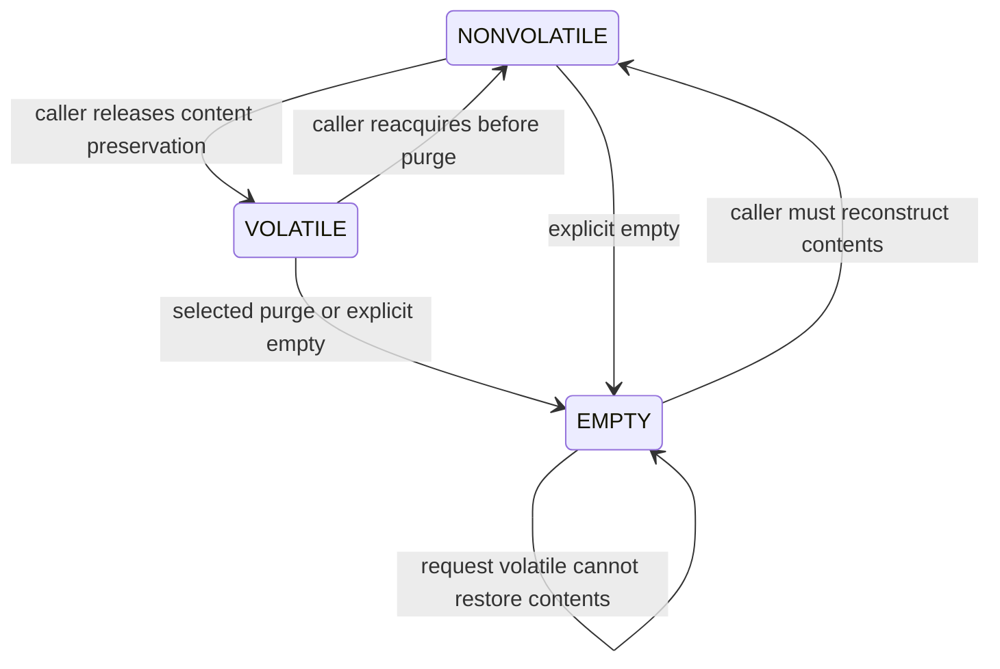

# Purgeable objects, aging tokens and owner accounting

[VM guide](README.md) · [Object lifetime](objects-and-pages.md) · [Reclaim](reclaim-and-pressure.md) · [Deferred reclaim](deferred-reclamation.md) · [Memory entries](wiring-and-memory-entries.md)

Purgeability lets the kernel discard selected object contents while preserving the object and its mappings. The application later makes the object nonvolatile and inspects the returned old state to decide whether its cache must be reconstructed. This is different from removing a virtual range, ordinary clean-file eviction and compressor backing that must preserve anonymous contents. The state machine lives in `vm_object_purgable_control()` and the selection/token machinery in `vm_purgeable.c`. [Control implementation](../../../platydoc-data/xnu/osfmk/vm/vm_object.c#L6156-L6474), [selection](../../../platydoc-data/xnu/osfmk/vm/vm_purgeable.c#L884-L1018).

## Admission happens before the object state transition

The map-based API sanitizes the address and finds its entry using the map's shared range lookup. It rejects a submap, missing/nonpurgeable object and state-changing operations on a nonwritable entry. It locks the VM object before releasing the map lookup protection and invoking common control. The whole-entry/whole-object check visible nearby is under `#if 00`, so it is not an active restriction of this path. [Map control](../../../platydoc-data/xnu/osfmk/vm/vm_map.c#L18078-L18198).

A named-memory-entry caller has a different admission contract: it rejects submap/copy wrappers and verifies that the named entry covers the whole underlying object before dropping the entry lock and calling common control with the object locked. Thus a successful lookup of some memory-entry port does not automatically authorize changing arbitrary backing state. [Named-entry control](../../../platydoc-data/xnu/osfmk/vm/vm_memory_entry.c#L1487-L1548).

The common routine requires an existing purgeable object, rejects `VM_PURGABLE_DENY`, rejects user state changes on kernel-only objects, and asserts that the object has no delayed copy and uses `MEMORY_OBJECT_COPY_NONE`. These are the active implementation checks; the long introductory comment's historical reference-count wording should not be substituted for checking the current callers and body. [Common preconditions](../../../platydoc-data/xnu/osfmk/vm/vm_object.c#L6156-L6204).

## Content state and lifetime are separate

| State | Content contract and transition consequences |
| --- | --- |
| `DENY` | Object was not admitted as purgeable; common purgeable control rejects it |
| `NONVOLATILE` | Contents must be preserved through ordinary residency/backing mechanisms |
| `VOLATILE` | Contents are eligible for purge according to queue/group/aging policy |
| `EMPTY` | Previous cache contents cannot be relied on; this is not an assertion that every physical/compressed page has already disappeared |



On success the in/out state word returns the old state. Moving EMPTY to VOLATILE does not undo a previous purge; the routine retains EMPTY. Explicit EMPTY can invoke purge immediately. Moving back to NONVOLATILE changes accounting/selection status, but does not recreate data. [Transition setup](../../../platydoc-data/xnu/osfmk/vm/vm_object.c#L6206-L6227), [final old-state output](../../../platydoc-data/xnu/osfmk/vm/vm_object.c#L6466-L6473).

For example, an application fills a cache while NONVOLATILE, marks it VOLATILE during an idle interval, then requests NONVOLATILE before reuse. An old state of EMPTY requires rebuilding the logical cache even if some wired or busy pages survived the purge. Page-by-page residency is not an application-level validity bitmap.

## Queues, groups and token age

`purgeable_queues[]` separates obsolete, FIFO and LIFO behavior; each contains object groups and token bookkeeping. Objects use `objq`, `purgable`, `purgeable_when_ripe` and owner fields. Tokens are small indexed records containing count/previous/next, not references to particular pages or a timer per object. A zero count represents ripeness. [Queue/token definitions](../../../platydoc-data/xnu/osfmk/vm/vm_purgeable.c#L60-L90), [internal queue definition](../../../platydoc-data/xnu/osfmk/vm/vm_purgeable_internal.h#L35-L100).

Transitioning to VOLATILE selects ordering/group and optional no-aging behavior. An aging object needs a token before the transition's accounting/publication. Token storage grows outside the page-queue lock under an allocation-in-progress flag; failure returns `KERN_RESOURCE_SHORTAGE`. A token allocation is therefore not infallible merely because the object already exists. [Token allocation](../../../platydoc-data/xnu/osfmk/vm/vm_purgeable.c#L158-L251), [VOLATILE transition](../../../platydoc-data/xnu/osfmk/vm/vm_object.c#L6304-L6363).

Token counts account for page-queue aging progress: new inactive pages contribute to `token_new_pagecount`, and advancement updates unripe tokens as inactive queues progress. This is not wall-clock expiration. Changing group priority alone does not necessarily install a new age token; the state-control code deliberately avoids resetting age to keep frequently moved objects from gaining repeated extra protection. [Token creation](../../../platydoc-data/xnu/osfmk/vm/vm_purgeable.c#L254-L310), [advancement](../../../platydoc-data/xnu/osfmk/vm/vm_purgeable.c#L465-L540), [queue integration](../../../platydoc-data/xnu/osfmk/vm/vm_resident.c#L10655-L10684), [new-page count](../../../platydoc-data/xnu/osfmk/vm/vm_resident.c#L10830), [group reassignment](../../../platydoc-data/xnu/osfmk/vm/vm_object.c#L6370-L6415).

## Selecting an object without reversing lock order

The declared ordering for task-owned objects is object lock → purgeable queue lock → task object-queue lock. Selection begins from the queues and cannot block on an object lock in the opposite order. It tries object locks, skips failures, considers owner importance and retains the best eligible locked candidate within its scan policy. Disowned objects differ from kernel-owned objects for that importance calculation. [Lock order](../../../platydoc-data/xnu/osfmk/vm/vm_purgeable.c#L47-L58), [candidate selection](../../../platydoc-data/xnu/osfmk/vm/vm_purgeable.c#L672-L758).

`vm_purgeable_object_purge_one()` enters with the page-queue lock, takes the purgeable-queue lock, checks ripe tokens or force-purge groups, selects/removes a token and obtains an object. It can return false despite volatile objects existing, because none could be locked/selected. Before actually purging, it drops the page-queue lock; the selected object's lock stabilizes its state. It restores the caller's page-queue locking afterward. [Selection and no-candidate result](../../../platydoc-data/xnu/osfmk/vm/vm_purgeable.c#L884-L996), [purge call boundary](../../../platydoc-data/xnu/osfmk/vm/vm_purgeable.c#L997-L1018).

[Source: `osfmk/vm/vm_purgeable.c`, lines 997–1007](../../../platydoc-data/xnu/osfmk/vm/vm_purgeable.c#L997-L1007).

<!-- source-excerpt: ../../../platydoc-data/xnu/osfmk/vm/vm_purgeable.c#L997-L1007 -->
```c
purge_now:

	assert(object);
	vm_page_unlock_queues();  /* Unlock for call to vm_object_purge() */
//	printf("%sPURGING object %p task %p importance %d queue %d group %d force_purge_below_group %d memorystatus_vm_pressure_level %d\n", forced_purge ? "FORCED " : "", object, object->vo_owner, task_importance_estimate(object->vo_owner), i, group, force_purge_below_group, memorystatus_vm_pressure_level);
	resident_page_count = object->resident_page_count;
	(void) vm_object_purge(object, flags);
	assert(object->purgable == VM_PURGABLE_EMPTY);
	/* no change in purgeable accounting */
	vm_object_unlock(object);
	vm_page_lock_queues();
```

## Purging resident and compressed backing

`vm_object_purge()` changes VOLATILE to EMPTY and updates aggregate counters before reaping resident pages, so page removal does not debit those counters a second time. It invokes `vm_object_reap_pages(..., REAP_PURGEABLE)`; busy/wired and other nonconvenient pages need not disappear immediately. Returned purge counts describe work actually completed, not the logical object size. [State-before-reap](../../../platydoc-data/xnu/osfmk/vm/vm_object.c#L5959-L6014).

Compressed backing is purged only when both paging and activity counts are zero. Otherwise the routine skips that part to avoid racing compression/decompression or deadlocking with memory allocation. A nonblocking compressor request can also leave backing. EMPTY still means the application must consider its data lost; it does not mean all internal storage ownership has already been released.

[Source: `osfmk/vm/vm_object.c`, lines 6015–6042](../../../platydoc-data/xnu/osfmk/vm/vm_object.c#L6015-L6042).

<!-- source-excerpt: ../../../platydoc-data/xnu/osfmk/vm/vm_object.c#L6015-L6042 -->
```c

	if (object->pager != NULL) {
		assert(VM_CONFIG_COMPRESSOR_IS_PRESENT);

		if (object->activity_in_progress == 0 &&
		    object->paging_in_progress == 0) {
			/*
			 * Also reap any memory coming from this object
			 * in the VM compressor.
			 *
			 * There are no operations in progress on the VM object
			 * and no operation can start while we're holding the
			 * VM object lock, so it's safe to reap the compressed
			 * pages and update the page counts.
			 */
			pgcount = vm_compressor_pager_get_count(object->pager);
			if (pgcount) {
				pgcount = vm_compressor_pager_reap_pages(object->pager, flags);
				vm_compressor_pager_count(object->pager,
				    -pgcount,
				    FALSE,                       /* shared */
				    object);
				vm_object_owner_compressed_update(object,
				    -pgcount);
			}
			if (!(flags & C_DONT_BLOCK)) {
				assert(vm_compressor_pager_get_count(object->pager)
				    == 0);
```

The compressor branch adjusts pager count and owner compressed accounting by the actual freed count. This is different from changing a mapping's invalid compressed-PTE marker; backing belongs to the object/pager and can be shared among mappings. [Remaining purge/error constraints](../../../platydoc-data/xnu/osfmk/vm/vm_object.c#L6043-L6077), [compressor representation](compressor-segments-and-swapfiles.md).

## Owner ledgers and final teardown

`vm_purgeable_accounting()` derives the owner's ledger indices from the object's tag and moves resident and compressed charges between volatile/nonvolatile accounts. Footprint adjustment uses resident plus compressed pages minus wired pages for the affected component; it must not be reconstructed by simply multiplying object size. Preemption is disabled around the no-preempt ledger operations. An ownerless/disowned case has different attribution from an ordinary task-owned object. [Accounting](../../../platydoc-data/xnu/osfmk/vm/vm_purgeable.c#L1490-L1579).

Final object reaping first clears ownership while the pager still exists, so compressed charges remain inspectable. It then disconnects the pager/control, removes volatile/nonvolatile queue membership, retires relevant tokens and reaps remaining backing. Purging contents alone performs none of the full last-reference protocol described in [object teardown](objects-and-pages.md). [Final reap ordering](../../../platydoc-data/xnu/osfmk/vm/vm_object.c#L1552-L1666).

This chapter covers map/named-entry admission, common transitions, selected token/selection paths and resident/compressed accounting. Complete owner-transfer policy, all debug flags and every driver API that exposes purgeability remain separate. [Deferred rings](deferred-reclamation.md) and [phantom refault history](phantom-cache-and-refaults.md) solve different reclaim problems and do not share this state machine.

<!-- BEGIN PLATYDOC DOCUMENTATION LICENSE -->
Original Platydoc text and diagrams are licensed under [CC BY 4.0](https://creativecommons.org/licenses/by/4.0/). Quoted source code and third-party material retain their respective licenses.
<!-- END PLATYDOC DOCUMENTATION LICENSE -->
