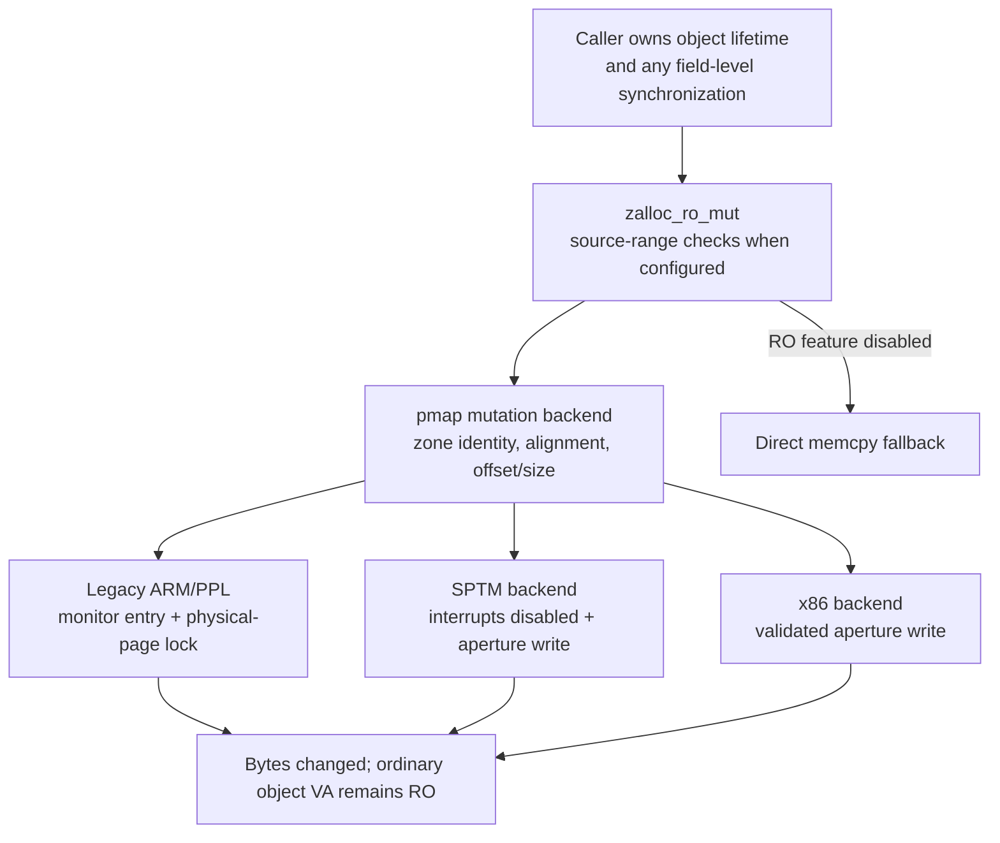
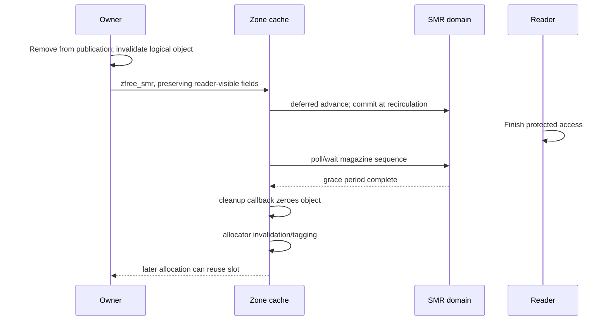

# Read-only and special zones: mutation and lifetime contracts

[VM guide](README.md) · [Zone allocator](zone-allocator.md) · [Kernel allocation](kernel-allocation.md) · [Typed allocation](typed-allocation.md)

The zone allocator has several interfaces whose storage resembles an ordinary zone but whose legal operations differ. Read-only allocations require checked mutation; SMR objects cannot be cleared until old readers finish; per-CPU objects represent multiple CPU slots; permanent allocations have no free operation; and bounded zones need an explicit exhaustion policy. These distinctions belong in the caller's object lifecycle, not just its allocation flags. The ordinary cache/bitmap/VM machinery is explained in [zone allocator](zone-allocator.md).

| Kind | Allocation | Release or mutation | Distinguishing invariant |
|---|---|---|---|
| Read-only | `zalloc_ro` | `zalloc_ro_mut*`, `zalloc_ro_clear`, `zfree_ro` | Ordinary object VA is read-only when enforcement is enabled; writes use a checked backend path |
| SMR | `zalloc_smr` | `zfree_smr`, followed later by registered cleanup | Reader-visible fields remain intact until the associated grace period has passed |
| Per-CPU | `zalloc_percpu` | `zfree_percpu` | One logical allocation has a page-strided instance for every CPU slot |
| Permanent | `zalloc_permanent*` | No free | Bump allocation or permanent VM allocation lasts for the kernel lifetime |
| Exhaustible | Ordinary zone interfaces | Ordinary free; allocation may fail/wait by policy | Wired capacity has an explicit bound rounded to allocator geometry |

The interface contracts are collected in [`zalloc.h`](../../../xnu/osfmk/kern/zalloc.h), and the original allocator documentation includes [API basics](../../../xnu/doc/allocators/api-basics.md) and [the read-only allocator](../../../xnu/doc/allocators/read-only.md). The source bodies below qualify those contracts for this checkout and build configuration.

## 1. Read-only zone registration and geometry

The [process/task structure study](../../structures/README.md) supplies concrete callers for this allocator contract. Its [protected-field update walkthrough](../../structures/read-only-object-updates.md) follows `proc_setpidversion()` and `task_ro_flags_set()` through these interfaces, distinguishing ordinary reads, checked writes, synchronization and final shared-record release.

Read-only allocations use reserved zone IDs. XNU-internal zones are declared with `ZONE_INIT` and an ID from the RO range; external users have a fixed [`zone_create_ro_id_t`](../../../xnu/osfmk/kern/zalloc.h#L229) namespace. [`zone_create_ro()`](../../../xnu/osfmk/kern/zalloc.c#L9444) translates that external creation ID into `ZONE_ID__FIRST_RO_EXT + zc_ro_id` and calls `zone_create_ext()` with `ZC_READONLY` forced on. This is registration of a known allocator identity, not creation of an arbitrary mutable zone whose permissions happen to be changed later.

The creation documentation requires early registration before lockdown, and reserved-slot creation cannot duplicate an existing zone or make it destructible. `zone_create_ext()` records size and alignment constants in the separately protected `zone_ro_size_params` array. RO zones use one page per chunk, require elements no larger than a page, and reject ten-percent-or-greater remainder waste. They cannot also be VM, DATA, per-CPU, or destructible zones. [`RO creation rules`](../../../xnu/osfmk/kern/zalloc.c#L9167), [`one-page geometry`](../../../xnu/osfmk/kern/zalloc.c#L9003), [`protected size parameters`](../../../xnu/osfmk/kern/zalloc.c#L515).

When `ZSECURITY_CONFIG(READ_ONLY)` is enabled, the zone's security configuration selects `Z_SUBMAP_IDX_READ_ONLY`. The RO VA region has backend-specific alignment: on SPTM it is aligned to a twig span so its last-level page tables can have the RO-zone table type. [`zone_submap_init()`](../../../xnu/osfmk/kern/zalloc.c#L9688) and [`pmap_ro_zone_align()`](../../../xnu/osfmk/arm64/sptm/pmap/pmap.c#L11746).

`zalloc_ro()` still uses the common cache and bitmap allocator. On success it checks that the object lies in the expected RO zone. Ordinary zone population chooses `VM_PROT_READ` and `PMAP_MAPPING_TYPE_ROZONE` for these pages. They are wired zone storage; their read-only permission is established at population rather than by a later user-style page fault. [`zalloc_ro()`](../../../xnu/osfmk/kern/zalloc.c#L6575), [`zone_page_prot()` and mapping type](../../../xnu/osfmk/kern/zalloc.c#L4782).

An application-level structure split often leaves frequently mutated state in a regular object and security-relevant state in a companion RO allocation. The original [RO guidance](../../../xnu/doc/allocators/read-only.md) recommends protecting the pointer chain to that allocation and validating a one-to-one backreference when used. The allocator itself enforces zone/size boundaries; it does not establish that the particular credential, task, or other object is semantically authorized for a given operation. Reference ownership and field locking remain the subsystem's responsibility.

## 2. Mutation is checked at two different layers

The general mutation interface is `zalloc_ro_mut(zid, elem, offset, new_data, size)`. The field/element macros in [`zalloc.h`](../../../xnu/osfmk/kern/zalloc.h#L845) compute offsets and sizes for this interface. Its source-side validation accepts a range from the current stack, a range in the RO map whose starting address has the same zone ID, or qualifying constant memory. This source-side check does not establish source element alignment, a single-object extent, or liveness. A special `ZONE_ID_AMFI_OSENTITLEMENTS` case skips this source check when the code-signing monitor configuration requests it. [`zalloc_ro_mut_validate_src()`](../../../xnu/osfmk/kern/zalloc.c#L6700), [`zalloc_ro_mut()`](../../../xnu/osfmk/kern/zalloc.c#L6716).

The source restriction is configuration-dependent. On KTRR/CTRR variants, [`from_const_memory()`](../../../xnu/osfmk/kern/zalloc.c#L6630) checks the protected read-only region. Without the relevant kernel-integrity configuration, its fallback returns true, so this predicate does not impose an equivalent source-location restriction. SPTM's current-stack helper also handles the thread's optional mapped stack redzone. These details matter when comparing the same API across targets.

After the source check, the write is delegated to pmap; when RO enforcement is compiled out, the same interface simply copies into ordinary writable storage:

[zalloc_ro_mut backend and fallback — source lines 6737–6747](../../../xnu/osfmk/kern/zalloc.c#L6737):

<!-- source-excerpt: ../../../xnu/osfmk/kern/zalloc.c#L6737-L6747 -->
```c
	if (skip_src_check == false) {
		zalloc_ro_mut_validate_src(zid, elem, (vm_offset_t)new_data,
		    new_data_size);
	}
	pmap_ro_zone_memcpy(zid, (vm_offset_t) elem, offset,
	    (vm_offset_t) new_data, new_data_size);
#else
	(void)zid;
	memcpy((void *)((uintptr_t)elem + offset), new_data, new_data_size);
#endif
}
```

Destination checking uses the immutable size/alignment parameters plus address metadata. `zone_require_ro()` checks RO range membership, element alignment relative to the page end, and exact zone ID:

[zone_require_ro — source lines 6820–6835](../../../xnu/osfmk/kern/zalloc.c#L6820):

<!-- source-excerpt: ../../../xnu/osfmk/kern/zalloc.c#L6820-L6835 -->
```c
zone_require_ro(zone_id_t zid, vm_size_t elem_size __unused, void *addr)
{
#if ZSECURITY_CONFIG(READ_ONLY) && !defined(__BUILDING_XNU_LIBRARY__) \
	/* can't do this in user-mode because there's no zones submap */
	struct zone_size_params p = zone_ro_size_params[zid];
	vm_offset_t elem = (vm_offset_t)addr;

	if (!from_ro_map(addr, 1) ||
	    !Z_FAST_ALIGNED(PAGE_SIZE - (elem & PAGE_MASK), p.z_align_magic) ||
	    zid != zone_meta_from_addr(elem)->zm_index) {
		zone_id_require_ro_panic(zid, addr);
	}
#else
#pragma unused(zid, addr)
#endif
}
```

This is an identity-and-boundary check, not a liveness proof. There is no allocation-generation/reference-count test here. The caller must prevent free/reuse while it accesses the object.

The pmap mutation backends additionally validate the reserved ID range and that `offset` and update size remain within the element. Their copy/clear validation checks source-address addition overflow. They write through a physical-aperture alias of the page, leaving the ordinary RO object address read-only. The protection mechanism and synchronization of this alias differ across backends. [`Legacy ARM validation`](../../../xnu/osfmk/arm/pmap/pmap.c#L12275), [`SPTM validation`](../../../xnu/osfmk/arm64/sptm/pmap/pmap.c#L11658), [`x86 validation`](../../../xnu/osfmk/x86_64/pmap.c#L366).



### Legacy ARM with and without PPL

[`pmap_ro_zone_memcpy()`](../../../xnu/osfmk/arm/pmap/pmap.c#L12424) calls its PPL entry when `XNU_MONITOR` is enabled, otherwise its internal implementation directly. The internal function resolves the physical address, validates bounds, locks the physical-page PV head, copies through `phystokv(pa)`, and unlocks. With PPL, the physical lock helper also requires `PVH_FLAG_LOCKDOWN_RO`; it rejects a mutation crossing a page boundary. The one-page RO element geometry is therefore important to the backend contract. [`pmap_ro_zone_lock_phy_page()`](../../../xnu/osfmk/arm/pmap/pmap.c#L12350).

During mapping, legacy ARM pmap rejects writable permissions for a VA in the RO zone range. After successfully entering that mapping, it calls `pmap_phys_write_disable()`. On PPL builds this locks down the physical page while permitting the privileged mutation path; non-PPL builds instead reduce mappings with `pmap_page_protect()`. [`RO mapping check`](../../../xnu/osfmk/arm/pmap/pmap.c#L6254), [`post-enter lockdown`](../../../xnu/osfmk/arm/pmap/pmap.c#L6665), [`pmap_phys_write_disable()`](../../../xnu/osfmk/arm/pmap/pmap.c#L12558).

The PV-head lock protects the physical-page operation. It is not a replacement for the object's own synchronization or a guarantee that a reader sees an entire structure-copy as one atomic transaction.

### SPTM is a different implementation

SPTM maps RO pages using the explicit mapping type. [`pmap_frame_type_for_pte()`](../../../xnu/osfmk/arm64/sptm/pmap/pmap.c#L6067) requires ROZONE mappings to belong to the kernel RO zone VA range, and the table-growth path gives the corresponding leaf tables `XNU_PAGE_TABLE_ROZONE` type. These type transitions establish the XNU/SPTM mapping-permission boundary. The monitor implementation itself is outside this source tree. [`RO-zone page-table typing`](../../../xnu/osfmk/arm64/sptm/pmap/pmap.c#L7415).

The mutation path in this checkout does **not** call the legacy PPL gateway or take its PV-head lock. It translates the destination, disables interrupts, validates the element, and copies through the aperture:

[SPTM pmap_ro_zone_memcpy_internal body — source lines 11800–11811](../../../xnu/osfmk/arm64/sptm/pmap/pmap.c#L11800):

<!-- source-excerpt: ../../../xnu/osfmk/arm64/sptm/pmap/pmap.c#L11800-L11811 -->
```c
	if (!new_data || new_data_size == 0) {
		return;
	}

	const pmap_paddr_t pa = kvtophys_nofail(va + offset);
	const bool istate = ml_set_interrupts_enabled(FALSE);
	pmap_ro_zone_validate_element(zid, va, offset, new_data, new_data_size);
	pmap_ro_zone_prepare_write();
	memcpy((void*)phystokv(pa), (void*)new_data, new_data_size);
	pmap_ro_zone_complete_write();
	ml_set_interrupts_enabled(istate);
}
```

The named `pmap_ro_zone_prepare_write()` and `pmap_ro_zone_complete_write()` hooks have empty bodies here. It would be inaccurate to describe them as visibly toggling a hardware write permission or issuing an SPTM mutation RPC. The source establishes checked API writes and SPTM-typed mapping restrictions; it does not justify claiming that this mutation helper has the same privilege transition as the legacy PPL implementation. See [`empty write hooks`](../../../xnu/osfmk/arm64/sptm/pmap/pmap.c#L11722) and [ARM64 pmap](pmap-arm64.md) for the wider backend distinction.

### x86 and disabled-feature fallbacks

The x86 implementation validates and writes through `phystokv(kvtophys(...))`; its RO mutation functions contain neither the PPL gateway nor SPTM type operations. [`x86 RO mutation helpers`](../../../xnu/osfmk/x86_64/pmap.c#L411). This is still an ordinary-address write-protection discipline, but its enforcement boundary should not be presented as PPL isolation.

`ZSECURITY_CONFIG(READ_ONLY)` is disabled under KASAN_CLASSIC in this checkout. In that mode, RO IDs and API structure remain useful, but ordinary copy/zero/atomic operations implement mutation and `zone_require_ro()` has no active range check. [`RO configuration`](../../../xnu/osfmk/kern/zalloc_internal.h#L432), [`fallback mutation`](../../../xnu/osfmk/kern/zalloc.c#L6743). A separate opt-in [`zalloc_ro_shim.h`](../../../xnu/osfmk/kern/zalloc_ro_shim.h#L39) supports an adoption experiment: with `ALLOW_ZALLOC_RO_SHIM`, creation can select a regular zone when `ZC_READONLY` is absent. This shim is a caller-selected alternate interface, not evidence that every RO zone can be switched off at runtime.

## 3. Atomic updates and read-only free

[`zalloc_ro_mut_atomic()`](../../../xnu/osfmk/kern/zalloc.c#L6751) selects the same backend family but supplies an operation code and value. The low bits encode the access width, which the backend uses for destination-size validation. [`__zalloc_ro_mut_atomic()`](../../../xnu/osfmk/kern/zalloc_internal.h#L981) supports 8-, 16-, 32-, and 64-bit OR, XOR, AND, ADD, and exchange. It uses sequentially consistent atomic operations and returns the previous value; an unsupported operation panics.

[RO atomic operation dispatch — source lines 983–1000](../../../xnu/osfmk/kern/zalloc_internal.h#L983):

<!-- source-excerpt: ../../../xnu/osfmk/kern/zalloc_internal.h#L983-L1000 -->
```c
#define __ZALLOC_RO_MUT_OP(op, op2) \
	case ZRO_ATOMIC_##op##_8: \
	        return os_atomic_##op2((uint8_t *)dst, (uint8_t)value, seq_cst); \
	case ZRO_ATOMIC_##op##_16: \
	        return os_atomic_##op2((uint16_t *)dst, (uint16_t)value, seq_cst); \
	case ZRO_ATOMIC_##op##_32: \
	        return os_atomic_##op2((uint32_t *)dst, (uint32_t)value, seq_cst); \
	case ZRO_ATOMIC_##op##_64: \
	        return os_atomic_##op2((uint64_t *)dst, (uint64_t)value, seq_cst)

	switch (op) {
		__ZALLOC_RO_MUT_OP(OR, or_orig);
		__ZALLOC_RO_MUT_OP(XOR, xor_orig);
		__ZALLOC_RO_MUT_OP(AND, and_orig);
		__ZALLOC_RO_MUT_OP(ADD, add_orig);
		__ZALLOC_RO_MUT_OP(XCHG, xchg);
	default:
		panic("%s: Invalid atomic operation: %d", __func__, op);
```

Atomic field mutation does not make neighboring fields one atomic record. A caller needing a consistent multi-field snapshot must provide an appropriate object protocol. A plain `zalloc_ro_mut` copy is not upgraded into an atomic update by its destination being read-only.

[`zalloc_ro_clear()`](../../../xnu/osfmk/kern/zalloc.c#L6766) routes a selected range to backend bzero. [`zfree_ro()`](../../../xnu/osfmk/kern/zalloc.c#L5736) takes the zone's protected size, zeroes the whole object through `pmap_ro_zone_bzero`, then calls common `zfree_ext()` to retire the allocator slot. Clearing the contents must use the protected path too; simply calling ordinary `zfree()` would attempt a normal-VA store and violates that API's asserted zone restrictions.

The public free macro clears the supplied pointer variable. Other pointers remain the caller's responsibility, and the RO nature of an allocation does not prevent a use-after-free. Slot caching and later physical reclamation follow the ordinary zone machinery after the checked zeroing stage.

## 4. SMR zones delay cleanup, not just physical page reclamation

SMR allows readers to access retired objects until they have passed a grace period. A normal zone free would zero reader-visible fields too early. The SMR zone extension therefore postpones **object cleanup and invalidation**, while integrating grace-period sequences with magazines. It does not merely delay returning the page to VM. [`SMR callback contract`](../../../xnu/osfmk/kern/zalloc.h#L1342).

[`zone_enable_smr()`](../../../xnu/osfmk/kern/zalloc.c#L9334) must run before the zone has any VA. It requires caching to be allowed, rejects LIFO policy and a sleepable SMR domain, enables CPU caches if necessary, and installs the domain plus cleanup callback in every CPU cache:

[zone_enable_smr prerequisites and publication — source lines 9336–9353](../../../xnu/osfmk/kern/zalloc.c#L9336):

<!-- source-excerpt: ../../../xnu/osfmk/kern/zalloc.c#L9336-L9353 -->
```c
	/* moving to SMR must be done before the zone has ever been used */
	assert(zone->z_va_cur == 0 && !zone->z_smr && !zone->z_nocaching);
	assert(!zone_security_array[zone_index(zone)].z_lifo);
	assert((smr->smr_flags & SMR_SLEEPABLE) == 0);

	if (!zone->z_pcpu_cache) {
		zone_enable_caching(zone);
	}

	zone_lock(zone);

	zpercpu_foreach(it, zone->z_pcpu_cache) {
		it->zc_smr = smr;
		it->zc_free = free_cb;
	}
	zone->z_smr = true;

	zone_unlock(zone);
```

The API requires callers not to be inside this SMR domain when allocating or freeing through these interfaces. `zalloc_smr` is otherwise the normal allocation macro. `zfree_smr` records the release and pushes the intact object into the CPU free magazine; unlike `zfree`, it does not zero the object or immediately call `__zcache_mark_invalid()`. [`SMR API restrictions`](../../../xnu/osfmk/kern/zalloc.h#L1450), [`zfree_smr()`](../../../xnu/osfmk/kern/zalloc.c#L5773).

A full magazine carries an SMR sequence. Just before inserting its final object, [`zfree_cached_get_pcpu_cache_smr()`](../../../xnu/osfmk/kern/zalloc.c#L5412) calls `smr_deferred_advance()`. When the magazine reaches recirculation, the code commits that advance under the recirculation lock. A depot is eligible for allocation only when [`zone_depot_poll()`](../../../xnu/osfmk/kern/zalloc.c#L2648) says the first full magazine's sequence has passed. The normal immediate allocation/free-magazine swap is disabled for SMR zones. [`Cached allocation selection`](../../../xnu/osfmk/kern/zalloc.c#L6267).

After the grace period, [`zalloc_cached_reuse_smr()`](../../../xnu/osfmk/kern/zalloc.c#L6178) invokes the registered callback for every object and then performs common allocator invalidation/tagging. The callback must zero the element and must be safe with preemption disabled. It should free only the remaining reader-visible resources at this stage; expensive resources protected by an earlier validity check should be removed in the subsystem's initial retirement operation. The allocator can retain retired objects for a long time in caches, so deferring all cleanup until this callback would unnecessarily retain those resources. [`Callback requirements and two-stage example`](../../../xnu/osfmk/kern/zalloc.h#L1342).



There are explicit slow alternatives. If an empty magazine cannot be allocated, [`zfree_item_smr()`](../../../xnu/osfmk/kern/zalloc.c#L5755) performs `smr_synchronize()`, then invokes the cleanup callback and returns the slot centrally. GC waits on a reclaimed full magazine's sequence before invoking that same cleanup/reuse helper and returning its slots to the bitmap. [`SMR reclaim`](../../../xnu/osfmk/kern/zalloc.c#L7332). A grace period is therefore required whether the eventual next event is object reuse or physical page reclamation.

The API guarantees sequence stamps for frees on the same thread are nondecreasing. It requires parent-before-child retirement order for related objects, but does not promise their callbacks or reuse happen in that same order. A sequence-order guarantee is weaker than a total cleanup-order guarantee. [`zfree_smr` ordering contract](../../../xnu/osfmk/kern/zalloc.h#L1482).

## 5. Per-CPU allocations represent multiple instances

A `ZC_PERCPU` zone allocates a chunk containing one page per CPU slot, and packs the same logical slot offset into every page. The logical element count is `PAGE_SIZE / element_size`, rather than the size of the entire multi-CPU chunk divided by element size. Primary metadata represents the chunk with `zm_chunk_len == 1`; other pages carry `ZM_SECONDARY_PCPU_PAGE`. [`Per-CPU geometry`](../../../xnu/osfmk/kern/zalloc.c#L8995), [`creation`](../../../xnu/osfmk/kern/zalloc.c#L9149), [`metadata publication`](../../../xnu/osfmk/kern/zalloc.c#L4017).

`zalloc_percpu()` sets `Z_PCPU` and enters `zalloc_ext()`. The returned pointer represents the allocation and must be accessed through the per-CPU helpers. The CPU stride is a page, not `sizeof(type)`:

[zpercpu_get_cpu — source lines 1213–1214](../../../xnu/osfmk/kern/zalloc.h#L1213):

<!-- source-excerpt: ../../../xnu/osfmk/kern/zalloc.h#L1213-L1214 -->
```c
#define zpercpu_get_cpu(ptr, cpu) \
	__zpcpu_cast(ptr, __zpcpu_addr(ptr) + ptoa((unsigned)(cpu)))
```

For a logical pointer `p`, CPU 0's instance begins at the unmangled base, CPU 1's instance is one page later, and so on. Other logical allocations occupy other offsets in those same pages. This arrangement shares backing pages among many logical objects while keeping each CPU's instances together. [`zpercpu_get()`](../../../xnu/osfmk/kern/zalloc.h#L1226) uses the current CPU number; the helper itself does not prevent migration. Code relying on current-CPU affinity must provide the appropriate preemption/CPU-local context, as the zone fast path does.

[`zfree_percpu()`](../../../xnu/osfmk/kern/zalloc.c#L5714) clears every CPU instance, then calls `zfree_ext()` once for the logical element. The whole multi-CPU allocation is released together. Allocation/free statistics and many zone counters are expressed in logical/unscaled units; helpers such as [`zone_scale_for_percpu()`](../../../xnu/osfmk/kern/zalloc_internal.h#L705) convert to physical-storage totals. Reclamation frees the entire per-CPU chunk, even though the primary record's populated length is one. [`zone_reclaim_chunk()` per-CPU branch](../../../xnu/osfmk/kern/zalloc.c#L6970).

Per-CPU storage does not make object fields globally race-free. A remote CPU may explicitly access another CPU's slot; shared aggregation and teardown still need a protocol. The allocator supplies placement and collective lifetime, not automatic synchronization for arbitrary slot access.

## 6. Permanent allocations bypass the free-list lifecycle

`zone_init()` creates `vm.permanent` and `vm.permanent.percpu` with no caching, no GC, no asynchronous refill, and no sanitizer redzones/quarantine. Both use a logical element size of one byte and set `z_permanent`. [`Permanent-zone creation`](../../../xnu/osfmk/kern/zalloc.c#L10193).

[`_zalloc_permanent()`](../../../xnu/osfmk/kern/zalloc.c#L6850) rounds the size to the requested alignment mask, scans partial pages for space, and expands if needed. Instead of a bitmap per fixed-size object, it uses the metadata's `zm_bump` member. Allocation advances the bump; `zm_alloc_count` and free counts represent bytes in this special path:

[permanent zone bump allocation — source lines 6880–6893](../../../xnu/osfmk/kern/zalloc.c#L6880):

<!-- source-excerpt: ../../../xnu/osfmk/kern/zalloc.c#L6880-L6893 -->
```c
found:
	offs = (uint16_t)((page_meta->zm_bump + mask) & ~mask);
	page_meta->zm_bump = (uint16_t)(offs + size);
	/*
	 * permanent zones element size is 1 so zm_alloc_count
	 * really counts size
	 */
	page_meta->zm_alloc_count += size;
	zone->z_elems_free -= size;
	zpercpu_get(zone->z_stats)->zs_mem_allocated += size;

	if (page_meta->zm_alloc_count >= PAGE_SIZE - sizeof(vm_offset_t)) {
		zone_meta_requeue(zone, &zone->z_pageq_full, page_meta);
	}
```

A page nearing completion moves to the full queue. There is no matching operation that rolls the bump back or returns an individual permanent object. The storage is zero-initialized from page population and is never reused. `zalloc_percpu_permanent()` combines this bump allocation with per-CPU page stride and collective geometry.

For a non-per-CPU request larger than a page, [`zalloc_permanent_tag()`](../../../xnu/osfmk/kern/zalloc.c#L6914) calls `_zalloc_permanent_large()`, which invokes `kernel_memory_allocate()` with `KMA_NOFAIL | KMA_KOBJECT | KMA_PERMANENT | KMA_ZERO`. This is a permanent VM allocation rather than a larger zone bitmap object. The ordinary permanent-zone path retries expansion instead of returning NULL; terminal allocation failure can panic. [`Large permanent allocation`](../../../xnu/osfmk/kern/zalloc.c#L6903).

The public header warns that `zone_element_size()` cannot determine an individual permanent allocation's size, so it is unsuitable for copyio size validation. Tracking the precise requested object extent remains with the caller. [`Permanent API contract`](../../../xnu/osfmk/kern/zalloc.h#L1128). Permanent allocation is appropriate for structures intended to survive for the kernel lifetime, such as the allocator's own cache structures; it is not an alternative way to allocate objects that should eventually be freed.

## 7. Exhaustible zones

[`zone_set_exhaustible()`](../../../xnu/osfmk/kern/zalloc.c#L8805) sets `z_wired_max` from a requested element count through `zone_alloc_pages_for_nelems()`, rounding capacity to chunks, and records whether exhaustion is intentional. The predicate [`zone_exhausted()`](../../../xnu/osfmk/kern/zalloc_internal.h#L755) compares current wired accounting against that limit. This is allocator-capacity policy, not an exact per-client number of live references.

With no central slot, ordinary allocation can stop expanding and return NULL at the bound. Before waiting, the allocator tries to recover slots trapped in full depot magazines by reducing the depot budget and returning a magazine centrally. A `Z_NOFAIL` allocation takes a distinct path: [`__ZONE_EXHAUSTED_AND_WAITING_HARD__()`](../../../xnu/osfmk/kern/zalloc.c#L4762) marks exhaustion, notifies listeners, drops the zone lock, and blocks until free activity wakes the waiters. A successful free can clear the exhausted-wait state. This is a wait for capacity to become available, not permission to ignore the bound. [`Refill decision`](../../../xnu/osfmk/kern/zalloc.c#L4735), [`free wakeup`](../../../xnu/osfmk/kern/zalloc.c#L5252).

Reserve and maximum are separate. `zone_raise_reserve()` raises a desired available-slot floor used by refill/GC decisions; it does not create capacity by itself. `zone_fill_initially()` can populate a previously unused, noncollectable, nondestructible fixed-element zone. It is unrelated to byte-granular `z_permanent` objects despite the overloaded word “permanent” in its API commentary. [`zone_fill_initially()`](../../../xnu/osfmk/kern/zalloc.c#L4230).

The broader zone-map wired-memory limit is another boundary: [`__ZONE_MAP_EXHAUSTED_AND_WAITING_FOR_GC__()`](../../../xnu/osfmk/kern/zalloc.c#L4614) signals VM's GC thread and may wait with priority donation or eventually panic. Essential VM/VM-privileged expansion has different treatment. Do not confuse a deliberately bounded zone returning NULL with exhaustion of the allocator's overall reserved VA or wired-memory budget.

## 8. Callback-backed object caches: `zcache`

A `zcache` retains **assembled objects** whose constituent allocations come from other zones. Its own zone record owns magazines, depot policy, and accounting; it owns no backing chunk bitmap. `ZC_OBJ_CACHE` sets `z_chunk_pages` and `z_chunk_elems` to zero, forces caching and LIFO reuse, and suppresses asynchronous zone expansion. Creation forbids NOCACHING, PERCPU, NOGC, and DESTRUCTIBLE combinations. The supplied size describes the cache's per-object accounting cost, not the extent of one contiguous object allocation. [`Object-cache creation`](../../../xnu/osfmk/kern/zalloc.c#L9128), [`cache enablement`](../../../xnu/osfmk/kern/zalloc.c#L9306).

### Registration and callback ownership

`ZCACHE_DECLARE` associates a reserved cache ID with its returned C type and callback table. `ZCACHE_DEFINE` adds startup registration and stores the operations in `zcache_ops`, which GC can find by ID. Allocation/free macros also supply that table directly to their implementation functions:

[ZCACHE_DEFINE registration — source lines 2461–2467](../../../xnu/osfmk/kern/zalloc.h#L2461):

<!-- source-excerpt: ../../../xnu/osfmk/kern/zalloc.h#L2461-L2467 -->
```c
#define ZCACHE_DEFINE(zid, name, type_t, size, ops) \
	ZCACHE_DECLARE(zid, type_t);                                            \
	ZONE_DECLARE_ID(zid, type_t);                                           \
	const zone_cache_ops_t __zcache_##zid##_ops = (ops);                    \
	ZONE_INIT(NULL, name, size, ZC_OBJ_CACHE, zid, ^(zone_t z __unused) {   \
	        zcache_ops[zid] = (ops);                                        \
	})
```

[`zone_cache_ops`](../../../xnu/osfmk/kern/zalloc.h#L2240) separates four transitions:

| Callback | Required role and call context |
|---|---|
| `zc_op_alloc` | Construct a new usable object; called with preemption restored after a cache miss. Clean up partial construction before returning NULL |
| `zc_op_mark_valid` | Restore access to a cached object and its constituent allocations; allocation-cache paths invoke it with preemption disabled |
| `zc_op_mark_invalid` | Retire an object into the cache while preserving the assembly needed for reuse; runs in the CPU-cache free path with preemption disabled |
| `zc_op_free` | Destroy the assembly and return its pieces to their underlying allocators; used when caching fails or GC reclaims a cached object |

The mark callbacks are distinct from construction/destruction. Their ordinary helpers, [`zcache_mark_valid()`](../../../xnu/osfmk/kern/zalloc.c#L5996) and [`zcache_mark_invalid()`](../../../xnu/osfmk/kern/zalloc.c#L5484), integrate allocator validation, tagging, and sanitizers. They can return a changed pointer representation; the composite's callback must maintain affected internal references. The invalid helper still checks zone ownership/alignment when a sanitizer is absent. Calling either helper on a piece requires that piece's actual underlying zone, not the composite-cache ID. [`Callback helper contracts`](../../../xnu/osfmk/kern/zalloc.h#L2270).

### Allocation and the partial-batch contract

`zcache_alloc_n()` enters [`zcache_alloc_n_ext()`](../../../xnu/osfmk/kern/zalloc.c#L6473) and first consumes active magazines, CPU depots, or recirculation through the shared cache machinery. [`zcache_alloc_stack_from_cpu()`](../../../xnu/osfmk/kern/zalloc.c#L6377) calls `zc_op_mark_valid` for each cached object. A newly constructed object does not need that reuse callback: `zc_op_alloc` must return it ready for use.

A miss reaches [`zcache_alloc_one()`](../../../xnu/osfmk/kern/zalloc.c#L6430), which restores preemption and calls the constructor with `Z_NOFAIL` removed. Construction success increases the cache's `z_elems_avail`; destruction decreases it. Thus this counter includes assembled objects both checked out and cached, not just objects available for immediate reuse.

If construction fails on a NOFAIL request, the allocator rechecks the cache under its zone lock, or enters the exhausted-wait path and retries. Removing NOFAIL from the initial callback call is intended to avoid immediately waiting in a constituent zone while reusable composites may exist; callback code still determines how it interprets its flags. Ordinary failure preserves whatever the batch has already obtained:

[zcache allocation preserves a partial stack — source lines 6504–6509](../../../xnu/osfmk/kern/zalloc.c#L6504):

<!-- source-excerpt: ../../../xnu/osfmk/kern/zalloc.c#L6504-L6509 -->
```c
			if (__improbable(o == NULL)) {
				return zcache_alloc_fail(zid, stack, count);
			}
			if (ops == NULL || o != ZCACHE_ALLOC_RETRY) {
				zstack_push(&stack, o);
			}
```

[`zcache_alloc_fail()`](../../../xnu/osfmk/kern/zalloc.c#L6408) corrects the prepaid allocation statistic for missing objects and increments the failure count; it does **not** free the partial result. The caller must inspect `z_count`: failure can return an empty stack or a shorter nonempty stack. Consume the available objects, or call `zcache_free_n` **only if the stack is nonempty**. Although the [batch-free API comment](../../../xnu/osfmk/kern/zalloc.h#L2403) does not state this precondition, `zcache_free_n_ext()` has no initial empty-stack guard, and its cache helper enters a `do` loop before testing the batch size. An empty result needs no free call. The [mbuf cleanup path](../../../xnu/bsd/kern/uipc_mbuf.c#L2189) explicitly checks `!zstack_empty(mp_list)` before returning a partial batch. Do not treat a short batch as an all-or-nothing transaction. Allocation loops likewise require a positive requested count. [`Batch-free loop and helper`](../../../xnu/osfmk/kern/zalloc.c#L5551).

[`zstack_t`](../../../xnu/osfmk/kern/zalloc.h#L2082) contains a head address and count. It is an intrusive temporary chain: `zstack_push` writes the next-address delta into the object's first machine word; `zstack_pop` follows that delta and clears the word. Delta encoding avoids leaving absolute kernel pointers in data-heap batch links. Objects still in the stack must retain that linkage. Free macros use `zstack_load_and_erase` to transfer the stack and clear the caller's stack descriptor. [`Stack operations`](../../../xnu/osfmk/kern/zalloc.c#L2276).

### Cached free versus actual destruction

[`zcache_free_n_ext()`](../../../xnu/osfmk/kern/zalloc.c#L5622) returns objects to CPU magazines in batches. It pops each temporary stack link, invokes `zc_op_mark_invalid`, and caches the resulting address. It does not blanket-zero composite storage; the callback decides which state must remain to reconstruct the object. The single-object [`zcache_free_1_ext()`](../../../xnu/osfmk/kern/zalloc.c#L5585) differs in one pointer detail: it assigns the callback result to `addr`, but stores the original `elem` in the magazine. The [batch helper](../../../xnu/osfmk/kern/zalloc.c#L5566) instead stores the callback-returned address. This is a visible distinction in this checkout; these paths should not be described as identically propagating a changed pointer representation. No intent or correction is inferred here.

If the cache cannot obtain space, the free path restores preemption, decrements assembled-object capacity, and calls `zc_op_free` directly. For an object already stored in a magazine, GC uses [`zcache_reclaim_elements()`](../../../xnu/osfmk/kern/zalloc.c#L7091): clear the magazine entry, mark the object valid so the destructor can access its parts, then call the destructor and decrement capacity. Mark-valid here does not mean the object is being published to a new external client.

Global [`zone_reclaim_all()`](../../../xnu/osfmk/kern/zalloc.c#L7418) reclaims object caches before ordinary zones. Destructors can therefore return component allocations before the central allocator evaluates their backing pages. [`zcache_drain()`](../../../xnu/osfmk/kern/zalloc.c#L7412) invokes ordinary zone draining; its implementation can reclaim depots/recirculation but does not force every current CPU magazine empty. It is not a guarantee that all composite objects immediately cease to exist. See the [reclamation distinction](zone-allocator.md#7-trimming-draining-and-destruction).

### Concrete consumer: mbuf plus cluster plus reference record

In the `!CONFIG_MBUF_MCACHE` branch, [`uipc_mbuf.c`](../../../xnu/bsd/kern/uipc_mbuf.c#L354) defines underlying mbuf, reference-record, and 2/4/16 KiB cluster zones, plus three composite caches. Each composite size is `sizeof(mbuf) + sizeof(ext_ref) + cluster size`, while the returned pointer addresses the mbuf. The three pieces are separately allocated; the accounting sum does not imply contiguous placement.

[`mz_composite_build()`](../../../xnu/bsd/kern/uipc_mbuf.c#L923) allocates cluster, reference record, then mbuf, initializes their relationship with `EXTF_COMPOSITE`, and unwinds earlier allocations if a later step fails. `mz_composite_mark_invalid()` verifies the expected composite/refcount state; under KASAN it marks constituent cluster/reference allocations invalid and updates stored pointers, then marks the mbuf invalid. [`mz_composite_mark_valid()`](../../../xnu/bsd/kern/uipc_mbuf.c#L963) reverses the access-state transition for reuse.

[`mz_composite_destroy()`](../../../xnu/bsd/kern/uipc_mbuf.c#L1019) clears composite reference/association fields and returns cluster, reference record, and mbuf through their underlying free helpers. Even these frees can enter the component zones' own caches, so destroying a composite is not identical to returning physical pages to VM.

The consumer's [`mz_composite_alloc()` and free wrappers](../../../xnu/bsd/kern/uipc_mbuf.c#L876) use batch interfaces even for one object, explicitly popping the allocation stack or pushing a one-element free stack. Its pressure handling drains composite caches before the constituent zones, matching the generic GC order. [`mbuf pressure drain`](../../../xnu/bsd/kern/uipc_mbuf.c#L4610). The alternative `CONFIG_MBUF_MCACHE` implementation is a separate allocator path; this trace does not describe that configuration.

## Sources inspected and limits

| Area | Inspection depth and boundary |
|---|---|
| [`zalloc.c`](../../../xnu/osfmk/kern/zalloc.c) | RO creation/allocate/mutate/free, source checks, per-CPU allocation/free/metadata, permanent bump/VM path, SMR magazine/cleanup/reclaim, bounded expansion read in depth |
| [`zalloc.h`](../../../xnu/osfmk/kern/zalloc.h), [`zalloc_internal.h`](../../../xnu/osfmk/kern/zalloc_internal.h) | API/lifetime contracts, IDs, configurations, protected parameters, atomic dispatch, counters and helpers read |
| [`zalloc_ro_shim.h`](../../../xnu/osfmk/kern/zalloc_ro_shim.h) | Complete shim read to distinguish optional adoption behavior from the core RO implementation |
| [`Legacy ARM pmap`](../../../xnu/osfmk/arm/pmap/pmap.c), [`SPTM pmap`](../../../xnu/osfmk/arm64/sptm/pmap/pmap.c), [`x86 pmap`](../../../xnu/osfmk/x86_64/pmap.c) | RO mutation/validation bodies and relevant mapping/type hooks read; full PPL dispatch assembly, external SPTM implementation, and all platform integrity policies are outside this page's review |
| [`Original RO guide`](../../../xnu/doc/allocators/read-only.md), [`API basics`](../../../xnu/doc/allocators/api-basics.md) | Read for caller-facing contracts and compared with implementation; recommendations about object layout remain caller design requirements |
| SMR and object-cache internals | Zone SMR integration, zcache registration/operations/bulk failure/free/reclaim paths read in depth; generic SMR algorithm not independently audited here |
| [`mbuf composite consumer`](../../../xnu/bsd/kern/uipc_mbuf.c) | Non-MCACHE zone/composite definitions, constructors, reuse callbacks, destructors, wrappers, and pressure drain inspected; alternative MCACHE allocator and complete networking object lifecycle not traced here |

The backend comparison deliberately reports the operations visible in this source. It does not infer identical security strength across architectures, and no target kernel was built or exercised for these documentation changes.

<!-- BEGIN PLATYDOC DOCUMENTATION LICENSE -->
Original Platydoc text and diagrams are licensed under [CC BY 4.0](https://creativecommons.org/licenses/by/4.0/). Quoted source code and third-party material retain their respective licenses.
<!-- END PLATYDOC DOCUMENTATION LICENSE -->
