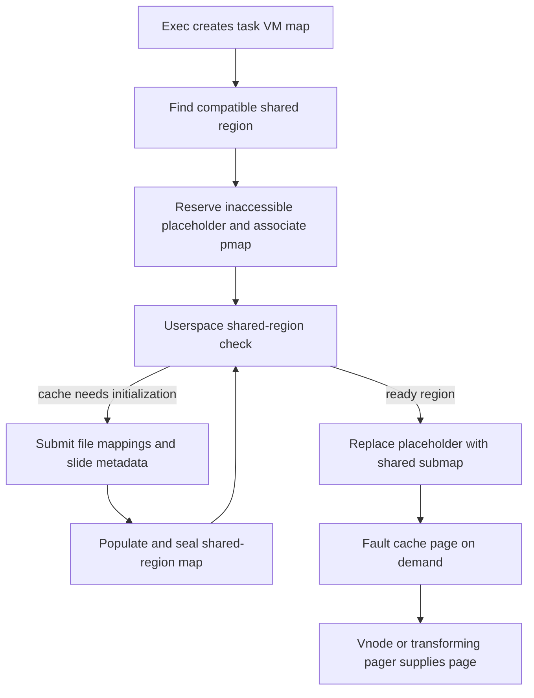
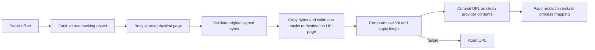

# Shared regions and transforming pagers

[VM guide](README.md) · [Objects and pages](objects-and-pages.md) · [Pagers and UPL](pagers-and-upl.md) · [Signature provenance](../security/page-signature-validation.md) · [ARM64 mappings](pmap-arm64.md)

A process's shared-cache address range is not populated by eagerly copying all shared libraries at exec. XNU associates the task with a compatible shared region, reserves a placeholder, and later installs the shared submap when the shared-region protocol succeeds. File-backed pages fault in on demand; designated pagers can slide or fix up a destination page while preserving the validation provenance of its source. This chapter follows those kernel-visible steps and separates them from userspace dyld's cache construction and library policy. [Exec integration](../../../xnu/osfmk/vm/vm_map.c#L13005-L13026), [placeholder contract](../../../xnu/osfmk/vm/vm_shared_region.c#L2412-L2460).

## Region identity and task association

[`vm_shared_region`](../../../xnu/osfmk/vm/vm_shared_region_xnu.h#L183-L225) carries references, queue membership, the memory-entry handle, configuration map, base/size and pmap-nesting bounds, root and CPU identity, mapping/slide ownership, persistence/stale flags, slide and cache-image identity. Its shared VM map and the task's own map are distinct objects; the nesting relation is distinct again from an ordinary VM object shadow.

`vm_shared_region_lookup()` compares root, CPU/subtype, bitness, DriverKit and RSR version, and conditionally page size/reslide state. Stale regions do not qualify. If none matches, it drops the global region lock to create one, then repeats lookup: another thread can have published the same environment while allocation ran. The unused candidate is not blindly inserted. [Lookup/publication](../../../xnu/osfmk/vm/vm_shared_region.c#L365-L461).

[Source: `osfmk/vm/vm_shared_region.c`, lines 412–429](../../../xnu/osfmk/vm/vm_shared_region.c#L412-L429).

<!-- source-excerpt: ../../../xnu/osfmk/vm/vm_shared_region.c#L412-L429 -->
```c
		if (new_shared_region == NULL) {
			/* no match: create a new one */
			vm_shared_region_unlock();
			new_shared_region = vm_shared_region_create(root_dir,
			    cputype,
			    cpu_subtype,
			    is_64bit,
			    target_page_shift,
			    reslide,
			    is_driverkit,
			    rsr_version);
			/* do the lookup again, in case we lost a race */
			vm_shared_region_lock();
			continue;
		}
		/* still no match: use our new one */
		shared_region = new_shared_region;
		new_shared_region = NULL;
```

This is environment reuse, not a universal system-wide singleton and not deduplication merely by filename. The task owns a reference to the selected region; the region's map/pager state can outlive one task's address space.

## Exec reserves a placeholder; the check path installs the submap

`vm_map_exec()` calls `vm_shared_region_enter()`. That function looks up the region and installs a fixed permanent `VM_PROT_NONE` placeholder. On success it associates the map's pmap with the region and publishes the task's shared-region reference. On failure, such as an overlapping statically linked mapping, it drops the region reference and leaves the task without that association. [Enter](../../../xnu/osfmk/vm/vm_shared_region.c#L2462-L2519), [placeholder implementation](../../../xnu/osfmk/vm/vm_shared_region.c#L2420-L2449).

The `shared_region_check_np`/start-address path waits for in-progress initialization and, when the region is available, replaces the placeholder with the real shared submap. `vm_shared_region_insert_submap()` divides the region according to nesting bounds and maps through `sr_mem_entry`. The source explicitly treats real submap insertion as a once-per-map operation: on protected platforms the pmap nesting relationship cannot simply be detached and re-established. Reserving address space at exec is therefore not equivalent to already making cache contents accessible. [BSD check](../../../xnu/bsd/vm/vm_unix.c#L1240), [start-address handling](../../../xnu/osfmk/vm/vm_shared_region.c#L1049), [submap insertion](../../../xnu/osfmk/vm/vm_shared_region.c#L2234-L2408).



The graph shows the protocol roles, not a promise that each process initializes the cache. Region lookup and mapping serialization allow a later process to reuse an already initialized region.

## Installing files and sealing the region

The BSD map-and-slide path validates user arguments and obtains file/mapping state before calling `vm_shared_region_map_file()`. The VM routine allocates per-slide bookkeeping, acquires exclusive initialization ownership via `sr_mapping_in_progress`, and rejects a region whose first mapping is already established or records an earlier failed attempt. [BSD setup](../../../xnu/bsd/vm/vm_unix.c#L1394), [syscall implementation](../../../xnu/bsd/vm/vm_unix.c#L2178), [VM preparation](../../../xnu/osfmk/vm/vm_shared_region.c#L1952-L2016), [ownership helpers](../../../xnu/osfmk/vm/vm_shared_region.c#L231-L257).

There are two mapping passes. Setup first establishes direct file mappings. The routine switches to `sr_config_map` so it can read slide metadata through those mappings, then replaces slide-required mappings with a shared-region pager. A slide error invokes `vm_shared_region_undo_mappings()` before common cleanup. Success adjusts unnestable bounds, records cache identity/layout, trims applicable pmap coverage, releases the configuration map, seals the region and releases initialization ownership. Temporary arrays and a switched map context have explicit cleanup independently of success. [Pass ordering](../../../xnu/osfmk/vm/vm_shared_region.c#L2017-L2050), [slide/undo](../../../xnu/osfmk/vm/vm_shared_region.c#L2051-L2074), [completion](../../../xnu/osfmk/vm/vm_shared_region.c#L2076-L2131).

## Shared-region pager and dyld pager serve different transformations

| Pager | Backing and transformation identity |
| --- | --- |
| Shared-region pager | Backing object/offset plus slide information; authenticated matching additionally compares JOP key, slide range/object and slide-info contents |
| Dyld pager | Snapshot backing object, per-range user addresses/file offsets/sizes, and owned linking information used by `fixup_page()` |

Sources: [shared-region pager creation/setup](../../../xnu/osfmk/vm/vm_shared_region_pager.c#L1152-L1275), [authenticated matching](../../../xnu/osfmk/vm/vm_shared_region_pager.c#L1284-L1352), [`dyld_pager` fields](../../../xnu/osfmk/vm/vm_dyld_pager.c#L228-L250), [dyld creation](../../../xnu/osfmk/vm/vm_dyld_pager.c#L1489-L1588).

`shared_region_pager_match()` can reuse an authenticated pager with matching backing snapshot and key/slide metadata. Its miss path unlocks before creating; its comment allows duplicate equivalent pagers from a race rather than claiming unique interning. `dyld_pager_setup()` instead creates a pager and waits for readiness. Both have readiness and mapping/reference lifetimes, but they should not be collapsed into one assumed global pager cache. [Shared match](../../../xnu/osfmk/vm/vm_shared_region_pager.c#L1284-L1352), [dyld setup](../../../xnu/osfmk/vm/vm_dyld_pager.c#L1591-L1618).

`vm_map_with_linking()` checks that the selected mapping is backed by the supplied file and a suitable snapshot/copy relationship. It rejects submaps, absent objects, inappropriate maximum protections, the wrong file and unsupported extra shadows. After pager creation, ownership of `*link_info` moves to the pager and the caller pointer is nulled. Each range is overwritten with a copy-on-write mapping of that pager. A later mapping failure does not undo earlier mapped ranges: the source explicitly relies on the caller's process-fatal failure policy. [Validation](../../../xnu/osfmk/vm/vm_dyld_pager.c#L1629-L1772), [mapping/ownership and cleanup](../../../xnu/osfmk/vm/vm_dyld_pager.c#L1774-L1841).

[Source: `osfmk/vm/vm_dyld_pager.c`, lines 1775–1781](../../../xnu/osfmk/vm/vm_dyld_pager.c#L1775-L1781).

<!-- source-excerpt: ../../../xnu/osfmk/vm/vm_dyld_pager.c#L1775-L1781 -->
```c
	/* create a pager, backed by the latest snapshot (copy object) of the file */
	pager = dyld_pager_setup(task, backing_object, regions, region_cnt, *link_info, link_info_size);
	if (pager == MEMORY_OBJECT_NULL) {
		kr = KERN_RESOURCE_SHORTAGE;
		goto done;
	}
	*link_info = NULL; /* ownership of this pointer was given to pager */
```

## One fault transforms a destination page

`dyld_pager_data_request()` obtains a lightweight internal UPL for absent destination pages. It references the backing object, then faults each needed source offset with `vm_fault_page()`. Retry, memory shortage, interrupted fault, no-page success and genuine memory error have separate branches. A source page returned busy remains protected by paging-in-progress accounting while the transformation proceeds. [Request/UPL](../../../xnu/osfmk/vm/vm_dyld_pager.c#L963-L1035), [fault outcomes](../../../xnu/osfmk/vm/vm_dyld_pager.c#L1054-L1110).



The destination physical page comes from UPL page information; the source page can belong to a lower object reached by the fault. `phystokv()` provides kernel access to each physical page on the inspected path. These addresses are neither the file offset nor the reconstructed userspace address used by relocation. [Page addresses and validation](../../../xnu/osfmk/vm/vm_dyld_pager.c#L1116-L1155).

The code validates source bytes when their object is code-signed and copies validated/tainted/NX masks into the destination's UPL metadata. It then drops the source object's lock while retaining busy and paging protection, copies a page, computes the user VA from the matching range, and invokes fixup. That is provenance-preserving transformation, not a new digest comparison of changed destination bytes against the original file. [Transformation](../../../xnu/osfmk/vm/vm_dyld_pager.c#L1135-L1199), [signature guide](../security/page-signature-validation.md).

[Source: `osfmk/vm/vm_dyld_pager.c`, lines 1149–1165](../../../xnu/osfmk/vm/vm_dyld_pager.c#L1149-L1165).

<!-- source-excerpt: ../../../xnu/osfmk/vm/vm_dyld_pager.c#L1149-L1165 -->
```c
		/*
		 * The page provider might access a mapped file, so let's
		 * release the object lock for the source page to avoid a
		 * potential deadlock.
		 * The source page is kept busy and we have a
		 * "paging_in_progress" reference on its object, so it's safe
		 * to unlock the object here.
		 */
		assert(src_page->vmp_busy);
		assert(src_page_object->paging_in_progress > 0);
		vm_object_unlock(src_page_object);

		/*
		 * Process the original contents of the source page
		 * into the destination page.
		 */
		bcopy((const char *)src_vaddr, (char *)dst_vaddr, PAGE_SIZE);
```

Afterward it reacquires the source object lock, clears busy/wakes waiters, ends paging and releases any top-page fault placeholder. Common cleanup marks provider-generated pages clean, aborts the UPL on failure or commits it with validation/written-by-kernel flags on success, deallocates the UPL and drops the backing-object reference. Clean here means reproducible by this pager, not byte-identical to the original vnode file. [Source cleanup](../../../xnu/osfmk/vm/vm_dyld_pager.c#L1198-L1222), [UPL cleanup](../../../xnu/osfmk/vm/vm_dyld_pager.c#L1223-L1257).

For an illustrative range at user VA `U`, file offset `F`, a fault at pager offset `F + d` uses `U + d` as its relocation coordinate. The source and destination physical pages can be entirely unrelated. Use the selected build's `PAGE_SIZE` for page iteration; no fixed 4 KiB assumption is required by this example.

## References outlive mappings in different ways

`vm_shared_region_deallocate()` adjusts optional persistence ownership for the boot-volume region. Reaching zero can schedule delayed destruction while taking a timer reference; stale/old-RSR or expired cases instead remove the region from the lookup queue before destroying it. A process exiting is therefore not sufficient evidence that its shared map disappeared. [Region deallocation](../../../xnu/osfmk/vm/vm_shared_region.c#L535-L639).

Shared-region pagers can retain unmapped cached instances. Trimming selects ready, unmapped instances at the expected reference count, dequeues them under the pager lock, then terminates them outside that lock. Dyld pager deallocation has a different threshold: dropping to the final internal reference dequeues and initiates termination; reaching zero frees linking information, control reference and pager allocation. [Shared-pager trim](../../../xnu/osfmk/vm/vm_shared_region_pager.c#L1357-L1421), [dyld teardown](../../../xnu/osfmk/vm/vm_dyld_pager.c#L1316-L1361).

The source supplies kernel mapping, slide/fixup and lifecycle bodies. Userspace dyld's complete selection/build rules, external decryption services and every relocation encoding remain outside this selected trace. Pointer-authentication, mixed-page-size and nesting guards matter; the ARM64 pmap chapters supply the hardware mapping mechanics rather than duplicating them here.

<!-- BEGIN PLATYDOC DOCUMENTATION LICENSE -->
Original Platydoc text and diagrams are licensed under [CC BY 4.0](https://creativecommons.org/licenses/by/4.0/). Quoted source code and third-party material retain their respective licenses.
<!-- END PLATYDOC DOCUMENTATION LICENSE -->
