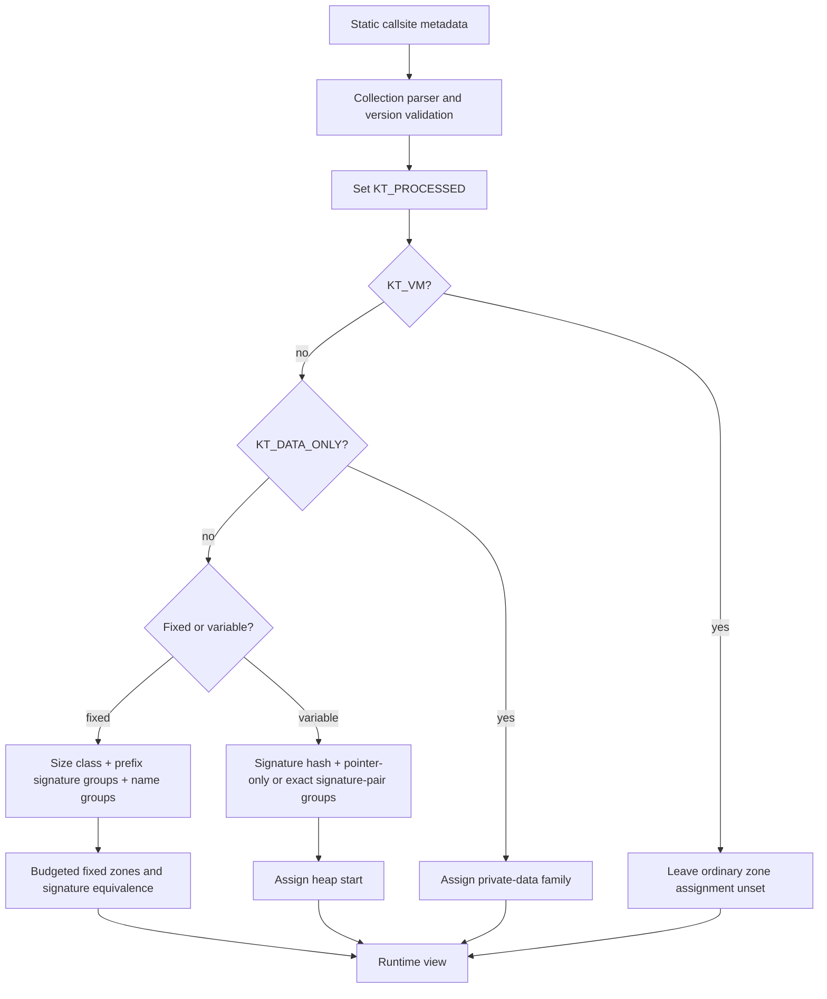
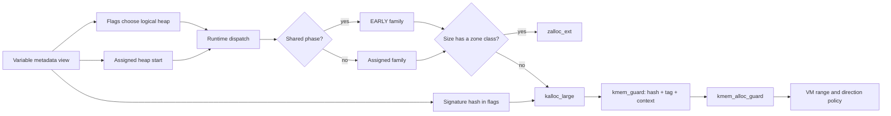

# Typed allocation: from C layouts to zones and VM ranges

`kalloc_type` attaches a compiler description of a C/C++ memory layout to an allocation callsite. Startup code turns that description into a zone or heap choice. The runtime then uses that precomputed choice, the requested size, and accounting state to select storage. This reduces which allocations can reuse the same storage, but the implementation deliberately groups types: it does not create one allocator for every C type. The fixed and variable paths also have different free-time checks. Start with the declarations in [kalloc.h](../../../xnu/osfmk/kern/kalloc.h#L225-L448), then follow [startup assignment](../../../xnu/osfmk/kern/kalloc.c#L1776-L2089) and [runtime dispatch](../../../xnu/osfmk/kern/kalloc.c#L2491-L2556).

This page follows the implementation in this checkout. [Kernel allocation](kernel-allocation.md) explains the public interface choices; [the zone allocator](zone-allocator.md) explains element storage, caching, and reclamation; [kernel virtual allocation](kernel-virtual-allocation.md) continues the large-allocation path through `kmem`. Four distinct identifiers recur below:

| Identifier | What it describes | What it does not promise |
|---|---|---|
| `kt_zv.zv_name` / `kt_name` | An emitted string such as `site.struct request`; used to group metadata records during startup | A globally unique C++ dynamic type or an allocation identity |
| `kt_signature`, `kt_sig_hdr`, `kt_sig_type` | Compiler descriptions of pointer/data/PAC placement in 8-byte granules | Member names, object lifetime, ownership, or arbitrary program semantics |
| `z_sig_eq` | A group of fixed-size zones whose allocations may be cross-freed by the typed free path | One unique layout signature per group |
| High 16 bits of `kt_flags` | A compact VM range/direction choice derived from variable-type signatures | A unique type ID stored with, and checked against, every object |

These roles are visible in [metadata emission](../../../xnu/osfmk/kern/kalloc.h#L1661-L1707), [signature equivalence assignment](../../../xnu/osfmk/kern/kalloc.c#L1682-L1695), [typed free](../../../xnu/osfmk/kern/zalloc.c#L5805-L5837), and [VM hash construction](../../../xnu/osfmk/kern/kalloc.c#L894-L943).

## 1. A source expression emits a metadata record

The interface has three allocation shapes. The spelling of the shape matters even when two expressions request the same number of bytes:

| Expression | Metadata section | Runtime size | Main internal path |
|---|---|---|---|
| `kalloc_type(T, flags)` | `__kalloc_type` | `sizeof(T)` | Fixed view → `kalloc_type_impl_internal` → `zalloc_ext` |
| `kalloc_type(T, count, flags)` | `__kalloc_var` | `sizeof(T) * count`, with overflow checking | Variable view → `kalloc_ext` → zone or `kalloc_large` |
| `kalloc_type(H, T, count, flags)` | `__kalloc_var` | `sizeof(H)` rounded up to `_Alignof(T)`, plus `sizeof(T) * count` | Same variable dispatch, with separate header/element signatures |

The macros generate the static view at the callsite; free macros generate their own corresponding view. `kalloc_type(T, flags)` and `kalloc_type(T, 1, flags)` therefore belong to different allocation families. The API documents that the matching free form must be used. [API contract](../../../xnu/osfmk/kern/kalloc.h#L700-L760), [size arithmetic and fixed macros](../../../xnu/osfmk/kern/kalloc.h#L1347-L1379), [array and header-array macros](../../../xnu/osfmk/kern/kalloc.h#L1412-L1429).

The fixed emission is small enough to show in full. It creates an array containing one view, records a stringized type name, and leaves the runtime-assigned fields zero-initialized. The `live_support` section attribute is part of the emitted section declaration; this is not a manually maintained registry. [Fixed metadata macro](../../../xnu/osfmk/kern/kalloc.h#L1667-L1678).

<!-- source-excerpt: ../../../xnu/osfmk/kern/kalloc.h#L1667-L1678 -->
```c
#define _KALLOC_TYPE_DEFINE(var, type, flags)                       \
	__kalloc_no_kasan                                               \
	__PLACE_IN_SECTION(KALLOC_TYPE_SEGMENT ", __kalloc_type, "      \
	    "regular, live_support")                                    \
	struct kalloc_type_view var[1] = { {                            \
	    .kt_zv.zv_name = "site." #type,                             \
	    .kt_flags = KALLOC_TYPE_ADJUST_FLAGS(flags, type),          \
	    .kt_size = sizeof(type),                                    \
	    .kt_signature = KALLOC_TYPE_EMIT_SIG(type),                 \
	} };                                                            \
	KALLOC_TYPE_SIZE_CHECK(sizeof(type));

```

`KALLOC_TYPE_SEGMENT` is `__DATA_CONST` for the kernel build and `__DATA` for `__BUILDING_XNU_LIBRARY__`. The header documents that views become protected by lockdown and cannot be initialized dynamically. Startup is the mutation phase: it fills zone pointers, accounting pointers, hashes, and processed flags before ordinary allocation consumes them. [Segment choice](../../../xnu/osfmk/kern/kalloc.h#L1584-L1592), [view lifetime contract](../../../xnu/osfmk/kern/kalloc.h#L309-L336), [assignment bodies](../../../xnu/osfmk/kern/kalloc.c#L600-L704).

The fixed record embeds a `zone_view`: `zv_zone` is the assigned zone, `zv_stats` is the accounting destination, and `zv_name` identifies the emitted type expression. `kt_zearly` records the shared initial-allocation zone; `kt_zsig` identifies the signature-equivalence zone. Startup packs the fixed-size class index into the top byte of `kt_size`; accessors mask off that byte when retrieving the original size. The other 24 bits are the size, not a per-object allocation count. [Fixed structure](../../../xnu/osfmk/kern/kalloc.h#L328-L346), [class packing](../../../xnu/osfmk/kern/kalloc.c#L568-L598), [size accessors](../../../xnu/osfmk/kern/kalloc.h#L1828-L1842).

The variable record instead carries `kt_size_hdr`, `kt_size_type`, `kt_sig_hdr`, `kt_sig_type`, `kt_heap_start`, `kt_stats`, and linkage for the heap's view list. `kt_heap_start` is the first zone ID of a contiguous size-class family. Although the structure still has a `kt_zones[]` field, the assignment and allocation bodies examined here use `kt_heap_start`; they do not consult that array for per-size routing. [Variable structure](../../../xnu/osfmk/kern/kalloc.h#L432-L448), [assignment](../../../xnu/osfmk/kern/kalloc.c#L677-L704), [runtime access](../../../xnu/osfmk/kern/kalloc.c#L2526-L2537).

For array sizes, `kt_size` uses checked multiply-and-add. Overflow or a result with the high size bit set produces a sentinel size which `kalloc_large` rejects. Header-plus-array allocation explicitly rounds the header to the element alignment before this calculation. There is no unchecked `sizeof(T) * count` in these wrappers. [Arithmetic](../../../xnu/osfmk/kern/kalloc.h#L1347-L1359), [header-array use](../../../xnu/osfmk/kern/kalloc.h#L1421-L1429), [large rejection](../../../xnu/osfmk/kern/kalloc.c#L2351-L2373).

## 2. What the compiler signature classifies

The header defines the interface to `__builtin_xnu_type_signature` and `__builtin_xnu_type_summary`. A signature describes the layout in 8-byte granules. Each granule's encoding is the bitwise OR of its contained member categories. The declared category values are padding `0`, ordinary pointer `1`, scalar data `2`, currently unused dual `4`, and PAC pointer `8`. This permits mixed encodings: a granule containing both pointer and scalar categories differs from either pure category. [Compiler contract and encodings](../../../xnu/osfmk/kern/kalloc.h#L777-L810).

The summary is a presence bitmap of granule encodings. `KT_SUMMARY_GRANULE_TO_IDX(g)` contributes `1UL << g`, and only the low 16 summary bits are used for these layout checks. `KT_SUMMARY_MASK_DATA` permits padding and scalar-data granules; `KT_SUMMARY_MASK_PTR` permits padding, ordinary-pointer, and PAC-pointer granules. A type qualifies only if no summary bit lies outside the relevant allowed mask. The test is thus about every granule, not whether the type contains at least one pointer. [Summary masks](../../../xnu/osfmk/kern/kalloc.h#L816-L843), [classification test](../../../xnu/osfmk/kern/kalloc.h#L861-L885).

`KALLOC_TYPE_HAS_OVERLAPS` uses another mask to detect granules containing different categories. “Overlapping” here includes different-category members sharing a granule; it does not by itself establish overlapping C storage or an invalid union. The compiler implementation is outside this repository, so the guide treats the header as the compiler/kernel contract rather than claiming to verify the compiler's handling of every language feature. [Overlap definition](../../../xnu/osfmk/kern/kalloc.h#L887-L902).

The flags are constructed from that summary and compile-time size tests. For the header-plus-element form, the data and pointer predicates must hold for both types. `KT_VM` is set by `sizeof(T) > KHEAP_MAX_SIZE`, or `sizeof(H) + sizeof(T) > KHEAP_MAX_SIZE` for the two-type form. It is a compile-time metadata classification, not the runtime array length test. [Classification macros](../../../xnu/osfmk/kern/kalloc.h#L1609-L1626), [adjusted flags](../../../xnu/osfmk/kern/kalloc.h#L1661-L1665).

<!-- source-excerpt: ../../../xnu/osfmk/kern/kalloc.h#L1661-L1665 -->
```c
#define KALLOC_TYPE_ADJUST_FLAGS(flags, ...)                                 \
	KALLOC_TYPE_CAST_FLAGS((flags | KT_CHANGED | KT_CHANGED2 |               \
	(KALLOC_TYPE_CHECK(KT_SUMMARY_MASK_DATA, __VA_ARGS__)? KT_DATA_ONLY: 0) |\
	(KALLOC_TYPE_CHECK(KT_SUMMARY_MASK_PTR, __VA_ARGS__)? KT_PTR_ARRAY: 0) | \
	(KALLOC_TYPE_VM_SIZE_CHECK(__VA_ARGS__)? KT_VM : 0)))
```

The flags relevant to the rest of the path are:

| Flag | Meaning in the inspected path |
|---|---|
| `KT_DATA_ONLY` | Route compiler-classified data/padding storage to the private data allocation family |
| `KT_PTR_ARRAY` | Qualifies a variable view for the special pointer-only heap pool; it is also present on qualifying fixed views, but the fixed policy does not use that pool |
| `KT_VM` | Skip ordinary boot-time zone/signature assignment for this compile-time-large view |
| `KT_CHANGED`, `KT_CHANGED2` | Required metadata-version markers checked while ingesting records |
| `KT_PROCESSED` | The startup parser saw the record; this is set even for views subsequently skipped because of `KT_VM` |
| `KT_PRIV_ACCT`, `KT_SHARED_ACCT`, `KT_DEFAULT` | Choose private or shared statistics according to the assignment code and `kt` options |
| `KT_NOEARLY` | Fixed-view request to bypass shared initial storage; assignment requires private accounting |
| `KT_HASH` | Upper 16 bits reserved for the variable-view VM placement hint |

See [flag definitions](../../../xnu/osfmk/kern/kalloc.h#L225-L307), [version validation](../../../xnu/osfmk/kern/kalloc.c#L729-L756), [parser filtering](../../../xnu/osfmk/kern/kalloc.c#L991-L1025), and [fixed accounting setup](../../../xnu/osfmk/kern/kalloc.c#L631-L664).

Two compile-time choices prevent misleading interpretations of the metadata. First, `KALLOC_TYPE_EMIT_SIG` emits an empty string for data-only or compile-time-large views. Such views are intentionally not part of the ordinary signature sorting. Second, a pointer-bearing header followed by a data-only trailing array is rejected by `KALLOC_TYPE_TRAILING_DATA_CHECK`. Callers must choose an appropriate allocation design instead of silently treating a large byte tail as pointer-bearing typed storage. [Signature omission](../../../xnu/osfmk/kern/kalloc.h#L1640-L1651), [trailing-data check](../../../xnu/osfmk/kern/kalloc.h#L1628-L1632).

<!-- source-excerpt: ../../../xnu/osfmk/kern/kalloc.h#L1628-L1632 -->
```c
#define KALLOC_TYPE_TRAILING_DATA_CHECK(hdr_ty, elem_ty)     \
	_Static_assert((KALLOC_TYPE_IS_DATA_ONLY(hdr_ty) ||  \
	    !KALLOC_TYPE_IS_DATA_ONLY(elem_ty)),             \
	"cannot allocate data-only array of " #elem_ty       \
	" contiguously to " #hdr_ty)
```

These are layout classifications. As a consequence, an integer used by a program to encode an address is still described through its declared scalar type; the allocator does not inspect stored values to discover semantic pointers. Likewise, data-only types are not separated from each other by their type names: their destination is the private data family. This conclusion follows from the compiler-category contract and the unconditional data redirection in [kalloc_type_handle_data_view_fixed](../../../xnu/osfmk/kern/kalloc.c#L824-L839).

## 3. Startup discovers and transforms the records

`kalloc_init` runs at `STARTUP(ZALLOC, STARTUP_RANK_THIRD, ...)`. It computes heap size classes; creates private-data, shared-data, and EARLY heaps; allocates a 256 KiB scratch buffer; processes fixed views; clears and reuses the scratch buffer for variable views; and releases it. Fixed initialization also chooses the boot-random signature-hash seed, builds the fixed direct lookup table, sorts surviving views, constructs group boundaries, and creates/assigns zones. [Scratch size](../../../xnu/osfmk/kern/kalloc.c#L432-L437), [fixed initialization](../../../xnu/osfmk/kern/kalloc.c#L1860-L1898), [startup sequence](../../../xnu/osfmk/kern/kalloc.c#L2047-L2089).

The parser is sensitive to kernel-collection format. With `KCFormatStatic`, it consumes coalesced section boundaries. For `KCFormatFileset`, it traverses `LC_FILESET_ENTRY` images in the primary collection and locates each image's appropriate section. The `KCFormatKCGEN` branch processes the kernel and traverses the prelinked extension Mach-O layout, applying slide handling where requested. Unsupported dynamic/unknown collection formats cause the parser to panic. The KCGEN source contains historical armv7 commentary, but the concrete branch should be read together with its compilation environment rather than generalized to every ARM platform. [Collection parsing](../../../xnu/osfmk/kern/kalloc.c#L1030-L1192).

For every record, `kalloc_type_view_copy` validates the required changed-version bits and marks it processed. A `KT_VM` record is then skipped. A data-only record is assigned directly to the data family and skipped. Only remaining records receive the ordinary hash/index processing and enter the scratch pointer array. This ordering matters: `KT_PROCESSED` does not prove that a view has an assigned typed zone, and an oversized variable element does not acquire the usual signature hash merely because its view was processed. [Filtering and transformations](../../../xnu/osfmk/kern/kalloc.c#L978-L1027).

<!-- source-excerpt: ../../../xnu/osfmk/kern/kalloc.c#L995-L1004 -->
```c
		kalloc_type_flags_t kt_flags = kalloc_type_func(type, get_flags, cur,
		    kext_uuid);
		kalloc_type_func(type, mark_processed, cur);
		/*
		 * Skip views that go to the VM
		 */
		if (kalloc_type_from_vm(kt_flags)) {
			cur += kalloc_type_func(type, view_sz);
			continue;
		}
```

The flow is:



The two branches are implemented by [kalloc_type_view_init_fixed](../../../xnu/osfmk/kern/kalloc.c#L1860-L1898) and [kalloc_type_view_init_var](../../../xnu/osfmk/kern/kalloc.c#L1965-L2045). They run once for the ingested metadata; runtime allocation does not sort type descriptions.

## 4. Fixed allocations: size classes, layout groups, and a finite zone budget

### Build the grouping keys

Fixed types use `kt_zone_cfg`, a separate class table from the ordinary heap sequence. For example, its small classes include 80, 160, 224, 288, 368, 400, and 576 bytes, which are not all present in the regular variable-heap progression. The table extends through 16 KiB, with 24 and 32 KiB entries on arm64; `KASAN_CLASSIC` adjusts some class capacities for guards. Startup builds a direct lookup table and packs the resulting class index into each surviving fixed view. [Fixed size classes](../../../xnu/osfmk/kern/kalloc.c#L112-L153), [lookup construction and packing](../../../xnu/osfmk/kern/kalloc.c#L567-L598).

`kalloc_type_cmp_fixed` orders records by size class, then lexicographic signature, then emitted name. The next pass creates groups within each size class. Despite a comment using “substring,” its actual comparison is a prefix test: the previous signature must match the beginning of the current one. The pass then remembers the current signature, so successive longer signatures can remain in the same group. It does not search for a signature at an arbitrary offset. [Comparator](../../../xnu/osfmk/kern/kalloc.c#L1195-L1221), [group builder](../../../xnu/osfmk/kern/kalloc.c#L1252-L1349).

The decisive branch and the update to the comparison prefix are shown here. [Prefix grouping](../../../xnu/osfmk/kern/kalloc.c#L1313-L1330).

<!-- source-excerpt: ../../../xnu/osfmk/kern/kalloc.c#L1313-L1330 -->
```c
		if (strncmp(c_sig, p_sig, strlen(p_sig)) != 0) {
			/*
			 * Unique signature detected. Update counts and advance index
			 */
			unique_sig++;
			total_sig++;

			*kt_skip_list = i;
			kt_skip_list++;
			p_sig = c_sig;
			p_name = c_name;
			continue;
		}
		/*
		 * Need this here as we do substring matching for signatures so you
		 * want to track the longer signature seen rather than the substring
		 */
		p_sig = c_sig;
```

The two per-class “frequency” arrays are counts of the parsed metadata's groups, not observations of runtime allocation rates. `kt_freq_list` counts signature groups. `kt_freq_list_total` records additional emitted-name groups beyond one per signature group (`total_sig - unique_sig`). Repeated allocation/free callsites with the same signature and emitted name therefore do not consume budget as independent types. More exactly, the implementation counts name changes in the sorted regions; it is not building a language-level global symbol table. [Count updates](../../../xnu/osfmk/kern/kalloc.c#L1283-L1347).

### Divide the zone budget

The default fixed-zone budget is 120 for watch targets or `KASAN_CLASSIC`, and 260 otherwise. `kt_fixed_zones` can supply the tunable value. These numbers are a budget for the new fixed typed zones, not the total number of all XNU zones or a promise that each C type gets one. The policy splits the budget into 70% for signature grouping and the remainder for additional separation among name groups. [Configuration](../../../xnu/osfmk/kern/zalloc_internal.h#L477-L486), [tunables](../../../xnu/osfmk/kern/kalloc.c#L460-L466), [policy entry](../../../xnu/osfmk/kern/kalloc.c#L1530-L1553).

<!-- source-excerpt: ../../../xnu/osfmk/kern/kalloc.c#L1538-L1539 -->
```c
	uint16_t zbudget_sig = (uint16_t) ((7 * zone_budget) / 10);
	uint16_t zbudget_type = zone_budget - zbudget_sig;
```

The signature-budget distribution first grants up to two zones per populated size class, capped by that class's group count. It caps the overall available budget by the total count, then distributes remaining zones proportionally to counts beyond those minima. An accumulated remainder distributes integer leftovers; the per-class result is capped by its count. The name-separation distribution uses the same routine with minimum zero. A subsequent pass borrows from the three largest name-zone allocations to give zones to classes with additional names but no such zone. These are static balancing heuristics, not per-type reservation guarantees. [Distribution](../../../xnu/osfmk/kern/kalloc.c#L1384-L1453), [redistribution](../../../xnu/osfmk/kern/kalloc.c#L1465-L1528).

The policy calls make the different minima explicit. [Budget application](../../../xnu/osfmk/kern/kalloc.c#L1549-L1553).

<!-- source-excerpt: ../../../xnu/osfmk/kern/kalloc.c#L1549-L1553 -->
```c
	wasted_zones += kalloc_type_distribute_budget(freq_list, kt_zones_sig,
	    zbudget_sig, 2);
	wasted_zones += kalloc_type_distribute_budget(freq_total_list,
	    kt_zones_type, zbudget_type, 0);
	kalloc_type_redistribute_budget(freq_total_list, kt_zones_type);
```

For each populated fixed size class, `kalloc_type_create_zone_for_size` creates `n_zones_sig + n_zones_type` zones named `kalloc.type<index>.<size>`, marked `ZC_KALLOC_TYPE`. With the default shared-fixed setting, it also finds an EARLY zone of exactly that element size, creating an additional shared zone when the regular EARLY heap does not have that exact class. This shared zone is separate from the typed-zone budget. [Creation and shared zone](../../../xnu/osfmk/kern/kalloc.c#L1573-L1611), [typed-zone flag handling](../../../xnu/osfmk/kern/zalloc.c#L9203-L9219).

### Assign groups with shuffling

`kalloc_type_create_zones_fixed` shuffles signature-group indices, then assigns the resulting groups round-robin over signature zones. If more signature groups exist than signature zones, distinct groups share a signature zone. The randomized order varies which groups collide; it does not remove collisions. Each signature zone is assigned its own zone ID as its `z_sig_eq` value. [Outer shuffle and assignment](../../../xnu/osfmk/kern/kalloc.c#L1817-L1856), [equivalence initialization](../../../xnu/osfmk/kern/kalloc.c#L1682-L1695).

Within a signature group, `kalloc_type_build_skip_list` locates emitted-name runs. `kalloc_type_zones_for_type` apportions the size class's additional type zones according to the group's share of those names, with a carry used for integer rounding. The denominator passed by the caller includes both the additional-name count and the signature-group count. A group receiving no extra zones stays entirely in the signature zone. A group with one name and an extra zone uses its first extra zone. Otherwise, names are spread across the extra zones plus the signature zone, with a fresh permutation for each complete cycle. [Name boundaries](../../../xnu/osfmk/kern/kalloc.c#L1648-L1680), [apportionment](../../../xnu/osfmk/kern/kalloc.c#L1613-L1646), [inner assignment](../../../xnu/osfmk/kern/kalloc.c#L1704-L1774).

The inner loop's permutation affects assignment, not each subsequent allocation. [Name-to-zone selection](../../../xnu/osfmk/kern/kalloc.c#L1763-L1770).

<!-- source-excerpt: ../../../xnu/osfmk/kern/kalloc.c#L1763-L1770 -->
```c
		if (zidx == 0) {
			kmem_shuffle(shuffle_buf, n_zones);
		}

		shuffled_zidx = shuffle_buf[zidx];
		zone = shuffled_zidx == 0 ? sig_zone : type_zones[shuffled_zidx - 1];
		kalloc_type_assign_zone_fixed(kt_type_start, kt_type_end, zone, sig_zone,
		    early_zone);
```

Every extra type zone receives the `z_sig_eq` of its group's signature zone. Consequently, if two different signature groups collided in that signature zone, their extra zones also belong to the same equivalence class. `kalloc_type_assign_zone_fixed` stores the assigned zone, signature zone, EARLY zone, and statistics in each view and validates this relationship. This is the structure the free path later recognizes. [Extra-zone equivalence](../../../xnu/osfmk/kern/kalloc.c#L1725-L1738), [view assignment](../../../xnu/osfmk/kern/kalloc.c#L600-L673).

A conceptual example, not measured boot output: suppose three 16-byte layouts describe `(pointer, scalar)`, `(pointer, scalar)`, and `(scalar, pointer)`. The first two can have different emitted names while sharing a layout signature; the third belongs to another signature group. Budget and shuffle decisions may separate the first two into different assigned zones, and may still put the third into the same broader equivalence group if signature zones are reused. Their ordinary small allocations can also initially use the same EARLY size class. The example illustrates the algorithm's possible relationships; it does not predict any particular build's assigned zone numbers. [Grouping](../../../xnu/osfmk/kern/kalloc.c#L1195-L1221), [finite assignment](../../../xnu/osfmk/kern/kalloc.c#L1836-L1856), [runtime EARLY choice](../../../xnu/osfmk/kern/kalloc.c#L2980-L2993).

## 5. Variable allocations: whole heap families and special classes

A variable allocation chooses a heap family at startup and a size class at runtime. Ordinary heap classes start at 16 and 32 bytes, then follow two classes per power-of-two interval, such as 48/64, 96/128, and 192/256. `KHEAP_MAX_SIZE` is 16 KiB on x86_64 and 32 KiB otherwise in these definitions. A sufficiently long array therefore leaves its heap's zones and enters `kalloc_large`, even though its element's metadata was an ordinary small type. [Heap geometry](../../../xnu/osfmk/kern/kalloc.h#L348-L398), [zone lookup](../../../xnu/osfmk/kern/kalloc.c#L246-L321), [zone/VM dispatch](../../../xnu/osfmk/kern/kalloc.c#L2549-L2555).

`kalloc_type_heap_init` creates the variable heap zone families before parsing views, because data and pointer-only views can be redirected while processing. It also creates shared statistics for `KHEAP_KT_VAR`. In `kalloc_type_heap_array`, indices zero and one are fake bookkeeping entries for private and shared data; indices two and three are pointer-only heaps; index four is the first flexible heap. The fake data entries link views but do not replace the separately initialized data heaps. [Heap IDs](../../../xnu/osfmk/kern/zalloc_internal.h#L514-L534), [heap initialization](../../../xnu/osfmk/kern/kalloc.c#L1900-L1920), [data bookkeeping](../../../xnu/osfmk/kern/kalloc.c#L833-L858).

Data-only fixed and variable views bypass signature-based separation and use `KHEAP_DATA_PRIVATE`. “Private” describes the intended security-domain sharing policy, not private accounting or an exclusive heap for the C type. Shared data requires the dedicated shared-data APIs; the typed compiler flags do not automatically infer that an object will be shared with userspace or a device. [Data handlers](../../../xnu/osfmk/kern/kalloc.c#L824-L858), [runtime heap choice](../../../xnu/osfmk/kern/kalloc.c#L2287-L2305), [explicit-sharing contract](../../../xnu/osfmk/kern/kalloc.h#L1653-L1659), [external data APIs](../../../xnu/osfmk/kern/kalloc.c#L2571-L2589).

For remaining variable views, sorting places pointer-only views first, then orders by header signature, element signature, and emitted name. `kalloc_type_handle_parray_var` walks the pointer-only prefix and assigns each detected name group to one of the two pointer heaps using `kmem_get_random16(1)`. A `KT_PTR_ARRAY` type can be a record composed only of pointer/padding/PAC granules; the name of the flag should not be read as requiring C array syntax in the type definition. Fixed pointer-only views still use the fixed policy described above. [Comparator](../../../xnu/osfmk/kern/kalloc.c#L1223-L1250), [pointer-heap assignment](../../../xnu/osfmk/kern/kalloc.c#L860-L892), [summary mask](../../../xnu/osfmk/kern/kalloc.h#L833-L836).

The remaining views are grouped by exact equality of the header and element signature strings. An absent header is treated as an empty string. Unlike fixed grouping, this pass does not use prefix matching, and it does not include runtime count in the key. Arrays of a particular element type at different lengths therefore share their startup classification and select different size buckets within the chosen heap. [Variable group construction](../../../xnu/osfmk/kern/kalloc.c#L1352-L1382), [runtime size selection](../../../xnu/osfmk/kern/kalloc.c#L2526-L2555).

### The flexible-heap split

The default `kt_var_heaps` is six. The exact indexing arithmetic deserves attention because these are pool indices, not six independent C type IDs:

1. Heap creation starts at index two and creates six families, indices 2 through 7.
2. `fixed_heaps = KT_VAR__FIRST_FLEXIBLE_HEAP - 1`, which is 3, and `flex_heap_count = kt_var_heaps - fixed_heaps - 1`, which is 2.
3. A permutation of the two ordinary flexible choices is built; one randomly selected choice is appended again, giving that choice twice as many positions in the assignment cycle.
4. A signature group assigned to that selected choice is subdivided by emitted-name runs. Each run randomly remains in the selected heap or is assigned to heap index `kt_var_heaps`, which is 6 with defaults.
5. Other signature groups stay together in their selected flexible heap. With these defaults, typed non-pointer views use indices 4/5 and the split target 6. Index 7 is also created; the separate `kheap_init_var` path can select existing flexible families including it.

This is a calculation from the current constants and bodies, not observed assignments on a running system. It does not justify arbitrary values for the tunables. [Default configuration](../../../xnu/osfmk/kern/zalloc_internal.h#L477-L486), [heap creation](../../../xnu/osfmk/kern/kalloc.c#L1900-L1920), [split helpers](../../../xnu/osfmk/kern/kalloc.c#L1922-L1963), [assignment arithmetic](../../../xnu/osfmk/kern/kalloc.c#L1965-L2045), [custom heap initialization](../../../xnu/osfmk/kern/kalloc.c#L3471-L3487).

The final dispatch of each signature group is explicit. [Flexible assignment](../../../xnu/osfmk/kern/kalloc.c#L2031-L2044).

<!-- source-excerpt: ../../../xnu/osfmk/kern/kalloc.c#L2031-L2044 -->
```c
	for (uint32_t i = 1; i <= unique_sig; i++) {
		uint32_t heap_id = shuffle_buf[i % (flex_heap_count + 1)] +
		    fixed_heaps + 1;
		uint32_t start = kt_skip_list_start[i - 1];
		uint32_t end = kt_skip_list_start[i];

		assert(heap_id <= kt_var_heaps);
		if (heap_id == split_heap) {
			kalloc_type_split_heap(start, end, heap_id);
			continue;
		}
		kalloc_type_assign_zone_var(&kt_buffer[start].ktv_var,
		    &kt_buffer[end].ktv_var, heap_id);
	}
```

`kalloc_type_assign_zone_var` stores only the chosen `kh_zstart` as the view's `kt_heap_start`, optionally allocates private statistics, and links the view into that heap's list. It does not reserve a separate set of pages for the view. The same family serves all of its assigned types. The generic heap mechanism also uses existing families: a named `KALLOC_HEAP_DEFINE` view is not evidence that a new physical heap was created. [Variable assignment](../../../xnu/osfmk/kern/kalloc.c#L677-L704), [heap-view setup](../../../xnu/osfmk/kern/kalloc.c#L3442-L3507).

## 6. Runtime selection and the shared initial-allocation phase

A fixed kernel-private allocation needs no size search. `kalloc_type_impl_internal` gets the assigned zone and statistics from its view. If `Z_SET_NOT_EARLY` is present or the current CPU's statistics have `zs_alloc_not_early` set, it allocates from the assigned zone. Otherwise, it allocates from `kt_zearly`, carrying `Z_SET_NOT_EARLY` to the zone implementation so the shared-allocation threshold can be evaluated. [Fixed dispatch](../../../xnu/osfmk/kern/kalloc.c#L2979-L2993).

<!-- source-excerpt: ../../../xnu/osfmk/kern/kalloc.c#L2980-L2993 -->
```c
kalloc_type_impl_internal(kalloc_type_view_t kt_view, zalloc_flags_t flags)
{
	zone_stats_t zs = kt_view->kt_zv.zv_stats;
	zone_t       z  = kt_view->kt_zv.zv_zone;
	zone_stats_t zs_cpu = zpercpu_get(zs);

	if ((flags & Z_SET_NOT_EARLY) ||
	    os_atomic_load(&zs_cpu->zs_alloc_not_early, relaxed)) {
		return zalloc_ext(z, zs, flags).addr;
	}

	assert(!zone_is_data_kheap(zone_security_config(z).z_kheap_id));
	return zalloc_ext(kt_view->kt_zearly, zs, flags | Z_SET_NOT_EARLY).addr;
}
```

The term EARLY does not mean “only before startup finishes.” `zone_share_always` starts true and is cleared by `zalloc_iokit_lockdown`. After that, the uncached `zalloc_item` path can set `zs_alloc_not_early` when cumulative bytes allocated through the statistics object reach a threshold. This is cumulative allocation traffic, not currently live bytes: the code tests `zs_mem_allocated`, not allocations minus frees. Once one CPU's statistic reaches the threshold, the implementation sets the flag across all CPU slots of that statistics object. [Initial state](../../../xnu/osfmk/kern/zalloc.c#L535-L540), [lockdown and first-process changes](../../../xnu/osfmk/kern/zalloc.c#L10238-L10250), [threshold transition](../../../xnu/osfmk/kern/zalloc.c#L6089-L6104).

<!-- source-excerpt: ../../../xnu/osfmk/kern/zalloc.c#L6092-L6103 -->
```c
	if (__improbable(!zone_share_always &&
	    !os_atomic_load(&zs->zs_alloc_not_early, relaxed))) {
		if (flags & Z_SET_NOT_EARLY) {
			vm_size_t shared_threshold = zalloc_get_shared_threshold(zone, esize);

			if (zs->zs_mem_allocated >= shared_threshold) {
				zpercpu_foreach(zs_cpu, zstats) {
					os_atomic_store(&zs_cpu->zs_alloc_not_early, 1, relaxed);
				}
			}
		}
	}
```

The threshold is `zone_early_thres_mul * page_size / 4` for elements up to 512 bytes, `zone_early_thres_mul * element_size * 8` below 2048 bytes, and `zone_early_thres_mul * chunk_elements * element_size` for larger elements. The multiplier begins at five and is set to one by `zalloc_first_proc_made`. The transition happens on the allocation path that contains this check, not by a periodic scan of every view. [Threshold function](../../../xnu/osfmk/kern/zalloc.c#L6051-L6060), [multiplier](../../../xnu/osfmk/kern/zalloc.c#L535-L540), [first-process hook](../../../xnu/osfmk/kern/zalloc.c#L10244-L10250).

Accounting scope therefore affects routing scope. Fixed views normally point to the assigned zone's statistics; views sharing those statistics share the transition state. `KT_PRIV_ACCT` creates separate per-view statistics, and `KT_NOEARLY` is accepted only with private accounting in the fixed assignment body. Data heaps have their no-EARLY bit set at creation and never take this pointer-storage sharing path. [Fixed statistics](../../../xnu/osfmk/kern/kalloc.c#L631-L650), [data setup](../../../xnu/osfmk/kern/kalloc.c#L359-L374). The ordinary `kalloc_type` macros request `KT_SHARED_ACCT`; the `KT_OPTIONS_ACCT` switch only changes records carrying `KT_DEFAULT`. [Macro default](../../../xnu/osfmk/kern/kalloc.h#L1362-L1375), [accounting condition](../../../xnu/osfmk/kern/kalloc.c#L631-L639).

For a variable view, the low bit of the metadata pointer distinguishes it from a plain `kalloc_heap` argument. `kalloc_ext` recovers the view, chooses the logical heap from flags, obtains `kt_heap_start` or its fallback, extracts the hash, and resolves statistics. Processed non-data views use `KHEAP_KT_VAR`; unprocessed non-data views use `KHEAP_DEFAULT`; data-only views use `KHEAP_DATA_PRIVATE`. The actual typed family comes from the view's `kt_heap_start`, which is distinct from that logical heap identity. [Pointer tagging](../../../xnu/osfmk/kern/kalloc.h#L1333-L1345), [logical heap choice](../../../xnu/osfmk/kern/kalloc.c#L2287-L2305), [variable dispatch](../../../xnu/osfmk/kern/kalloc.c#L2512-L2556).

`kalloc_use_early_heap` can replace the selected non-data family with the EARLY heap while its statistics still have a zero transition bit. Unlike the fixed allocation body's explicit flag check, this helper tests statistics directly; setting `Z_SET_NOT_EARLY` in a variable request is not itself a bypass of this helper. It then selects the size class or takes the large path. Normal processed variable views share `KHEAP_KT_VAR` statistics unless private statistics were requested, so their shared-phase state can cover many views and heaps. [EARLY helper](../../../xnu/osfmk/kern/kalloc.c#L2491-L2508), [statistics fallback](../../../xnu/osfmk/kern/kalloc.c#L2526-L2550), [variable statistics creation](../../../xnu/osfmk/kern/kalloc.c#L694-L698).

## 7. Large allocations: signatures become a limited placement hint

Variable views which survive the startup filters get a hash derived from their element signature and optional header signature. `kalloc_type_set_type_hash` feeds a boot-random seed through Jenkins update operations, then applies the VM range/direction masks and `kmem_adjust_range_id`. The resulting range, `KMEM_HASH_SET` marker, and direction bit occupy the high half of `kt_flags`. Count is not part of this hash; increasing an array's length does not create a new type classification. [Hash seed](../../../xnu/osfmk/kern/kalloc.c#L1860-L1866), [hash construction](../../../xnu/osfmk/kern/kalloc.c#L894-L943).

<!-- source-excerpt: ../../../xnu/osfmk/kern/kalloc.c#L913-L922 -->
```c
	assert(sig_ty != NULL);
	hash = os_hash_jenkins_update(sig_ty, strlen(sig_ty),
	    kalloc_type_hash_seed);
	if (sig_hdr) {
		hash = os_hash_jenkins_update(sig_hdr, strlen(sig_hdr), hash);
	}
	os_hash_jenkins_finish(hash);
	hash &= (KMEM_RANGE_MASK | KMEM_DIRECTION_MASK);

	*kt_flags = *kt_flags | kalloc_hash_adjust(hash, 16);
```

There is a precise implementation detail in that excerpt: the call to `os_hash_jenkins_finish(hash)` discards its return value. The helper takes `hash` by value and returns the finalized result, so the value subsequently masked in this checkout is the update state, not the returned finalized value. This describes the current code rather than inferring an intended alternative. [Finalization helper](../../../xnu/libkern/os/hash.h#L51-L59).

<!-- source-excerpt: ../../../xnu/libkern/os/hash.h#L51-L59 -->
```c
static inline uint32_t
os_hash_jenkins_finish(uint32_t hash)
{
	hash += (hash << 3);
	hash ^= (hash >> 11);
	hash += (hash << 15);

	return hash;
}
```

Fixed views have an intentionally empty hash hook. For processed oversized non-data fixed views, the external allocation fallback chooses `KHEAP_KT_VAR`, whose base hash is zero, allowing VM backtrace-based placement. An unprocessed non-data fixed view instead falls back to `KHEAP_DEFAULT`, which is initialized as a heap view with its own boot-random hash. Data-only views take the private-data branch before either of those non-data choices. Likewise, variable views skipped for `KT_VM` never execute the signature hash hook. One must follow the actual fallback heap and flags before describing placement as “type hashed” or “backtrace hashed.” [Fixed no-op hook](../../../xnu/osfmk/kern/kalloc.c#L925-L943), [external fixed fallback](../../../xnu/osfmk/kern/kalloc.c#L2719-L2743), [data-first heap classification](../../../xnu/osfmk/kern/kalloc.c#L2287-L2305), [default heap declaration](../../../xnu/osfmk/kern/kalloc.c#L208-L222), [heap hash assignment](../../../xnu/osfmk/kern/kalloc.c#L3471-L3487), [VM fallback](../../../xnu/osfmk/vm/vm_kern.c#L725-L765).

`kalloc_large` checks the request before asking VM for storage. `Z_NOFAIL` on a large request panics; `Z_NOWAIT` returns failure; excessive sizes and array-encoding limits are rejected. It derives data/private/shared and other VM flags, resolves the VM accounting tag, and calls `kmem_alloc_guard`. `kalloc_guard` marks the request atomic and carries the VM tag, type hash, and a hash of the owner context. These are different concepts: a VM accounting tag is not a type-layout hash, and neither is a memory-tagging tag. [Large allocation](../../../xnu/osfmk/kern/kalloc.c#L2340-L2430), [guard construction](../../../xnu/osfmk/kern/kalloc.c#L2107-L2122), [optional memory-tagging policy](../../../xnu/osfmk/kern/kalloc.c#L2307-L2337).

At the VM boundary, private/shared data flags select their data ranges. A nonzero type hash supplies the pointer range bits and placement direction; when the hash is zero, `kmem_apply_security_policy` obtains a backtrace hash. Early startup and maps other than `kernel_map` bypass that ordinary kernel-range policy. This finite set of destinations permits collisions by design. It is placement information, not a unique object type checked by every free. Continue with [kernel virtual allocation](kernel-virtual-allocation.md) for guard objects, size-class slabs, physical population, and address reuse. [Security-policy entry](../../../xnu/osfmk/vm/vm_kern.c#L725-L765), [large free handoff](../../../xnu/osfmk/kern/kalloc.c#L2839-L2851).



This diagram omits failure checks but preserves the separate sources of heap identity, zone start, and VM placement hash. [kalloc_ext](../../../xnu/osfmk/kern/kalloc.c#L2512-L2556), [kalloc_large](../../../xnu/osfmk/kern/kalloc.c#L2340-L2430).

## 8. Freeing verifies allocator relationships, not nominal C identity

The free macros first apply `KALLOC_TYPE_ASSERT_COMPATIBLE_POINTER`. The compiler builtin accepts the specified type or a compatible signature; `void *` is explicitly a wildcard. The wrappers also load and clear the caller's pointer expression before calling the implementation. These checks and pointer clearing help callers, but they are not an unforgeable allocation-time type stored in each object. [Compatibility contract](../../../xnu/osfmk/kern/kalloc.h#L904-L929), [free wrappers](../../../xnu/osfmk/kern/kalloc.h#L1367-L1403).

### Fixed free

`kfree_type_impl_internal` reads the actual zone ID from the allocation's zone-page metadata. If the view targets a data heap, or the allocation is already in the assigned zone, the function frees through the view; the ordinary zone free still validates that pointer. Otherwise it compares actual and expected signature-equivalence IDs. A match frees through the actual zone. Failing that, it attempts the EARLY zone; the ordinary zone free machinery must still validate that destination. Thus the fallback is not permission to free any address, but it intentionally accepts storage from the view's shared initial zone. [Complete typed-free body](../../../xnu/osfmk/kern/zalloc.c#L5805-L5837), [zone free mechanics](zone-allocator.md).

<!-- source-excerpt: ../../../xnu/osfmk/kern/zalloc.c#L5826-L5836 -->
```c
	if (zone_is_data_kheap(zsflags_z.z_kheap_id) ||
	    zone_has_index(z, zidx_meta)) {
		return (zfree)(&kt_view->kt_zv, ptr);
	}
	zsflags_zsig = zone_security_config(zsig);
	if (zsflags_meta.z_sig_eq == zsflags_zsig.z_sig_eq) {
		z = zone_array + zidx_meta;
		return (zfree)(z, ptr);
	}

	return (zfree)(kt_view->kt_zearly, ptr);
```

The important limit is the equivalence comparison: the check does not compare emitted names or signature strings at free time. An assigned extra zone is narrower placement than the whole signature-equivalence class accepted by the free path. Types assigned to the same physical zone or equivalence class cannot be distinguished by this test. Private accounting can also differ from actual storage ownership, so the selected free route matters when interpreting statistics. [Assignment relationship](../../../xnu/osfmk/kern/kalloc.c#L652-L664), [typed free](../../../xnu/osfmk/kern/zalloc.c#L5826-L5836).

`kalloc_type_require(T, ptr)` is a separate and stricter check than this typed-free routing. It emits a fixed view and calls `zone_require` on the assigned zone. `zone_require` checks that exact zone membership; it does not reproduce the signature-equivalence and EARLY alternatives above. It also does not prove that an address denotes a live allocation if its zone storage remains mapped. Use its actual contract rather than treating it as a general runtime C type assertion. [Require macro and scope](../../../xnu/osfmk/kern/kalloc.h#L762-L773), [zone_require](../../../xnu/osfmk/kern/zalloc.c#L1414-L1432).

### Variable free

`kfree_ext` first handles null, rejects absurd sizes, and distinguishes a zone-sized free from a large free. For the zone case it recovers the actual zone and bucket size from the pointer, accounts for a possible guarded-allocation offset, and rejects a supplied size extending beyond the bucket. `kfree_zone` then resolves the expected broad heap category from the view, while retaining the actual zone for the free. [Size and provenance recovery](../../../xnu/osfmk/kern/kalloc.c#L2903-L2931), [zone free](../../../xnu/osfmk/kern/kalloc.c#L2853-L2907).

For typed data allocations, which resolve to the base private-data heap, the actual heap ID must match. Calls through the base shared-data heap similarly require its exact heap ID. Other heap pointers use the branch accepting their logical heap ID or EARLY; this branch also includes custom data heap views because the preceding test compares the heap pointer with the two data bases. All ordinary variable typed families use `KHEAP_ID_KT_VAR`, so this code does not validate that the actual zone belongs to this particular view's `kt_heap_start`. It does not recompute a signature hash on free. The source explicitly discusses cross-frees between processed and unprocessed views and the resulting accounting inaccuracies. [Heap validation](../../../xnu/osfmk/kern/kalloc.c#L2865-L2894).

<!-- source-excerpt: ../../../xnu/osfmk/kern/kalloc.c#L2884-L2894 -->
```c
	zsflags = zone_security_config(z);
	if (kheap == KHEAP_DATA_PRIVATE || kheap == KHEAP_DATA_SHARED) {
		if (kheap->kh_heap_id != zsflags.z_kheap_id) {
			kfree_heap_confusion_panic(kheap, data, size, z);
		}
	} else {
		if ((kheap->kh_heap_id != zsflags.z_kheap_id) &&
		    (zsflags.z_kheap_id != KHEAP_ID_EARLY)) {
			kfree_heap_confusion_panic(kheap, data, size, z);
		}
	}
```

After validation, it zeroes the entire bucket and calls `zfree_ext` on the actual zone. The supplied requested size need not equal the original request to pass the bucket-bound check; it must satisfy the actual checked size and ownership constraints. For a VM-backed allocation, `kfree_large` delegates to `kmem_free_guard` with atomic/context guard information and no type hash. The VM guard checks are covered in [kernel virtual allocation](kernel-virtual-allocation.md), not by an assertion that this pointer has a particular C type. [Zone zero/free](../../../xnu/osfmk/kern/kalloc.c#L2896-L2901), [large free](../../../xnu/osfmk/kern/kalloc.c#L2839-L2851).

Reallocation preserves another useful limit. `krealloc_ext` computes the new destination family and size class, but if an existing zone allocation has the same bucket size it can retain that allocation without requiring `old_z == new_z`. Therefore a resize within one size bucket need not migrate an old EARLY allocation into the subsequently preferred typed family. If a move is needed, it allocates from the new destination, copies the retained prefix, and releases the old allocation under the requested failure semantics. [Destination calculation and same-bucket path](../../../xnu/osfmk/kern/kalloc.c#L3247-L3341), [move/free path](../../../xnu/osfmk/kern/kalloc.c#L3359-L3386).

## 9. What the isolation provides, and where sharing remains

| Boundary | Concrete mechanism | Limits visible in this checkout |
|---|---|---|
| Data versus pointer-bearing storage | `KT_DATA_ONLY` redirects to private-data zones/VM flags | All qualifying data types share the data family; declared type classification does not inspect stored values |
| Fixed layouts and type names | Size grouping, prefix layout grouping, budgeted signature zones, extra name zones, startup shuffling | Multiple layouts can share a signature zone; multiple names can share an assigned zone; free accepts an equivalence class |
| Pointer-only variable storage | Two special heap families selected by name groups | Many pointer-only types share these families; initial shared routing still applies |
| Other variable layouts | Exact header/element signature groups assigned to a small flexible pool, with one split by name | Heaps are shared; allocation count is not an identity key; frees validate broad heap category |
| Initial low-volume storage | EARLY zone/family until statistics transition | Unrelated non-data types of a compatible size can initially share storage, including after boot |
| Large allocation placement | Type- or heap-derived hash, or backtrace fallback, selects finite VM range/direction | Hash collisions and fallback policies; no unique nominal-type check on free |
| Pointer lifetime | Free clears the caller's pointer expression and allocator paths validate ownership | Other aliases can remain; this is not automatic reference management or a proof against all use-after-free |

The mechanisms in this table come from [data filtering](../../../xnu/osfmk/kern/kalloc.c#L1006-L1025), [fixed assignment](../../../xnu/osfmk/kern/kalloc.c#L1776-L1857), [variable assignment](../../../xnu/osfmk/kern/kalloc.c#L1965-L2045), [shared-phase routing](../../../xnu/osfmk/kern/kalloc.c#L2491-L2556), [fixed free](../../../xnu/osfmk/kern/zalloc.c#L5805-L5837), [variable free](../../../xnu/osfmk/kern/kalloc.c#L2853-L2937), and [VM placement](../../../xnu/osfmk/vm/vm_kern.c#L725-L765). Page allocation, zone virtual-address sequestering, quarantine, and memory tagging are additional mechanisms with their own configuration and reuse rules; see [zone allocator](zone-allocator.md) and [kernel virtual allocation](kernel-virtual-allocation.md).

Several build distinctions affect the concrete result. Kernel-private fixed calls statically require a type no larger than `KALLOC_SAFE_ALLOC_SIZE`, 16 KiB, even where the heap maximum is larger. External fixed wrappers can encounter a null assigned zone, either because the view was not ingested or because it is compile-time large, and fall back through `kalloc_ext`. KASAN changes some size classes and the fixed-zone budget. VM allocation's `KMA_KOBJECT` policy has an x86 compatibility exception, and `Z_MAY_COPYINMAP` can move x86 data requests to VM earlier than the normal heap maximum. [Size checks](../../../xnu/osfmk/kern/kalloc.h#L75-L80), [fixed compile-time enforcement](../../../xnu/osfmk/kern/kalloc.h#L1594-L1607), [external fallback](../../../xnu/osfmk/kern/kalloc.c#L2719-L2743), [class adjustments](../../../xnu/osfmk/kern/kalloc.c#L112-L153), [copyin-map lookup](../../../xnu/osfmk/kern/kalloc.c#L250-L283), [large VM flags](../../../xnu/osfmk/kern/kalloc.c#L2375-L2405).

The private-data mapping restriction has a separate policy mode: `restricted_data_mode` defaults to none on x86_64, telemetry on OSX/TV targets, and enforcement otherwise. In the VM allocation path, `__kmem_mapping_type` requests `PMAP_MAPPING_TYPE_RESTRICTED` for private data only in enforce mode. This is separate from private accounting and heap classification. [Mode definitions and defaults](../../../xnu/osfmk/kern/kalloc.c#L468-L509), [VM mapping selector](../../../xnu/osfmk/vm/vm_kern.c#L218-L229).

Small data-zone allocations follow a different selector in this checkout. Final zone creation puts both private and shared data heaps in `Z_SUBMAP_IDX_DATA` without consulting `restricted_data_mode`, and `zone_mapping_type` returns `PMAP_MAPPING_TYPE_DEFAULT` for that submap. Zone expansion explicitly supplies this result to `kernel_memory_populate_object_and_unlock`; the presence of `KMA_DATA` in the separate zone flags does not make it use the VM path's selector. Therefore the VM private-data enforcement branch must not be generalized to all private-data pages. [Data-heap predicate](../../../xnu/osfmk/kern/zalloc.h#L2007-L2012), [final zone placement](../../../xnu/osfmk/kern/zalloc.c#L9294-L9304), [zone mapping selector](../../../xnu/osfmk/kern/zalloc.c#L4782-L4800), [population handoff](../../../xnu/osfmk/kern/zalloc.c#L5001-L5006). Downstream frame-type enforcement also depends on platform configuration; [allocator mapping boundaries](allocator-interfaces.md#mapping-restrictions-are-a-separate-layer-of-isolation) and [ARM64 pmap lifecycle](pmap-mapping-lifecycle.md) follow that boundary.

## 10. Reading and verification route

For a fixed callsite, follow `_KALLOC_TYPE_DEFINE` → `kalloc_type_view_copy` → `kalloc_type_cmp_fixed` → `kalloc_type_create_iterators_fixed` → `kalloc_type_apply_policy` → `kalloc_type_create_zones_fixed` → `kalloc_type_impl_internal` → `kfree_type_impl_internal`. Keep the three zone pointers and the statistics pointer visible while reading. For an array, substitute `KALLOC_TYPE_VAR_DEFINE_*`, exact signature-pair grouping, heap assignment, and `kalloc_ext`; then follow the size threshold into `kalloc_large`. These symbol paths are anchored in [metadata emission](../../../xnu/osfmk/kern/kalloc.h#L1667-L1707), [fixed startup](../../../xnu/osfmk/kern/kalloc.c#L1860-L1898), [variable startup](../../../xnu/osfmk/kern/kalloc.c#L1965-L2045), and [runtime dispatch](../../../xnu/osfmk/kern/kalloc.c#L2491-L2556).

The tree contains useful checks but they were not run for this documentation review. `run_kalloc_type_test` checks assigned sizes, exercises budget policy with synthetic counts, checks for typed zones, and tests data classification. `tests/kalloc.c` invokes the debug sysctl test; `tests/verify_kalloc_config.c` compares runtime zone names with reported element sizes. These do not establish one-zone-per-type isolation, and their existence is not evidence of a measured zone assignment in this guide. [Kernel test](../../../xnu/osfmk/kern/kalloc.c#L3620-L3781), [test wrapper](../../../xnu/tests/kalloc.c#L24-L28), [configuration test](../../../xnu/tests/verify_kalloc_config.c#L17-L76).

| Sources inspected | Depth | Limits |
|---|---|---|
| [kalloc.h](../../../xnu/osfmk/kern/kalloc.h) | Metadata structures, compiler contract, fixed/variable macros, size arithmetic, classification and compatibility checks | Compiler builtin implementation and produced Mach-O records were not available for execution/inspection here |
| [kalloc.c](../../../xnu/osfmk/kern/kalloc.c) | Collection parsing, data/pointer classification, sorting, budget and shuffle algorithms, heap assignment, allocation/free/reallocation boundaries, tests | No boot, workload measurements, or exhaustive tuning combinations were exercised |
| [zalloc_internal.h](../../../xnu/osfmk/kern/zalloc_internal.h) | Budgets, heap IDs, heap metadata, security configuration interfaces | Full zone page/cache/reclaim mechanics are in the zone guide |
| [zalloc.c](../../../xnu/osfmk/kern/zalloc.c) and [zalloc.h](../../../xnu/osfmk/kern/zalloc.h) | Fixed typed dispatch/free, exact-zone requirement, statistics transition, startup hooks, typed-zone marking | This page does not audit every sanitizer, memory-tagging, or zone-validation path |
| [vm_kern.c](../../../xnu/osfmk/vm/vm_kern.c), [hash.h](../../../xnu/libkern/os/hash.h) | Type-hash range/direction consumption, shuffle helper, and hash update/finalization bodies | Guard objects, map placement, and VM recycling are covered by the kernel virtual allocation guide |
| [Allocator tests](../../../xnu/tests/kalloc.c), [configuration test](../../../xnu/tests/verify_kalloc_config.c) | Test coverage and entry-point survey | Tests were read, not executed; conceptual examples are not test output |

<!-- BEGIN PLATYDOC DOCUMENTATION LICENSE -->
Original Platydoc text and diagrams are licensed under [CC BY 4.0](https://creativecommons.org/licenses/by/4.0/). Quoted source code and third-party material retain their respective licenses.
<!-- END PLATYDOC DOCUMENTATION LICENSE -->
