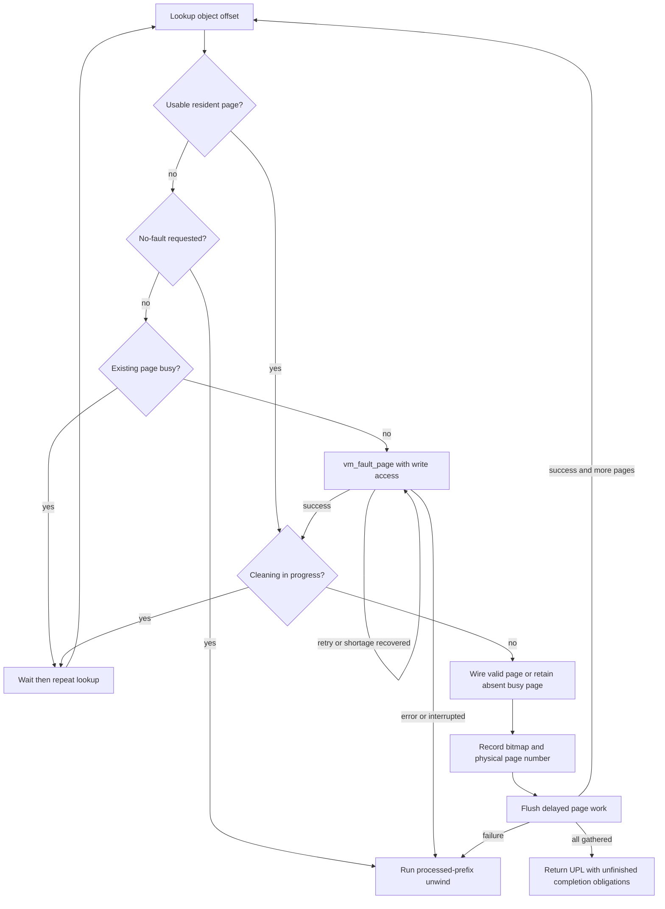
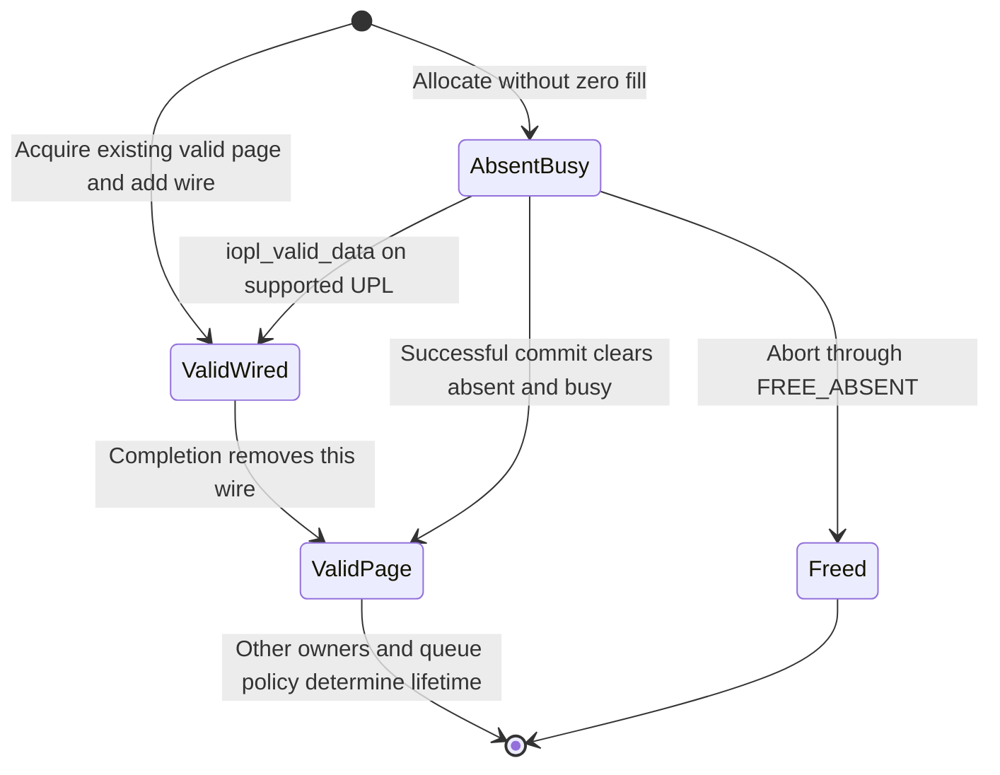
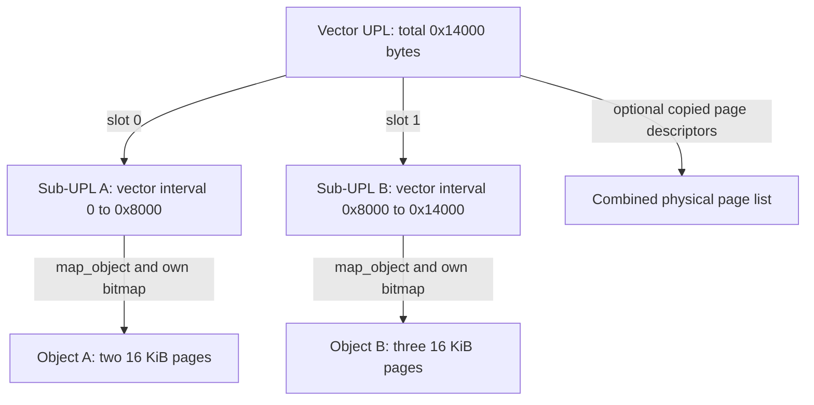
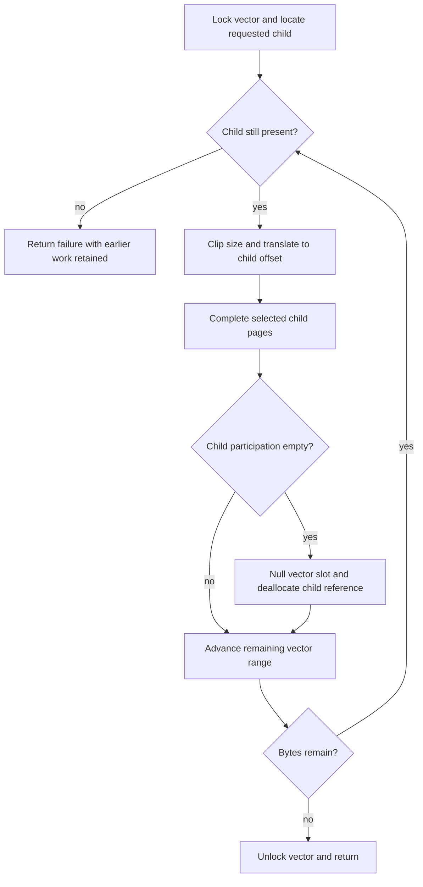

# UPL gathering, partial completion, and vector ownership

[VM index](README.md) · [Pagers and UBC](pagers-and-upl.md) · [Wiring and memory entries](wiring-and-memory-entries.md) · [User buffer to DMA completion](../../cross-cutting/user-buffer-to-dma-completion.md)

A UPL is both a description of physical backing and a set of unfinished VM operations. Its hardest paths occur when gathering faults or waits after acquiring some pages, when completion covers only part of a range, and when one vector joins UPLs from unrelated objects. This chapter follows those paths in `xnu-12377.121.6`, separating the ordinary I/O-wire case from file-cache page-in, physical device memory and access-blocking redirection. The examples use ARM64 with 16 KiB VM pages; byte offsets, page indexes and physical page numbers remain distinct.

[Executable pages and UPL I/O](executable-pages-and-upl-io.md) follows the earlier admission step that can redirect a request to temporary kernel backing before this gather/completion machinery runs.

## The state that must survive a lock drop

The [private UPL header and flags](../../../xnu/osfmk/vm/vm_pageout_xnu.h#L206-L282) describe several independent obligations:

| State | What it preserves | How it ends |
| --- | --- | --- |
| `upl->ref_count` | UPL metadata, not valid page contents by itself | `upl_deallocate`; final release invokes an optional completion callout and destroys metadata |
| `map_object`, `u_offset`, `u_size` | Backing association and original byte extent | Object activity/shadow ownership must be discharged separately from freeing the header |
| `lite_list` | A bit for each page still participating in this UPL | Commit/abort clears selected bits; emptiness ends the ordinary object activity hold |
| `vmp_wire_count` | Stable resident physical backing for an already valid page | Commit or gather-error unwind removes this operation's wire |
| `vmp_busy` and `vmp_absent` | An unfinished page whose contents must not yet be exposed | Valid completion clears absent/busy and wakes waiters; unsuccessful input can free it |
| `vmo_pl_req_in_progress` | A modifying gather is resolving its copy obligations | End of the gather, including its error path; it is not held for the entire subsequent I/O |
| `UPL_ACCESS_BLOCKED` / `object->blocked_access` | Explicit access exclusion used by selected redirection paths | The corresponding completion unblocks the object and releases page busy state |

[`vm_object_pl_req_begin/end`](../../../xnu/osfmk/vm/vm_object_internal.h#L660-L680) require the object lock and maintain a counter with a wakeup at zero. [`vm_object_copy_delayed`](../../../xnu/osfmk/vm/vm_object.c#L3840-L3864) waits for this counter even when a true-share object bypasses the ordinary paging/activity wait. This closes a specific race: establishing a new delayed-copy relationship while a modifying UPL is collecting pages and preserving an existing copy's contents. It does not make the eventual I/O an atomic memory transaction.

The normal IOPL path takes an activity hold on the object. Optional object-level I/O tracking takes a second activity hold and puts the UPL on `object->uplq`; that second hold survives until [`upl_destroy`](../../../xnu/osfmk/vm/vm_pageout.c#L6223-L6247). A kernel-object optimization uses a shared object lock and `UPL_KERNEL_OBJECT` instead of treating kernel-owned pages like newly acquired pageable user pages.

## Entry: choose contents before collecting physical pages

[`vm_map_create_upl`](../../../xnu/osfmk/vm/vm_pageout.c#L7484-L7842) performs map-side range/COW/share preparation and retains the resulting object before dropping range protection. A memory-entry caller instead reaches the same gathering machinery through [`memory_object_iopl_request`](../../../xnu/osfmk/vm/memory_object.c#L1231-L1330). Neither a task virtual address nor a memory-entry port name is the object offset consumed by `vm_object_iopl_request`.

[`vm_object_iopl_request`](../../../xnu/osfmk/vm/vm_pageout.c#L8618-L8752) rounds the requested interval out to VM-page boundaries but keeps the caller's original byte coordinates in `u_offset/u_size`. For an illustrative object range `[0x2080, 0x7080)` and `PAGE_SIZE = 0x4000`, the original length is `0x5000`, the gathered extent is `[0, 0x8000)`, and two page slots describe the physical backing. That does not authorize the consumer to overwrite bytes before `0x2080` or after `0x7080`.

Control direction is from the UPL consumer's perspective: `UPL_COPYOUT_FROM` means obtaining existing contents for output, so the initial protection is read. Without it the consumer may modify the pages, so the initial protection includes write. However, the slow gather calls `vm_fault_page` with **`prot | VM_PROT_WRITE`**, even for output: it needs the appropriate top-object page whose physical identity can be held, rather than accepting a lower shadow page merely because reading it would suffice. The map preflight and gather have already arranged the sharing/copy policy; this is not permission to bypass the caller's map protection checks. See [direction setup](../../../xnu/osfmk/vm/vm_pageout.c#L8696-L8706) and [fault invocation](../../../xnu/osfmk/vm/vm_pageout.c#L9020-L9032).

For ordinary non-kernel/non-compressor objects the gather sets true-share state, marks transient sharing and asserts that copy strategy is no longer symmetric. A modifying gather with `vo_copy` calls `vm_object_update(... MEMORY_OBJECT_COPY_SYNC ...)` before handing out pages. The [source's warning](../../../xnu/osfmk/vm/vm_pageout.c#L8839-L8891) is precise: preserving an older delayed copy does not stop another mapping from seeing contents while I/O modifies the original object. Explicit access blocking is a different mechanism.

## Resident fast paths and the general fault loop

The [whole-object fast-path predicate](../../../xnu/osfmk/vm/vm_pageout.c#L8893-L8913) requires no low-address substitution or access blocking, no volatile/empty purgeable state, no copy/shadow/pager, offset zero and a request equal to object size. Only then does resident-page count select the full or empty specialization.

| Gather route | Work and important fallback |
| --- | --- |
| Fully resident | [`vm_object_iopl_wire_full`](../../../xnu/osfmk/vm/vm_pageout.c#L8388-L8488) walks the object's resident-page queue, wires acceptable pages and records bitmap slots by object offset. Busy, absent, cleaning, laundry, error/restart, fictitious or selected executable/coherency cases stop the fast path. Already acquired pages remain recorded. |
| Entirely empty | [`vm_object_iopl_wire_empty`](../../../xnu/osfmk/vm/vm_pageout.c#L8493-L8615) allocates and inserts pages. Normally it zeroes and wires them; no-zero-fill requests leave them absent/busy. `UPL_REQUEST_NO_FAULT` prevents this allocation route. |
| General | [`vm_object_iopl_request`'s loop](../../../xnu/osfmk/vm/vm_pageout.c#L8957-L9148) looks up each object offset, waits or faults as necessary, then stabilizes and records the selected page. When a resident fast path fell back, bitmap tests skip pages it already processed, since resident-queue order need not equal offset order. |



This diagram simplifies the two fast paths, physical-device memory and compressor pages. In the general loop a busy-page sleep can be abort-safe when `UPL_SET_INTERRUPTIBLE` is selected, but the **cleaning-page wait is explicitly uninterruptible**. The latter prevents another UPL's cleaning completion from clearing busy state now needed by this gather. A page marked laundry can be removed from pending pageout by `vm_pageout_steal_laundry` before I/O wiring proceeds. A no-fault request rejects missing or otherwise unusable pages; it does not mean that every remaining synchronization step is nonblocking.

The fault result controls which locks and holds still exist. Success ends paging holds and frees a top placeholder when present. Retry reacquires the object lock. A memory shortage waits with the selected interruptibility and retries after reacquiring it; interruption becomes `MACH_SEND_INTERRUPTED`. A fault success without a `vm_page` is unsuitable for this page-gather loop and becomes failure. These [distinct branches](../../../xnu/osfmk/vm/vm_pageout.c#L9034-L9124) must not be replaced with “retry any error.”

## Why an I/O-wired UPL can contain pages with wire count zero

An already valid page normally receives a physical wire. A newly allocated no-zero-fill page is different: it is absent and busy, so no faulting thread may map potentially stale physical contents before the producer fills them. The gather intentionally leaves it busy and avoids the ordinary wire increment in that state. This is why `UPL_IO_WIRE` describes the UPL protocol rather than asserting that every slot currently has `vmp_wire_count > 0`.

The [no-zero-fill success branch](../../../xnu/osfmk/vm/vm_pageout.c#L9038-L9053) says why the busy bit remains:

<!-- source-excerpt: ../../../xnu/osfmk/vm/vm_pageout.c#L9038-L9053 -->
```c
					if (!dst_page->vmp_absent) {
						vm_page_wakeup_done(object, dst_page);
					} else {
						/*
						 * we only get back an absent page if we
						 * requested that it not be zero-filled
						 * because we are about to fill it via I/O
						 *
						 * absent pages should be left BUSY
						 * to prevent them from being faulted
						 * into an address space before we've
						 * had a chance to complete the I/O on
						 * them since they may contain info that
						 * shouldn't be seen by the faulting task
						 */
					}
```

For a consumer that has supplied valid data but must retain its preparation, [`iopl_valid_data`](../../../xnu/osfmk/vm/vm_pageout.c#L8259-L8370) converts absent/busy pages to valid, dirty, IOPL-wired pages and wakes waiters. It rejects vector, device, shadowed, access-blocked and internal-page-list UPLs, and rejects kernel/compressor or volatile/empty purgeable objects. This is a narrow interface, not a general “validate any UPL” operation. An actual caller is [`IOGeneralMemoryDescriptor::complete`](../../../xnu/iokit/Kernel/IOMemoryDescriptor.cpp#L5109-L5138) when `kIODirectionCompleteWithDataValid` is supplied and another preparation count remains.



`ValidPage` does not imply wire count zero: another owner can keep its wire. The state diagram describes this operation's ownership only.

## Delayed work, executable pages, and failure after progress

Gathering records queue-changing work in a small delayed-work array. [`VM_PAGE_ADD_DELAYED_WORK`](../../../xnu/osfmk/vm/vm_page_internal.h#L1233-L1253) and [`vm_page_do_delayed_work`](../../../xnu/osfmk/vm/vm_resident.c#L8457-L8530) coordinate busy ownership with the object and global page-queue locks. The worker first tries the queue lock while holding the object lock. If that fails, it drops the object lock, takes the queue lock and reacquires the object in the order used by pageout scanning. The array's pages must stay stable across that gap.

Under `CONFIG_SPTM`, writable I/O wiring of a user-executable physical page is checked **inside this delayed worker**, after it has reacquired the locks. Checking only in the caller would race with mapping changes during the lock drop. The worker still processes the entire batch after recording `KERN_PROTECTION_FAILURE`, allowing the gather's unwind to reverse a consistently completed batch. The check is [adjacent to the wire operation](../../../xnu/osfmk/vm/vm_resident.c#L8554-L8564):

<!-- source-excerpt: ../../../xnu/osfmk/vm/vm_resident.c#L8554-L8564 -->
```c
				if ((dwp->dw_mask & DW_vm_page_iopl_wire_write) && PMAP_PAGE_IS_USER_EXECUTABLE(m)) {
					if (kr == KERN_SUCCESS) {
						kr = KERN_PROTECTION_FAILURE;
						vm_map_guard_exception(current_map(), VM_PAGE_GET_PHYS_PAGE(m), kGUARD_EXC_SEC_IOPL_ON_EXEC_PAGE);
						ktriage_record(thread_tid(current_thread()), KDBG_TRIAGE_EVENTID(KDBG_TRIAGE_SUBSYS_VM,
						    KDBG_TRIAGE_RESERVED, KDBG_TRIAGE_VM_IOPL_ON_EXEC_PAGE),
						    (uintptr_t)(VM_PAGE_GET_PHYS_PAGE(m)));
					}
				} else {
					m->vmp_q_state = VM_PAGE_IS_IOPL_WIRED;
				}
```

Low-address substitution is another partially destructive branch. With `UPL_NEED_32BIT_ADDR`, a page above the accepted DMA limit cannot be replaced if already wired; the gather returns protection failure because another device may already use its physical address. Otherwise it allocates a low page, disconnects old pmap mappings, copies valid contents and replaces the object page **without dropping the object lock**. Failure to allocate the low page is `KERN_RESOURCE_SHORTAGE`. This is replacement in VM backing, distinct from the descriptor-level bounce-buffer strategy described in the [DMA chapter](../drivers/dma-segment-walkthrough.md). See [substitution and state transfer](../../../xnu/osfmk/vm/vm_pageout.c#L9154-L9220).

The [gather error path](../../../xnu/osfmk/vm/vm_pageout.c#L9395-L9497) walks the processed prefix, accounting separately for deferred work that has not yet performed a wire and batches already executed. It frees absent pages or pages created by the failed empty-object fast path, unwires valid pages where necessary, and clears/wakes only busy state the unwind identifies as its own. It ends object activity, destroys the provisional UPL and sets `*upl_ptr = NULL`. The modifying-gather counter and priority floor also end.

The cleanup explicitly does **not** restore the original dirty/reference bits, as the [unwind comment states](../../../xnu/osfmk/vm/vm_pageout.c#L9409-L9418):

<!-- source-excerpt: ../../../xnu/osfmk/vm/vm_pageout.c#L9409-L9418 -->
```c
		/*
		 * if we've already processed this page in an earlier
		 * dw_do_work, we need to undo the wiring... we will
		 * leave the dirty and reference bits on if they
		 * were set, since we don't have a good way of knowing
		 * what the previous state was and we won't get here
		 * under any normal circumstances...  we will always
		 * clear BUSY and wakeup any waiters via vm_page_free
		 * or PAGE_WAKEUP_DONE
		 */
```

For the ordinary offset-ordered gather, this is a processed-prefix unwind followed by returning no usable UPL. It does not promise that faulted pages disappeared, that copied/shadow contents were restored, that low-page substitution was reversed, or that all accounting bits match their entry values.

There is a further source-review boundary after the fully resident fast path falls back. That fast path acquires pages in resident-list order and can already have wired a high-offset slot before rejecting another page; the general path then restarts in offset order and skips recorded bitmap slots. The error loop shown here walks only `[offset, dst_offset)`, rather than all set bitmap bits. Its body alone therefore does not prove that a failure before reaching a previously acquired high-offset slot releases that slot's wire. No additional invariant or runtime reproduction resolving that interleaving was established in this review. Treat it as an unresolved cleanup boundary, not a demonstrated live-kernel failure or a reason to claim transactional gathering. Compare [fast-path acquisition](../../../xnu/osfmk/vm/vm_pageout.c#L8414-L8452), [fallback bitmap skip](../../../xnu/osfmk/vm/vm_pageout.c#L8960-L8973), and [error-loop extent](../../../xnu/osfmk/vm/vm_pageout.c#L9395-L9406).

## Explicit access blocking is a separate protocol

For ordinary RAM, `UPL_BLOCK_ACCESS` marks pages busy during gathering, removes their pmap mappings after gathering, and then sets the object's `blocked_access` gate. A fault that encounters the gate exchanges its paging hold for an activity hold, waits uninterruptibly for `VM_OBJECT_EVENT_UNBLOCKED`, then reacquires paging ownership. The holds matter because the operation being enabled by the wait can require paging to drain. See [gather finish](../../../xnu/osfmk/vm/vm_pageout.c#L9361-L9377) and [fault wait](../../../xnu/osfmk/vm/vm_fault.c#L1254-L1273).

The gate is **object-wide**, while busy bits protect individual pages. Both commit and abort [clear the gate and wake the event](../../../xnu/osfmk/vm/vm_upl.c#L758-L762) before processing selected page state. They assert it was set, and the UPL retains its access-blocked flag. Consequently, this is not a general per-range exclusion token for arbitrary repeated partial completions. The concrete callers examined are [`IOMemoryMap::redirect`](../../../xnu/iokit/Kernel/IOMemoryDescriptor.cpp#L6166-L6218) and its [`upl_transpose` mapping partner](../../../xnu/iokit/Kernel/IOMemoryDescriptor.cpp#L5331-L5377); they use whole-UPL `upl_commit` and then deallocation. The transposition operation has additional object eligibility and locking requirements; this chapter does not generalize it into a generic memory-copy operation.

For a physically contiguous device object the gather has its own early path: `UPL_DEVICE_MEMORY`, one physical page-list entry describing the base, and no ordinary per-page wire loop. The [device return](../../../xnu/osfmk/vm/vm_pageout.c#L8808-L8837) and commit's zero-length page walk are a distinct representation, not evidence that one `vm_page` covers arbitrary RAM.

## Partial completion: bytes select pages, bits record remaining ownership

For a lite UPL, [`upl_commit_range`](../../../xnu/osfmk/vm/vm_upl.c#L596-L865) locks the UPL, validates the range against its adjusted size, locks the backing object and translates UPL offsets into object offsets using `u_offset - paging_offset`. It rounds the selected object interval to VM pages. Bitmap membership decides whether each slot participates; a cleared slot does not mean the object has lost that page. Completion removes this UPL's ownership, while valid contents can remain cached or wired by another owner.

The following is an illustrative **aligned** case, excluding `UPL_ACCESS_BLOCKED`, device memory and the whole-object fast commit. The requested UPL covers four 16 KiB pages starting at object offset `0x20000`, all valid and each with one wire from this operation. `UPL_COMMIT_NOTIFY_EMPTY` has been set, and no independent mapping of the UPL remains:

| Operation | Object pages processed | Remaining bitmap, low slot first | Consequence |
| --- | --- | --- | --- |
| Gather 64 KiB | `0x20000`, `0x24000`, `0x28000`, `0x2c000` | `1 1 1 1` | One activity hold protects the object across I/O |
| Commit offset `0x8000`, size `0x8000` | Slots 2 and 3 | `1 1 0 0` | Their I/O wires end; `empty` remains false |
| Abort offset `0`, size `0x4000`, without dump-pages | Slot 0 | `0 1 0 0` | I/O-wire abort delegates to commit with `FREE_ABSENT`; this valid page is unwired, not discarded |
| Commit offset `0x4000`, size `0x4000` | Slot 1 | `0 0 0 0` | Last participation ends object activity; `empty` becomes true |
| Deallocate UPL | None | No metadata remains on last reference | Header/page-list/bitmap lifetime ends |

The relevant [I/O-wire completion branch](../../../xnu/osfmk/vm/vm_upl.c#L886-L1014) clears returned page-list physical addresses, applies dirty policy and unwires valid pages. For an absent page, ordinary success clears absent/busy and queues it; `UPL_COMMIT_FREE_ABSENT` instead frees it. The fast completion route batches queue/counter updates, so one should not infer that every successful commit calls `vm_page_unwire` individually.

The empty decision scans the UPL's entire bitmap, not only the byte range just completed. Its object-activity release is [here](../../../xnu/osfmk/vm/vm_upl.c#L1320-L1363). `UPL_COMMIT_NOTIFY_EMPTY` is an internal UPL flag; the [UBC wrapper](../../../xnu/bsd/kern/ubc_subr.c#L2844-L2873) turns the caller's `UPL_COMMIT_FREE_ON_EMPTY` request into notification and separately deallocates when true.

Do not replay completion of an already exhausted UPL as a supposedly idempotent cleanup: the empty path releases an activity hold, and a free-on-empty wrapper may already have destroyed the pointer. Nor does commit itself prove that a device stopped accessing the memory. The caller's I/O completion protocol must establish that before giving VM its pages back.

## A vector joins completion coordinates, not VM objects

The [vector representation](../../../xnu/osfmk/vm/vm_pageout_xnu.h#L165-L177) has a total size, an array of sub-UPL pointers with `(offset,size)` I/O coordinates, counts of inserted/invalidated children, an optional combined page list and a mapped kernel address. Each sub-UPL retains its own backing object and participation bitmap.

<!-- source-excerpt: ../../../xnu/osfmk/vm/vm_pageout_xnu.h#L165-L177 -->
```c
struct _vector_upl {
	upl_size_t              size;
	uint32_t                num_upls;
	uint32_t                invalid_upls;
	uint32_t                max_upls;
	vm_offset_t             dst_addr;
	vm_object_offset_t      offset;
	upl_page_info_array_t   pagelist;
	struct {
		upl_t                   elem;
		vector_upl_iostates_t   iostate;
	} upls[];
};
```

[`vector_upl_create`](../../../xnu/osfmk/vm/vm_pageout.c#L9961-L9982) caps the allocation at 64 child slots. The append helper does not itself grow the array; callers such as cluster I/O stop and submit when `vector_upl_max_upls` is reached. [`vector_upl_set_subupl`](../../../xnu/osfmk/vm/vm_pageout.c#L10026-L10071) stores the pointer, backpointer and size without taking an extra UPL reference. The [test's ownership comment](../../../xnu/osfmk/vm/vm_tests.c#L2714-L2717) correctly treats this as transferring the caller's reference into the vector. `vector_upl_set_iostate` separately records the child's vector coordinates.



A vector can concatenate physically unrelated pages from different VM objects into one I/O coordinate system. It does not merge the objects, make their physical pages contiguous or install an IOMMU mapping. [`vector_upl_set_pagelist`](../../../xnu/osfmk/vm/vm_pageout.c#L10075-L10101) copies child page-info arrays and computes the highest physical page; it is metadata assembly.

There is a concrete producer in [`cluster_write_direct`](../../../xnu/bsd/vfs/vfs_cluster.c#L3315-L3513): collect user pages through `vm_map_get_upl`, honor its returned size, validate every needed slot, append each sub-UPL, then issue `vector_cluster_io`. A non-page-aligned new iovec base flushes the preceding vector so that only the first element can begin inside a page; an element ending inside a page terminates the run. These constraints explain why vector size and submitted data length are tracked separately. The [submission helper](../../../xnu/bsd/vfs/vfs_cluster.c#L2527-L2540) creates the combined page list and forwards to `cluster_io`.

For a CPU mapping, [`vm_map_enter_upl_range`](../../../xnu/osfmk/vm/vm_pageout.c#L7878-L7940) reserves one kernel virtual span and maps child UPLs at their recorded offsets. This is optional and separate from vector construction. The [unmap path](../../../xnu/osfmk/vm/vm_pageout.c#L8164-L8223) removes child mappings and finally the vector reservation. Mapping references must be released as required before final completion/destruction.

## Vector completion can finish one child before failing on the next

The vector mutex serializes the dispatch loop. [`vector_upl_subupl_byoffset`](../../../xnu/osfmk/vm/vm_pageout.c#L10122-L10160) locates the child, clips the requested size at its end and changes the offset to child-relative coordinates. The commit loop advances the remaining vector extent **before** executing that child's page work. When the child's bitmap is empty, it invalidates the array entry and drops the transferred child reference. The final child makes the vector empty; the outer UBC wrapper can then drop the vector header.

The [child-retirement branch](../../../xnu/osfmk/vm/vm_upl.c#L1378-L1383) is small:

<!-- source-excerpt: ../../../xnu/osfmk/vm/vm_upl.c#L1378-L1383 -->
```c
		if (*empty == TRUE) {
			*empty = vector_upl_set_subupl(vector_upl, upl, 0);
			upl_deallocate(upl);
		}
		goto process_upl_to_commit;
	}
```

For the aligned two-child layout above, commit `[0x4000, 0xc000)` first processes A's second page, then B's first page. A's first page and B's other two pages remain owned by their respective sub-UPLs. A later commit of `[0,0x4000)` empties A and sets slot 0 to `NULL`, while B remains live.



A range that reaches an already retired slot returns failure; lookup deliberately does not skip the hole. In a general multi-child completion, a later hole or invalid range can therefore cause failure **after earlier child work has completed**. There is no rollback that reinstates wires or reconstructs retired child UPLs. The diagram's loop abbreviates a fresh offset lookup at each step.

Abort also walks child ranges, but the ordinary I/O-wire shortcut must be read at the level where it executes: `upl_abort_range` checks `UPL_IO_WIRE` **before** detecting a vector. A vector header is created with `UPL_VECTOR`, not with each child's flags. Do not assume that calling abort on a vector automatically recursively invokes the single-UPL `FREE_ABSENT` shortcut for every child. The [vector abort body](../../../xnu/osfmk/vm/vm_upl.c#L199-L240) instead performs its own page-state cleanup after resolving each child. Callers must follow the applicable cluster completion/error flags and ownership protocol. For example, [`cluster_ioerror`](../../../xnu/bsd/vfs/vfs_cluster.c#L989-L1028) calls **commit**, even on an I/O error, when `B_PHYS | B_CACHE` are both set: the direct-write or unaligned-direct-read buffer must release its page holds while preserving contents. Other error classes select abort flags. The storage operation's error and the VM completion verb therefore answer different questions.

Finally, [`vector_upl_deallocate`](../../../xnu/osfmk/vm/vm_pageout.c#L10004-L10017) panics unless `invalid_upls == num_upls`. Destroying the vector is not a way to cancel unfinished child work.

## Source tests and remaining boundaries

[`vm_vector_upl_test`](../../../xnu/osfmk/vm/vm_tests.c#L2650-L2756) copies an iovec array from userspace, creates child I/O-wire UPLs, transfers them into a vector, maps one kernel virtual range, increments each byte, unmaps, commits children through the vector and finally drops the vector reference. Its userspace companion [`tests/vm/vectorupl.c`](../../../xnu/tests/vm/vectorupl.c#L45-L87) drives the test through a development/debug sysctl. These are source examples of the ownership route, not runtime validation performed for this handbook.

The inspected implementation covers gather fast/general paths, COW coordination, delayed work and SPTM admission, partial commit/abort, vector offsets and selected cluster/IOKit callers. It does not establish all filesystem-provider failure policies, every mixed-page-size boundary, all `UPL_BLOCK_ACCESS`/transposition combinations or every MTE tag-storage completion branch. The [MTE page-lifetime chapter](mte-tag-storage-and-page-lifecycle.md) and [reclaim chapter](reclaim-and-pressure.md) cover their respective mechanisms. Physical DMA addresses, IOVA mappings and device quiescence remain governed by the [descriptor/DMA protocol](../../cross-cutting/user-buffer-to-dma-completion.md), beyond what a VM UPL alone can prove.

<!-- BEGIN PLATYDOC DOCUMENTATION LICENSE -->
Original Platydoc text and diagrams are licensed under [CC BY 4.0](https://creativecommons.org/licenses/by/4.0/). Quoted source code and third-party material retain their respective licenses.
<!-- END PLATYDOC DOCUMENTATION LICENSE -->
