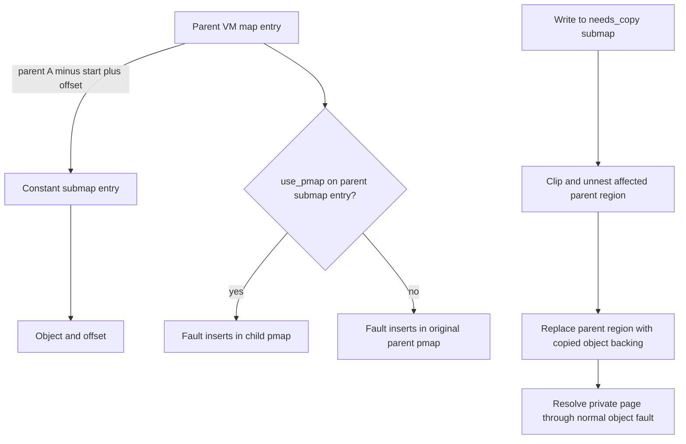

# Virtual address maps: intervals, ownership, locking, and mutation

[VM index](README.md) · [Entry guide](maps-and-faults.md) · [Fault resolution](fault-resolution.md) · [Objects and pages](objects-and-pages.md)

The map is the authoritative description of a virtual address range: its backing object or submap, offset, allowed access, inheritance and wiring state. Pmap implements the translations needed to access those contents. A map operation can create an interval without immediately populating hardware translations; it must also remove or restrict existing translations when the logical relationship changes. This division is stated in the [`vm_map` interface](../../../xnu/osfmk/vm/vm_map.h#L113) and visible in [`vm_map_enter`](../../../xnu/osfmk/vm/vm_map.c#L3030), [`vm_map_protect`](../../../xnu/osfmk/vm/vm_map.c#L5801) and [`vm_map_delete_handle_entry`](../../../xnu/osfmk/vm/vm_map.c#L8517).

## The map and entry layouts

Map policy also determines whether a later fault may recover unavailable contents. [Resilient mappings](fault-resolution.md#resilient-mappings-recover-selected-missing-contents-without-changing-the-file) explains `MAP_RESILIENT_MEDIA` versus `MAP_RESILIENT_CODESIGN`, BSD/current/max-protection admission, internal top-object requirements, and revalidation after a fault retains a failed object/offset. These flags do not replace the ordinary map permission checks.

`_vm_map` has a linked-entry header, a B+tree root, a pmap, virtual-size/limit accounting and a reference count. Its `ilock` is the structural interlock. `unlink_timestamp` helps detect whether an entry pointer can still be dereferenced after dropping that interlock; an unchanged counter does not guarantee unchanged entry bounds.

[struct _vm_map — source lines 594–618](../../../xnu/osfmk/vm/vm_map_xnu.h#L594):

<!-- source-excerpt: ../../../xnu/osfmk/vm/vm_map_xnu.h#L594-L618 -->
```c
struct _vm_map {
	lck_rw_new_t            ilock;
	uint64_t                unlink_timestamp; /* Counter incremented every time
	                                           * an entry is removed from the map.
	                                           * This allows us to see if a pointer
	                                           * to an entry is still valid after
	                                           * having dropped and retaken the interlock.
	                                           * Note the bounds of the entry may arbitrarily
	                                           * change.
	                                           */
	struct vm_map_header    hdr;            /* Map entry header */
	vm_map_store_root_t     root;
#define min_offset              hdr.links.start /* start of range, inclusive */
#define max_offset              hdr.links.end   /* end of range, exclusive */
	pmap_t                  XNU_PTRAUTH_SIGNED_PTR("_vm_map.pmap") pmap;           /* Physical map */
	vm_map_size_t           size;           /* virtual size */
	uint64_t                size_limit;     /* rlimit on address space size */
	uint64_t                data_limit;     /* rlimit on data size */
	vm_map_size_t           user_wire_limit;/* rlimit on user locked memory */
	vm_map_size_t           user_wire_size; /* current size of user locked memory in this map */
#if __x86_64__
	vm_map_offset_t         vmmap_high_start;
#endif /* __x86_64__ */

	os_ref_atomic_t         map_refcnt;       /* Reference count */
```

The header's `links.start/end` become the map's minimum/maximum address; its list links identify first and last entries. `hdr.page_shift` is the map's page size, which need not equal the kernel's system-page size. `size` is mapped virtual size, not resident bytes. `user_wire_size` accounts user-locked ranges, while other memory accounting also lives in objects and pmap ledgers. See [`vm_map_header`](../../../xnu/osfmk/vm/vm_map_xnu.h#L457) and [Wiring and memory entries](wiring-and-memory-entries.md).

Additional map state matters to allocation and faults: `CONFIG_MAP_RANGES` adds default/data/large-file and extra ranges; guard-object slabs/chunks support guarded placement; flags record sealed, nested, terminated, never-faulting, code-signing and execution-policy states. `owning_task` is a weak pointer: the field comment requires a task reference for safe use, or acquiring one under the map lock after checking it is nonnull. `serial_id` records map provenance and is copied on fork, so it is not an always-unique identifier for every map instance. See [`_vm_map` policy and ownership fields](../../../xnu/osfmk/vm/vm_map_xnu.h#L620).

Every entry carries ordered list links, half-open bounds, an entry lock and its store/chunk representation:

[vm_map_links and vm_map_entry — source lines 311–327](../../../xnu/osfmk/vm/vm_map_xnu.h#L311):

<!-- source-excerpt: ../../../xnu/osfmk/vm/vm_map_xnu.h#L311-L327 -->
```c
struct vm_map_links {
	struct vm_map_entry    *next;           /* next entry */
	struct vm_map_entry    *prev;           /* prev entry */
	vm_map_offset_t         start;          /* start address */
	vm_map_offset_t         end;            /* end address */
	vm_entry_lock_t         lock;
	vm_map_store_val_ptr_t  chunk;
};

struct vm_map_entry {
	struct vm_map_links     links;                      /* links to other entries */
#define vme_prev                links.prev
#define vme_next                links.next
#define vme_start               links.start
#define vme_end                 links.end
#define vme_lock                links.lock
#define vme_chunk               links.chunk
```

The remaining fields describe the interval:

| Field/accessor | Meaning and important qualification |
|---|---|
| `VME_OBJECT(entry)` / `VME_SUBMAP(entry)` | Selected by `is_sub_map`; packed representations and kernel-object cases make direct casting incorrect |
| `VME_OFFSET(entry)` | Backing offset at `vme_start`; the stored field is shifted by `VME_OFFSET_SHIFT` |
| `protection`, `max_protection` | Current logical permission and the ceiling for ordinary permission changes; they are not a snapshot of every PTE |
| `needs_copy` | Entry-level COW preparation remains necessary before granting a write |
| `inheritance` | Policy used when forking, with further checks on object strategy and wiring |
| `wired_count`, `user_wired_count` | Entry wiring references and user contribution, not the page descriptor's wire count |
| `vme_atomic`, `vme_permanent` | Restrictions on splitting/coalescing and removal; both are required on transparent-submap parent entries |
| `use_pmap` | Nested hardware mapping for submaps; footprint accounting for object entries |
| `is_shared`, `iokit_acct`, `no_cache`, `used_for_jit`, `csm_associated` | Sharing/accounting/cache or execution-policy inputs to later operations |

The exact fields, including ARM64e's reuse of the fourth protection bit for `used_for_tpro`, are in [`vm_map_entry`](../../../xnu/osfmk/vm/vm_map_xnu.h#L329). The overloaded bit deserves direct inspection:

[vm_map_entry.use_pmap — source lines 390–398](../../../xnu/osfmk/vm/vm_map_xnu.h#L390):

<!-- source-excerpt: ../../../xnu/osfmk/vm/vm_map_xnu.h#L390-L398 -->
```c
	/*
	 * use_pmap is overloaded:
	 * if "is_sub_map":
	 *      use a nested pmap?
	 * else (i.e. if object):
	 *      use pmap accounting
	 *      for footprint?
	 */
	/* boolean_t         */ use_pmap:1,
```

## Lookup, holes, and entry clipping

The store is a B+tree with an inner-node fanout of 15 and leaf fanout of 20. Inner nodes hold keys, child pointers and hole-size-class summaries. Leaves hold keys and packed values that select entries or guard-object chunks; a chunk uses an additional lookup within its represented interval. The root keeps tree depth and a last-leaf hint. These are current structures, despite older “RB tree” terminology in some comments. See [`vm_map_store_node`](../../../xnu/osfmk/vm/vm_map_store_internal.h#L65) and [`vm_map_store_lookup_entry`](../../../xnu/osfmk/vm/vm_map_store.c#L1410).

[`vm_map_store_lookup_entry`](../../../xnu/osfmk/vm/vm_map_store.c#L1410) requires the interlock in shared or exclusive mode, except for sealed maps. It resolves the leaf slot, descends into a guard chunk if needed, and can return either the containing entry or, for `or_next`, the following one. [`vm_map_store_find_space`](../../../xnu/osfmk/vm/vm_map_store.c#L1683) uses hole information for placement. A hole means no mapping occupies the range; an entry whose protection is `VM_PROT_NONE` still occupies virtual space.

Protection or removal of part of an interval requires clipping. [`vm_map_store_clip_start`](../../../xnu/osfmk/vm/vm_map_store.c#L3013) and `vm_map_store_clip_end` require both an exclusive map interlock and exclusive entry ownership, duplicate the relevant entry, update the linked sequence and store, and preserve backing continuity by adjusting offsets. The crucial start-clip arithmetic is:

[vm_map_hdr_store_clip_start — source lines 2933–2941](../../../xnu/osfmk/vm/vm_map_store.c#L2933):

<!-- source-excerpt: ../../../xnu/osfmk/vm/vm_map_store.c#L2933-L2941 -->
```c
	new_entry->vme_end = entry->vme_start = start;
	VME_OFFSET_SET(entry, VME_OFFSET(entry) + VME_SIZE(new_entry));
	new_entry->vme_chunk = entry->vme_chunk;

	if (!entry->is_sub_map && VME_OBJECT(entry)) {
		vm_object_mark_clipped_unlocked(VME_OBJECT(entry));
	}

	vm_map_hdr_store_insert(hdr, new_entry, entry);
```

For example, splitting `[0x10000,0x14000)` with backing offset `0x8000` at `0x12000` gives left offset `0x8000` and right offset `0xa000`. No physical-page copying follows merely from this split. Entry-copy helpers retain the relevant backing ownership; the new intervals continue to name the same bytes. Clipping marks object state to account for the fact that an object now has a subdivided mapping. See the [entry copy helpers](../../../xnu/osfmk/vm/vm_map.c#L742) and [`vm_map_hdr_store_clip_end`](../../../xnu/osfmk/vm/vm_map_store.c#L2958).

## Range locks stabilize operations beyond the interlock

The interlock protects lookup structures, entry-list edits and map accounting. An entry lock stabilizes the interval's mapping state while a caller works outside the interlock. Its representation includes shared-reader count, exclusive ownership, waiter bits and invalidation state; invalidated or replaced entries cannot be treated as ordinary unlocked entries. See [`vm_entry_lock_t`](../../../xnu/osfmk/vm/vm_map_xnu.h#L253) and [`vm_entry_lock_internal.h`](../../../xnu/osfmk/vm/vm_entry_lock_internal.h).

The range-lock layer combines lookup, entry acquisition, optional preparation, clipping and iteration in a `vm_map_lock_ctx`. Its flags express two independent decisions: shared versus exclusive entry ownership, and streaming versus atomic coverage.

The [`vm_map_lock_ctx` structure](../../../xnu/osfmk/vm/vm_map_lock_internal.h#L613-L682) records requested bounds, the current map/entry, and a preflight callback. Its mode-specific union tracks either streaming progress and the first error, or the first entry and bounds of an atomically locked range. Parent-map bounds, offset and entry are retained separately during submap descent. These fields explain why callers carry a context through iteration instead of saving only an entry pointer.

| Mode | Contract | Representative use |
|---|---|---|
| `STREAM` | Holds the current entry as iteration advances; holes are allowed | Fork walks the old map |
| `STREAM_NO_HOLES` | Streaming, but encountering a hole fails | Fault lookup and operations requiring continuous coverage |
| `ATOMIC` | Locks the requested mapped range before exposing it to the operation; holes fail | Protection changes |
| `ATOMIC_ALLOW_HOLES` | Exclusive coverage may include holes; sentinel entries reserve those intervals | Removal and fixed-address replacement |

These are the [documented range modes](../../../xnu/osfmk/vm/vm_map_lock_internal.h#L307). “Atomic” here describes stabilization of that requested range; it does not imply an atomic processor instruction or a globally frozen task. In a streaming walk, concurrent coalescing can make a later returned entry overlap already processed addresses. Callers use context-bound helpers instead of assuming the full returned entry is wholly new work.

Preparation flags are equally significant. `VMO_ALLOCATE` supplies a missing object where necessary. `RESOLVE_COW_AND_OBJ` also resolves COW and can convert a COW submap relationship into ordinary private backing. The caller may request shared ownership but the implementation temporarily acquires exclusive entry ownership to perform that work, then downgrades. A preflight callback can reject an entry or request special setup such as symmetric COW or preparation for sharing. Read [`__vmrl_entry_lock_ilocked`](../../../xnu/osfmk/vm/vm_map_lock.c#L2464) and [`__vmrl_entry_prepare_ilocked`](../../../xnu/osfmk/vm/vm_map_lock.c#L2194) together.

The preparation order is deliberate: unnest pmap mappings, perform necessary clipping, allocate backing, establish COW obligations, resolve submap COW, resolve symmetric COW or prepare sharing, then perform final clipping. The code drops the structural interlock while retaining exclusive entry ownership before work such as object copying that may block. See [`__vmrl_entry_prepare_ilocked`](../../../xnu/osfmk/vm/vm_map_lock.c#L2209).

Waiting for an entry may drop and retake the interlock. On restart, the waiter must check both lifetime and whether the desired address still lies in that entry. An exclusive ownership handoff is a separate safe return path. Without a handoff, the decisive check is:

[__vm_entry_lock_block — source lines 467–478](../../../xnu/osfmk/vm/vm_entry_lock.c#L467):

<!-- source-excerpt: ../../../xnu/osfmk/vm/vm_entry_lock.c#L467-L478 -->
```c
	/*
	 * The unlink_timestamp being unchanged tells us no entries have been
	 * removed from the map. That means we can safely dereference the old
	 * entry pointer and look to see if the address we want to lock is within
	 * the bounds of the entry.
	 */
	if (timestamp == map->unlink_timestamp &&
	    entry->vme_start <= addr && addr < entry->vme_end) {
		return KERN_SUCCESS;
	}

	return VMRL_ERR_RELOOKUP;
```

A changed timestamp causes relookup even if a saved pointer happens to have the same numeric value. An unchanged timestamp allows dereference, but clipping can still have changed bounds. `VMRL_TRY_LOCK_ENTRY` instead returns `VMRL_ERR_LOCK_ALREADY_HELD` when acquisition cannot succeed immediately. Slow faults use this mode because they hold a page busy and cannot block behind a wiring operation that holds the entry while waiting for that page. See [Fault revalidation](fault-resolution.md#slow-faults-release-and-revalidate-the-mapping).

## API entry points and sanitization

The [argument-validation companion](api-argument-validation.md) follows these helpers through actual API callers, with 16 KiB arithmetic examples, zero-size return rules, protection-pair rewriting and the separate map/capability checks.

Public VM arguments use opaque `_ut` types for unchecked addresses, sizes, protections and inheritance. Sanitizers validate and unwrap arithmetic before internal routines operate on it, including overflow introduced by rounding. API-specific compatibility logic can rewrite errors or request immediate successful return without performing the operation. This is why an apparently simple zero-size or out-of-range case must be read at its actual API boundary. The original [sanitization document](../../../xnu/doc/vm/sanitize.md) describes this design; see also [`mach_vm_allocate_kernel_sanitize`](../../../xnu/osfmk/vm/vm_kern.c#L1375).

| Request | Implementation route in this checkout |
|---|---|
| Mach allocate | [`mach_vm_allocate_external`](../../../xnu/osfmk/vm/vm_user.c#L144) → [`mach_vm_allocate_kernel`](../../../xnu/osfmk/vm/vm_kern.c#L1410) → `vm_map_enter` |
| Mach map / named memory | [`mach_vm_map_external`](../../../xnu/osfmk/vm/vm_user.c#L829) → [`mach_vm_map_kernel`](../../../xnu/osfmk/vm/vm_kern.c#L2482) → [`vm_map_enter_mem_object`](../../../xnu/osfmk/vm/vm_map.c#L4342) → object/submap/copy-specific entry work |
| BSD anonymous `mmap` | [`mmap`](../../../xnu/bsd/kern/kern_mman.c#L803) → `mach_vm_map_kernel` with null memory-object port |
| BSD file `mmap` | [`mmap`](../../../xnu/bsd/kern/kern_mman.c#L840) → UBC control → [`vm_map_enter_mem_object_control`](../../../xnu/osfmk/vm/vm_map.c#L5447) → `vm_map_enter` |
| Protect | [`mach_vm_protect`](../../../xnu/osfmk/vm/vm_user.c#L259) / BSD [`mprotect`](../../../xnu/bsd/kern/kern_mman.c#L1163) → `vm_map_protect` |
| Deallocate | [`mach_vm_deallocate_kernel`](../../../xnu/osfmk/vm/vm_kern.c#L1509) → `vm_map_remove_guard`; BSD [`munmap`](../../../xnu/bsd/kern/kern_mman.c#L1091) enters this route |
| Remap | [`mach_vm_remap_external`](../../../xnu/osfmk/vm/vm_user.c#L1019) / new interface → [`vm_map_remap`](../../../xnu/osfmk/vm/vm_map.c#L16982) |

These are C implementation routes; generated MIG stubs are not necessary to understand the interval operations. For port translation, memory-entry authorization and map-copy representations, use [Wiring and memory entries](wiring-and-memory-entries.md) and [Mach IPC](../ipc/README.md).

Anonymous allocation's final call is instructive: it supplies no initial object, requests default current protections and all maximum protections, and uses default inheritance.

[mach_vm_allocate_kernel — source lines 1456–1467](../../../xnu/osfmk/vm/vm_kern.c#L1456):

<!-- source-excerpt: ../../../xnu/osfmk/vm/vm_kern.c#L1456-L1467 -->
```c
	result = vm_map_enter(
		map,
		&map_addr,
		map_size,
		(vm_map_offset_t)0,
		vmk_flags,
		VM_OBJECT_NULL,
		(vm_object_offset_t)0,
		FALSE,
		VM_PROT_DEFAULT,
		VM_PROT_ALL,
		VM_INHERIT_DEFAULT);
```

Missing backing is later created by [`vm_map_entry_lock_allocate_object`](../../../xnu/osfmk/vm/vm_map_lock.c#L155), which allocates an object of entry length and resets its offset to zero. Some adjacent mappings can coalesce, so do not assume one allocation API call permanently corresponds to one entry or one object.

For files, BSD `mmap` obtains `ubc_getobject(vp)`, establishes the file offset and requested protections, and sets `docow` for a nonanonymous mapping without `MAP_SHARED`. `MAP_SHARED` requests share inheritance; private mappings use default inheritance. [`vm_map_enter_mem_object_control`](../../../xnu/osfmk/vm/vm_map.c#L5447) converts the control to an object, retains it, handles the named-pager mapping notification, and applies `vm_object_copy_strategically` when private contents are requested. It drops the object lock around `memory_object_map` while using object mapping-state coordination. Its pager-facing protection excludes WRITE for a private copy. The copied/retained object then goes to `vm_map_enter`; failure releases its reference. See [Pagers and UPL](pagers-and-upl.md) for the vnode/object lifetime and page-in side.

## Insertion and fixed-address replacement

[`vm_map_enter`](../../../xnu/osfmk/vm/vm_map.c#L3030) uses a store reservation and separate lists for displaced and newly created entries. After checking flags, range policies and limits under the interlock, it chooses [`vm_map_locate_space_anywhere`](../../../xnu/osfmk/vm/vm_map.c#L2637) or [`vm_map_locate_space_fixed`](../../../xnu/osfmk/vm/vm_map.c#L2779). Anywhere placement searches suitable holes; the uncommon wait-for-space case can drop the interlock and retry. A fixed request verifies bounds/alignment and either requires a hole or follows overwrite handling.

A fixed overwrite calls the delete machinery with overwrite semantics and reserves the vacated interval with a sentinel. That prevents another allocator from consuming the address while replacement work releases structural locking. Old entries remain in a zap list until the operation can dispose of their ownership. The normal insertion path can coalesce with compatible neighbors or create entries that name the supplied backing and offset. See [fixed replacement](../../../xnu/osfmk/vm/vm_map.c#L2875) and [new-entry construction](../../../xnu/osfmk/vm/vm_map.c#L3705).

Object-reference transfer is part of the transaction. On a successful ordinary insertion the map takes ownership of the supplied backing reference. Where later work can fail after dropping the interlock, the implementation takes an extra caller-object reference to preserve its failure contract. Cleanup removes new entries and tries to restore displaced old entries if their address range is still available. Superpage wiring paths can drop the interlock and allow interference, so rollback must not be described as unconditional. See [`vm_map_enter` late setup and cleanup](../../../xnu/osfmk/vm/vm_map.c#L4015).

Normal demand-paged insertion need not obtain resident pages. Explicit superpage/wiring requests, prepopulation options, JIT/execution policy, purgable/accounted objects and guard allocations add work or constraints. This chapter follows the ordinary object/submap transaction; it does not treat those flags as interchangeable variations of ordinary anonymous allocation.

## Submaps and pmap nesting

This checkout supports two VM submap forms and explicitly forbids a submap entry inside another submap:

[Current submap contract — source lines 68–79](../../../xnu/osfmk/vm/vm_map_lock_internal.h#L68):

<!-- source-excerpt: ../../../xnu/osfmk/vm/vm_map_lock_internal.h#L68-L79 -->
```c
 * Explanation of the two types of submaps:
 * There are two types of submaps supported by the VM today.
 * For both types, nested submaps are disallowed, which means that a submap cannot
 * have an entry that is a submap itself.
 *
 * 1) constant submaps
 * Constant submaps are submaps that have static vm_map_entry_t's.
 * That means once "sealed", there is a guarantee that no vm_map_entry_t in that
 * submap will change in any way. This means no locks need to be held on constant submaps.
 * When descending into a constant submap, address transformation is required
 * (see vm_map_parent_address_to_submap_address).
 * Today's examples of these are the shared cache and the x86 commpage.
```

A **constant submap** becomes immutable after sealing. Its entries need no entry locks after that point. Parent entries can map child coordinates at different parent addresses; the range-lock context locks the parent relationship and performs the coordinate conversion. Calling the range lock directly on a sealed constant map is prohibited. Shared-cache mappings and the x86 commpage are examples named by the implementation.

A **transparent submap**, created by `kmem_suballoc`, is mapped only in `kernel_map`, shares `kernel_pmap`, cannot be mapped by multiple entries, and has `VME_OFFSET(parent_entry) == parent_entry->vme_start`. Therefore parent and child addresses are identical. Its parent entry must be atomic and permanent. The range layer descends automatically, and callers may start directly in the transparent map. `ipc_kernel_map` and the compressor submap are examples. See [transparent-submap contract](../../../xnu/osfmk/vm/vm_map_lock_internal.h#L81).

Pmap nesting is a related but separate representation choice. For a submap entry, `use_pmap` says that parent hardware translation structures nest a child pmap. [`vm_map_enter`](../../../xnu/osfmk/vm/vm_map.c#L3772) checks that parent and child map page shifts match before `pmap_nest`, then sets `use_pmap` only after successful nesting. A submap relationship can remain meaningful without nested pmap translation tables.



Fault lookup therefore returns both the map containing the resolved entry and `real_map`, the map whose pmap will receive the translation. They can differ. [`vm_map_lookup_object_and_lock_entry`](../../../xnu/osfmk/vm/vm_fault.c#L4741) chooses the child's pmap only when the parent relationship is pmap-nested.

Writing to a COW constant-submap region requires changing the parent relationship, not modifying sealed child entries. [`vm_map_entry_resolve_submap_cow`](../../../xnu/osfmk/vm/vm_map_lock.c#L641) computes the intersecting child object interval, requests a strategic copy, clips/unnests a bounded region around the address, and converts that parent region to direct object backing. It preserves relevant child attributes and protections subject to policy. The helper runs with exclusive parent-entry ownership and without the map interlock because strategic copying can block. Pmap unnest granularity can exceed one fault page; the code bounds it by the applicable mapped object interval.

## Protection changes are coordinated with future faults

The [executable-memory companion](executable-memory-policy.md) follows MAP_JIT and RW→RX requests through admission, entry permissions, monitor association and later ARM64 faults. It separates common/mobile policy from macOS compatibility and checks the actual pmap hook bodies behind the JIT guard.

[`vm_map_protect`](../../../xnu/osfmk/vm/vm_map.c#L5801) sanitizes the range and protection, installs a preflight callback, then takes an exclusive atomic range lock. Holes or disallowed entries fail before the normal protection-update walk. Preflight checks maximum protection, protected/JIT/TPRO mappings, write/execute restrictions and execution lockdown with build-specific exceptions. `VM_PROT_COPY` is special: it requests a private remap/replacement before applying ordinary protection changes. It is not simply a hardware permission bit. See [`vm_map_protect_preflight`](../../../xnu/osfmk/vm/vm_map.c#L5700).

When `set_max` is true, the new maximum also bounds current permission; otherwise the operation replaces current permission:

[vm_map_protect updates logical permissions — source lines 5987–5995](../../../xnu/osfmk/vm/vm_map.c#L5987):

<!-- source-excerpt: ../../../xnu/osfmk/vm/vm_map.c#L5987-L5995 -->
```c
		old_prot = entry->protection;

		if (set_max) {
			entry->max_protection = new_prot;
			/* Consider either EXECUTE or UEXEC as EXECUTE for this masking */
			entry->protection = (new_prot & old_prot);
		} else {
			entry->protection = new_prot;
		}
```

The PTE update commonly withholds WRITE even when the entry's new logical protection includes it. A future write must fault so VM can honor outstanding COW. The explicit compressor-object exception can grant write immediately because its backing is managed differently:

[vm_map_protect prepares pmap permissions — source lines 6049–6056](../../../xnu/osfmk/vm/vm_map.c#L6049):

<!-- source-excerpt: ../../../xnu/osfmk/vm/vm_map.c#L6049-L6056 -->
```c
			vm_prot_t prot;

			prot = entry->protection;
			if (entry->is_sub_map || (VME_OBJECT(entry) == NULL) || (VME_OBJECT(entry) != compressor_object)) {
				prot &= ~VM_PROT_WRITE;
			} else {
				assert(!VME_OBJECT(entry)->code_signed);
				assert(VME_OBJECT(entry)->copy_strategy == MEMORY_OBJECT_COPY_NONE);
```

The routine then invokes the pmap protection path; additional pmap policy may force removal so a later fault reconstructs a valid translation. Submap entry mutations unnest pmap sharing when needed. Thus `mprotect` success means the logical policy changed, not that every existing or absent PTE immediately has exactly that bit pattern. The [pmap lifecycle guide](pmap-mapping-lifecycle.md) follows the backend restrictions and invalidation work.

## Fork and inheritance

[`vm_map_fork`](../../../xnu/osfmk/vm/vm_map.c#L12688) creates a new pmap and map, preserves required page-size and policy state, and walks the source under an exclusive streaming range lock. Its preflight requests symmetric COW setup when a copied entry has qualifying backing and has not already been marked `needs_copy`. It does not hold an atomic lock over every source entry for the complete walk.

[`vm_map_fork_compute_extended_inheritance`](../../../xnu/osfmk/vm/vm_map.c#L12601) converts public inheritance into implementation cases:

| Case | Work |
|---|---|
| NONE | Usually omit the range; special corpse/fork options can override selected entries |
| SHARE | [`vm_map_fork_share`](../../../xnu/osfmk/vm/vm_map.c#L12400) retains shared backing, creating missing backing before sharing so later faults cannot allocate independent objects |
| COPY, fast | Null backing, or qualifying unwired symmetric-copy objects without `true_share`, can clone mapping metadata and arrange deferred COW |
| COPY, slow | Nonsymmetric strategy, wired mappings or true sharing require the copy machinery; `COPY` on a submap entry is omitted by the classifier |

For symmetric COW, [`vm_map_entry_setup_symmetric_cow`](../../../xnu/osfmk/vm/vm_map_lock.c#L997) removes writable access through `vm_object_pmap_protect`, marks `needs_copy`, and records that the object is shadowed. For shared entries the pmap argument is null, requiring object-based protection across applicable mappings rather than assuming only the current task can write. The fast fork branch calls `vm_object_copy_quickly` and sets the child's COW state; it does not copy every resident page. See [fork's fast branch](../../../xnu/osfmk/vm/vm_map.c#L12877).

The first later write resolves the entry-level obligation through `VME_OBJECT_SHADOW` and clears `needs_copy`:

[vm_map_entry_lock_resolve_symmetric_cow — source lines 176–185](../../../xnu/osfmk/vm/vm_map_lock.c#L176):

<!-- source-excerpt: ../../../xnu/osfmk/vm/vm_map_lock.c#L176-L185 -->
```c
	if (VME_OBJECT(entry)->shadowed == FALSE) {
		vm_object_lock(VME_OBJECT(entry));
		VM_OBJECT_SET_SHADOWED(VME_OBJECT(entry), TRUE);
		vm_object_unlock(VME_OBJECT(entry));
	}
	VME_OBJECT_SHADOW(entry,
	    (vm_map_size_t) (entry->vme_end -
	    entry->vme_start),
	    vm_map_always_shadow(map));
	entry->needs_copy = FALSE;
```

Clearing that bit does **not** imply all data was copied. The new top object can remain empty; a read can use a lower shadow's page, while a write copies the relevant page into the top object. Eligible single-owner cases can avoid creating another shadow. The object-level relationships and collapse rules are covered in [Objects and pages](objects-and-pages.md); the actual resident-page copy is in [Fault resolution](fault-resolution.md#resident-pages-and-copy-on-write).

Sharing has its own strategy conversion: a symmetric object may need shadow preparation before becoming a permanently shared delayed-copy object. [`vm_map_fork_share`](../../../xnu/osfmk/vm/vm_map.c#L12400) also preserves nested submap sharing through `pmap_nest`. Any `pmap_copy` call is an architecture hook; do not infer from its name that all hardware page tables are copied eagerly.

## Remap separates extraction from installation

[`vm_map_remap`](../../../xnu/osfmk/vm/vm_map.c#L16982) first validates source/destination arguments and page-size conventions, then asks [`vm_map_copy_extract`](../../../xnu/osfmk/vm/vm_map.c#L12135) and [`vm_map_remap_extract`](../../../xnu/osfmk/vm/vm_map.c#L15638) for an entry-list copy representing the source range. This representation owns backing references while the destination is prepared. Copy versus sharing controls COW and strategy work; extracting a copy is not equivalent to copying physical bytes immediately.

After extraction, source and destination need not remain locked together. When page sizes differ, [`vm_map_copy_adjust_to_target`](../../../xnu/osfmk/vm/vm_map.c#L16495) adjusts the copy for target granularity, including trimming/overmapping constraints and the offset of requested data. The target is then interlocked, fixed/anywhere placement is reserved, copied entries are rebased to the target address and inserted. Unused copy state is discarded and displaced target entries are disposed after unlocking. See [target installation](../../../xnu/osfmk/vm/vm_map.c#L17183).

Return-data-address rounding and legacy/new protection semantics are separate choices: legacy remap can also request `VM_FLAGS_RETURN_DATA_ADDR`. Read the [public remap wrappers](../../../xnu/osfmk/vm/vm_user.c#L929-L1057) before treating source byte address, source page boundary, target allocation boundary and returned data address as identical. [Copy-overwrite and remapping](copy-overwrite-and-remap.md#7-remap-extracts-owned-views-before-reserving-the-target) follows source preparation, constant-submap extraction, 4 KiB/16 KiB trim/overmap, fixed replacement and output publication. The introductory ownership of `vm_map_copy` and named memory entries remains in [Wiring and memory entries](wiring-and-memory-entries.md).

## Removal, deferred release, and teardown

The common route is [`vm_map_remove_guard`](../../../xnu/osfmk/vm/vm_map.c#L9038) → `vm_map_remove_and_iunlock` → `vm_map_delete_and_iunlock`. Ordinary deletion uses exclusive atomic coverage allowing holes; terminated-map teardown can use streaming coverage. Preflight resolves constraints such as permanent mappings, guards and kernel wiring. Entry clipping confines the operation to the requested interval. See [`vm_map_delete_and_iunlock_internal`](../../../xnu/osfmk/vm/vm_map.c#L8696).

[`vm_map_delete_handle_entry`](../../../xnu/osfmk/vm/vm_map.c#L8517) unwires where required, removes or unnests translations, updates accounting, and detaches removable entries. The pmap operation depends on the relationship: an ordinary range uses `pmap_remove`; a nested submap uses `pmap_unnest`; backing potentially mapped through other pmaps can require `vm_object_pmap_protect_options` with removal semantics. Explicitly managed kernel/compressor-object ranges have special handling. A permanent entry retained by an allowed operation can have its protections reduced to NONE instead of disappearing.

Detached entries enter a zap list so reference release and destruction can occur after the structural operation. [`vm_map_zap_dispose`](../../../xnu/osfmk/vm/vm_map.c#L995) calls the entry release helper; object or submap references are then released according to entry ownership. Unmapping one alias does not destroy an object still mapped, referenced by a shadow, named by a memory entry, or involved in paging. See [`vm_map_entry_free_locked`](../../../xnu/osfmk/vm/vm_map.c#L778) and [Objects and pages](objects-and-pages.md).

Gap handling is API-sensitive: ordinary removal may record a guard event while returning success for historical behavior, whereas `GAPS_FAIL` requests a failure. [`vm_map_terminate`](../../../xnu/osfmk/vm/vm_map.c#L9087) marks the map terminated, clears its weak `owning_task`, and removes the full range. The map's own reference lifetime remains separate from the task's immediate teardown and from backing-object destruction.

## Sources inspected and limits

| Sources | Depth |
|---|---|
| `vm_map_xnu.h`, `vm_map_store_internal.h`, `vm_map_store.c` | Deep reads of current structures, lookup, clipping and store ownership; surveyed hole placement, guard chunks and mutation APIs; no exhaustive proof of B+tree balancing |
| `vm_map_lock_internal.h`, `vm_map_lock.c`, `vm_entry_lock.c` | Deep reads of range modes, entry preparation, preflight, submap COW, wait/relookup and lock handoff |
| `vm_map.c` | Deep reads of enter/fixed overwrite, file-control mapping, protect, delete, fork and remap integration; narrower survey of every external memory-entry branch and special allocation flag |
| `vm_user.c`, `vm_kern.c`, BSD `kern_mman.c`, `doc/vm/sanitize.md` | Traced the concrete API routes and sanitization boundaries; BSD vnode authorization and architecture execution policy continue in their owning guides |

No generated MIG body, user-library implementation, or external filesystem/driver implementation is assumed here. Hardware page-table algorithms are described separately; this page establishes when common VM requires insertion, restriction, removal or unnesting.

<!-- BEGIN PLATYDOC DOCUMENTATION LICENSE -->
Original Platydoc text and diagrams are licensed under [CC BY 4.0](https://creativecommons.org/licenses/by/4.0/). Quoted source code and third-party material retain their respective licenses.
<!-- END PLATYDOC DOCUMENTATION LICENSE -->
