# Wiring, memory entries, and VM transfers

[VM index](README.md) · [Objects and pages](objects-and-pages.md) · [Address maps](virtual-address-maps.md) · [Mach messages](../ipc/message-send-receive.md)

This chapter follows three ways VM contents outlive an ordinary lookup: wiring keeps physical pages resident, a named memory entry exports an authorized view of contents through Mach rights, and a `vm_map_copy` carries contents between maps or through IPC. These mechanisms can cooperate, but they are different objects with different cleanup rules.

## What wiring holds

Wiring is a coordinated transition across a map entry, its backing object/pages and its pmap. Ordinary pageable memory can fault its contents back in later; wired memory must preserve the relevant physical pages while the wire remains. Making a mapping resident once is insufficient: future COW, remapping and reclamation must respect the wire.

The entry counters, page counters and map accounting answer different questions:

| State | Meaning |
|---|---|
| `entry->user_wired_count` | Nested user wire requests for the entry. Additional user requests after the first do not each create another independent physical wire. |
| `entry->wired_count` | Entry wire ownership including the aggregate user wire and kernel wires. |
| `map->user_wire_size` | Bytes charged to the map for user wiring, checked against its limits. |
| `page->vmp_wire_count` | Physical-page wire references, potentially from multiple mappings or I/O uses. |
| `object->wired_page_count` | Number of its resident pages currently wired, used with object/task accounting. |
| pmap wiring state | Translation-side restrictions and architecture-specific handling; it is not the object/page reference count. |

[`vm_map_wire_count_add`](../../../xnu/osfmk/vm/vm_map.c#L6353) increments an existing nonzero user count without changing `wired_count` again. The first user wire charges bytes and increments the entry wire count. [`vm_map_wire_count_sub`](../../../xnu/osfmk/vm/vm_map.c#L6422) reverses this aggregation; its true return means that the final entry wire was removed and physical unwiring is needed.

The nested-user shortcut is [visible here](../../../xnu/osfmk/vm/vm_map.c#L6367).

<!-- source-excerpt: ../../../xnu/osfmk/vm/vm_map.c#L6368-L6372 -->
```c
		if (entry->user_wired_count > 0) {
			assert(entry->wired_count);
			entry->user_wired_count++;
			return KERN_SUCCESS;
		}
```

`wired_count` is not a count of physical pages in the entry. An entry covering many pages can have one entry wire, and each page's own count can differ because of other users. The [page layer](objects-and-pages.md) explains how a first physical wire removes a page from pageable queues and how the final unwire restores eligibility without necessarily freeing it.

## Wiring is a three-stage operation in this checkout

[`vm_map_wire_impl`](../../../xnu/osfmk/vm/vm_map.c#L7059) does not hold a single map lock while performing all paging. It sanitizes addresses/protection, establishes the range-lock preflight and uses an explicit work list of `wire_copy_node` snapshots.

Before wiring, [`vm_map_wire_stabilize_entry_object`](../../../xnu/osfmk/vm/vm_map.c#L6649) makes the object identity suitable for the operation. It can allocate an object even for a `PROT_NONE` region, so `mlock` has something to wire. A symmetric-COW object may need a shadow and write protection before being converted to delayed-copy sharing. The code considers wiring a permanent sharing use with the physical aperture. This avoids later COW changing the physical backing behind the wire without the corresponding coordination.

The operation then proceeds as follows:

1. **Under an exclusive atomic range lock**, resolve COW/object state, preflight wire space and snapshot object, offset, address bounds and wire state. Already-wired entries can acquire another entry wire immediately.
2. **With the range lock released**, fault and wire the object pages for snapshots that still need physical wiring. User requests permit abort-safe waiting; kernel requests use uninterruptible waits at this stage.
3. **Reacquire the range lock**, compare the current entry's object and offset with the snapshot, update counts and establish wired translations. Reconcile concurrent wiring/deletion, or undo work and restart/fail as required.

The code's transition to the second stage is [explicit](../../../xnu/osfmk/vm/vm_map.c#L7201).

<!-- source-excerpt: ../../../xnu/osfmk/vm/vm_map.c#L7201-L7227 -->
```c
	vm_map_range_ex_unlock(ctx, &original_map);

	/*
	 * Stage 2:
	 * Transition our copies from NOT_WIRED -> OBJ_WIRED
	 * To do this, wire all the pages in our copies.
	 */
	TAILQ_FOREACH(cur_copy, &copy_list, chain) {
		if (cur_copy->wire_state == ENTRY_WIRED) {
			/* We already wired it. Don't do anything */
			continue;
		}

		wait_interrupt_t interrupt_level;
		if (user_wire) {
			interrupt_level = THREAD_ABORTSAFE;
		} else {
			interrupt_level = THREAD_UNINT;
		}
		assert(!cur_copy->is_sub_map);
		kr = vm_fault_wire_object_pages(cur_map, cur_copy->object, cur_copy->offset,
		    cur_copy->end - cur_copy->start, tag, interrupt_level);
		if (kr != KERN_SUCCESS) {
			goto wire_error_unlocked;
		}
		cur_copy->wire_state = OBJ_WIRED;
	}
```



```mermaid
stateDiagram-v2
    [*] --> NOT_WIRED: Snapshot an unwired entry
    [*] --> ENTRY_WIRED: Entry already wired; add owner
    NOT_WIRED --> OBJ_WIRED: Fault and wire object pages without range lock
    OBJ_WIRED --> ENTRY_WIRED: Revalidate entry; update counts and pmap
    OBJ_WIRED --> NOT_WIRED: Race or error; undo object wire
    ENTRY_WIRED --> [*]: Success or matching unwind of entry wire
    NOT_WIRED --> [*]: Cleanup
```

These are actual [`vm_wire_state_t` states](../../../xnu/osfmk/vm/vm_map.c#L6759). The work list holds object references independently of the mutable map. If another thread wired the same entry during stage two, the code removes its redundant object-page wire before retaining the new entry wire. If the object/offset changed, a kernel wire against a user map can restart; the kernel-map deletion race is treated as a bug. User deletion races can instead be ordered as deletion after the wire and the snapshot's physical work undone. Those distinctions are in [stage three](../../../xnu/osfmk/vm/vm_map.c#L7262), not a generic “retry every race” rule.

[`vm_fault_wire_object_pages`](../../../xnu/osfmk/vm/vm_fault.c#L7397) resolves pages with `vm_fault_page`, using read/write access to obtain the appropriate top-object contents, then invokes `vm_page_wire` under the page-queue lock. It unwires the completed prefix on failure. Guard pages and physically contiguous objects have explicit special cases rather than ordinary page-wire accounting.

The success-side page transition is [small enough to read directly](../../../xnu/osfmk/vm/vm_fault.c#L7525).

<!-- source-excerpt: ../../../xnu/osfmk/vm/vm_fault.c#L7525-L7540 -->
```c
		assert((prot & VM_PROT_WRITE) != VM_PROT_NONE);
		assert(object == VM_PAGE_OBJECT(page));

		vm_page_lockspin_queues();
		vm_page_wire(page, tag, TRUE);
		vm_page_unlock_queues();
		vm_page_wakeup_done(object, page);

		if (top_page != VM_PAGE_NULL) {
			VM_PAGE_FREE(top_page);
		}
		vm_object_paging_end(object);

		vm_object_unlock(object);

		amount_left -= effective_page_size;
```

[`vm_fault_wire_resident_pages`](../../../xnu/osfmk/vm/vm_fault.c#L7270) handles the translation side. It calls `pmap_pageable(..., FALSE)`, tries `vm_fault_wire_fast` and can use `vm_fault_internal` as fallback. When fallback adds an extra physical wire, it removes that extra reference because stage two already wired the page. It steps by the effective map/page size, which matters for mixed page-size maps.

The pmap call is the VM/architecture contract. Its precise implementation and whether a particular architecture needs additional work must be read in the pmap guide; a generic call name does not establish that every platform allocates or pins page tables there.

[`vm_map_unwire_impl`](../../../xnu/osfmk/vm/vm_map.c#L7509) range-locks the entries, decrements aggregate counts, and invokes `vm_fault_unwire` only when the final entry wire disappears. Unwire still has to find the proper object/page and modify pmap/page state; it is not just a decrement in the map entry.

## A named memory entry is an IPC capability with bounded contents

The private [`vm_named_entry`](../../../xnu/osfmk/vm/vm_map_xnu.h#L104) contains a mutex, a backing union, size/offset/data-offset and permissions. Its backing is either a submap or a `vm_map_copy_t`. Even `is_object` means “one object wrapped in a VM map copy,” not a direct object pointer stored in the union.

<!-- source-excerpt: ../../../xnu/osfmk/vm/vm_map_xnu.h#L104-L124 -->
```c
struct vm_named_entry {
	decl_lck_mtx_data(, Lock);              /* Synchronization */
	union {
		vm_map_t        map;            /* map backing submap */
		vm_map_copy_t   copy;           /* a VM map copy */
	} backing;
	vm_object_offset_t      offset;         /* offset into object */
	vm_object_size_t        size;           /* size of region */
	vm_object_offset_t      data_offset;    /* offset to first byte of data */
	unsigned int                            /* Is backing.xxx : */
	/* unsigned  */ access:8,               /* MAP_MEM_* */
	/* vm_prot_t */ protection:4,           /* access permissions */
	/* boolean_t */ is_object:1,            /* ... a VM object (wrapped in a VM map copy) */
	/* boolean_t */ internal:1,             /* ... an internal object */
	/* boolean_t */ is_sub_map:1,           /* ... a submap? */
	/* boolean_t */ is_copy:1,              /* ... a VM map copy */
	/* boolean_t */ is_fully_owned:1;       /* ... all objects are owned */
#if VM_NAMED_ENTRY_DEBUG
	uint32_t                named_entry_bt; /* btref_t */
#endif /* VM_NAMED_ENTRY_DEBUG */
};
```

[`mach_memory_entry_allocate`](../../../xnu/osfmk/vm/vm_memory_entry.c#L1288) allocates the structure and creates an `IKOT_NAMED_ENTRY` kobject port with a send right. The handle supplied to userspace is a port name in that task's IPC space, not an address of the object, a physical address or a pmap pointer. Mach IPC rights let another task receive authority to map the exported range; see [port rights and lifecycle](../ipc/ports-and-rights-lifecycle.md).

[`mach_make_memory_entry_internal`](../../../xnu/osfmk/vm/vm_memory_entry.c#L1188) dispatches according to requested flags and a possible parent handle:

| Route | Concrete operation |
|---|---|
| `MAP_MEM_NAMED_CREATE` | Allocate a new internal object and package it as a named entry; there need not be any resident pages yet. |
| `MAP_MEM_VM_COPY` | Copy in the requested map range using an entry-list representation and record it as `is_copy`. |
| `MAP_MEM_VM_SHARE`, ordinary sharing, or named reuse | Extract a sharable view of existing map contents; the exact single-object versus multi-entry representation depends on flags. |
| Parent-derived entry | Validate bounds and permissions against the parent, then retain the relevant object or submap view. |
| `MAP_MEM_ONLY` | Update access/cache mode of an existing single-object parent, subject to its rights and object constraints; returns no new handle. See [the dedicated path](../../../xnu/osfmk/vm/vm_memory_entry.c#L159). |

`MAP_MEM_VM_SHARE` is important when reading the flags: the implementation can set `is_copy` even though extraction requested sharing. Here `is_copy` identifies the multi-entry storage form. It does not by itself prove snapshot/COW semantics. Conversely, the ordinary single-object share route uses `is_object` with a one-entry `backing.copy`. The source's representation flags and the requested copying semantics must be read separately.

[`vm_named_entry_associate_vm_object`](../../../xnu/osfmk/vm/vm_map.c#L19172) constructs the one-entry wrapper and records its permissions. The initial caller supplies the object ownership; deriving a child from an existing parent explicitly takes the additional reference.

The wrapper assembly is [here](../../../xnu/osfmk/vm/vm_map.c#L19188).

<!-- source-excerpt: ../../../xnu/osfmk/vm/vm_map.c#L19188-L19206 -->
```c
	copy = vm_map_copy_allocate(VM_MAP_COPY_ENTRY_LIST, PAGE_SHIFT);
	copy->offset = offset;
	copy->size = size;

	copy_entry = vm_map_copy_entry_create(copy,
	    VM_MAP_TRUNC_PAGE(offset, PAGE_MASK),
	    VM_MAP_ROUND_PAGE(offset + size, PAGE_MASK));
	copy_entry->protection = prot;
	copy_entry->max_protection = prot;
	copy_entry->use_pmap = TRUE;
	VME_OBJECT_SET(copy_entry, object, false, 0);
	VME_OFFSET_SET(copy_entry, vm_object_trunc_page(offset));
	vm_map_copy_store_insert_tail(copy, copy_entry);

	named_entry->backing.copy = copy;
	named_entry->is_object = TRUE;
	if (object->internal) {
		named_entry->internal = TRUE;
	}
```

The ordinary share path calls [`vm_map_copy_extract` with copy=false](../../../xnu/osfmk/vm/vm_memory_entry.c#L782). The single-object form can return a smaller extent than initially requested, because it is limited to what that extracted entry actually covers. Permission-mask requests intersect allowed protection; other requests must satisfy the requested access. Named reuse can return another send right to a matching parent handle rather than allocate a distinct object.

A [parent-derived entry](../../../xnu/osfmk/vm/vm_memory_entry.c#L1046) is also bounded by the parent's permissions. A submap child retains the map; an object child retains the object through its wrapper. The implementation refuses a parent marked `is_copy` at dispatch, so it is incorrect to describe arbitrary copy-backed handles as interchangeable parents for all sharing operations. `data_offset` preserves a requested data address within rounded page boundaries; it is distinct from the object's base offset and the handle's exported size.

## Mapping a handle does not transfer its pmap

[`vm_map_enter_mem_object`](../../../xnu/osfmk/vm/vm_map.c#L4342) validates the requested view against a named entry and locks the entry while interpreting its backing. The underlying mapping API is covered in [address maps](virtual-address-maps.md); the ownership points here are:

- For a submap, take a map reference and create a submap entry. The target map has its own address placement and may use a different pmap.
- For a copy-backed view, reserve an appropriate destination extent, walk the copy entries and retain/map their object or submap backing, resolving copy/share policy as needed.
- For a single object, extract the wrapped object and permitted offset/protection, then establish the ordinary VM object mapping.

A copied range can need page-size adjustment for its destination. A handle does not promise the same virtual address or the same page-table representation in another task. Sharing object contents normally means distinct map entries and translations reference common backing.

When a submap is mapped into a map with a different pmap, [the code sets `mapped_in_other_pmaps`](../../../xnu/osfmk/vm/vm_map.c#L4561). This records that later removal must account for translations outside the submap's own pmap. Pmap nesting and object sharing are different relationships; a named entry's send right does not directly confer manipulation of either pmap.

No-senders cleanup completes the other half of the capability lifetime. [`mach_memory_entry_no_senders`](../../../xnu/osfmk/vm/vm_memory_entry.c#L2164) deallocates the kobject port and then releases the submap or discards the stored copy. In the single-object case it asserts that the wrapper has one entry before discarding it. Existing mappings have their own backing references, so dropping the last handle is not automatically an unmap of every mapping created from it.

The backing-release distinction appears [in the callback](../../../xnu/osfmk/vm/vm_memory_entry.c#L2173).

<!-- source-excerpt: ../../../xnu/osfmk/vm/vm_memory_entry.c#L2168-L2187 -->
```c
	named_entry = ipc_kobject_dealloc_port(port, mscount, IKOT_NAMED_ENTRY);

	if (named_entry->is_sub_map) {
		vm_map_deallocate(named_entry->backing.map);
	} else if (named_entry->is_copy) {
		vm_map_copy_discard(named_entry->backing.copy);
	} else if (named_entry->is_object) {
		assert(named_entry->backing.copy->cpy_hdr.nentries == 1);
		vm_map_copy_discard(named_entry->backing.copy);
	} else {
		assert(named_entry->backing.copy == VM_MAP_COPY_NULL);
	}

#if VM_NAMED_ENTRY_DEBUG
	btref_put(named_entry->named_entry_bt);
#endif /* VM_NAMED_ENTRY_DEBUG */

	named_entry_lock_destroy(named_entry);
	kfree_type(struct vm_named_entry, named_entry);
}
```

## The two current `vm_map_copy` representations

In this checkout [`struct vm_map_copy`](../../../xnu/osfmk/vm/vm_map_xnu.h#L768) has exactly two type values:

<!-- source-excerpt: ../../../xnu/osfmk/vm/vm_map_xnu.h#L768-L784 -->
```c
struct vm_map_copy {
#define VM_MAP_COPY_ENTRY_LIST          1
#define VM_MAP_COPY_KERNEL_BUFFER       2
	uint16_t                type;
	bool                    is_kernel_range;
	bool                    is_user_range;
	vm_map_range_id_t       orig_range;
	vm_object_offset_t      offset;
	vm_map_size_t           size;
	union {
		struct vm_map_header                  hdr;    /* ENTRY_LIST */
		struct {
			void *XNU_PTRAUTH_SIGNED_PTR("vm_map_copy.kdata") kdata;  /* KERNEL_BUFFER */
			bool uses_large_buffers;
		} buffer_data;
	} c_u;
};
```

An entry list retains object/submap views and the information needed to recreate a mapping. A kernel buffer owns copied bytes. Older descriptions of additional page-list or single-object `vm_map_copy` types do not describe this structure.

[`vm_map_copyin_internal`](../../../xnu/osfmk/vm/vm_map.c#L11869) sanitizes the range and flags, then calls [`_vm_map_copyin_select_strategy`](../../../xnu/osfmk/vm/vm_map.c#L11372). Small copies can use a kernel buffer, forced entry-list consumers use map entries, and security-sensitive no-COW requests can select a larger physical buffer. Read the selector before inferring that every OOL message uses COW or that every small transfer follows the same path.

The buffer path, [`vm_map_copyin_kernel_buffer`](../../../xnu/osfmk/vm/vm_map.c#L10411), allocates byte storage, copies from the source map, then allocates the `vm_map_copy` header separately. It can remove the source range for a destroy request. A nearby older discard comment describes one combined allocation, but the current implementation uses `kalloc_data` plus the copy zone; the cleanup uses `kfree_data` and `zfree` accordingly.

<!-- source-excerpt: ../../../xnu/osfmk/vm/vm_map.c#L10431-L10445 -->
```c
	kdata = kalloc_data(len, Z_WAITOK);
	if (kdata == NULL) {
		return KERN_RESOURCE_SHORTAGE;
	}
	kr = copyinmap(src_map, src_addr, kdata, (vm_size_t)len);
	if (kr != KERN_SUCCESS) {
		kfree_data(kdata, len);
		return kr;
	}

	copy = vm_map_copy_allocate(VM_MAP_COPY_KERNEL_BUFFER, 0);
	copy->cpy_kdata = kdata;
	copy->size = len;
	copy->offset = 0;
	copy->cpy_uses_large_buffers = (strategy == VM_MAP_COPYIN_STRATEGY_KERNEL_LARGE_BUFFER);
```

The virtual-copy path allocates an entry-list header and iterates source ranges. [`vm_map_copyin_internal_for_entry`](../../../xnu/osfmk/vm/vm_map.c#L11590) checks readability and backing suitability, creates an entry initially without object ownership, and then obtains its backing reference through the selected copy operation. Symmetric COW sets the required map state/write protection through the range-lock preflight and uses `vm_object_copy_quickly`. Wired sources and other forced physical-copy cases use `vm_object_copy_slowly`; other cases use strategic copying. The result is an owned transfer representation, not a borrowed pointer into the source map.

This distinction matters for Mach OOL descriptors. [Message copyin/copyout](../ipc/message-send-receive.md) places a `vm_map_copy` in the kernel descriptor while the message is in flight. Copying bytes into the receiver or inserting transferred entries is a later step. A successful send need not imply the receiver already has virtual addresses for the transferred memory.

## Copyout and failure ownership

[`vm_map_copyout_internal`](../../../xnu/osfmk/vm/vm_map.c#L10766) validates the copy's zone identity and requested size before use. Kernel-buffer copyout allocates destination space when necessary and copies bytes into it; a different target map can require temporarily switching the current thread's map context. Entry-list copyout locates destination space, adjusts addresses/page-size representation and transfers or duplicates entries according to `consume_on_success`.

The ownership parameter is consequential. Success may consume the copy; a failed copyout normally leaves it for the caller to dispose of. A caller that always discards after success can double-free; a caller that abandons a failed copyout can leak retained objects or a kernel buffer. Read the exact wrapper's consume behavior instead of extrapolating from its name. [`vm_map_copyout_kernel_buffer`](../../../xnu/osfmk/vm/vm_map.c#L10478) states this contract explicitly.

[`vm_map_copy_discard`](../../../xnu/osfmk/vm/vm_map.c#L9135) is the common destructor. It validates the copy, removes/frees every retained entry for the entry-list form, or frees the byte allocation for the buffer form, then frees the copy header. Named-entry no-senders, IPC message destruction and failed transfers can all reach this boundary from different owners.

Copy-overwrite is a separate route: [`vm_map_copy_overwrite`](../../../xnu/osfmk/vm/vm_map.c#L10092) operates on an already supplied destination range instead of allocating a new receive region. Continue with [copy-overwrite and remapping](copy-overwrite-and-remap.md) for streaming permission checks, object substitution versus physical copying, fault/COW revalidation, partial progress and mixed-granule transfer. The description above is specifically the allocation-style copyout path.

## Sources inspected and limits

| Area | Inspection depth | Limits |
|---|---|---|
| `vm_map.c` wiring and `vm_fault.c` wiring helpers | Entry-count aggregation, object stabilization, three stages, revalidation, resident translation setup, unwind | General fault resolution and all map range-lock internals are covered by sibling chapters. |
| `vm_memory_entry.c` / `vm_map_xnu.h` | Named-create, copy/share dispatch, parent restriction, wrapped-object representation, port construction and no-senders teardown | Ledger/purgeable policy variants and all access-mode flag combinations are not exhaustively traced. |
| `vm_map.c` copy routines | Selector, kernel buffer allocation, entry copyin, copyout ownership and discard | [Copy-overwrite and mixed-page-size transformation](copy-overwrite-and-remap.md) have a separate implementation guide; every flag and overlapping-alias combination is not exhaustively verified. |
| Pmap and IPC interfaces | Concrete calls and ownership transitions at the boundary | Architecture-specific page tables and IPC name translation remain in their dedicated guides. |

<!-- BEGIN PLATYDOC DOCUMENTATION LICENSE -->
Original Platydoc text and diagrams are licensed under [CC BY 4.0](https://creativecommons.org/licenses/by/4.0/). Quoted source code and third-party material retain their respective licenses.
<!-- END PLATYDOC DOCUMENTATION LICENSE -->
