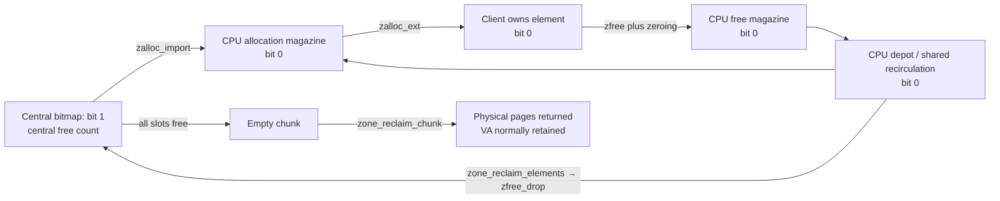

# Zone allocator: identity, caches, expansion, and reclamation

[VM guide](README.md) · [Kernel allocation](kernel-allocation.md) · [Typed allocation](typed-allocation.md) · [Read-only and special zones](read-only-and-special-zones.md)

A zone is a source of fixed-size allocations with an identity that survives individual allocation lifetimes. Its implementation manages several different resources: virtual address ranges, wired backing pages, slots within those pages, and caches of slots that callers have released. Keeping these resources separate explains both its speed and its isolation properties. A free object may remain in a CPU magazine; an empty chunk can lose its physical pages while retaining its address range; and a destroyed non-data zone does not make its addresses available to an unrelated zone. These are concrete behaviors of [`zalloc_ext()`](../../../xnu/osfmk/kern/zalloc.c#L6295), [`zone_reclaim()`](../../../xnu/osfmk/kern/zalloc.c#L7267), and [`zone_reclaim_chunk()`](../../../xnu/osfmk/kern/zalloc.c#L6939).

This page follows ordinary fixed-element zones. The companion [special-zone guide](read-only-and-special-zones.md) explains where read-only, SMR, per-CPU, permanent, and exhaustible allocations change that lifecycle. [Typed allocation](typed-allocation.md) explains how kalloc chooses a zone; choosing the zone and implementing its storage are different parts of the allocator.

## 1. The structures and the three meanings of “free”

[`struct zone`](../../../xnu/osfmk/kern/zalloc_internal.h#L228) owns the policy and aggregate state for one allocation size. Its first four members intentionally match a zone view: `z_self`, `z_stats`, `z_name`, and `z_views`. A view can account for allocations separately while using the same underlying zone. A view does not create a distinct address pool. The allocation wrappers resolve the underlying zone and selected statistics before calling [`zalloc_ext()`](../../../xnu/osfmk/kern/zalloc.c#L6557).

| State | Important fields | Meaning |
|---|---|---|
| Identity and geometry | `z_self`, `z_elem_size`, `z_elem_offs`, `z_chunk_pages`, `z_chunk_elems`, quotient/alignment constants | Whether the zone is published; size returned to clients; how elements fit in a backing chunk |
| Backing and free-slot accounting | `z_elems_avail`, `z_elems_free`, `z_elems_rsv`, `z_wired_cur`, `z_wired_empty`, `z_va_cur` | Populated capacity, slots available to the central bitmap allocator, reserve, wired pages, and retained VA |
| Central chunk queues | `z_pageq_empty`, `z_pageq_partial`, `z_pageq_full`, `z_pageq_va` | Fully unused, partly allocated, fully allocated, and unpopulated/residual chunks |
| CPU caches | `z_pcpu_cache`, `z_depot_size`, `z_depot_limit` | Current-CPU magazines and a bounded depot behind each CPU |
| Shared cache | `z_recirc`, `z_recirc_lock` | Full/empty magazines exchanged between CPUs and reclaimed in batches |
| Growth | `z_expander`, `z_async_refilling`, `z_expanding_wait`, `z_exhausted_wait` | Active growth context, deferred refill, and waiters |

The complete field layout is in [`zalloc_internal.h`](../../../xnu/osfmk/kern/zalloc_internal.h#L228). The flags in this structure include `collectable`, `z_percpu`, `z_smr`, `z_permanent`, `z_nocaching`, and `z_destructible`; immutable security policy lives separately.

Each page in the zone VA range has a 16-byte [`zone_page_metadata`](../../../xnu/osfmk/kern/zalloc.c#L193). `zm_index` identifies the zone; `zm_chunk_len` distinguishes a primary chunk record, a secondary page, an unpopulated chunk, and a guard. The primary record counts allocated slots. A secondary page records how far back to find the primary record. The same word that ordinarily describes the bitmap is a bump offset for permanent zones:

[zone_page_metadata count, bitmap, and queue fields — source lines 231–254](../../../xnu/osfmk/kern/zalloc.c#L231):

<!-- source-excerpt: ../../../xnu/osfmk/kern/zalloc.c#L231-L254 -->
```c

	union {
#define ZM_ALLOC_COUNT_LOCK     (1u << 15)
		uint16_t zm_alloc_count; /* first page only */
		struct {
			uint8_t zm_page_index;   /* secondary pages only */
			uint8_t zm_subchunk_len; /* secondary pages only */
		};
		uint16_t zm_oob_offs;   /* in guard pages  */
	};
	union {
		uint32_t zm_bitmap;     /* most zones      */
		uint32_t zm_bump;       /* permanent zones */
	};

	union {
		struct {
			zone_pva_t      zm_page_next;
			zone_pva_t      zm_page_prev;
		};
	};
};
static_assert(sizeof(struct zone_page_metadata) == 16, "validate packing");

```

`zone_meta_from_addr()` computes this metadata address from the page number using a pre-offset metadata base. Chunk-list links are packed page addresses, not pointers stored inside freed client objects. [`zone_element_resolve()`](../../../xnu/osfmk/kern/zalloc.c#L1166) validates zone ownership, follows secondary metadata back to the chunk, and derives an element index from the address and geometry. [`zone_pva_from_addr()` and metadata conversion](../../../xnu/osfmk/kern/zalloc.c#L904) show the packing and sign extension.

There are three relevant states for a slot:

1. **Allocated to a client.** The bitmap bit is clear and the chunk allocation count includes it.
2. **Released by the client but held in a magazine or depot.** The bit is still clear and the count still includes it. The cache has exclusive responsibility for eventually reusing or returning the slot.
3. **Returned to the central zone allocator.** The bit is set, `z_elems_free` includes the slot, and a chunk can become empty.

[`zalloc_import()`](../../../xnu/osfmk/kern/zalloc.c#L5877) performs the transition from the central bitmap into an allocation or cache; [`zfree_drop()`](../../../xnu/osfmk/kern/zalloc.c#L5228) performs the reverse. Cache-to-cache movement does neither. [`zone_count_free()`](../../../xnu/osfmk/kern/zalloc_internal.h#L693) counts central free slots plus full shared recirculation magazines, but not all CPU-held slots. A statistic called “free” therefore needs its exact definition before it can be used to predict physical reclamation.



## 2. Creation fixes geometry and isolation policy

`ZONE_INIT` arranges startup registration through [`zone_create_startup()`](../../../xnu/osfmk/kern/zalloc.c#L9358); ordinary creation calls [`zone_create()`](../../../xnu/osfmk/kern/zalloc.c#L9427) and ultimately [`zone_create_ext()`](../../../xnu/osfmk/kern/zalloc.c#L9068). The latter normalizes size, obtains a zone-array slot, configures geometry and flags, runs an optional setup callback, and finally publishes `z_self` under the zone lock.

[`zone_create_find()`](../../../xnu/osfmk/kern/zalloc.c#L8841) serializes slot selection with `all_zones_lock`. Reserved identities cannot be initialized twice or made destructible. Dynamic destructible zones can reuse an old matching zone record, with matching name and element size. The code initializes the slot locks before release-publishing the increased `num_zones`; enumeration has the corresponding publication protocol. A zone identity is therefore more stable than one caller's current use of it. After lockdown, the name is copied to permanent storage so an unloadable kext cannot leave a dangling name pointer. [`zone_create_ext()` initialization](../../../xnu/osfmk/kern/zalloc.c#L9091).

The requested element size is capped at 32 KiB, aligned, and adjusted for configured sanitizer redzones. `z_elem_size` is the usable inner size; outer size includes the relevant redzone overhead. [`zone_elem_adjust_size()`](../../../xnu/osfmk/kern/zalloc.c#L8942) and [`zone_get_min_alloc_granule()`](../../../xnu/osfmk/kern/zalloc.c#L8991) select a chunk that limits fragmentation. Page-multiple elements fit directly. For other sizes, the search considers page-multiple chunks and chooses a lower integer percentage of waste. On ARM64 with 16 KiB pages and elements above 4 KiB, the search extends to 48 KiB so the 12/24 KiB classes can fit efficiently. MTE builds can double an otherwise exact-fit chunk containing an odd number of elements for the odd/even tagging arrangement. These are build- and page-size-dependent rules, not a fixed “one slab equals one page” design.

For an ordinary zone, the final slot offset is `alloc % size` plus any redzone offset. The remainder sits at the beginning; the final element reaches the end of the chunk. As a simple geometry example, a non-tagged, non-redzone 64-byte zone with a 4 KiB allocation granule has 64 slots and no leading remainder. For a geometry with a nonzero remainder, subtract `z_elem_offs` before dividing an address into its slot index. [`Geometry assignment`](../../../xnu/osfmk/kern/zalloc.c#L9142).

Security policy is kept in the separately declared `SECURITY_READ_ONLY_LATE` [`zone_security_array`](../../../xnu/osfmk/kern/zalloc.c#L506). Its members describe placement, heap membership, reuse order, and signature equivalence:

[zone_security_flags — source lines 413–429](../../../xnu/osfmk/kern/zalloc_internal.h#L413):

<!-- source-excerpt: ../../../xnu/osfmk/kern/zalloc_internal.h#L413-L429 -->
```c
typedef struct zone_security_flags {
	uint16_t
	/*
	 * Security sensitive configuration bits
	 */
	    z_submap_idx       :8,  /* a Z_SUBMAP_IDX_* value */
	    z_kheap_id         :3,  /* zone_kheap_id_t when part of a kalloc heap */
	    z_kalloc_type      :1,  /* zones that does types based seggregation */
	    z_lifo             :1,  /* depot and recirculation layer are LIFO */
	    z_submap_from_end  :1,  /* allocate from the left or the right ? */
	    z_noencrypt        :1,  /* do not encrypt pages when hibernating */
	    z_unused           :1;
	/*
	 * Signature equivalance zone
	 */
	zone_id_t           z_sig_eq;
} zone_security_flags_t;
```

The main effects of creation flags are visible in [`zone_create_ext()`](../../../xnu/osfmk/kern/zalloc.c#L9162):

| Flag/policy | Implemented consequence |
|---|---|
| `ZC_VM` | Select the VM zone region, whose range must satisfy several kernel pointer-packing constraints |
| `ZC_DATA` / `ZC_SHARED_DATA` | Set data heap identity; final policy selects the DATA submap and LIFO recirculation |
| `ZC_READONLY` | Reserved RO identity and size parameters; select RO VA when the feature is enabled |
| `ZC_KALLOC_TYPE` | Record that the zone participates in typed segregation |
| `ZC_CACHING` / `ZC_NOCACHING` | Explicitly enable caching, or prohibit it including later automatic enablement |
| `ZC_NOGC` | Exclude from normal collectable-zone reclamation |
| `ZC_NOCALLOUT` | Suppress asynchronous refill |
| `ZC_DESTRUCTIBLE` | Permit the explicit destruction protocol; ordinary zones are not destructible by default |

`ZC_SEQUESTER` and `ZC_NOSEQUESTER` still exist but are explicitly marked obsolete in [`zalloc.h`](../../../xnu/osfmk/kern/zalloc.h#L131). They should not be used to infer current address-reuse policy. Likewise, ordinary [`zfree()`](../../../xnu/osfmk/kern/zalloc.c#L5698) itself clears the allocation; zero-on-free is not conditional on noticing `ZC_ZFREE_CLEARMEM` in a particular zone initializer. Specialized no-zero and SMR interfaces have different contracts.

### Isolation is a set of checks, not a promise of one C type per zone

An explicit zone gives a distinguishable allocator identity. `zone_require()` validates a pointer's zone range and identity; `zone_id_require_aligned()` adds element alignment validation. Neither proves that a caller owns a live reference or that a pointer still denotes the same allocation generation. They do not implement a reference counter. [`Zone ownership checks`](../../../xnu/osfmk/kern/zalloc.c#L1423).

Typed allocation may deliberately assign multiple types to one zone or use an early/signature-equivalent pool. On free, [`kfree_type_impl_internal()`](../../../xnu/osfmk/kern/zalloc.c#L5806) reads the actual zone from metadata. A data-type view, or a pointer whose zone matches the assigned zone, follows the view; matching signature equivalence uses the actual zone; otherwise it tries the view's early zone, where the ordinary free validation still applies. `z_sig_eq` expresses allowed allocator compatibility; it is not a runtime C-type tag stored in every object. The classification and zone-budget decisions are in [typed allocation](typed-allocation.md).

## 3. VA regions and out-of-line metadata

[`zone_bootstrap()`](../../../xnu/osfmk/kern/zalloc.c#L9538) initializes early CPU-count information, randomness, cache tuning, and refill/trim callouts. [`zone_init()`](../../../xnu/osfmk/kern/zalloc.c#L10150) establishes the VA layout and metadata, creates permanent and magazine zones, and migrates startup statistics to permanent per-CPU storage. These stages avoid needing a fully operational general allocator in order to construct the allocator itself.

The regions include VM, RO, general regions, and DATA. With `SAD_FENG_SHUI` enabled, boot assigns general zones among four general regions and chooses a growth direction. Under KASAN_CLASSIC the related configuration uses one general region and disables this layout randomization; read-only enforcement also has a separate configuration switch. See [`security configuration`](../../../xnu/osfmk/kern/zalloc_internal.h#L432) and [`boot policy initialization`](../../../xnu/osfmk/kern/zalloc.c#L9538).

The current predicate is short and decisive:

[zone_submap_is_sequestered — source lines 3779–3784](../../../xnu/osfmk/kern/zalloc.c#L3779):

<!-- source-excerpt: ../../../xnu/osfmk/kern/zalloc.c#L3779-L3784 -->
```c
__attribute__((overloadable))
static inline bool
zone_submap_is_sequestered(zone_submap_idx_t idx)
{
	return idx != Z_SUBMAP_IDX_DATA;
}
```

[`zone_submap_init()`](../../../xnu/osfmk/kern/zalloc.c#L9650) creates a single permanent `kernel_map` entry covering each sequestered region. Zone-specific VA allocation within those ranges uses low/high bump fronts protected by `zone_va_lock`, through [`zone_submap_alloc_sequestered_va()`](../../../xnu/osfmk/kern/zalloc.c#L4195). It does not allocate a VM map entry for each chunk. DATA instead gets `zone_data_map`, a genuine submap whose chunk reservations use `kmem_alloc(... KMA_VAONLY)`. RO initially has `VM_PROT_NONE` map-entry permissions; actual zone page population supplies its read-only mappings explicitly.

This avoids recursively allocating `vm_map_entry` objects while extending zones used by VM itself. It also means generic VM lookup does not reconstruct individual zone chunks or their ordinary per-allocation protections from map entries. The large region entry and allocator metadata describe different levels of the layout. Some older commentary immediately above the expansion code still describes a VM-only first-fit allocator; the current predicate, bump-front allocator, and submap initializer are the relevant implementation for this checkout.

The metadata and bitmap VA ranges are reserved separately from the element ranges. `zone_info.zi_meta_base` is offset to make address-to-record conversion cheap. [`zone_meta_populate()`](../../../xnu/osfmk/kern/zalloc.c#L1070) supplies metadata pages as zone VA becomes usable. [`zone_metadata_init()`](../../../xnu/osfmk/kern/zalloc.c#L9818) handles the permanent range and migration from early static metadata.

One bitmap bit represents one element: **1 means available to the central allocator**. Small chunks store bitmap words in their page records. In [`zcram_and_lock()`](../../../xnu/osfmk/kern/zalloc.c#L4016), inline storage is eligible when the element count fits `32 * chunk_pages` and no permanent/tag-tracking exception applies. Otherwise the primary metadata contains a packed reference to an out-of-line bitmap.

[`zone_meta_bits_alloc_init()`](../../../xnu/osfmk/kern/zalloc.c#L2105) rounds bitmap capacity to an order, allocates it from a dedicated buddy allocator, initializes only populated slots as available, and packs the reference with its order and optional VM-tracking metadata bit. The buddy allocator has its own mutex, free lists by order, splitting and merging; [`zba_free()`](../../../xnu/osfmk/kern/zalloc.c#L1811) walks buddies upward. This auxiliary allocator can populate backing storage without allocating a zone bitmap from the same zone whose initialization needs it. Per-element VM allocation tags, when configured, are additional accounting metadata rather than hardware memory tags.

[`zone_meta_find_and_clear_bit()`](../../../xnu/osfmk/kern/zalloc.c#L2052) scans from a remembered per-CPU round-robin index. Allocation does not simply take the most recently freed central slot. It searches inline or referenced words, clears the selected bit, and updates that scan position. The source also scrambles early allocation positions while `zone_caching_disabled < 0`; the actual early-phase end is [`zalloc_first_proc_made()`](../../../xnu/osfmk/kern/zalloc.c#L10245), not a timer implied by an older comment in the import path.

## 4. Allocation: CPU magazines first, central slots second

The ordinary entry [`zalloc_flags()`](../../../xnu/osfmk/kern/zalloc.c#L6557) passes zone plus view statistics into `zalloc_ext()`. The core checks allowed execution context and rejects `Z_NOFAIL` combined with NOWAIT/NOPAGEWAIT. It resolves accounting tags where configured, disables preemption, and tries the current CPU's cache.

[zalloc_ext cache success and central fallback — source lines 6354–6372](../../../xnu/osfmk/kern/zalloc.c#L6354):

<!-- source-excerpt: ../../../xnu/osfmk/kern/zalloc.c#L6354-L6372 -->
```c
	if (zone->z_pcpu_cache) {
		zone_cache_t cache;
		vm_offset_t index, addr, esize;
		int cpu = cpu_number();

		cache = zalloc_cached_get_pcpu_cache(zone, NULL, cpu, flags);
		if (__probable(cache)) {
			esize = zone_elem_inner_size(zone);
			zpercpu_get_cpu(zstats, cpu)->zs_mem_allocated += esize;
			index = --cache->zc_alloc_cur;
			addr  = cache->zc_alloc_elems[index];
			cache->zc_alloc_elems[index] = 0;
			enable_preemption();
			return zalloc_return(zone, addr, flags, esize);
		}
	}

	__attribute__((musttail))
	return zalloc_item(zone, zstats, flags);
```

Preemption is disabled because `cpu_number()` and that CPU's active magazines must remain paired. The successful fast path needs no central zone lock. It pops one address, clears the magazine entry, restores preemption, and calls `zalloc_return()`. That final helper restores allocator tagging/sanitizer state, performs configured zero validation, records allocation logging, and returns both pointer and usable size. [`zalloc_return()`](../../../xnu/osfmk/kern/zalloc.c#L6027).

For hardware MTE, follow [tag selection and reuse](mte-tag-storage-and-page-lifecycle.md) alongside this path. Eligible zones initialize allocation tags, retag on ordinary free and reload the tag when returning an allocation; SMR delays invalidation until readers are safe. Zone/cache publication, tag compatibility and object lifetime are separate parts of that explanation.

Each [`zone_cache`](../../../xnu/osfmk/kern/zalloc.c#L367) has two current magazines: an allocation stack and a free stack. A magazine is a header plus an array of addresses, with an SMR sequence field when relevant. The default magazine capacity starts at eight; absent a `zc_mag_size` override, bootstrap raises it to fourteen for at least ten CPUs, otherwise ten for at least 4 GiB RAM. Those are concrete defaults in [`cache tunables`](../../../xnu/osfmk/kern/zalloc.c#L662) and [`zone_bootstrap()`](../../../xnu/osfmk/kern/zalloc.c#L9561), not ABI constants.

[`zalloc_cached_get_pcpu_cache()`](../../../xnu/osfmk/kern/zalloc.c#L6267) tries these levels in order:

1. Pop the current allocation magazine if nonempty.
2. For non-SMR zones, swap allocation/free magazines if the free magazine contains slots.
3. In [`zalloc_cached_prime()`](../../../xnu/osfmk/kern/zalloc.c#L6216), obtain a full magazine from the CPU depot or shared recirculation depot, returning an empty magazine in exchange.
4. In [`zalloc_cached_import()`](../../../xnu/osfmk/kern/zalloc.c#L6110), lock the central zone and import a batch of currently free slots.
5. If none succeeds, fall through to `zalloc_item()`, which can grow or fail according to flags.

A [`zone_depot`](../../../xnu/osfmk/kern/zalloc_internal.h#L151) stores full magazines followed by empty magazines in a combined queue/list representation, with counts and a boundary tail pointer. CPU depots have `zc_depot_lock`; the shared recirculation depot has **its own** `z_recirc_lock`. Full magazines normally circulate FIFO to avoid immediate systematic reuse. DATA and object-cache policy enables LIFO for performance. [`Depot movement`](../../../xnu/osfmk/kern/zalloc.c#L2506) and [`zfree_cached_recirculate()`](../../../xnu/osfmk/kern/zalloc.c#L5315) implement the exchange order.

On a central import, [`zalloc_import()`](../../../xnu/osfmk/kern/zalloc.c#L5877) prefers a partially used chunk over an entirely empty one. It validates metadata, clears available bits, increases the chunk allocation count, and moves chunks between empty/partial/full queues. It subtracts the imported slots from `z_elems_free` even when the immediate destination is a CPU magazine. Packing allocations into partial chunks preserves other wholly empty chunks for reclamation.

[`zalloc_item()`](../../../xnu/osfmk/kern/zalloc.c#L6064) holds the zone ticket lock. At or below half the reserve, it schedules an async refill when the caller is NOWAIT or some slot is still available; with no slot and a permitted blocking request it invokes `zone_expand_locked()`. If no slot becomes available, it accounts failure and returns an empty result; `Z_NOFAIL` instead leads to a panic if that supposedly nonfailing path cannot supply memory. A successful import updates the selected per-CPU statistics. The `Z_SET_NOT_EARLY` threshold update here feeds typed allocation routing; [typed allocation](typed-allocation.md) explains why this is cumulative allocation activity rather than a once-only boot phase.

## 5. Growing a zone without holding its lock across VM waits

Growth has to avoid duplicate work, recursive VM allocation, and reclaiming a chunk while it is only partly populated. [`zone_expand_locked()`](../../../xnu/osfmk/kern/zalloc.c#L4814) starts with the zone lock and returns with it held, but deliberately releases it for VA work, page allocation, and population.

The local `zone_expand` record identifies the expanding thread and whether it has waited for pages or has VM privilege. Ordinary competing expanders sleep with the current expander as their inheritor. A VM-privileged expander can be linked ahead of an ordinary one; this avoids making crucial VM work depend on a less privileged page waiter. A NOPAGEWAIT caller does not wait behind an expander already marked as a page waiter. The per-zone expander list is a coordination protocol, not a lock held across physical page allocation. [`Expansion ownership and wait loop`](../../../xnu/osfmk/kern/zalloc.c#L4827).

The central steps are:

1. Use retained VA from `z_pageq_va`, or call `zone_allocate_va_locked()` for more. The queue can contain both unpopulated whole chunks and secondary records representing the unpopulated tail of a partial chunk.
2. If extending a partial chunk, set `ZM_ALLOC_COUNT_LOCK` while holding the zone lock. That artificial allocation-count bit prevents the chunk from appearing reclaimable while VM work is in progress.
3. Unlock. Grab and zero physical pages, normally with `VM_PAGE_GRAB_NOPAGEWAIT`, explicitly waiting with `VM_PAGE_WAIT()` when allowed and needed. A permitted partial batch must still be large enough to hold a usable element; per-CPU and KASAN_CLASSIC cases have stricter complete-chunk behavior.
4. Lock the selected kernel object and call `kernel_memory_populate_object_and_unlock()` for the new segment. The object offset is the kernel VA in this call; these are wired kernel allocations, not demand-paged user mappings.
5. Call `zcram_and_lock()` to initialize/extend metadata and publish available elements. Remove the partial-growth interlock, update counters and queues, and retain any unpopulated tail for a later extension.

Sources: [`VA selection and partial interlock`](../../../xnu/osfmk/kern/zalloc.c#L4880), [`page allocation and shortage rollback`](../../../xnu/osfmk/kern/zalloc.c#L4930), and [`population and publication`](../../../xnu/osfmk/kern/zalloc.c#L4998).

The handoff to VM explicitly chooses permissions and mapping type. [`zone_mapping_type()`](../../../xnu/osfmk/kern/zalloc.c#L4782) selects DEFAULT for DATA, ROZONE for RO, and RESTRICTED for the remaining regions. [`zone_page_prot()`](../../../xnu/osfmk/kern/zalloc.c#L4802) supplies read-only permissions only for RO. The architecture/backend determines the enforcement meaning of RESTRICTED and ROZONE; see [kernel allocation](kernel-allocation.md) and [pmap mapping lifecycle](pmap-mapping-lifecycle.md). Allocation policy alone does not establish hardware enforcement.

`zcram_and_lock()` can initialize a new unpublished chunk without the zone lock, then acquire it before exposing slots. Extending an existing chunk requires locked bitmap merging. The accounting publication is explicit:

[zcram_and_lock publishes new capacity — source lines 4105–4126](../../../xnu/osfmk/kern/zalloc.c#L4105):

<!-- source-excerpt: ../../../xnu/osfmk/kern/zalloc.c#L4105-L4126 -->
```c
		zone_meta_remqueue(zone, meta);
	}

	if (zone->z_permanent || meta->zm_alloc_count) {
		zone_meta_queue_push(zone, &zone->z_pageq_partial, meta);
	} else {
		zone_meta_queue_push(zone, &zone->z_pageq_empty, meta);
		zone->z_wired_empty += zone->z_percpu ? 1 : pg_end;
	}
	if (pg_end < chunk_pages) {
		/* push any non populated residual VA on z_pageq_va */
		zone_meta_queue_push(zone, &zone->z_pageq_va, meta + pg_end);
	}

	zone->z_elems_free  += free_end - free_start;
	zone->z_elems_avail += free_end - free_start;
	zone->z_wired_cur   += zone->z_percpu ? 1 : pg_end - pg_start;
	if (pg_va_new) {
		zone->z_va_cur += zone->z_percpu ? 1 : pg_va_new;
	}
	if (zone->z_wired_hwm < zone->z_wired_cur) {
		zone->z_wired_hwm = zone->z_wired_cur;
```

A NOPAGEWAIT shortage has a real rollback: free the temporary page list, reacquire the zone lock, request an allowed async refill, remove any partial-growth interlock, and put the unused VA record back on its queue. It must not publish nonexistent capacity. Exhaustion of the reserved VA region is handled differently: [`zone_allocate_va_locked()`](../../../xnu/osfmk/kern/zalloc.c#L4527) panics with zone diagnostics; it is not an ordinary NULL allocation result.

Under layout randomization, new non-per-CPU sequestered reservations contain a randomly chosen one-to-ten chunks. Guard regions are sampled, the last run receives a mandatory trailing guard region, and an additional leading guard is sampled. Guard size is at least a chunk's page count. DATA uses a single run with a sampled guard; per-CPU zones skip these guards. [`zone_allocate_va_locked()`](../../../xnu/osfmk/kern/zalloc.c#L4431). This randomizes allocation layout and separates some boundaries; it does not put a guard page after every object.

## 6. Free, validation, and when an empty page really exists

The ordinary [`zfree()`](../../../xnu/osfmk/kern/zalloc.c#L5698) checks that the zone is not RO, per-CPU, permanent, or SMR, zeroes the usable element, and enters `zfree_ext()`. The usual public macro also clears the caller's pointer variable; clearing one variable cannot invalidate other aliases. [`zfree` API](../../../xnu/osfmk/kern/zalloc.h#L1085).

[`__zcache_mark_invalid()`](../../../xnu/osfmk/kern/zalloc.c#L5449) verifies zone range/identity and alignment, adjusts tracking tags, invokes configured sanitizer handling, and applies the free-tagging operation. [`zfree_ext()`](../../../xnu/osfmk/kern/zalloc.c#L5508) records free statistics, handles an enabled KASAN quarantine, and then places the address into the CPU free magazine or falls back to `zfree_item()`.

With caches, a full free magazine first tries swapping with a non-full allocation magazine. If both are full, [`zfree_cached_trim()`](../../../xnu/osfmk/kern/zalloc.c#L5360) sends a full magazine to the CPU depot/shared recirculation and obtains an empty one. Allocating a magazine uses NOWAIT; inability to obtain the container can force a direct central return. These are allocator-internal magazine objects allocated from `zc_magazine_zone`, which is itself noncached and has a reserve.

A central return is where the bitmap and chunk accounting change:

[zfree_drop returns an element to the central allocator — source lines 5234–5250](../../../xnu/osfmk/kern/zalloc.c#L5234):

<!-- source-excerpt: ../../../xnu/osfmk/kern/zalloc.c#L5234-L5250 -->
```c
	meta = zone_element_resolve(zone, addr, &eidx);

	if (!zone_meta_mark_free(meta, eidx)) {
		zone_meta_double_free_panic(zone, addr, __func__);
	}

	vm_offset_t old_count = meta->zm_alloc_count & ~ZM_ALLOC_COUNT_LOCK;
	vm_offset_t new_count = zone_meta_alloc_count_sub(zone, meta, 1);

	if (new_count == 0) {
		/* whether the page was on the intermediate or all_used, queue, move it to free */
		zone_meta_requeue(zone, &zone->z_pageq_empty, meta);
		zone->z_wired_empty += meta->zm_chunk_len;
	} else if ((old_count + 1) * esize > ptoa(meta->zm_chunk_len)) {
		/* first free element on page, move from all_used */
		zone_meta_requeue(zone, &zone->z_pageq_partial, meta);
	}
```

If a bit was already free, this path detects a double free and panics. With cached slots, the central bitmap check occurs when those slots reach this path; it is not a guarantee that every erroneous free is diagnosed at its first cache insertion. Other tagging/sanitizer checks can catch errors earlier, depending on configuration. `zone_element_resolve()` validates slot boundaries before the bitmap update, and a count reaching zero moves the chunk onto `z_pageq_empty`.

An object may therefore be zeroed and logically freed while its containing page remains unavailable for physical reclamation. The implementation intentionally trades some retained memory for avoiding a shared lock on every allocation and free. A stale explanatory comment near the cache declaration describes recirculation elements as centrally free; current movement routines retain their allocated bitmap state until [`zone_reclaim_elements()`](../../../xnu/osfmk/kern/zalloc.c#L7077) calls `zfree_drop()`.

## 7. Trimming, draining, and destruction

[`compute_zone_working_set_size()`](../../../xnu/osfmk/kern/zalloc.c#L7595) samples minima, weighted averages, and lock contention. It can enable caching for a sufficiently contended eligible zone, grow/shrink CPU depot budgets, or request trimming. `ZONE_WSS_UPDATE_PERIOD` is fifteen seconds in this checkout. The early-phase flag is left alone until first-process creation; afterward the routine sets `zone_caching_disabled` from `vm_pool_low()`. Disabling central cache imports is not equivalent to instantaneously emptying every CPU magazine. [`WSS period`](../../../xnu/osfmk/kern/zalloc_internal.h#L820).

[`zone_gc()`](../../../xnu/osfmk/kern/zalloc.c#L7478) serializes reclamation through `zone_gc_lock`, sets the current thread's zone-privileged option, and selects trim, drain, or jetsam-associated reclaim. It processes constructed object caches first, then collectable sequestered zones, then other collectable zones, and magazine storage last. The ordering lets returned objects flow into the underlying zones before those zones are reclaimed. [`zone_reclaim_all()`](../../../xnu/osfmk/kern/zalloc.c#L7418).

`zone_reclaim()` first respects reserves. Trimming uses observed idle cache capacity and central free-slot minima; draining takes the shared recirculation depot and trims CPU depots more aggressively. Neither ordinary operation forcibly collects all active per-CPU allocation/free magazines. Only the destruction case in [`zone_reclaim_pcpu()`](../../../xnu/osfmk/kern/zalloc.c#L7133) returns those active magazine slots, relying on destruction's exclusion of concurrent users. Full reclaimed magazines are returned to the bitmap in batches, with periodic lock release and yielding to bound preemption-disabled work. SMR magazines additionally wait for their grace-period sequence and run their cleanup callback before those slots are returned.

An empty chunk can be reclaimed only when doing so will leave the required reserve/working-set allowance. [`zone_reclaim_chunk()`](../../../xnu/osfmk/kern/zalloc.c#L6939) removes the chunk and accounts its slots/pages under the zone lock, detaches any out-of-line bitmap, then drops the lock for freeing that bitmap and depopulating VM memory. On reacquisition, retained VA is queued for future expansion. Partially populated chunks also have their residual-VA record removed before reclamation, so the same range cannot appear twice in `z_pageq_va`.

The VA decision deserves special attention:

[zone_reclaim_chunk decides whether VA stays with the zone — source lines 6948–6959](../../../xnu/osfmk/kern/zalloc.c#L6948):

<!-- source-excerpt: ../../../xnu/osfmk/kern/zalloc.c#L6948-L6959 -->
```c
	zone_security_flags_t zsflags = zone_security_config(z);
	bool         sequester = !z->z_destroyed;
	bool         oob_guard = false;

	if (zone_submap_is_sequestered(zsflags)) {
		/*
		 * If the entire map is sequestered, we can't return the VA.
		 * It stays pinned to the zone forever.
		 */
		sequester = true;
	}

```

For a live zone, GC retains VA even in DATA. For a destroyed DATA zone, reclamation can `kmem_free()` the reservation. For every non-DATA region, VA remains pinned to that zone identity even across destruction. A freed physical page is reusable by VM; retaining its old zone VA does not retain the old physical page. This is the difference between preventing cross-zone **virtual address** reuse and withholding physical memory from the rest of the kernel.

[`zdestroy()`](../../../xnu/osfmk/kern/zalloc.c#L9470) requires a destructible zone and validates the no-live-allocation/no-active-expansion contract. It invalidates `z_self` where sanitizer quarantine does not require a delayed state, drains caches, reclaims chunks, frees reusable DATA VA, and checks remaining counters. This is not a mechanism for forcibly invalidating outstanding object pointers. Destruction should be read together with the matching-zone reuse rules in `zone_create_find()`.

## 8. Concurrency map and reading route

| Protection | State it protects | Important release boundary |
|---|---|---|
| Preemption disabled | Current CPU's active magazines and local allocation statistics | Restored before `zalloc_return()`; transferred into the central ticket-lock path on a miss |
| `zc_depot_lock` | One CPU's depot; permits GC to manipulate a remote CPU depot | Depot exchange may also acquire the recirculation lock |
| `z_recirc_lock` | Shared full/empty magazines and contention/minimum counters | Released before fallback central operations |
| `z_lock` | Central bitmaps, page queues, counters, expansion coordination | Dropped for physical allocation, population, depopulation, and prolonged reclamation |
| `zone_va_lock` | Low/high allocation fronts of sequestered regions | VA reservation does not hold the central zone lock |
| `zba_mtx` | Out-of-line bitmap buddy allocator | Separate from slot-bit updates under the owning zone lock |
| `zone_gc_lock` | Global reclaim/destroy coordination | Does not exclude ordinary concurrent allocation/free |

Sources: [`lock helpers`](../../../xnu/osfmk/kern/zalloc.c#L2321), [`cache/depot transfer`](../../../xnu/osfmk/kern/zalloc.c#L5269), [`expansion`](../../../xnu/osfmk/kern/zalloc.c#L4814), [`bitmap locking`](../../../xnu/osfmk/kern/zalloc.c#L1582), and [`reclamation`](../../../xnu/osfmk/kern/zalloc.c#L7267). The table describes the paths above, not a complete kernel-wide lock-order proof. In particular, acquiring a zone lock does not itself stop another CPU from consuming a slot already in its magazine.

For a first implementation pass, read `struct zone` and the metadata layout, then follow `zalloc_ext → zalloc_cached_get_pcpu_cache → zalloc_item → zalloc_import`. Next follow `zfree → zfree_ext → zfree_item → zfree_drop`. Only then add `zone_expand_locked`, `zcram_and_lock`, and `zone_reclaim_chunk`; otherwise the accounting operations can look interchangeable when they change different ownership layers.

## Sources inspected and limits

| Scope | Inspection depth and limits |
|---|---|
| [`zalloc.c`](../../../xnu/osfmk/kern/zalloc.c) metadata, bitmaps, caches, expansion, free, GC, creation/startup | Deep reads of the paths described above, including failure/rollback and publication boundaries; diagnostics, telemetry formatting, and zalloc test cases were not exhaustively traced |
| [`zalloc_internal.h`](../../../xnu/osfmk/kern/zalloc_internal.h) and [`zalloc.h`](../../../xnu/osfmk/kern/zalloc.h) | Structure layouts, flags, counters, zone/API contracts, configurations, and tuning definitions read; compatibility and annotation macros surveyed where relevant |
| Bitmap buddy allocator | Split/merge/reference representation and population boundary inspected; no exhaustive proof of every packed-bit index or boot-capacity formula |
| [`API basics`](../../../xnu/doc/allocators/api-basics.md) and [`read-only allocator`](../../../xnu/doc/allocators/read-only.md) | Original allocator contracts read and checked against current bodies; special allocator differences are covered in the companion page |
| VM/pmap dependency | Calls and flags inspected here; physical-page lifecycle, translation installation, and restricted mapping enforcement are described in the linked VM/pmap guides |
| Typed policy and optional diagnostics | Typed free compatibility examined; signature generation/grouping belongs to [typed allocation](typed-allocation.md). KASAN, MTE, VM tags, and leak logging alter these paths; no claim that all are enabled together or that all configurations were built |

This is a source-derived account of this checkout. No running-kernel measurements or allocator benchmarks were performed.

<!-- BEGIN PLATYDOC DOCUMENTATION LICENSE -->
Original Platydoc text and diagrams are licensed under [CC BY 4.0](https://creativecommons.org/licenses/by/4.0/). Quoted source code and third-party material retain their respective licenses.
<!-- END PLATYDOC DOCUMENTATION LICENSE -->
